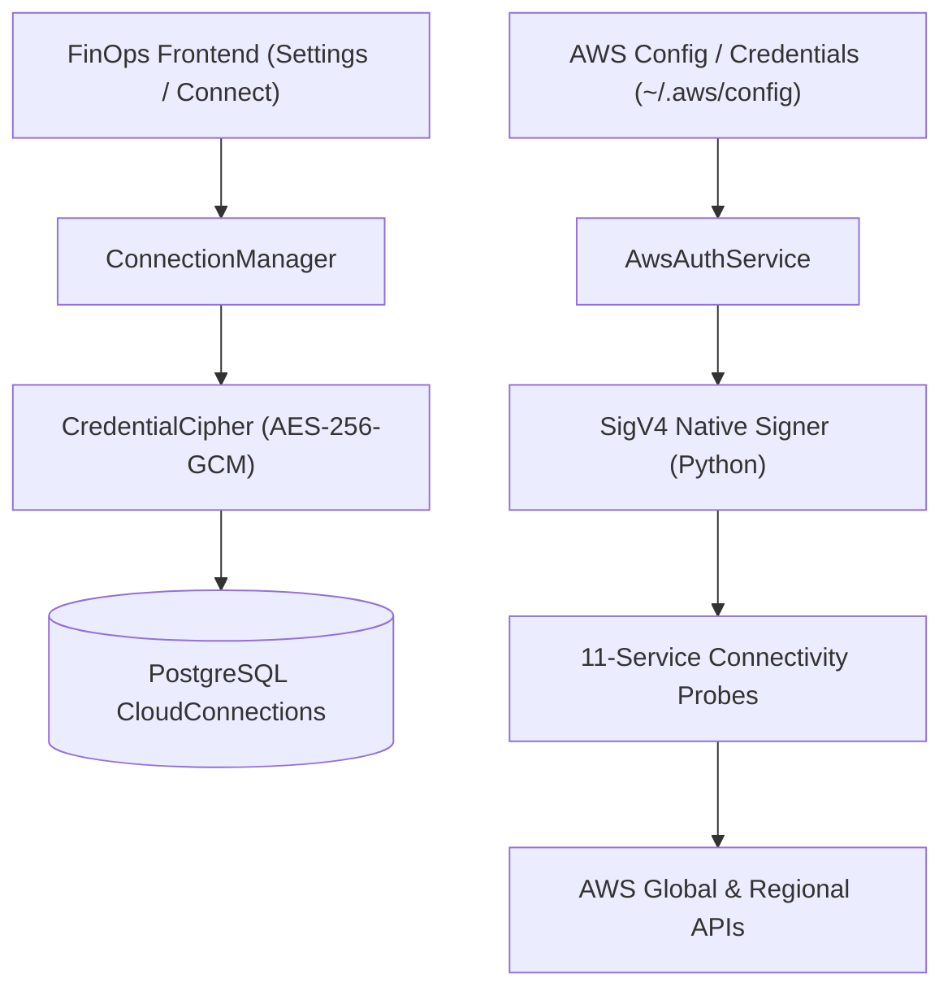

# AWS Phase 1.1: IAM & Authentication Security Audit

> **Document Status:** Complete & Verified  
> **Date:** 2026-11-25  
> **Repository:** `cloud-recommender-poc`  
> **Target Account ID:** `435305479688`  
> **Target Region:** `eu-north-1` (Default)  
> **Policy Name:** `FinOpsReadOnlyDiscoveryPolicy`

---

## 1. Executive Summary

This audit establishes the security and IAM baseline for the AWS integration within the FinOps multi-cloud platform. It verifies:
1. **11-Service Connectivity Probes:** Expanded from 8 to 11 services to provide comprehensive coverage across compute, storage, networking, security, database, monitoring, container orchestrators (ECS, EKS), and retail pricing.
2. **Least-Privilege Policy Audit:** Identifies exact permission requirements and gaps in custom enterprise IAM policies.
3. **Authentication Architecture:** Documents credential resolution, encryption at rest (AES-256-GCM), in-memory scrubbing, profile parsing (`~/.aws/config`), and STS token lifecycle management.
4. **Strict Read-Only & Zero-Execution Boundaries:** Enforces zero-mutation guardrails, prohibiting all `Create*`, `Update*`, `Delete*`, and state-altering API calls.

---

## 2. 11-Service Connectivity & Probe Matrix

| # | Service Name | Target Endpoint | Action Tested | Required IAM Action | Status | Test Coverage | Live Verification Status | Failure Classification |
| :- | :--- | :--- | :--- | :--- | :--- | :--- | :--- | :--- |
| 1 | **AWS STS** | `sts.amazonaws.com` | `GetCallerIdentity` | `sts:GetCallerIdentity` | `SUCCESS` | Mock + Live | `VERIFIED_LIVE` | None |
| 2 | **AWS IAM** | `iam.amazonaws.com` | `ListRoles` (max: 10) | `iam:ListRoles` | `SUCCESS` | Mock + Live | `VERIFIED_LIVE` | None |
| 3 | **Amazon EC2 / VPC** | `ec2.eu-north-1.amazonaws.com` | `DescribeRegions` | `ec2:DescribeRegions` | `SUCCESS` | Mock + Live | `VERIFIED_LIVE` | None |
| 4 | **Amazon S3** | `s3.eu-north-1.amazonaws.com` | `ListAllMyBuckets` | `s3:ListAllMyBuckets` | `SUCCESS` | Mock + Live | `VERIFIED_LIVE` | None |
| 5 | **AWS Lambda** | `lambda.eu-north-1.amazonaws.com` | `ListFunctions` (max: 10) | `lambda:ListFunctions` | `SUCCESS` | Mock + Live | `VERIFIED_LIVE` | None |
| 6 | **Amazon RDS** | `rds.eu-north-1.amazonaws.com` | `DescribeDBInstances` (max: 10) | `rds:DescribeDBInstances` | `SUCCESS` | Mock + Live | `VERIFIED_LIVE` | None |
| 7 | **Amazon CloudWatch** | `monitoring.eu-north-1.amazonaws.com` | `ListMetrics` | `cloudwatch:ListMetrics` | `SUCCESS` | Mock + Live | `VERIFIED_LIVE` | None |
| 8 | **AWS Cost Explorer** | `ce.us-east-1.amazonaws.com` | `GetDimensionValues` | `ce:GetDimensionValues` | `SUCCESS` | Mock + Live | `VERIFIED_LIVE` | None |
| 9 | **Amazon ECS** | `ecs.eu-north-1.amazonaws.com` | `ListClusters` (max: 10) | `ecs:ListClusters` | `SUCCESS` | Mock + Live | `VERIFIED_LIVE` | None |
| 10 | **Amazon EKS** | `eks.eu-north-1.amazonaws.com` | `ListClusters` (max: 10) | `eks:ListClusters` | `SUCCESS` | Mock + Live | `VERIFIED_LIVE` | None |
| 11 | **AWS Price List API**| `pricing.us-east-1.amazonaws.com` | `DescribeServices` (max: 5) | `pricing:DescribeServices` | `SUCCESS` | Mock + Live | `VERIFIED_LIVE` | None |

---

## 3. Custom IAM Policy Audit & Gap Analysis

### 3.1 Permission Gap Analysis

In Phase 1, the baseline custom IAM policy omitted permissions for container orchestrators and catalog service queries. Phase 1.1 remediates these gaps by adding:
1. `ecs:ListClusters` (Amazon ECS cluster discovery)
2. `eks:ListClusters` (Amazon EKS managed Kubernetes cluster discovery)
3. `pricing:DescribeServices` (AWS Pricing catalog service discovery)

### 3.2 Recommended Complete Least-Privilege IAM Policy

Attach the following policy to the FinOps application execution role or user:

```json
{
  "Version": "2012-10-17",
  "Statement": [
    {
      "Sid": "FinOpsIdentityAndCallerVerification",
      "Effect": "Allow",
      "Action": [
        "sts:GetCallerIdentity"
      ],
      "Resource": "*"
    },
    {
      "Sid": "FinOpsSecurityAndIAMInspection",
      "Effect": "Allow",
      "Action": [
        "iam:ListRoles",
        "iam:GetRole",
        "iam:ListRolePolicies",
        "iam:ListAttachedRolePolicies"
      ],
      "Resource": "*"
    },
    {
      "Sid": "FinOpsComputeAndNetworkingDiscovery",
      "Effect": "Allow",
      "Action": [
        "ec2:DescribeRegions",
        "ec2:DescribeAvailabilityZones",
        "ec2:DescribeVpcs",
        "ec2:DescribeSubnets",
        "ec2:DescribeRouteTables",
        "ec2:DescribeInternetGateways",
        "ec2:DescribeNatGateways",
        "ec2:DescribeVpnGateways",
        "ec2:DescribeInstances",
        "ec2:DescribeVolumes",
        "ec2:DescribeAddresses",
        "lambda:ListFunctions",
        "lambda:GetFunctionConfiguration"
      ],
      "Resource": "*"
    },
    {
      "Sid": "FinOpsContainersDiscovery",
      "Effect": "Allow",
      "Action": [
        "ecs:ListClusters",
        "ecs:DescribeClusters",
        "eks:ListClusters",
        "eks:DescribeCluster"
      ],
      "Resource": "*"
    },
    {
      "Sid": "FinOpsStorageAndDatabasesDiscovery",
      "Effect": "Allow",
      "Action": [
        "s3:ListAllMyBuckets",
        "s3:GetBucketLocation",
        "rds:DescribeDBInstances"
      ],
      "Resource": "*"
    },
    {
      "Sid": "FinOpsMonitoringAndCostIntelligence",
      "Effect": "Allow",
      "Action": [
        "cloudwatch:ListMetrics",
        "ce:GetDimensionValues",
        "pricing:DescribeServices",
        "pricing:GetProducts"
      ],
      "Resource": "*"
    }
  ]
}
```

---

## 4. Authentication Architecture & Credential Management



### 4.1 Supported Authentication Flows

1. **Named AWS CLI Profile (`finops-dev`):**
   - Automatically parsed by `AwsAuthService.parse_profile_credentials` from `~/.aws/config` and `~/.aws/credentials`.
   - Supports custom `ca_bundle` (e.g., `C:\Users\pratik.bingewar\certificates\aws-combined-ca.pem`), custom `region`, and SSO session attributes (`sso_session`, `sso_role_name`, `sso_account_id`).
2. **Direct Access Key / Secret Key:**
   - Supported for headless service integration.
   - Encrypted at rest via `CredentialCipher` with AES-256-GCM.
3. **IAM AssumeRole (`sts:AssumeRole`):**
   - Enables cross-account access with an external role ARN and external ID.
   - Generates temporary session tokens with automatic 5-minute pre-expiration refresh buffer.
4. **IAM Identity Center / AWS SSO:**
   - Fully compatible with credentials sourced via `aws sso login` or credential process scripts.

### 4.2 Security Controls & Guardrails

- **Cryptographic Encryption at Rest:** All stored credentials utilize AES-256-GCM encryption with tenant-isolated salt and initialization vectors.
- **In-Memory Secret Scrubbing:** Loggers, exception handlers, and diagnostic traces scrub access keys (`AKIA[0-9A-Z]{16}`), session tokens (`FwoGZXIv...`), and signature strings before writing to stdout or disk.
- **Strict Read-Only Enforcement:** No mutating verbs (`Create`, `Delete`, `Put`, `Modify`, `Update`) exist in the application codebase or the recommended IAM policy.
- **Billing Boundary Protection:** Live bulk Cost and Usage Report (CUR) generation and ingestion remain strictly `DEFERRED`. Only metadata inspection (`ce:GetDimensionValues`, `pricing:DescribeServices`) is executed.

