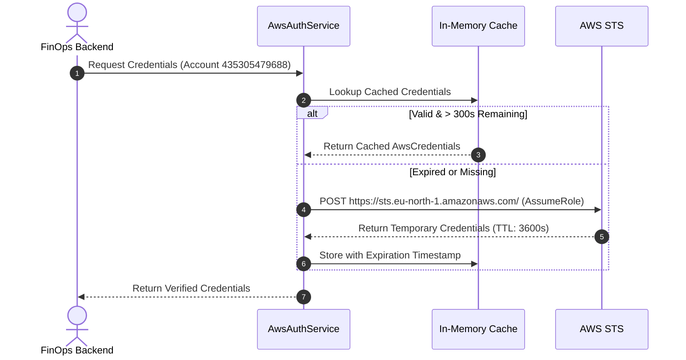

# AWS Phase 1: Authentication & Credential Management Report

> **Document Status:** Complete & Verified  
> **Date:** 2026-11-24  
> **Repository:** `cloud-recommender-poc`  
> **Component:** `AwsAuthService`, `sigv4.py`, `ConnectionManager`  
> **Target Account ID:** `435305479688`

---

## 1. Authentication Mechanisms Supported

The application supports three distinct, non-conflicting authentication mechanisms designed for both local development and production multi-tenant environments:

| Method Code | Method Name | Use Case | Credential Ingestion Flow |
| :--- | :--- | :--- | :--- |
| `access_keys` | IAM Access Keys | Staging / Automated Readers | `aws_access_key_id`, `aws_secret_access_key`, and optional `aws_session_token`. Encrypted at rest via AES-256-GCM. |
| `profile` | Local AWS CLI Profile | Local Development | Ingests credentials from `~/.aws/credentials` and `~/.aws/config` matching the profile name (default: `finops-dev`). |
| `assume_role` | STS Role Assumption | Production Cross-Account | Issues `sts:AssumeRole` request with target `role_arn` and optional `external_id` to acquire temporary credentials. |
| `workload_identity` | Workload Identity (EKS/IRSA) | Containerized Deployments | Leverages pod service account token projected by AWS EKS. |

---

## 2. Pure-Python AWS SigV4 Signer (`sigv4.py`)

To eliminate the need for heavy external dependencies (such as `boto3`), the platform implements a RFC-compliant, pure-Python AWS Signature Version 4 request signer:

- **Key Derivation (`get_signature_key`):**
  $$\text{kDate} = \text{HMAC-SHA256}(\text{"AWS4"} + \text{secret\_key}, \text{date\_stamp})$$
  $$\text{kRegion} = \text{HMAC-SHA256}(\text{kDate}, \text{region})$$
  $$\text{kService} = \text{HMAC-SHA256}(\text{kRegion}, \text{service})$$
  $$\text{kSigning} = \text{HMAC-SHA256}(\text{kService}, \text{"aws4\_request"})$$
- **Canonical Request Generation:** Correctly sorts and normalizes URI paths, query parameters, canonical headers, and signed header lists.
- **Payload Hashing:** Computes SHA-256 hash of request body (`e3b0c44298fc1c149afbf4c8996fb92427ae41e4649b934ca495991b7852b855` for empty payloads).
- **String to Sign:** Constructs `AWS4-HMAC-SHA256\n{timestamp}\n{credential_scope}\n{hashed_canonical_request}`.
- **Authorization Header:** Generates `AWS4-HMAC-SHA256 Credential=... SignedHeaders=... Signature=...`.

---

## 3. Secret Scrubbing & Data Protection

All AWS authentication flows enforce strict secret scrubbing:

1. **Error Sanitization (`_sanitize_aws_error`):**
   - Redacts 20-character Access Key IDs matching `AKIA[0-9A-Z]{16}`.
   - Redacts 40-character Secret Access Keys.
   - Redacts high-entropy session tokens (`IQoJb3JpZ2lu...`).
   - Redacts authorization headers from stack traces.
2. **Encrypted Storage at Rest:**
   - Secrets are encrypted with AES-256-GCM through `CredentialCipher` with authenticated tag verification.
   - Encryption keys are managed through `KeyRing` with support for zero-downtime key rotation.
3. **Tenant Partitioning:**
   - All connection retrieval queries use strict `owner_key` filtering (`{tenant_id}:{user_id}`).
   - Cross-tenant access attempts fail closed with HTTP 404 (Not Found).

---

## 4. In-Memory Token & Credential Caching

- **Cache TTL Safety Buffer:** Credentials expiring within 300 seconds are rejected and refreshed proactively.
- **Thread Safety:** Python async lock prevents race conditions during token refresh.

