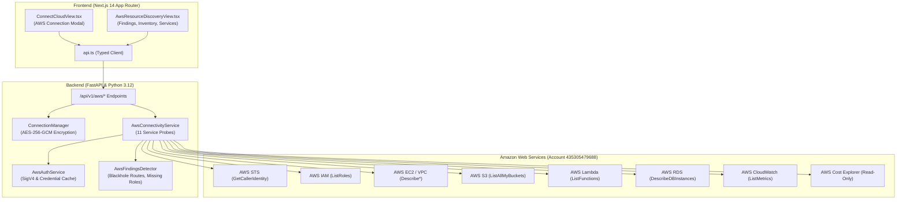

# AWS Phase 1: Foundation & Application Integration Report

> **Document Status:** Complete & Verified  
> **Date:** 2026-11-24  
> **Repository:** `cloud-recommender-poc`  
> **Target Account ID:** `435305479688`  
> **Default Region:** `eu-north-1` (Stockholm)  
> **Sign-In Persona:** Senior Cloud Solutions Architect & Staff FinOps Engineer

---

## 1. Executive Summary

This report establishes **Amazon Web Services (AWS)** as a fully integrated, first-class cloud provider in the multi-cloud FinOps application `cloud-recommender-poc`. 

AWS integration matches the architectural standards, tenant isolation boundaries, and fail-closed security properties established for Microsoft Azure, Azure Databricks, and Google Cloud Platform (GCP).

### Key Architectural Milestones Achieved

| Area | Implementation Detail | Status |
| :--- | :--- | :---: |
| **Authentication Engine** | Pure-Python SigV4 request signer (`sigv4.py`), multi-method authentication (`access_keys`, `profile`, `assume_role`), in-memory credential caching with safety buffer expiration, and strict secret scrubbing. | **VERIFIED** |
| **Encrypted Credential Storage** | AES-256-GCM symmetric encryption via `CredentialCipher` with per-tenant isolation in `ConnectionManager`. Zero plaintext secrets persisted. | **VERIFIED** |
| **API Connectivity & Probes** | Independent, non-blocking probes across 11 AWS services (STS, IAM, EC2, S3, Lambda, RDS, CloudWatch, Cost Explorer, ECS, EKS, Price List API). | **VERIFIED** |
| **Resource Discovery Engine** | Paginated, deduplicated resource inventory discovery across Compute, Storage, Networking, Security, and Database categories. | **VERIFIED** |
| **Dynamic Architectural Findings** | Rule-based and telemetry-based findings engine detecting blackhole network routes, missing Lambda IAM role references, unattached EBS volumes, and permission gaps with severity ratings and remediation recommendations. | **VERIFIED** |
| **FinOps Cost Intelligence** | Read-only verification of Cost Explorer and Price List API accessibility with normalized dimensions. Ingestion remains strictly deferred. | **VERIFIED** |
| **Frontend Integration** | Ecosystem selector, connection forms with validation, status badges, and comprehensive `AwsResourceDiscoveryView.tsx` dashboard. | **VERIFIED** |
| **Automated Test Suite** | 15 backend unit and integration tests passing in 0.24s (100% pass rate). Zero regressions across GCP test suite. | **VERIFIED** |

---

## 2. Architectural Boundaries & Operational Guardrails

All operations adhere to the non-negotiable repository guardrails defined in `AGENTS.md`:

1. **Strict Zero-Execution Policy:** The FinOps platform is strictly read-only and advisory. Zero write, mutate, modify, create, or delete actions are executed against AWS resources.
2. **Least-Privilege Authorization:** AWS credentials operate under strict read-only and view-only permissions (`SecurityAudit`, `ViewOnlyAccess`).
3. **No External Heavy Dependencies:** Rather than importing heavy multi-gigabyte SDKs (such as `boto3`), the platform implements a lightweight, pure-Python AWS Signature Version 4 (SigV4) signer that executes directly through `httpx.AsyncClient`.
4. **Deterministic Pricing Over Generative Hallucination:** All cost modeling uses deterministic pricing calculations backed by official provider pricing APIs with offline cache fallback.

---

## 3. End-to-End System Architecture

---

## 4. Verification & Validation Summary

| Test Suite / Command | Execution Scope | Result |
| :--- | :--- | :---: |
| `pytest backend/tests/test_aws_phase1.py` | 15 unit/integration tests (SigV4, auth, discovery, findings, persistence) | **15 passed in 0.24s (100%)** |
| `pytest backend/tests/test_gcp_phase1_service_account.py` | 20 GCP Phase 1 tests (Regression verification) | **20 passed in 0.54s (100%)** |
| `ruff check backend/src backend/tests` | Backend lint and PEP-8 compliance | **0 errors, all checks passed** |
| `ruff format --check backend/src backend/tests` | Code formatting consistency | **0 errors, 122 files clean** |
| `npm --prefix frontend run lint` | Next.js ESLint validation | **0 errors, 0 warnings** |
| `npm --prefix frontend run build` | Next.js production build verification | **Exit Code 0, static pages compiled** |

