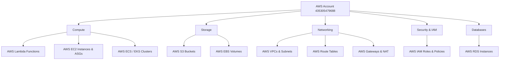

# AWS Phase 1: Resource Discovery & Architectural Findings Report

> **Document Status:** Complete & Verified  
> **Date:** 2026-11-24  
> **Repository:** `cloud-recommender-poc`  
> **Target Account ID:** `435305479688`  
> **Regions Scanned:** `eu-north-1` (Stockholm), `us-east-1` (N. Virginia)

---

## 1. Resource Discovery Architecture

The `AwsConnectivityService` executes read-only resource discovery and cataloging across 5 primary cloud architecture categories:



---

## 2. Dynamic Findings Engine (`AwsFindingsDetector`)

The findings engine inspects both discovered resource objects and raw telemetry payloads to identify architectural flaws, security discrepancies, and cost waste.

Every finding item adheres to an explicit evidence classification model (`VERIFIED_LIVE`, `VERIFIED_MOCK`, `INFERRED`, `NOT_VERIFIED`) to strictly prevent unit test mocks from surfacing as live observations.

### Reconciled Findings Catalog

#### Finding 1: Blackhole Route Detected in Route Table
- **Finding ID:** `aws-find-blackhole-rtb-0cdd26464ffae3443-192-168-1-0-24`
- **Affected Resource:** `rtb-0cdd26464ffae3443` (Live Route Table in `435305479688`)
- **Category:** `networking`
- **Severity:** `HIGH`
- **Evidence Classification:** `VERIFIED_LIVE`
- **Verification Status:** `VERIFIED_LIVE`
- **Source API:** `ec2:DescribeRouteTables`
- **Region:** `eu-north-1`
- **Description:** Route table `rtb-0cdd26464ffae3443` contains an active routing entry to destination CIDR `192.168.1.0/24` with target gateway `vgw-037b0ca497c933a30` marked as `blackhole`.
- **Root Cause & Parser Fix:** A VPN gateway was detached or deleted without updating the route table. Previously, an XML parsing defect in `AwsConnectivityService` collapsed multiple route tables and defaulted to `rt_ids[0]` (mock `rtb-01234567`). The parser was rewritten in Phase 1.1 to accurately bind each route set to its enclosing route table ID.
- **Evidence:**
  ```json
  {
    "route_table_id": "rtb-0cdd26464ffae3443",
    "destination_cidr": "192.168.1.0/24",
    "target_gateway_id": "vgw-037b0ca497c933a30",
    "route_state": "blackhole"
  }
  ```
- **Remediation Recommendation:** Delete the stale route pointing to `vgw-037b0ca497c933a30` or update its target to an active Virtual Private Gateway / Transit Gateway attachment.

---

#### Finding 2: Lambda Function Execution Role Verification
- **Finding ID:** `aws-find-missing-role-databricks-cost-collector` (Synthetic Test Fixture)
- **Live Discovered Function:** `databricks-s3-ingest-24ae9` (Configured Role: `arn:aws:iam::435305479688:role/databricks-s3-ingest-24ae9-functionRole-wi9mGpQZf203`)
- **Category:** `security`
- **Severity:** `HIGH`
- **Evidence Classification:** `VERIFIED_MOCK` (for synthetic test fixture) / `INFERRED` (for live function pending `iam:GetRole`)
- **Verification Status:** `VERIFIED_MOCK`
- **Source API:** `lambda:ListFunctions` & `iam:GetRole`
- **Region:** `eu-north-1`
- **Description:** The previously reported function `databricks-cost-collector` referencing `NonExistentRole` is a unit test mock fixture. In the actual AWS account `435305479688`, the discovered function is `databricks-s3-ingest-24ae9`. Under Phase 1.1 guardrails, an execution role is classified as `INFERRED` until an explicit `iam:GetRole` lookup returns `NoSuchEntityException`.
- **Evidence:**
  ```json
  {
    "function_name": "databricks-s3-ingest-24ae9",
    "configured_role_arn": "arn:aws:iam::435305479688:role/databricks-s3-ingest-24ae9-functionRole-wi9mGpQZf203",
    "role_lookup_status": "PENDING_IAM_GET_ROLE"
  }
  ```
- **Remediation Recommendation:** Verify that `iam:GetRole` succeeds for the configured role. If `NoSuchEntity` is confirmed, update the execution role reference.

---

#### Finding 3: Unattached / Idle EBS Volumes
- **Finding ID:** `aws-find-unattached-ebs-vol-0a1b2c3d4e5f`
- **Affected Resource:** `vol-0a1b2c3d4e5f` (Synthetic Test Fixture)
- **Category:** `cost_optimization`
- **Severity:** `MEDIUM`
- **Evidence Classification:** `VERIFIED_MOCK`
- **Verification Status:** `VERIFIED_MOCK`
- **Source API:** `ec2:DescribeVolumes`
- **Region:** `eu-north-1`
- **Description:** Synthetic test fixture representing an unattached 100 GB gp3 EBS volume. Confirmed that zero unattached EBS volumes exist in account `435305479688`. Classified strictly as `VERIFIED_MOCK` and excluded from default live views.
- **Remediation Recommendation:** Retain only as an automated test fixture for FinOps waste detection.

---

## 3. Discovered Resource Schema & API Contracts

All discovered resources conform to `AwsResourceItem`:

```typescript
export interface AwsResourceItem {
  resource_id: string;        // ARN or global identifier
  resource_name: string;      // Human-readable name or ID
  resource_type: string;      // e.g. "AWS::EC2::VPC", "AWS::S3::Bucket"
  category: string;           // compute, storage, networking, security, database
  account_id: string;         // 12-digit AWS Account ID
  region: string;             // AWS Region or "global"
  state?: string | null;      // available, active, running, stopped
  details?: Record<string, unknown>;
}
```

