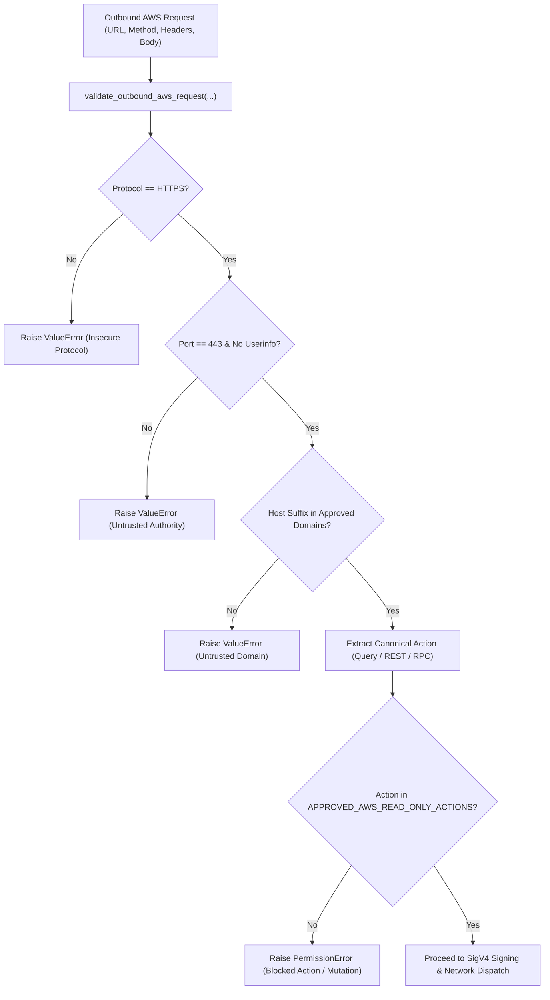

# AWS Phase 2.1A — Security Verification & Action Allowlist Architecture

> **Repository:** `cloud-recommender-poc`  
> **Status:** VERIFIED & HARDENED  
> **Date:** November 2026

---

## 1. Centralized Outbound AWS Action Allowlist

### 1.1 Architecture & Fail-Closed Design

Prior to Phase 2.1A, HTTP method filtering (`DELETE`, `PUT`, `PATCH`) blocked generic REST mutations, but left a critical vulnerability: AWS Query APIs (EC2, IAM, CloudWatch) execute mutating actions via HTTP `POST`.

In Phase 2.1A, `backend/src/cloud_recommender/services/aws/operation_validator.py` was introduced as the single source of truth for outbound AWS action validation. Every outbound request must pass `validate_outbound_aws_request(...)` before SigV4 signing in `sign_aws_request(...)`. If validation fails, `PermissionError` or `ValueError` is raised immediately, preventing request transmission.

### 1.2 Multi-Protocol Canonical Action Extraction Matrix

| Service Protocol | Transport Mechanism | Extraction Method | Example Canonical Action |
| :--- | :--- | :--- | :--- |
| **AWS Query API** (EC2, IAM, CloudWatch, RDS, STS) | URL Query String or `application/x-www-form-urlencoded` body | Inspect `Action` parameter | `ec2:DescribeInstances`, `iam:ListRoles`, `cloudwatch:GetMetricData` |
| **AWS JSON RPC** (Cost Explorer, Pricing, ECS, EKS) | HTTP Header `X-Amz-Target` | Inspect header prefix & target name | `ce:GetCostAndUsage`, `ce:GetCostForecast`, `pricing:DescribeServices` |
| **AWS REST API** (S3) | HTTP Method + URL Path / Query Parameter | Inspect URL path segments (`?location`, `?list-type=2`) | `s3:ListAllMyBuckets`, `s3:GetBucketLocation`, `s3:ListObjectsV2` |
| **AWS REST API** (Lambda) | HTTP Method + Path (`/2015-03-31/functions`) | Inspect method and route pattern | `lambda:ListFunctions`, `lambda:GetFunction` |

### 1.3 Blocked Mutating Actions (Verified via Tests)

The following dangerous operations were explicitly tested and verified blocked pre-network:
- `ec2:TerminateInstances` (HTTP POST Query) $\rightarrow$ **Blocked**
- `ec2:StopInstances` (HTTP POST Query) $\rightarrow$ **Blocked**
- `ec2:RunInstances` (HTTP POST Query) $\rightarrow$ **Blocked**
- `iam:CreateRole` (HTTP POST Query) $\rightarrow$ **Blocked**
- `iam:AttachRolePolicy` (HTTP POST Query) $\rightarrow$ **Blocked**
- `cloudwatch:PutMetricData` (HTTP POST Query) $\rightarrow$ **Blocked**
- `lambda:CreateFunction` (HTTP POST REST) $\rightarrow$ **Blocked**
- `s3:PutObject` (HTTP PUT) $\rightarrow$ **Blocked**
- `s3:DeleteObject` (HTTP DELETE) $\rightarrow$ **Blocked**
- Unknown arbitrary actions (`ec2:UnknownDangerousAction`) $\rightarrow$ **Blocked**

---

## 2. Cryptographic Approval Token & Canonical Plan Binding

### 2.1 Canonical Plan Hashing

To prevent parameter tampering between preview generation and execution, `AwsSyncApprovalService` generates a cryptographic plan hash:
$$\text{Canonical JSON} = \text{json.dumps}(plan, \text{sort\_keys}=\text{True}, \text{separators}=(',', ':'))$$
$$\text{plan\_hash} = \text{SHA-256}(\text{Canonical JSON})$$
$$\text{token\_signature} = \text{HMAC-SHA256}(K_{secret}, \text{token\_id} \parallel \text{plan\_hash} \parallel \dots)$$

### 2.2 Tamper Resistance Verification

Any modification to:
- `approved_budget_usd`
- `max_requests`
- `max_metric_queries`
- `approved_operations`
- `start_date` / `end_date`

results in a mismatch between the recomputed plan hash and the token's bound plan hash, raising `AwsApprovalTokenError("Approval token plan hash mismatch: approved execution parameters have been tampered with.")`.

### 2.3 Single-Use State & Multi-Tenant Isolation

1. **Single-Use Enforcement:** Tokens transition from `ISSUED` $\rightarrow$ `CONSUMED`. Subsequent calls raise `TOKEN_ALREADY_USED`.
2. **Tenant Isolation:** Tokens are bound to `tenant_id` and `user_id`. Queries from unauthorized tenants return HTTP 404 or fail cryptographic verification.

