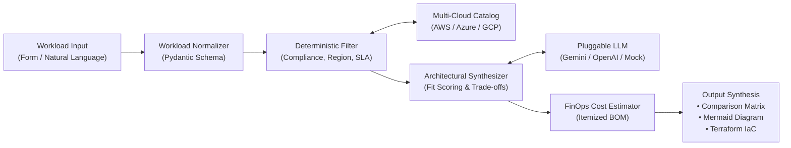

# Cloud Recommender POC ☁️⚡

> **Intelligent Multi-Cloud Workload Recommendation Engine**  
> Evaluates application workload profiles, enforces strict regulatory and architectural constraints, and produces justified, cost-estimated cloud architecture blueprints across **AWS**, **Azure**, and **GCP**.

---

## 🌟 Key Features

- **Hybrid Deterministic-Generative Engine:** Enforces 100% compliance and technical feasibility through deterministic rule engines before invoking LLMs for architectural reasoning and trade-off synthesis (eliminates hallucinations).
- **Multi-Cloud Comparison Matrix:** Side-by-side service mapping (Compute, Storage, Database, Networking) between AWS, Azure, and Google Cloud.
- **Automated Bill of Materials (BOM):** Itemized monthly cost estimates with FinOps-recommended safety buffers.
- **Visual Architecture Diagrams:** Instant generation of renderable **Mermaid.js** flowcharts.
- **Starter Infrastructure as Code (IaC):** Generates ready-to-prototype **Terraform** HCL templates.
- **Zero-Cost Offline/Mock Mode:** Fully functional test suite and local environment using deterministic mock providers—no cloud credentials or paid LLM API keys required.

---

## 📚 Foundational Documentation & Specifications

Before writing or modifying application code, developers and autonomous coding agents must review and follow these foundational specifications:

| Document | Purpose |
| :--- | :--- |
| **[AGENTS.md](file:///c:/Users/Admin/OneDrive%20-%20bizmetric.com/Desktop/Workspace/cloud-recommender-poc/AGENTS.md)** | **Agent Operational Guardrails:** Non-negotiable coding rules, protected boundaries, and milestone validation checklists. |
| **[docs/PRODUCT_REQUIREMENTS.md](file:///c:/Users/Admin/OneDrive%20-%20bizmetric.com/Desktop/Workspace/cloud-recommender-poc/docs/PRODUCT_REQUIREMENTS.md)** | **Product Requirements Document (PRD):** Target personas, functional requirements (FR-1 to FR-8), and standard benchmark scenarios. |
| **[docs/ARCHITECTURE.md](file:///c:/Users/Admin/OneDrive%20-%20bizmetric.com/Desktop/Workspace/cloud-recommender-poc/docs/ARCHITECTURE.md)** | **System Architecture Specification:** System topologies, sequence diagrams, Pydantic data schemas, and full directory layout. |
| **[docs/IMPLEMENTATION_ROADMAP.md](file:///c:/Users/Admin/OneDrive%20-%20bizmetric.com/Desktop/Workspace/cloud-recommender-poc/docs/IMPLEMENTATION_ROADMAP.md)** | **Phased Implementation Roadmap:** Sequential milestones (M0 through M8) with exact validation shell commands and exit criteria. |
| **[docs/ADR/](file:///c:/Users/Admin/OneDrive%20-%20bizmetric.com/Desktop/Workspace/cloud-recommender-poc/docs/ADR/)** | **Architectural Decision Records (ADRs):** Binding architectural choices (hybrid engine, FastAPI, offline catalog, pluggable LLMs). |

---

## 🏗️ Architecture at a Glance



---

## 🛠️ Technology Stack

- **Backend:** Python 3.11+, FastAPI, Pydantic v2, Uvicorn
- **AI/LLM Adapters:** Google GenAI (Gemini 2.5), OpenAI (GPT-4o), Anthropic (Claude 3.7), Mock Provider
- **Catalog & Data:** Bundled, version-controlled JSON datasets with in-memory indexing
- **Frontend:** React 18, Vite, TypeScript, Tailwind CSS, Lucide Icons, Mermaid.js
- **Testing & Quality:** Pytest, Pytest-Cov, Mypy (strict), Ruff (linter/formatter)

---

## 🚀 Quick Start Guide

### 1. Prerequisites
- Python 3.11+
- Node.js 20+ & npm
- Git

### 2. Environment Configuration
Copy the template environment file:
```bash
cp .env.example .env
```
*(By default, `.env.example` has `LLM_PROVIDER=mock`, allowing full functionality without API keys).*

### 3. Backend Setup
```bash
# Navigate to backend and create virtual environment
cd backend
python -m venv .venv

# Activate virtual environment
# Windows (PowerShell):
.venv\Scripts\Activate.ps1
# macOS/Linux:
source .venv/bin/activate

# Install dependencies
pip install -r requirements.txt

# Run test suite
pytest tests/ -v

# Start development API server
uvicorn app.main:app --reload --port 8000
```
API Documentation will be live at: `http://localhost:8000/docs`

### 4. Frontend Setup
```bash
# In a separate terminal:
cd frontend
npm install
npm run dev
```
Web client will be available at: `http://localhost:3000`

---

## 🧪 Validation & Quality Assurance

All contributions and agent tasks must pass the standard validation suite before merge:

```bash
# Linting & Formatting Check
ruff check backend/
ruff format --check backend/

# Type Checking
mypy backend/

# Automated Test Suite with Coverage
pytest backend/tests/ -v --cov=backend/app --cov-report=term-missing
```

---

## 📜 Architectural Decisions (ADR Index)

- **[ADR 0001: Hybrid Deterministic-Generative Architecture](file:///c:/Users/Admin/OneDrive%20-%20bizmetric.com/Desktop/Workspace/cloud-recommender-poc/docs/ADR/0001-hybrid-recommendation-engine.md)**
- **[ADR 0002: Backend Selection: FastAPI & Pydantic v2](file:///c:/Users/Admin/OneDrive%20-%20bizmetric.com/Desktop/Workspace/cloud-recommender-poc/docs/ADR/0002-fastapi-backend-with-pydantic-v2.md)**
- **[ADR 0003: Offline-First Cloud Catalog & Pricing Heuristics](file:///c:/Users/Admin/OneDrive%20-%20bizmetric.com/Desktop/Workspace/cloud-recommender-poc/docs/ADR/0003-cloud-catalog-schema-and-offline-fallback.md)**
- **[ADR 0004: Pluggable LLM Interface & Deterministic Mock Provider](file:///c:/Users/Admin/OneDrive%20-%20bizmetric.com/Desktop/Workspace/cloud-recommender-poc/docs/ADR/0004-pluggable-llm-provider-interface.md)**

---

## 🔒 Security & Privacy

The Cloud Recommender POC is designed with a **zero-trust credential model**:
- No AWS, Azure, or GCP credentials are ever requested or stored.
- Workload requirements are evaluated against public service capabilities.
- Local mock providers allow 100% offline development and air-gapped evaluation.
