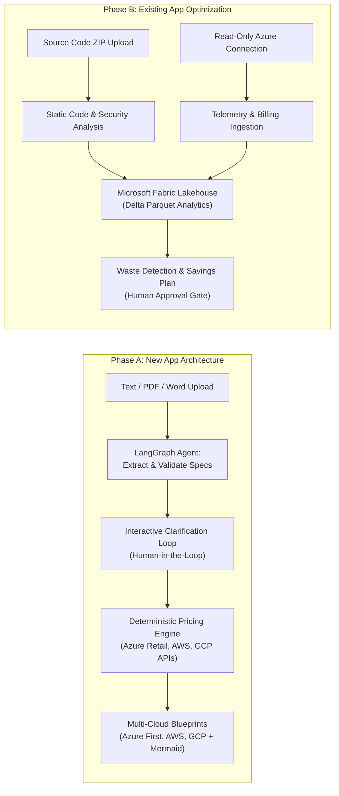

# Cloud Recommender POC ☁️⚡

> **Intelligent Multi-Cloud Architecture & Optimization Platform**  
> An AI-powered decision-support platform designed to design resilient, multi-cloud architectures from requirements documents (**Phase A**) and uncover cloud waste and modernization opportunities from existing code and telemetry (**Phase B**).

---

## 🎯 Core Product Objectives

The platform delivers two distinct, end-to-end workflows:



### 1. Phase A — New Application Architecture
- **Multi-Modal Requirements Ingestion:** Ingests application concepts from text and uploaded **PDF (`.pdf`)** or **Word (`.docx`)** specifications.
- **Interactive Clarifying Questions:** Utilizes **LangGraph** to identify incomplete requirements (unspecified scale, missing compliance, ambiguous budget) and pauses to ask targeted clarifying questions.
- **Deterministic Multi-Cloud Blueprints:** Generates comparable, production-grade cloud architectures across **Azure** (primary), **AWS**, and **GCP**.
- **Official Provider Pricing:** Calculates monthly and annual cost estimates directly from official cloud pricing sources (Azure Retail Prices API, AWS Price List API, GCP Catalog API)—eliminating hallucinated pricing.
- **Pillar-Based Trade-Off Matrix:** Evaluates architectures across Cost, Security, Reliability, Scalability, and Operational Simplicity.

### 2. Phase B — Existing Application Optimization
- **Source Code Analysis:** Ingests application code archives (`.zip`) to evaluate code quality, outdated dependencies, security vulnerabilities, and monolithic bottlenecks.
- **Read-Only Azure Telemetry:** Connects to customer Azure environments with **strictly authorized, read-only permissions** to ingest Azure Resource Graph inventory, Azure Monitor utilization metrics, and Azure Cost Management billing logs.
- **Microsoft Fabric Lakehouse Layer:** Stages and transforms high-volume telemetry and billing data in **Microsoft Fabric** using **Delta Parquet** tables via OneLake.
- **Waste & Modernization Detection:** Detects idle VMs, orphaned disks, over-provisioned databases, and recommends PaaS/serverless modernization opportunities (e.g. migrating VMs to Azure Container Apps).
- **Quantified Savings & Zero-Execution Policy:** Forecasts monthly/annual dollar savings and implementation effort. **All changes require explicit human review; the platform NEVER executes cloud modifications automatically.**

---

## 🛡️ Security Boundaries & Zero-Execution Policy

- **Strictly Advisory Platform:** The Cloud Recommender platform is strictly an advisory, analysis, and architecture generation tool. It **must not** create, modify, or destroy real customer cloud resources.
- **Read-Only Azure Scope:** Integrations strictly require `Reader`, `Cost Management Reader`, and `Monitoring Reader` roles. Contributor or Owner roles are explicitly forbidden.
- **Data & Credential Sanitization:** Uploaded source code and requirement documents are stored ephemerally and scrubbed of detected secrets, connection strings, and PII before LLM ingestion.

---

## 📚 Foundational Documentation Index

Review these foundational specifications before modifying or implementing code:

| Document | Description |
| :--- | :--- |
| **[AGENTS.md](file:///c:/Users/Admin/OneDrive%20-%20bizmetric.com/Desktop/Workspace/cloud-recommender-poc/AGENTS.md)** | **Operational Guardrails:** Mandatory coding rules, protected architectural boundaries, and milestone validation protocols. |
| **[docs/PRODUCT_REQUIREMENTS.md](file:///c:/Users/Admin/OneDrive%20-%20bizmetric.com/Desktop/Workspace/cloud-recommender-poc/docs/PRODUCT_REQUIREMENTS.md)** | **PRD:** Detailed specifications for Phase A & B, confirmed requirements vs assumptions vs open questions, prerequisites, and benchmark scenarios. |
| **[docs/ARCHITECTURE.md](file:///c:/Users/Admin/OneDrive%20-%20bizmetric.com/Desktop/Workspace/cloud-recommender-poc/docs/ARCHITECTURE.md)** | **System Architecture:** Topologies, LangGraph state workflows, PostgreSQL schemas, Microsoft Fabric Lakehouse layout, and directory tree. |
| **[docs/IMPLEMENTATION_ROADMAP.md](file:///c:/Users/Admin/OneDrive%20-%20bizmetric.com/Desktop/Workspace/cloud-recommender-poc/docs/IMPLEMENTATION_ROADMAP.md)** | **Implementation Roadmap:** Sequential milestones (M0 through M9) with explicit exit criteria and terminal verification commands. |
| **[docs/ADR/](file:///c:/Users/Admin/OneDrive%20-%20bizmetric.com/Desktop/Workspace/cloud-recommender-poc/docs/ADR/)** | **Architectural Decision Records:** Binding technical choices across the platform stack. |

---

## 🔑 External Prerequisites

| Prerequisite | Required Configuration | Offline / Mock Fallback |
| :--- | :--- | :--- |
| **Azure Subscription** | Service Principal with `Reader`, `Cost Management Reader` roles | Bundled `mock_azure_telemetry.json` dataset |
| **Microsoft Fabric** | Fabric Workspace ID, Lakehouse ID, OneLake ADLS Gen2 access | Local DuckDB / Parquet lakehouse abstraction (`FABRIC_ENABLED=false`) |
| **Official Pricing APIs** | Public Azure Retail Prices API, AWS Pricing, GCP Billing | Local 24h cached dataset (`OFFLINE_PRICING_MODE=true`) |
| **LLM Provider** | Azure OpenAI, OpenAI, Gemini, or Claude API key | Deterministic `MockProvider` (`LLM_PROVIDER=mock`) |
| **PostgreSQL 15+** | Database URL with `asyncpg` support | Local PostgreSQL or test container |

---

## 🛠️ Technology Stack

- **Frontend:** Next.js 14+ (App Router), React 18, TypeScript, Tailwind CSS, Mermaid.js
- **Backend API:** Python 3.11+, FastAPI, Pydantic v2, Uvicorn
- **Agent Orchestration:** LangGraph (Stateful Cyclic Graphs)
- **Database:** PostgreSQL 15+ (SQLAlchemy 2.0 async, asyncpg)
- **Analytics & Lakehouse:** Microsoft Fabric (OneLake Delta Parquet) + Local DuckDB fallback
- **Cloud SDK:** Azure SDK for Python (`azure-mgmt-resourcegraph`, `azure-mgmt-costmanagement`, `azure-mgmt-monitor`)
- **Document & Code Parsers:** `pypdf`, `python-docx`, Python AST & zipfile

---

## 🚀 Quick Start Guide

### 1. Environment Configuration
```bash
cp .env.example .env
```
*(By default, `.env.example` is configured with `LLM_PROVIDER=mock`, `OFFLINE_PRICING_MODE=true`, and `FABRIC_ENABLED=false`, allowing full offline testing without cloud credentials).*

### 2. Backend Setup
```bash
cd backend
python -m venv .venv

# Activate virtual environment
# Windows (PowerShell):
.venv\Scripts\Activate.ps1
# macOS/Linux:
source .venv/bin/activate

# Install dependencies
pip install -r requirements.txt

# Run verification test suite
pytest tests/ -v
```

### 3. Frontend Setup
```bash
cd frontend
npm install
npm run dev
```

---

## 🧪 Verification Protocol

Every milestone must pass the verification sequence before proceeding:

```bash
# Backend Quality Checks
ruff check backend/
ruff format --check backend/
mypy backend/
pytest backend/tests/ -v --cov=backend/app --cov-report=term-missing

# Frontend Quality Checks
npm --prefix frontend run lint
npm --prefix frontend run typecheck
npm --prefix frontend run build
```

---

## 📜 Architectural Decisions (ADR Index)

- **[ADR 0001: Hybrid Architecture with LangGraph Stateful Agent Orchestration](file:///c:/Users/Admin/OneDrive%20-%20bizmetric.com/Desktop/Workspace/cloud-recommender-poc/docs/ADR/0001-hybrid-recommendation-engine.md)**
- **[ADR 0002: Backend API (FastAPI) and Relational Persistence (PostgreSQL)](file:///c:/Users/Admin/OneDrive%20-%20bizmetric.com/Desktop/Workspace/cloud-recommender-poc/docs/ADR/0002-fastapi-backend-with-pydantic-v2.md)**
- **[ADR 0003: Analytics Layer Architecture (Microsoft Fabric Lakehouse & OneLake)](file:///c:/Users/Admin/OneDrive%20-%20bizmetric.com/Desktop/Workspace/cloud-recommender-poc/docs/ADR/0003-cloud-catalog-schema-and-offline-fallback.md)**
- **[ADR 0004: Pluggable LLM Provider Interface with Mandatory Mock Engine](file:///c:/Users/Admin/OneDrive%20-%20bizmetric.com/Desktop/Workspace/cloud-recommender-poc/docs/ADR/0004-pluggable-llm-provider-interface.md)**
- **[ADR 0005: Read-Only Azure Integration & Human-in-the-Loop Zero-Execution Boundary](file:///c:/Users/Admin/OneDrive%20-%20bizmetric.com/Desktop/Workspace/cloud-recommender-poc/docs/ADR/0005-read-only-azure-and-zero-execution-guardrail.md)**
- **[ADR 0006: Deterministic Pricing Engine with Official API Integration and Local Cache](file:///c:/Users/Admin/OneDrive%20-%20bizmetric.com/Desktop/Workspace/cloud-recommender-poc/docs/ADR/0006-deterministic-pricing-engine.md)**
