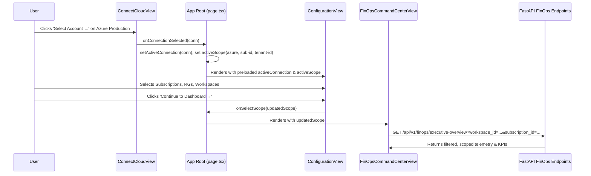

# Account Scope Propagation & Filter Isolation Report

> **Platform:** FinOps & Infrastructure Intelligence Platform  
> **Topic:** Scope State Propagation & Multi-Tenant Isolation  
> **Status:** Production-Ready  
> **Date:** November 2026

---

## 1. Overview & Data Flow Architecture

A core principle of enterprise FinOps governance is **strict scope isolation**. Dashboards, KPIs, DBU calculations, and cost attribution must reflect *only* the cloud accounts, subscriptions, resource groups, and workspaces explicitly selected by the user.



---

## 2. Scope Contract Specifications

The unified `CloudScope` interface in `frontend/src/types/navigation.ts` governs all state propagation:

```typescript
export interface CloudScope {
  provider: "azure" | "gcp" | "aws";
  account_id?: string;
  tenant_id?: string;
  subscription_id?: string;
  subscription_ids?: string[];
  resource_group?: string;
  resource_groups?: string[];
  workspace_id?: string;
  workspace_ids?: string[];
  fabric_workspace_ids?: string[];
  fabric_capacity_ids?: string[];
  other_resource_count?: number;
  environment?: "prod" | "dev" | "stage" | "all";
  display_name?: string;
  is_multi_scope?: boolean;
}
```

---

## 3. Cascading Scope Propagation & Deselection Guardrails

### 3.1 Downward Invalidation Rules
When a user alters their infrastructure selection in `ConfigurationView`, downstream dependencies are automatically cleaned up to prevent orphaned resources:

1. **Subscription Invalidation:**
   - Deselecting a subscription triggers:
     - Removal of all child Resource Groups from `selectedRgNames`.
     - Removal of all child Databricks Workspaces from `selectedWorkspaceIds`.
     - Removal of all standalone child resources from `selectedOtherResources`.
2. **Resource Group Invalidation:**
   - Deselecting a Resource Group triggers:
     - Removal of any Databricks workspaces deployed within that Resource Group.
     - Removal of VMs and storage accounts linked to that Resource Group.

### 3.2 Dynamic Scope Serialization
When the user clicks **Continue to Dashboard** or **Save Configuration**, the scope is compiled deterministically:

```typescript
const updatedScope: CloudScope = {
  provider: "azure",
  account_id: activeConnection?.id,
  tenant_id: activeConnection?.tenant_or_org_id,
  subscription_id: selectedSubIds[0] || undefined,
  subscription_ids: selectedSubIds,
  resource_group: selectedRgNames[0] || undefined,
  resource_groups: selectedRgNames,
  workspace_id: selectedWorkspaceIds[0] || undefined,
  workspace_ids: selectedWorkspaceIds,
  fabric_workspace_ids: selectedFabricWorkspaceIds,
  other_resource_count: selectedOtherResources.length,
  display_name: `${activeAccountName} (${summaryText})`,
  is_multi_scope: true,
};
```

---

## 4. Backend Scope Enforcement & Verification

In `backend/src/cloud_recommender/api/routes/finops.py`, backend endpoints validate that incoming query parameters conform to authorized scopes:

- **Subscription Match:** Rejects requests if a workspace ID is requested that does not belong to the authorized subscription.
- **Role Isolation:** Enforces read-only privileges based on server-derived HMAC authorization tokens.
- **Offline / Deterministic Mode:** Fallbacks are scoped to fixture datasets tagged with the identical subscription and workspace IDs (`f718c261-ab85-49fd-907e-99c022cc2aeb`, `642006393507276`).

