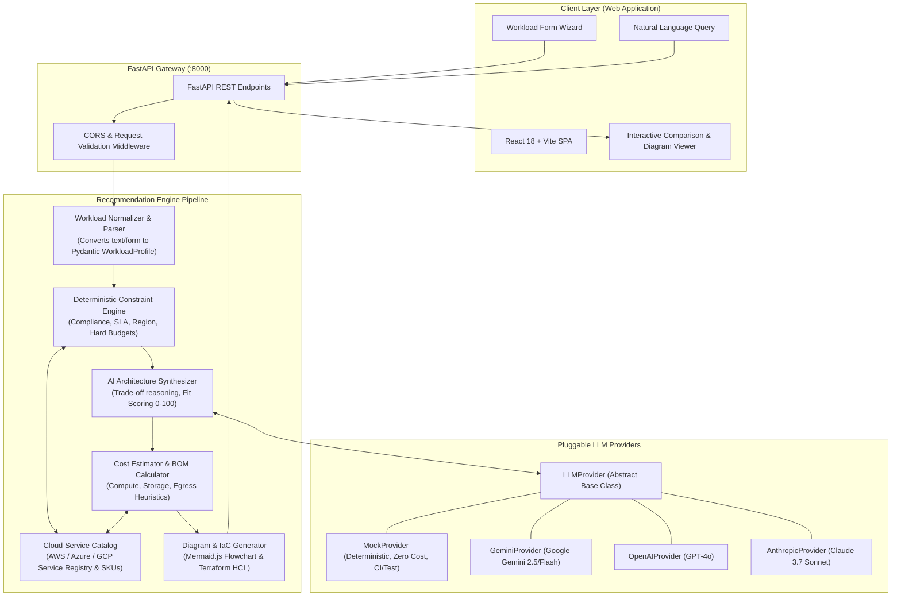
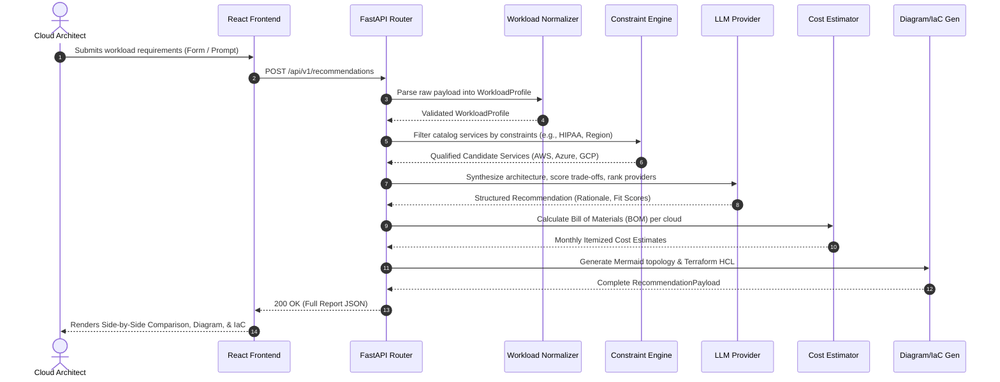

# Architecture Specification Document

| Document Metadata | Value |
| :--- | :--- |
| **Project** | Cloud Recommender POC |
| **Version** | 1.0.0 |
| **Status** | Approved & Binding |
| **Target Runtime** | Python 3.11+ (Backend) / Node 20+ (Frontend) |

---

## 1. System Overview & Architecture Philosophy

The Cloud Recommender POC implements a **Hybrid Deterministic-Generative Architecture**. 

Pure LLM systems often hallucinate cloud SKUs, invent non-existent pricing, or miss strict regulatory boundaries. Pure rule engines lack nuance, conversational flexibility, and the ability to synthesize compelling trade-off narratives. 

By separating the pipeline into **Deterministic Constraint Verification** (first pass) and **Generative Architectural Synthesis** (second pass), the system ensures 100% technical validity while providing deep, context-aware architectural recommendations.

---

## 2. System Architecture Diagram



---

## 3. Technology Stack & Rationale

| Component | Technology | Rationale |
| :--- | :--- | :--- |
| **Backend Framework** | **FastAPI (Python 3.11+)** | High performance async endpoints, native OpenAPI schema generation, and first-class Pydantic v2 integration. |
| **Data Validation & Schemas** | **Pydantic v2** | Strict runtime type validation, fast Rust-based serialization, and seamless integration with LLM structured output parsing. |
| **LLM Provider Layer** | **Custom Pluggable Adapter Pattern** | Zero lock-in to any single AI provider; allows running in mock mode during CI/offline, and swapping between Gemini, OpenAI, and Anthropic. |
| **Catalog Storage** | **Local JSON Dataset + In-Memory Index** | Fast, deterministic, zero external database setup required for the POC. Service records are easily audited and version-controlled. |
| **Frontend Framework** | **React 18 + Vite + TypeScript** | Instant HMR, type safety, low bundle size, and fast component composition. |
| **Styling & UI Components** | **Tailwind CSS + Lucide React** | Utility-first, responsive design with clear visual hierarchy for complex comparison matrices. |
| **Diagram Engine** | **Mermaid.js** | Text-to-diagram rendering directly in the browser; exports clean SVG/PNG diagrams. |
| **Testing & Quality** | **Pytest + Mypy + Ruff** | High-velocity test suite, strict static type enforcement, and standard PEP 8 formatting. |

---

## 4. Pipeline Execution Lifecycle



---

## 5. Domain Data Models & Core Schemas

### 5.1 `WorkloadProfile`
The canonical input representation normalized across form fields and NLP prompts:
```python
class WorkloadType(str, Enum):
    WEB_APP = "web_app"
    MICROSERVICES = "microservices"
    BATCH_PROCESSING = "batch_processing"
    DATA_PIPELINE = "data_pipeline"
    AI_INFERENCE = "ai_inference"
    EVENT_DRIVEN = "event_driven"

class ComplianceStandard(str, Enum):
    HIPAA = "HIPAA"
    GDPR = "GDPR"
    PCI_DSS = "PCI_DSS"
    SOC2 = "SOC2"
    FEDRAMP = "FEDRAMP"

class WorkloadProfile(BaseModel):
    name: str = Field(..., description="Project or workload identifier")
    workload_type: WorkloadType
    target_traffic_rps: int = Field(default=100, ge=1)
    monthly_active_users: int = Field(default=10_000, ge=0)
    cpu_cores_required: int = Field(default=4, ge=1)
    memory_gb_required: int = Field(default=16, ge=1)
    gpu_required: bool = False
    storage_gb: int = Field(default=100, ge=0)
    database_type: str = Field(default="relational", description="relational, document, cache, timeseries")
    high_availability: bool = True
    multi_region: bool = False
    compliance: list[ComplianceStandard] = Field(default_factory=list)
    max_monthly_budget_usd: Optional[float] = None
    preferred_provider: Optional[str] = None  # "aws", "azure", "gcp", or None (open)
```

### 5.2 `CloudServiceItem`
Catalog representation of a discrete cloud service:
```python
class CloudProvider(str, Enum):
    AWS = "aws"
    AZURE = "azure"
    GCP = "gcp"

class ServiceCategory(str, Enum):
    COMPUTE = "compute"
    DATABASE = "database"
    STORAGE = "storage"
    NETWORKING = "networking"
    SECURITY = "security"
    MONITORING = "monitoring"

class CloudServiceItem(BaseModel):
    service_id: str
    provider: CloudProvider
    category: ServiceCategory
    name: str
    description: str
    supported_compliance: list[ComplianceStandard]
    sla_percentage: float
    base_hourly_rate_usd: float
    unit_metric: str  # e.g., "per_vcpu_hour", "per_gb_month"
    strengths: list[str]
    limitations: list[str]
```

### 5.3 `RecommendationResult`
The unified synthesis response payload:
```python
class FitScore(BaseModel):
    overall: int = Field(ge=0, le=100)
    cost_score: int = Field(ge=0, le=100)
    performance_score: int = Field(ge=0, le=100)
    reliability_score: int = Field(ge=0, le=100)
    security_score: int = Field(ge=0, le=100)
    simplicity_score: int = Field(ge=0, le=100)

class ProviderArchitecture(BaseModel):
    provider: CloudProvider
    rank: int
    fit_score: FitScore
    selected_services: dict[ServiceCategory, CloudServiceItem]
    estimated_monthly_cost_usd: float
    cost_breakdown: dict[str, float]
    justification_summary: str
    trade_offs: list[str]
    potential_risks: list[str]
    mermaid_diagram: str
    terraform_hcl: str

class RecommendationResponse(BaseModel):
    workload_summary: WorkloadProfile
    recommended_primary: CloudProvider
    provider_blueprints: dict[CloudProvider, ProviderArchitecture]
    constraint_check_status: str
    warnings: list[str]
```

---

## 6. Physical Directory Layout

The codebase will follow this structured layout when fully implemented:

```text
cloud-recommender-poc/
├── .github/
│   └── workflows/
│       ├── ci.yml                     # CI lint, typecheck, and test runner
│       └── pr-check.yml               # PR policy check
├── docs/
│   ├── PRODUCT_REQUIREMENTS.md       # Product requirements & acceptance criteria
│   ├── ARCHITECTURE.md               # System architecture & data models (this file)
│   ├── IMPLEMENTATION_ROADMAP.md     # Step-by-step phased milestones
│   └── ADR/
│       ├── 0001-hybrid-recommendation-engine.md
│       ├── 0002-fastapi-backend-with-pydantic-v2.md
│       ├── 0003-cloud-catalog-schema-and-offline-fallback.md
│       └── 0004-pluggable-llm-provider-interface.md
├── backend/
│   ├── app/
│   │   ├── __init__.py
│   │   ├── main.py                   # FastAPI application factory
│   │   ├── config.py                 # Pydantic Settings & environment variables
│   │   ├── schemas/                  # Pydantic data schemas
│   │   │   ├── __init__.py
│   │   │   ├── domain.py             # WorkloadProfile, CloudProvider, etc.
│   │   │   └── api.py                # Request / Response DTOs
│   │   ├── catalog/                  # Service catalog & seed datasets
│   │   │   ├── __init__.py
│   │   │   ├── registry.py           # Catalog query & filter service
│   │   │   └── data/
│   │   │       ├── aws_services.json
│   │   │       ├── azure_services.json
│   │   │       └── gcp_services.json
│   │   ├── engine/                   # Recommendation pipeline modules
│   │   │   ├── __init__.py
│   │   │   ├── normalizer.py         # Freeform NLP -> WorkloadProfile
│   │   │   ├── rule_engine.py        # Hard constraint filter
│   │   │   ├── synthesizer.py        # Architectural synthesis & scoring
│   │   │   ├── cost_estimator.py     # Heuristic BOM cost calculator
│   │   │   ├── diagram_generator.py  # Mermaid flowchart builder
│   │   │   └── iac_scaffolder.py     # Terraform template renderer
│   │   ├── providers/                # Pluggable LLM interfaces
│   │   │   ├── __init__.py
│   │   │   ├── base.py               # Abstract LLMProvider interface
│   │   │   ├── mock_provider.py      # Deterministic local test provider
│   │   │   ├── gemini_provider.py    # Google Gemini client
│   │   │   ├── openai_provider.py    # OpenAI client
│   │   │   └── claude_provider.py    # Anthropic Claude client
│   │   └── api/
│   │       ├── __init__.py
│   │       └── v1/
│   │           ├── __init__.py
│   │           ├── router.py         # Main v1 API router
│   │           ├── endpoints/
│   │           │   ├── recommendations.py
│   │           │   ├── catalog.py
│   │           │   └── health.py
│   ├── tests/
│   │   ├── __init__.py
│   │   ├── conftest.py               # Pytest fixtures and mock client
│   │   ├── test_normalizer.py
│   │   ├── test_catalog.py
│   │   ├── test_rule_engine.py
│   │   ├── test_cost_estimator.py
│   │   ├── test_diagram_generator.py
│   │   ├── test_providers.py
│   │   └── test_api_integration.py
│   ├── pyproject.toml                # Dependencies, ruff, mypy, pytest config
│   └── requirements.txt
├── frontend/
│   ├── src/
│   │   ├── main.tsx
│   │   ├── App.tsx
│   │   ├── components/               # React UI components
│   │   │   ├── WorkloadForm.tsx      # Structured parameter wizard
│   │   │   ├── PromptInput.tsx       # NLP query bar
│   │   │   ├── ComparisonMatrix.tsx  # Side-by-side cloud grid
│   │   │   ├── FitScoreGauge.tsx     # Score visualizer
│   │   │   ├── CostBreakdown.tsx     # BOM visualization
│   │   │   ├── DiagramViewer.tsx     # Mermaid SVG renderer
│   │   │   └── IaCExportModal.tsx    # Terraform viewer & copy
│   │   ├── services/
│   │   │   └── api.ts                # Axios/Fetch client
│   │   ├── types/
│   │   │   └── index.ts              # TypeScript domain types
│   │   └── index.css
│   ├── package.json
│   ├── tsconfig.json
│   ├── vite.config.ts
│   └── tailwind.config.js
├── .env.example
├── .gitignore
├── AGENTS.md
└── README.md
```

---

## 7. Security, Resiliency & Observability

1. **Zero Secret Footprint:** The application operates without requiring cloud provider credentials from the end user. It performs recommendations strictly on public architectural patterns and heuristic cost data.
2. **Graceful Degradation:** If the configured LLM provider returns an HTTP 429 (Rate Limit) or 5xx error, the engine seamlessly engages the deterministic fallback generator, returning catalog recommendations with heuristic trade-offs and an informative banner.
3. **Structured Logging:** All engine steps log execution time, token usage (if external LLM was invoked), and constraint outcomes with contextual correlation IDs.
