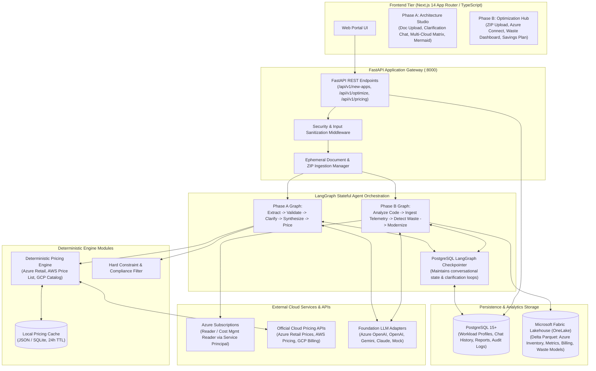
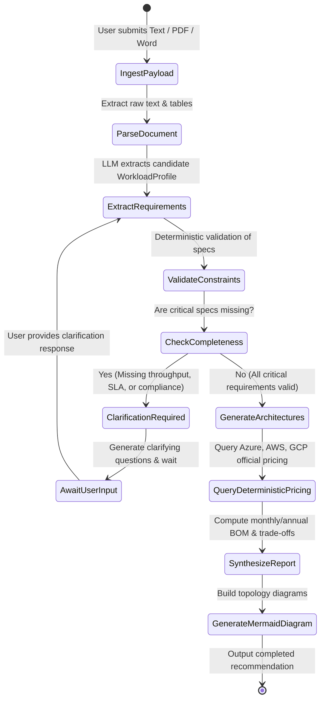
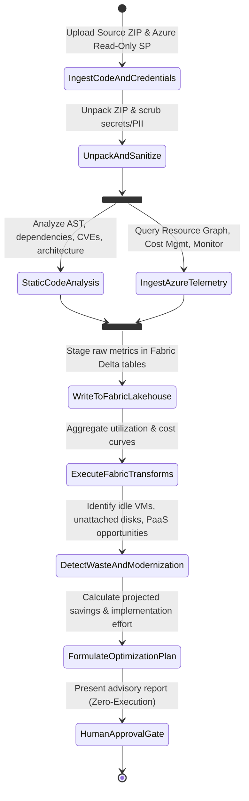
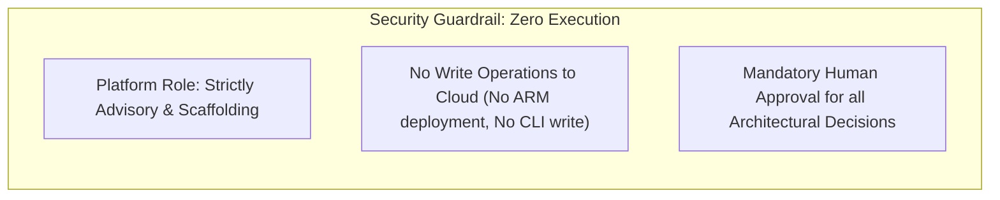

# Architecture Specification Document — Cloud Recommender POC

| Document Metadata | Value |
| :--- | :--- |
| **Project Name** | Cloud Recommender POC |
| **Architectural Style** | Hybrid Deterministic-Generative with Stateful Agent Orchestration |
| **Status** | Approved & Enforced |
| **Target Runtime** | Python 3.11+ (API & Engine) / Node.js 20+ (Next.js Frontend) |

---

## 1. Architectural Philosophy & Principles

The Cloud Recommender POC is engineered to resolve a fundamental tension in AI-assisted systems:
- **LLMs excel at narrative reasoning, code comprehension, and unstructured document extraction.**
- **LLMs fail at deterministic pricing math, strict constraint filtering, and reliable billing calculation.**

To solve this, the platform decouples tasks into a **Two-Stage Hybrid Architecture** orchestrated by **LangGraph**:
1. **Generative Stage:** Document parsing, requirements extraction, interactive clarification generation, code quality analysis, and trade-off synthesis.
2. **Deterministic Stage:** Official provider pricing retrieval, cost estimation, compliance checking, Azure Resource Graph querying, and Microsoft Fabric lakehouse aggregations.
3. **Strict Zero-Execution Guardrail:** Customer cloud environments are strictly read-only; no infrastructure modifications are executed automatically.

---

## 2. End-to-End System Topology



---

## 3. Technology Stack & Component Justifications

| Component | Selected Technology | Architectural Justification |
| :--- | :--- | :--- |
| **Frontend Framework** | **Next.js 14+ (React 18, TypeScript)** | Server-side rendering, streaming API support, modern component ecosystem, and strict type safety. |
| **API Framework** | **Python 3.11+ / FastAPI** | Native async concurrency, automated OpenAPI generation, fast Pydantic v2 data validation, and direct integration with Python AI/data libraries. |
| **Agent Orchestration** | **LangGraph (LangChain ecosystem)** | Provides cyclic, stateful multi-agent graphs required for human-in-the-loop clarification loops and multi-step code/cloud analysis. |
| **Relational Database** | **PostgreSQL 15+ (asyncpg / SQLAlchemy 2.0)** | ACID persistence for user projects, workload profiles, clarification chat logs, and generation histories. |
| **Analytics Storage & Transformation** | **Microsoft Fabric Lakehouse (OneLake)** | Enterprise lakehouse utilizing Delta Parquet for storing Azure inventory, utilization metrics, and billing datasets, with local DuckDB/Parquet fallback for offline dev. |
| **Cloud Integrations** | **Azure SDK for Python (`azure-mgmt-*`)** | Native SDKs for Azure Resource Graph, Azure Monitor, and Azure Cost Management with strictly enforced read-only scopes. |
| **Document Parsers** | **`pypdf` & `python-docx`** | Robust, open-source text and metadata extraction from uploaded PDF and Word documents without external SaaS dependencies. |
| **Pricing Engine** | **Custom Deterministic Pricing Service** | Directly queries Azure Retail Prices API, AWS Price List API, and GCP Billing Catalog; stores cached schemas in JSON/SQLite. |
| **Diagram Generation** | **Mermaid.js** | Browser-renderable text-based diagrams that easily export to SVG and PNG. |

---

## 4. LangGraph Agent Workflows

### 4.1 Phase A: New Application Architecture Graph



### 4.2 Phase B: Existing Application Optimization Graph



---

## 5. Data Architecture & Schemas

### 5.1 Operational Relational Layer (PostgreSQL)

```sql
-- Workload Profiles (Phase A)
CREATE TABLE workload_profiles (
    id UUID PRIMARY KEY DEFAULT gen_random_uuid(),
    project_name VARCHAR(255) NOT NULL,
    workload_type VARCHAR(50) NOT NULL,
    target_traffic_rps INT DEFAULT 100,
    monthly_active_users INT DEFAULT 10000,
    cpu_cores_required INT DEFAULT 4,
    memory_gb_required INT DEFAULT 16,
    gpu_required BOOLEAN DEFAULT FALSE,
    storage_gb INT DEFAULT 100,
    database_type VARCHAR(50) DEFAULT 'relational',
    high_availability BOOLEAN DEFAULT TRUE,
    multi_region BOOLEAN DEFAULT FALSE,
    compliance_frameworks JSONB DEFAULT '[]'::jsonb,
    max_monthly_budget_usd NUMERIC(12, 2),
    created_at TIMESTAMP WITH TIME ZONE DEFAULT NOW()
);

-- Clarification Sessions (Human-in-the-Loop)
CREATE TABLE clarification_sessions (
    id UUID PRIMARY KEY DEFAULT gen_random_uuid(),
    workload_profile_id UUID REFERENCES workload_profiles(id),
    status VARCHAR(50) DEFAULT 'in_progress', -- in_progress, completed
    pending_questions JSONB NOT NULL,
    user_responses JSONB DEFAULT '{}'::jsonb,
    created_at TIMESTAMP WITH TIME ZONE DEFAULT NOW()
);

-- Recommendation Reports (Phase A Output)
CREATE TABLE architecture_reports (
    id UUID PRIMARY KEY DEFAULT gen_random_uuid(),
    workload_profile_id UUID REFERENCES workload_profiles(id),
    recommended_primary VARCHAR(20) NOT NULL, -- azure, aws, gcp
    azure_architecture JSONB NOT NULL,
    aws_architecture JSONB NOT NULL,
    gcp_architecture JSONB NOT NULL,
    pricing_assumptions JSONB NOT NULL,
    mermaid_diagrams JSONB NOT NULL,
    created_at TIMESTAMP WITH TIME ZONE DEFAULT NOW()
);

-- Optimization Audits (Phase B Output)
CREATE TABLE optimization_audits (
    id UUID PRIMARY KEY DEFAULT gen_random_uuid(),
    azure_subscription_id VARCHAR(100) NOT NULL,
    current_monthly_spend_usd NUMERIC(12, 2) NOT NULL,
    projected_monthly_spend_usd NUMERIC(12, 2) NOT NULL,
    estimated_monthly_savings_usd NUMERIC(12, 2) NOT NULL,
    detected_waste JSONB NOT NULL,
    modernization_recommendations JSONB NOT NULL,
    implementation_effort_days INT NOT NULL,
    human_approval_status VARCHAR(50) DEFAULT 'pending_review',
    created_at TIMESTAMP WITH TIME ZONE DEFAULT NOW()
);
```

### 5.2 Microsoft Fabric Lakehouse Layer (Delta Parquet)

Telemetry and billing data are organized in **Microsoft Fabric OneLake** tables:

```text
onelake/
└── workspaces/{fabric_workspace_id}/
    └── lakehouses/{fabric_lakehouse_id}/
        └── Tables/
            ├── raw_azure_inventory/        # Resource ID, type, location, SKU, tags
            ├── raw_azure_metrics/          # Timestamp, resource ID, metric_name, avg, max
            ├── raw_azure_billing/          # Usage date, resource ID, service, amortized_cost_usd
            ├── agg_resource_utilization/   # 30-day aggregate P95 CPU/memory, idle flags
            └── waste_detection_results/    # Resource ID, waste_category, monthly_waste_usd
```

*Note: For local development and test runs when `FABRIC_ENABLED=false`, a local DuckDB / Parquet engine mirrors this schema under `backend/app/analytics/local_lakehouse/`.*

---

## 6. Security Boundaries & Zero-Execution Enforcement



1. **Strictly Read-Only Azure Role Scope:**
   - Permitted: `Reader`, `Cost Management Reader`, `Monitoring Reader`.
   - Denied: `Contributor`, `Owner`, `User Access Administrator`.
   - Code verification: Backend Azure client initialization checks token permissions and rejects initialization if write permissions are granted.
2. **Data & Secret Sanitization:**
   - Source code uploaded via ZIP is scanned with AST regex detectors to scrub connection strings, `.env` values, and API keys before analysis.
   - Uploaded documents and code archives are stored ephemerally with a 24-hour cleanup cron.
3. **Deterministic Pricing Integrity:**
   - Pricing calculations are verified against official provider pricing APIs or local cached catalog data; LLMs are never prompted for cost values.

---

## 7. Physical Codebase Directory Structure

```text
cloud-recommender-poc/
├── .github/
│   └── workflows/
│       ├── ci.yml                          # Continuous Integration Pipeline
│       └── pr-check.yml                    # Pull Request Validation
├── docs/
│   ├── PRODUCT_REQUIREMENTS.md            # Product Requirements Document (PRD)
│   ├── ARCHITECTURE.md                    # System Architecture (this document)
│   ├── IMPLEMENTATION_ROADMAP.md          # Phased Implementation Roadmap
│   └── ADR/                               # Architectural Decision Records
│       ├── 0001-hybrid-recommendation-engine.md
│       ├── 0002-fastapi-backend-with-pydantic-v2.md
│       ├── 0003-cloud-catalog-schema-and-offline-fallback.md
│       ├── 0004-pluggable-llm-provider-interface.md
│       └── 0005-deterministic-pricing-engine.md
├── backend/
│   ├── app/
│   │   ├── __init__.py
│   │   ├── main.py                        # FastAPI application entrypoint
│   │   ├── config.py                      # Pydantic Settings & environment variables
│   │   ├── database.py                    # SQLAlchemy 2.0 / PostgreSQL connection
│   │   ├── schemas/                       # Pydantic domain models
│   │   │   ├── __init__.py
│   │   │   ├── domain.py                  # Core WorkloadProfile & Blueprint types
│   │   │   ├── pricing.py                 # Official pricing models
│   │   │   └── optimization.py            # Code analysis & telemetry schemas
│   │   ├── ingestion/                     # Document & Archive Ingestion
│   │   │   ├── __init__.py
│   │   │   ├── document_parser.py         # PDF & Word (.docx) extraction
│   │   │   ├── zip_extractor.py           # Source code archive handler
│   │   │   └── sanitizer.py               # Secret & PII scrubber
│   │   ├── agents/                        # LangGraph Workflows
│   │   │   ├── __init__.py
│   │   │   ├── state.py                   # TypedDict state schemas
│   │   │   ├── phase_a_graph.py           # New app architecture graph
│   │   │   ├── phase_b_graph.py           # Optimization & modernization graph
│   │   │   └── nodes/
│   │   │       ├── requirement_extractor.py
│   │   │       ├── clarification_node.py
│   │   │       ├── architecture_synthesizer.py
│   │   │       ├── code_analyzer.py
│   │   │       └── waste_detector.py
│   │   ├── pricing/                       # Deterministic Pricing Engine
│   │   │   ├── __init__.py
│   │   │   ├── engine.py                  # Calculation & aggregation engine
│   │   │   ├── cache.py                   # Local pricing cache (JSON/SQLite)
│   │   │   ├── azure_retail_client.py     # Azure Retail Prices API client
│   │   │   ├── aws_pricing_client.py      # AWS Price List API client
│   │   │   └── gcp_pricing_client.py      # GCP Billing Catalog client
│   │   ├── cloud/                         # Cloud Integrations (Azure First)
│   │   │   ├── __init__.py
│   │   │   ├── azure_client.py            # Azure Read-Only SDK wrapper
│   │   │   ├── resource_graph.py          # Inventory querying
│   │   │   ├── cost_management.py         # Billing ingestion
│   │   │   └── monitor.py                 # Telemetry & metric ingestion
│   │   ├── analytics/                     # Microsoft Fabric Lakehouse Integration
│   │   │   ├── __init__.py
│   │   │   ├── fabric_client.py           # OneLake / Fabric REST API client
│   │   │   ├── delta_writer.py            # Delta Parquet writer
│   │   │   └── local_lakehouse.py         # DuckDB / Parquet offline fallback
│   │   ├── providers/                     # Foundation Model Adapters
│   │   │   ├── __init__.py
│   │   │   ├── base.py                    # LLMProvider abstract interface
│   │   │   ├── mock_provider.py           # Deterministic offline mock provider
│   │   │   ├── azure_openai_provider.py   # Azure OpenAI adapter
│   │   │   ├── openai_provider.py         # OpenAI adapter
│   │   │   └── gemini_provider.py         # Google Gemini adapter
│   │   └── api/                           # REST Endpoints
│   │       ├── __init__.py
│   │       └── v1/
│   │           ├── router.py
│   │           ├── endpoints/
│   │           │   ├── phase_a.py         # Ingestion, clarification, architectures
│   │           │   ├── phase_b.py         # Code upload, Azure connect, waste
│   │           │   ├── pricing.py         # Pricing lookup endpoints
│   │           │   └── health.py          # Health checks
│   ├── tests/                             # Pytest Suite
│   │   ├── conftest.py
│   │   ├── test_document_parser.py
│   │   ├── test_sanitizer.py
│   │   ├── test_phase_a_graph.py
│   │   ├── test_phase_b_graph.py
│   │   ├── test_pricing_engine.py
│   │   ├── test_azure_client.py
│   │   ├── test_fabric_lakehouse.py
│   │   └── test_api_integration.py
│   ├── pyproject.toml
│   └── requirements.txt
├── frontend/                              # Next.js 14+ Frontend Portal
│   ├── src/
│   │   ├── app/
│   │   │   ├── page.tsx                   # Landing page
│   │   │   ├── phase-a/                   # Phase A UI wizard & comparison
│   │   │   └── phase-b/                   # Phase B optimization dashboard
│   │   ├── components/                    # UI Components
│   │   │   ├── DocumentUpload.tsx
│   │   │   ├── ClarificationChat.tsx
│   │   │   ├── ComparisonGrid.tsx
│   │   │   ├── MermaidDiagram.tsx
│   │   │   ├── WasteDashboard.tsx
│   │   │   └── HumanApprovalModal.tsx
│   │   ├── lib/                           # API clients & utilities
│   │   └── types/                         # TypeScript interfaces
│   ├── package.json
│   ├── tsconfig.json
│   └── tailwind.config.js
├── .env.example
├── .gitignore
├── AGENTS.md
└── README.md
```
