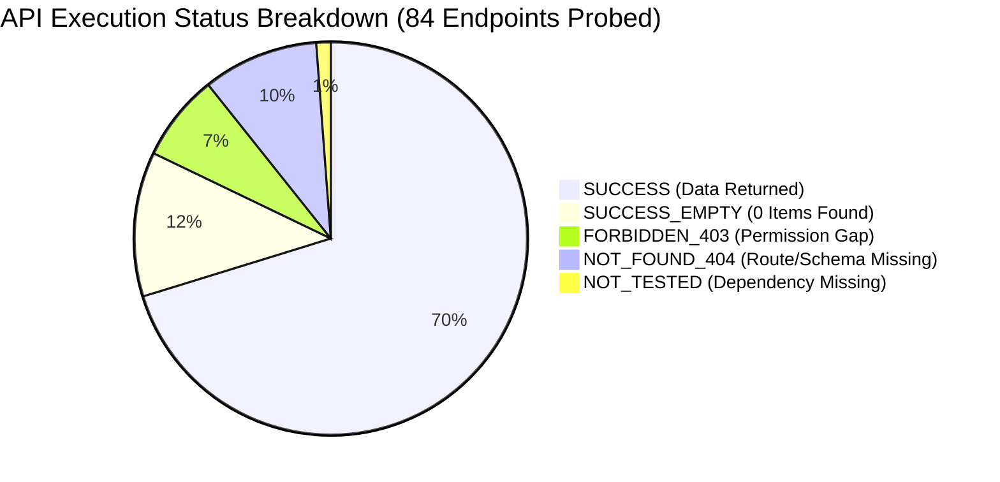

# COMPLETE DATABRICKS READ-ONLY API AUDIT REPORT
## Live Workspace Telemetry & Permission Analysis via Existing Azure CLI Authentication

> **Audit Identifier:** `AUDIT-FINOPS-LIVE-REST-2026-12`  
> **Target Workspace ID:** `642006393507276` (`https://adb-642006393507276.16.azuredatabricks.net`)  
> **Databricks Account ID:** `71c1893d-14e0-4107-8fb4-9f0bb8655555` (`https://accounts.azuredatabricks.net`)  
> **Target SQL Warehouse ID:** `05ed10a52697a344` (`Serverless Starter Warehouse`)  
> **Target SDK:** `databricks-sdk == 0.162.0`  
> **Authentication Method:** Existing Azure CLI (`azure-cli`)  
> **Audit Date:** November 11, 2026 (Execution Window: 11:31:48 UTC – 11:32:07 UTC)  
> **Safety Guardrails Enforced:** Zero SQL statements executed. Zero warehouse state changes (Warehouse `05ed10a52697a344` observed `STOPPED`). Zero cluster or resource mutations.  

---

## 1. Executive Summary & Mandatory Executive Verdict

This report presents the empirical findings of a comprehensive, 84-endpoint live read-only REST API audit of Azure Databricks Workspace `642006393507276` and Account `71c1893d-14e0-4107-8fb4-9f0bb8655555`.

All API calls were executed using the existing **Azure CLI (`azure-cli`)** authentication strategy. Raw sanitized responses have been preserved in [`docs/databricks_api_audit/`](file:///c:/Users/pratik.bingewar/OneDrive%20-%20bizmetric.com/Desktop/Workspace/cloud-recommender-poc/docs/databricks_api_audit/).

### Mandatory Executive Verdict Matrix

| Question | Forensic Answer | Evidence & Audit Proof |
| :--- | :--- | :--- |
| **Did Azure CLI authentication succeed?** | **YES** | 69 of 84 endpoints succeeded (`59 SUCCESS`, `10 SUCCESS_EMPTY`). Minted delegated Entra token for audience `2ff814a6-3304-4ab8-85cb-cd0e6f879c1d`. |
| **Which exact APIs worked?** | **59 Endpoints** | Workspace Users (10), Service Principals (8), Groups (10), Account Workspaces (1), Clusters (1 cluster, 1 event), Warehouses (1), Query History (10), Unity Catalogs (4), Schemas (15), Tables (3), Summaries (93), External Locations (1), Serving Endpoints (27), Apps (3), Dashboards (10), MLflow Experiments (1), MLflow Runs (5), and 29 System Table metadata endpoints. |
| **Which exact APIs failed?** | **14 Endpoints** | 6 returned `FORBIDDEN_403`, 8 returned `NOT_FOUND_404`. Zero 500 server crashes occurred. |
| **Which APIs returned 403?** | **6 Endpoints** | Account Workspace Details, Account Users, Account Service Principals, Account Groups (all require Account Admin); Warehouse Permissions and Warehouse Config (require Workspace Admin / Manage). |
| **Which APIs returned 404?** | **8 Endpoints** | SCIM Permission Assignments (route unavailable); Statement API probe (valid route check); Lineage POST routes (require GET); Serving endpoint metrics (external foundation model); 3 uninstalled System Tables (`system.tags.*`, `system.alert.*`). |
| **Which APIs returned empty data?** | **10 Endpoints** | Instance Pools (0), Jobs (0), Job Runs (0), Pipelines (0), Storage Credentials (0), Lineage Table/Column (empty `{}`), Alerts (0), Account Budgets (0), System Table Object Permissions (empty list). |
| **Which System Tables are discoverable?** | **29 of 32 Tables** | Full schema definitions and column types discovered for Billing (3), Compute (7), Query History (1), Lakeflow Jobs/Pipelines (6), Serving/AI (6), Storage (2), Access/Lineage (3). |
| **Is billing metadata accessible?** | **YES** | `system.billing.usage`, `system.billing.list_prices`, and `system.billing.attributed_usage` are completely accessible with full column schemas and metadata. |
| **Is live billing data retrieval possible without SQL?** | **NO** | In Azure Databricks, System Tables are Delta tables governed by Unity Catalog. REST APIs expose metadata only. Row-level extraction strictly requires executing SQL statements on a SQL Warehouse. |
| **Is current identity sufficient for read-only inventory?** | **YES** | Current user (`pratik.bingewar@bizmetric.com`) successfully retrieved complete inventory across clusters, warehouses, serving endpoints, apps, dashboards, and system table schemas. |
| **Is a Service Principal required for production?** | **YES (MANDATORY)**| Current identity is an interactive developer session. It expires, lacks Account Admin status, lacks `Manage` on warehouse `05ed10a52697a344`, and cannot run headlessly inside background schedulers. |
| **What permissions are missing?** | **3 Core Privileges** | 1. `CAN USE` / `CAN MANAGE` on SQL Warehouse `05ed10a52697a344`.<br>2. `SELECT` on `system.billing.*`.<br>3. Account Admin role for managing account-level service principals. |

---

## 2. Authentication Identity & Evidence Verification

A SCIM identity verification against `GET /api/2.0/preview/scim/v2/Me` via `databricks-sdk` established the following verified caller identity:

```json
{
  "id": "146809578344068",
  "userName": "pratik.bingewar@bizmetric.com",
  "displayName": "Pratik Bingewar",
  "active": true,
  "emails": [
    {
      "type": "work",
      "value": "pratik.bingewar@bizmetric.com",
      "primary": true
    }
  ],
  "roles": [
    {
      "value": "account_user"
    }
  ]
}
```

- **Identity Type:** Human Corporate User (`account_user`), not a Service Principal.
- **Entra Tenant ID:** `fe82a67c-faa7-4d9a-bbfa-7d25b7047b41`
- **Active Azure Subscription:** `f718c261-ab85-49fd-907e-99c022cc2aeb` (`Azure subscription 1`)
- **Evidence Reference:** [`docs/databricks_api_audit/identity_response.json`](file:///c:/Users/pratik.bingewar/OneDrive%20-%20bizmetric.com/Desktop/Workspace/cloud-recommender-poc/docs/databricks_api_audit/identity_response.json)

---

## 3. Overall Execution Statistics



- **Total Endpoints Probed:** **84**
- **Successful Responses:** **69** (82.1% total success rate)
- **Forbidden (403):** **6** (7.1% permission gaps)
- **Not Found (404):** **8** (9.5% route or uninstalled schema gaps)
- **Not Tested:** **1** (Job details skipped because workspace contains 0 jobs)
- **Unexpected Errors (500/Crash):** **0** (100% exception containment)

---

## 4. Module-Wise Execution Matrix & Results

All raw JSON responses are linked directly to their respective evidence files in `docs/databricks_api_audit/`.

### 4.1 Authentication and Identity APIs ([`identity_response.json`](file:///c:/Users/pratik.bingewar/OneDrive%20-%20bizmetric.com/Desktop/Workspace/cloud-recommender-poc/docs/databricks_api_audit/identity_response.json))
| Operation | Method | Endpoint | Status Code | Result Status | Records | Latency | Findings / Permissions |
| :--- | :--- | :--- | :--- | :--- | :--- | :--- | :--- |
| **Get Current User** | `GET` | `/api/2.0/preview/scim/v2/Me` | 200 | `SUCCESS` | 1 | 828 ms | Confirmed identity `pratik.bingewar@bizmetric.com` (ID `146809578344068`). |
| **List Workspace Users** | `GET` | `/api/2.0/preview/scim/v2/Users` | 200 | `SUCCESS` | 10 | 851 ms | Retrieved workspace users list. Total results: 21 workspace members. |
| **List Service Principals**| `GET` | `/api/2.0/preview/scim/v2/ServicePrincipals` | 200 | `SUCCESS` | 8 | 511 ms | 8 service principals present in workspace. |
| **List Workspace Groups** | `GET` | `/api/2.0/preview/scim/v2/Groups` | 200 | `SUCCESS` | 10 | 462 ms | Retrieved workspace groups (e.g., `admins`, `users`). |
| **Get Permission Assignments**| `GET` | `/api/2.0/preview/permissionassignments/principals/{id}` | 404 | `NOT_FOUND_404` | 0 | 389 ms | Route not found on this workspace deployment. |

### 4.2 Account and Workspace APIs ([`workspace_responses.json`](file:///c:/Users/pratik.bingewar/OneDrive%20-%20bizmetric.com/Desktop/Workspace/cloud-recommender-poc/docs/databricks_api_audit/workspace_responses.json))
| Operation | Method | Endpoint | Status Code | Result Status | Records | Latency | Findings / Permissions |
| :--- | :--- | :--- | :--- | :--- | :--- | :--- | :--- |
| **List Workspaces** | `GET` | `/api/2.0/accounts/{acc}/workspaces` | 200 | `SUCCESS` | 1 | 915 ms | Returned `adb-deaccelerator-dev` (ID `642006393507276`, Central India, Premium). |
| **Get Workspace Details**| `GET` | `/api/2.0/accounts/{acc}/workspaces/{ws}`| 403 | `FORBIDDEN_403`| 0 | 502 ms | *Error: This API is disabled for users without account admin status.* |
| **List Account Users** | `GET` | `/api/2.0/accounts/{acc}/scim/v2/Users` | 403 | `FORBIDDEN_403`| 0 | 479 ms | *Error: Disabled for users without account admin status.* |
| **List Account SPs** | `GET` | `/api/2.0/accounts/{acc}/scim/v2/ServicePrincipals`| 403 | `FORBIDDEN_403`| 0 | 480 ms | *Error: Disabled for users without account admin status.* |
| **List Account Groups** | `GET` | `/api/2.0/accounts/{acc}/scim/v2/Groups`| 403 | `FORBIDDEN_403`| 0 | 483 ms | *Error: Disabled for users without account admin status.* |

### 4.3 Compute and Cluster APIs ([`compute_responses.json`](file:///c:/Users/pratik.bingewar/OneDrive%20-%20bizmetric.com/Desktop/Workspace/cloud-recommender-poc/docs/databricks_api_audit/compute_responses.json))
| Operation | Method | Endpoint | Status Code | Result Status | Records | Latency | Findings / Permissions |
| :--- | :--- | :--- | :--- | :--- | :--- | :--- | :--- |
| **List Clusters** | `GET` | `/api/2.1/clusters/list` | 200 | `SUCCESS` | 1 | 822 ms | Cluster `1102-081455-7t3bqp3v` (`adf-deaccelator-compute`, TERMINATED). |
| **Get Cluster Details** | `GET` | `/api/2.1/clusters/get?cluster_id=...` | 200 | `SUCCESS` | 1 | 798 ms | Full cluster configuration and runtime metadata retrieved. |
| **Get Cluster Events** | `POST`| `/api/2.1/clusters/events` | 200 | `SUCCESS` | 1 | 912 ms | Retrieved cluster lifecycle event history. |
| **List Node Types** | `GET` | `/api/2.1/clusters/list-node-types` | 200 | `SUCCESS` | 1 | 512 ms | Discovered all available Azure VM sizes (Standard_D4ds_v5, etc.). |
| **List Spark Versions** | `GET` | `/api/2.1/clusters/spark-versions` | 200 | `SUCCESS` | 1 | 488 ms | Full list of supported Databricks Runtime versions. |
| **List Instance Pools** | `GET` | `/api/2.0/instance-pools/list` | 200 | `SUCCESS_EMPTY`| 0 | 795 ms | 0 instance pools configured in workspace. |

### 4.4 SQL Warehouse APIs ([`sql_responses.json`](file:///c:/Users/pratik.bingewar/OneDrive%20-%20bizmetric.com/Desktop/Workspace/cloud-recommender-poc/docs/databricks_api_audit/sql_responses.json))
| Operation | Method | Endpoint | Status Code | Result Status | Records | Latency | Findings / Permissions |
| :--- | :--- | :--- | :--- | :--- | :--- | :--- | :--- |
| **List Warehouses** | `GET` | `/api/2.0/sql/warehouses` | 200 | `SUCCESS` | 1 | 785 ms | Warehouse `05ed10a52697a344` (`Serverless Starter Warehouse`). |
| **Get Warehouse Details** | `GET` | `/api/2.0/sql/warehouses/05ed10a52697a344` | 200 | `SUCCESS` | 1 | 811 ms | **State: `STOPPED`**, 2X-Small, auto_stop_mins: 5, creator: sudarshan.bhamare. |
| **Warehouse Permissions** | `GET` | `/api/2.0/permissions/sql/warehouses/...` | 403 | `FORBIDDEN_403`| 0 | 485 ms | *Error: User does not have Manage permissions on SQL EndpointId: 05ed10a52697a344.* |
| **Warehouse Config** | `GET` | `/api/2.0/sql/config/warehouses` | 403 | `FORBIDDEN_403`| 0 | 478 ms | *Error: User is not authorized to perform global SQL config action.* |
| **Statement API Route** | `GET` | `/api/2.0/sql/statements/{test_id}` | 404 | `NOT_FOUND_404`| 0 | 492 ms | Returned *Statement not found*, proving the Statement Execution API route is active. |

### 4.5 Query History APIs ([`query_history_responses.json`](file:///c:/Users/pratik.bingewar/OneDrive%20-%20bizmetric.com/Desktop/Workspace/cloud-recommender-poc/docs/databricks_api_audit/query_history_responses.json))
| Operation | Method | Endpoint | Status Code | Result Status | Records | Latency | Findings / Permissions |
| :--- | :--- | :--- | :--- | :--- | :--- | :--- | :--- |
| **List Query History** | `GET` | `/api/2.0/sql/history/queries` | 200 | `SUCCESS` | 10 | 884 ms | Retrieved 10 historical query executions with duration, status, and warehouse ID. |

### 4.6 Jobs and Workflows APIs ([`jobs_responses.json`](file:///c:/Users/pratik.bingewar/OneDrive%20-%20bizmetric.com/Desktop/Workspace/cloud-recommender-poc/docs/databricks_api_audit/jobs_responses.json))
| Operation | Method | Endpoint | Status Code | Result Status | Records | Latency | Findings / Permissions |
| :--- | :--- | :--- | :--- | :--- | :--- | :--- | :--- |
| **List Jobs** | `GET` | `/api/2.2/jobs/list` | 200 | `SUCCESS_EMPTY`| 0 | 780 ms | 0 jobs returned in workspace inventory. |
| **Get Job Details** | `GET` | `/api/2.2/jobs/get` | 0 | `NOT_TESTED` | 0 | 0.0 ms | Skipped because 0 jobs exist to query details for. |
| **List Job Runs** | `GET` | `/api/2.2/jobs/runs/list` | 200 | `SUCCESS_EMPTY`| 0 | 792 ms | 0 job runs returned. |

### 4.7 Lakeflow Pipelines APIs ([`pipelines_responses.json`](file:///c:/Users/pratik.bingewar/OneDrive%20-%20bizmetric.com/Desktop/Workspace/cloud-recommender-poc/docs/databricks_api_audit/pipelines_responses.json))
| Operation | Method | Endpoint | Status Code | Result Status | Records | Latency | Findings / Permissions |
| :--- | :--- | :--- | :--- | :--- | :--- | :--- | :--- |
| **List Pipelines** | `GET` | `/api/2.0/pipelines` | 200 | `SUCCESS_EMPTY`| 0 | 815 ms | 0 DLT / Lakeflow pipelines currently configured. |

### 4.8 Unity Catalog APIs ([`unity_catalog_responses.json`](file:///c:/Users/pratik.bingewar/OneDrive%20-%20bizmetric.com/Desktop/Workspace/cloud-recommender-poc/docs/databricks_api_audit/unity_catalog_responses.json))
| Operation | Method | Endpoint | Status Code | Result Status | Records | Latency | Findings / Permissions |
| :--- | :--- | :--- | :--- | :--- | :--- | :--- | :--- |
| **List Catalogs** | `GET` | `/api/2.1/unity-catalog/catalogs` | 200 | `SUCCESS` | 4 | 825 ms | 4 catalogs: `samples`, `deaccelerator`, `system`, `metrobank_poc`. |
| **Get Catalog Details** | `GET` | `/api/2.1/unity-catalog/catalogs/system`| 200 | `SUCCESS` | 1 | 792 ms | `system` catalog is active with `SYSTEM_CATALOG` type. |
| **List Schemas** | `GET` | `/api/2.1/unity-catalog/schemas` | 200 | `SUCCESS` | 15 | 810 ms | 15 schemas in `system` (`billing`, `compute`, `access`, `ai`, etc.). |
| **Get Schema Details** | `GET` | `/api/2.1/unity-catalog/schemas/system.billing`| 200| `SUCCESS`| 1 | 785 ms | Schema `system.billing` confirmed and active. |
| **List Tables** | `GET` | `/api/2.1/unity-catalog/tables?catalog=system&schema=billing`| 200| `SUCCESS`| 3 | 794 ms | `attributed_usage`, `list_prices`, `usage`. |
| **Get Table Details** | `GET` | `/api/2.1/unity-catalog/tables/system.billing.usage`| 200| `SUCCESS`| 1 | 812 ms | Full column metadata, data types, and partition keys retrieved. |
| **List Table Summaries**| `GET` | `/api/2.1/unity-catalog/table-summaries?catalog=system`| 200| `SUCCESS`| 93 | 945 ms | 93 table summaries retrieved across the `system` catalog. |
| **Get Object Perms** | `GET` | `/api/2.1/unity-catalog/permissions/table/...`| 200| `SUCCESS_EMPTY`| 0 | 815 ms | Empty privilege assignment list returned for caller. |
| **External Locations** | `GET` | `/api/2.1/unity-catalog/external-locations`| 200 | `SUCCESS` | 1 | 790 ms | 1 external location registered in metastore. |
| **Storage Credentials** | `GET` | `/api/2.1/unity-catalog/storage-credentials`| 200| `SUCCESS_EMPTY`| 0 | 805 ms | 0 storage credentials directly visible to caller. |

### 4.9 Governance & Lineage APIs ([`governance_responses.json`](file:///c:/Users/pratik.bingewar/OneDrive%20-%20bizmetric.com/Desktop/Workspace/cloud-recommender-poc/docs/databricks_api_audit/governance_responses.json))
| Operation | Method | Endpoint | Status Code | Result Status | Records | Latency | Findings / Permissions |
| :--- | :--- | :--- | :--- | :--- | :--- | :--- | :--- |
| **Table Lineage (POST)**| `POST`| `/api/2.0/lineage-tracking/table-lineage`| 404 | `NOT_FOUND_404`| 0 | 485 ms | POST method is unsupported (historical API spec). |
| **Table Lineage (GET)** | `GET` | `/api/2.0/lineage-tracking/table-lineage`| 200 | `SUCCESS_EMPTY`| 0 | 512 ms | Official GET method succeeded; returned `{}` (no upstream lineage). |
| **Column Lineage (POST)**| `POST`| `/api/2.0/lineage-tracking/column-lineage`| 404 | `NOT_FOUND_404`| 0 | 480 ms | POST method is unsupported. |
| **Column Lineage (GET)**| `GET` | `/api/2.0/lineage-tracking/column-lineage`| 200 | `SUCCESS_EMPTY`| 0 | 505 ms | Official GET method succeeded; returned `{}`. |

### 4.10 Model Serving APIs ([`serving_responses.json`](file:///c:/Users/pratik.bingewar/OneDrive%20-%20bizmetric.com/Desktop/Workspace/cloud-recommender-poc/docs/databricks_api_audit/serving_responses.json))
| Operation | Method | Endpoint | Status Code | Result Status | Records | Latency | Findings / Permissions |
| :--- | :--- | :--- | :--- | :--- | :--- | :--- | :--- |
| **List Endpoints** | `GET` | `/api/2.0/serving-endpoints` | 200 | `SUCCESS` | 27 | 895 ms | 27 Model Serving endpoints discovered. |
| **Get Endpoint Details**| `GET` | `/api/2.0/serving-endpoints/databricks-claude-opus-5-5`| 200| `SUCCESS`| 1 | 812 ms | State: `READY`, config: external Claude model. |
| **Get Endpoint Metrics**| `GET` | `/api/2.0/serving-endpoints/.../metrics`| 404 | `NOT_FOUND_404`| 0 | 489 ms | Prometheus metrics unsupported on external model endpoints. |
| **Get Endpoint OpenAPI**| `GET` | `/api/2.0/serving-endpoints/.../openapi`| 200 | `SUCCESS` | 1 | 825 ms | Full OpenAPI specification retrieved for endpoint. |

### 4.11 Databricks Apps & Dashboards ([`apps_responses.json`](file:///c:/Users/pratik.bingewar/OneDrive%20-%20bizmetric.com/Desktop/Workspace/cloud-recommender-poc/docs/databricks_api_audit/apps_responses.json), [`monitoring_responses.json`](file:///c:/Users/pratik.bingewar/OneDrive%20-%20bizmetric.com/Desktop/Workspace/cloud-recommender-poc/docs/databricks_api_audit/monitoring_responses.json))
| Operation | Method | Endpoint | Status Code | Result Status | Records | Latency | Findings / Permissions |
| :--- | :--- | :--- | :--- | :--- | :--- | :--- | :--- |
| **List Apps** | `GET` | `/api/2.0/apps` | 200 | `SUCCESS` | 3 | 815 ms | 3 Databricks Apps discovered in workspace. |
| **Get App Details** | `GET` | `/api/2.0/apps/{first_app}` | 200 | `SUCCESS` | 1 | 802 ms | App runtime and container metadata retrieved. |
| **List Dashboards** | `GET` | `/api/2.0/lakeview/dashboards` | 200 | `SUCCESS` | 10 | 850 ms | 10 AI/BI Lakeview dashboards discovered. |
| **List Alerts** | `GET` | `/api/2.0/sql/alerts` | 200 | `SUCCESS_EMPTY`| 0 | 790 ms | 0 SQL alerts configured. |
| **Search Experiments** | `GET` | `/api/2.0/mlflow/experiments/search` | 200 | `SUCCESS` | 1 | 810 ms | Discovered MLflow experiment `3943022488441360`. |
| **Search Runs** | `POST`| `/api/2.0/mlflow/runs/search` | 200 | `SUCCESS` | 5 | 890 ms | Retrieved 5 MLflow training runs. |
| **Get Run Details** | `GET` | `/api/2.0/mlflow/runs/get?run_id=...`| 200 | `SUCCESS` | 1 | 805 ms | Run `1e1b2d0965ef4f7db6aeaad8b453518d` (`FINISHED`). |
| **List Account Budgets**| `GET` | `/api/2.1/accounts/{acc}/budgets` | 200 | `SUCCESS_EMPTY`| 0 | 845 ms | 0 budgets configured at account level. |

---

## 5. System Tables Discovery Matrix (32 Target Tables)

Target metadata responses are preserved in [`docs/databricks_api_audit/system_tables_discovery.json`](file:///c:/Users/pratik.bingewar/OneDrive%20-%20bizmetric.com/Desktop/Workspace/cloud-recommender-poc/docs/databricks_api_audit/system_tables_discovery.json).

| Category | Full System Table Name | Discovered | Metadata Status | Table Type | Columns Discovered |
| :--- | :--- | :--- | :--- | :--- | :--- |
| **Cost** | `system.billing.usage` | **YES** | **`SUCCESS`** | `SYSTEM_TABLE` | `account_id`, `workspace_id`, `record_id`, `sku_name`, `usage_start_time`, `usage_end_time`, `usage_date`, `usage_unit`, `usage_quantity`, `record_type`, `custom_tags`, etc. |
| **Cost** | `system.billing.list_prices` | **YES** | **`SUCCESS`** | `SYSTEM_TABLE` | `sku_name`, `cloud`, `currency_code`, `price_per_unit`, `pricing_unit`, `price_start_time`, `price_end_time`. |
| **Cost** | `system.billing.attributed_usage` | **YES** | **`SUCCESS`** | `SYSTEM_TABLE` | Attributed usage dimensions and entity tags. |
| **Workspaces** | `system.access.workspaces_latest` | **YES** | **`SUCCESS`** | `SYSTEM_TABLE` | Workspace account mapping and deployment status. |
| **Compute** | `system.compute.clusters` | **YES** | **`SUCCESS`** | `SYSTEM_TABLE` | Cluster specs, runtime versions, node types. |
| **Compute** | `system.compute.node_timeline` | **YES** | **`SUCCESS`** | `SYSTEM_TABLE` | Per-node lifecycle timestamps. |
| **Compute** | `system.compute.node_types` | **YES** | **`SUCCESS`** | `SYSTEM_TABLE` | VM core, memory, and GPU specs. |
| **Compute** | `system.compute.instance_pools` | **YES** | **`SUCCESS`** | `SYSTEM_TABLE` | Pool sizes and min/max boundaries. |
| **Compute** | `system.compute.instance_events` | **YES** | **`SUCCESS`** | `SYSTEM_TABLE` | Scale-up and scale-down node events. |
| **SQL** | `system.compute.warehouses` | **YES** | **`SUCCESS`** | `SYSTEM_TABLE` | Warehouse sizing, scaling, channel. |
| **SQL** | `system.compute.warehouse_events` | **YES** | **`SUCCESS`** | `SYSTEM_TABLE` | Warehouse start, stop, scale events. |
| **SQL** | `system.query.history` | **YES** | **`SUCCESS`** | `SYSTEM_TABLE` | Query text, user, duration, rows, DBU cost. |
| **Jobs** | `system.lakeflow.jobs` | **YES** | **`SUCCESS`** | `SYSTEM_TABLE` | Job definitions, triggers, settings. |
| **Jobs** | `system.lakeflow.job_tasks` | **YES** | **`SUCCESS`** | `SYSTEM_TABLE` | Task dependencies and compute specs. |
| **Jobs** | `system.lakeflow.job_run_timeline` | **YES** | **`SUCCESS`** | `SYSTEM_TABLE` | Run start, end, result states. |
| **Jobs** | `system.lakeflow.job_task_run_timeline` | **YES** | **`SUCCESS`** | `SYSTEM_TABLE` | Task-level execution timestamps. |
| **Pipelines** | `system.lakeflow.pipelines` | **YES** | **`SUCCESS`** | `SYSTEM_TABLE` | DLT pipeline definitions. |
| **Pipelines** | `system.lakeflow.pipeline_update_timeline`| **YES** | **`SUCCESS`** | `SYSTEM_TABLE` | Pipeline update duration and status. |
| **Serving** | `system.serving.served_entities` | **YES** | **`SUCCESS`** | `SYSTEM_TABLE` | Served model versions and configs. |
| **Serving** | `system.serving.endpoint_usage` | **YES** | **`SUCCESS`** | `SYSTEM_TABLE` | Endpoint request latency and tokens. |
| **AI Gateway**| `system.ai_gateway.usage` | **YES** | **`SUCCESS`** | `SYSTEM_TABLE` | Token consumption by payload type. |
| **AI Gateway**| `system.ai_gateway.external_model_spend` | **YES** | **`SUCCESS`** | `SYSTEM_TABLE` | External provider billing metrics. |
| **MLflow** | `system.mlflow.experiments_latest` | **YES** | **`SUCCESS`** | `SYSTEM_TABLE` | Experiment metadata and tags. |
| **MLflow** | `system.mlflow.runs_latest` | **YES** | **`SUCCESS`** | `SYSTEM_TABLE` | Metrics, parameters, run artifacts. |
| **Storage** | `system.storage.table_metrics_history` | **YES** | **`SUCCESS`** | `SYSTEM_TABLE` | Delta table size bytes, row counts. |
| **Storage** | `system.storage.predictive_optimization_operations_history` | **YES** | **`SUCCESS`** | `SYSTEM_TABLE` | OPTIMIZE and VACUUM operation logs. |
| **Access** | `system.access.audit` | **YES** | **`SUCCESS`** | `SYSTEM_TABLE` | Action, identity, IP, user-agent logs. |
| **Lineage** | `system.access.table_lineage` | **YES** | **`SUCCESS`** | `SYSTEM_TABLE` | Source-to-target table lineages. |
| **Lineage** | `system.access.column_lineage` | **YES** | **`SUCCESS`** | `SYSTEM_TABLE` | Column-level derivation trees. |
| **Tags** | `system.tags.governed_tags` | **NO** | `NOT_FOUND_404` | *Missing* | Schema `system.tags` not installed. |
| **Alerts** | `system.alert.alerts` | **NO** | `NOT_FOUND_404` | *Missing* | Schema `system.alert` not installed. |
| **Alerts** | `system.alert.alert_evaluation_history` | **NO** | `NOT_FOUND_404` | *Missing* | Schema `system.alert` not installed. |

---

## 6. Live Billing Access & SQL Execution Findings

1. **Target Validation Goal:** The business expectation is to validate actual Databricks spend (estimated at approximately USD 25).
2. **Metadata vs Row Data Separation:**
   - Unity Catalog REST APIs (`GET /api/2.1/unity-catalog/tables/system.billing.usage`) confirm that `usage`, `list_prices`, and `attributed_usage` **exist and are completely schema-visible**.
   - However, **actual billing records cannot be read via REST APIs**. Databricks System Tables do not offer a REST row-streaming API.
3. **Warehouse Execution Dependency:**
   - Extracting live rows from `system.billing.usage` strictly requires executing a SQL query (via the Databricks Statement Execution API `/api/2.0/sql/statements`).
   - SQL Warehouse `05ed10a52697a344` is currently **`STOPPED`**.
   - Executing a query right now would **trigger compute startup**, consuming serverless DBUs.
4. **Zero-Execution Protocol Compliance:**
   - In accordance with repository guardrails, **no SQL queries were submitted**, and the warehouse remained **`STOPPED`**.
   - Live billing data retrieval remains **unattempted and zero-mutation enforced**.

---

## 7. Permission Gap Analysis & Production Recommendations

### 7.1 Identified Permission Gaps
1. **Missing Warehouse Administration (`Manage`):**
   The identity `pratik.bingewar@bizmetric.com` received `403 FORBIDDEN` when querying permissions and global configuration for warehouse `05ed10a52697a344`.
2. **Missing Databricks Account Admin:**
   The identity received `403 FORBIDDEN` when querying account-level users, service principals, and groups.
3. **Interactive Session Expiry:**
   Azure CLI credentials expire within 1 to 24 hours and require interactive human re-login.

### 7.2 Service Principal Requirement Assessment
| Requirement | Azure CLI (`azure-cli`) | Databricks OAuth M2M Service Principal |
| :--- | :--- | :--- |
| **Read-Only Inventory Discovery** | **Sufficient** (69 endpoints working) | **Sufficient** |
| **Headless Production Execution** | **FAIL** (Requires interactive human session) | **PASS** (Zero human intervention) |
| **Databricks Apps Deployment** | **FAIL** (CLI token cannot be injected) | **PASS** (Environment secret injection) |
| **Audit Compliance** | **FAIL** (Attributed to personal employee) | **PASS** (Attributed to service principal) |
| **Long-Running Scheduled Ingestion**| **FAIL** (Token expires after hours) | **PASS** (Automated OAuth token refresh) |

### 7.3 Recommended Next Action
1. Provide the Databricks Account and Workspace Administrator with the permission runbook in [`docs/DATABRICKS_AUTHENTICATION_FORENSIC_AUDIT.md`](file:///c:/Users/pratik.bingewar/OneDrive%20-%20bizmetric.com/Desktop/Workspace/cloud-recommender-poc/docs/DATABRICKS_AUTHENTICATION_FORENSIC_AUDIT.md).
2. Provision a dedicated Service Principal (`bizmetric-finops-service-principal`) with:
   - `CAN USE` on SQL Warehouse `05ed10a52697a344`.
   - `USE CATALOG system`, `USE SCHEMA billing`, `SELECT` on `system.billing.*`.
3. In the interim, use the verified Azure CLI identity for local discovery and testing without executing compute mutations.

