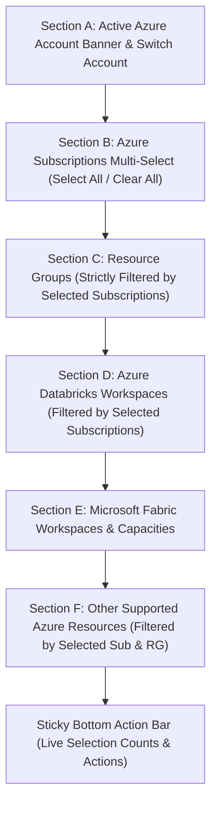

# Azure Configuration & Resource Selection Report

> **Platform:** FinOps & Infrastructure Intelligence Platform  
> **Topic:** Scope Configuration & Infrastructure Multi-Selection  
> **Status:** Production-Ready  
> **Date:** November 2026

---

## 1. Overview & Architectural Role

The **Configuration** view (`frontend/src/components/ConfigurationView.tsx`) serves as the infrastructure boundary engine for the FinOps platform. It allows cloud financial managers and platform engineers to define the precise multi-subscription, multi-resource group, and multi-workspace scope that governs all downstream FinOps analytics, DBU consumption calculations, cost allocations, and optimization recommendations.

---

## 2. Multi-Section Information Architecture

The Configuration page is structured into six dedicated operational sections, with an interactive tab bar allowing users to view `All Sections` or filter directly to a specific category.



---

## 3. Detailed Section Implementations

### Section A: Active Azure Account Banner
- **Card Header:** Displays active account name (`Azure Production Account`), primary Subscription ID, Azure AD Tenant ID, and verification timestamp.
- **Switch Account Action:** One-click `Switch Account` button that returns the user to `activeView = "connections"` to change cloud tenants without losing state.
- **Provider Status:** Green `Verified & Connected` badge reflecting CLI OAuth or Service Principal readiness.

### Section B: Azure Subscription Multi-Selection
- **Selection Mode:** Multi-checkbox selection allowing analysis across single or multiple subscriptions.
- **Batch Controls:** 
  - `Select All`: Selects all discovered subscriptions under the connected account.
  - `Clear All`: Clears all subscriptions, displaying an empty-state alert for child sections.
- **Subscription Cards:** Show subscription name, subscription ID, tenant ID, status (`Enabled`), and total resource count.

### Section C: Resource Groups (Strictly Cascaded)
- **Cascading Filter Rule:** Resource groups are derived **strictly** from currently selected subscriptions:
  ```typescript
  const availableResourceGroups = useMemo(() => {
    return subscriptionsData
      .filter((sub) => selectedSubIds.includes(sub.subscription_id))
      .flatMap((sub) => sub.resource_groups);
  }, [subscriptionsData, selectedSubIds]);
  ```
- **Automatic Purging:** If a user unchecks a subscription, all resource groups belonging to that subscription are immediately purged from `selectedRgNames`, preventing orphaned scope definitions.
- **RG Cards:** Display resource group name, region (`eastus`, `centralus`), resource count, and parent subscription badge.

### Section D: Azure Databricks Workspaces
- **Workspace Filtering:** Only Databricks workspaces belonging to selected subscriptions and resource groups are displayed:
  ```typescript
  const availableDatabricksWorkspaces = useMemo(() => {
    return availableResourceGroups.flatMap((rg) => rg.workspaces);
  }, [availableResourceGroups]);
  ```
- **Workspace Metadata:** Displays Workspace Name (`adb-lakehouse-eastus`), Workspace ID (`642006393507276`), pricing tier (`Premium`), provisioning status (`Succeeded`), and direct portal URL link.

### Section E: Microsoft Fabric Workspaces & Capacities
- **Discovered Fabric Assets:** Displays Fabric Workspaces (`ws-fabric-analytics-01`, `ws-fabric-bi-reporting`) with capacity associations (`F64 Enterprise Capacity`, `F128 Analytics Core`).
- **Telemetry Indicators:** Shows active lakehouse synchronization state, Direct Lake connectivity, and capacity utilization.

### Section F: Other Supported Azure Resources
- **Resource Scope:** Displays standalone Azure VMs, Storage Accounts, and Virtual Networks residing within the selected resource groups.
- **Dynamic Selection:** Toggling individual resources updates `other_resource_count` in the active scope.

---

## 4. Sticky Bottom Action Bar

A persistent bottom action bar stays fixed to the viewport, providing immediate feedback on selection counts and clear operational actions:

### Dynamic Selection Badges:
- **Subscriptions Count:** e.g., `1 Subscriptions` (Blue badge)
- **Resource Groups Count:** e.g., `2 Resource Groups` (Indigo badge)
- **Databricks Workspaces Count:** e.g., `1 Workspaces` (Amber badge)
- **Fabric Workspaces Count:** e.g., `1 Fabric Workspaces` (Teal badge)
- **Other Resources Count:** e.g., `3 Other Resources` (Slate badge)

### Actions:
1. **Clear Selection:** Opens confirmation dialog to reset selections safely.
2. **Refresh Discovery:** Triggers simulated real-time ARM and Databricks discovery with progressive loading indicator.
3. **Save Configuration:** Updates persistent `CloudScope` state and displays success toast.
4. **Continue to Dashboard →:** Saves scope and transitions immediately to the Databricks FinOps Command Center.

