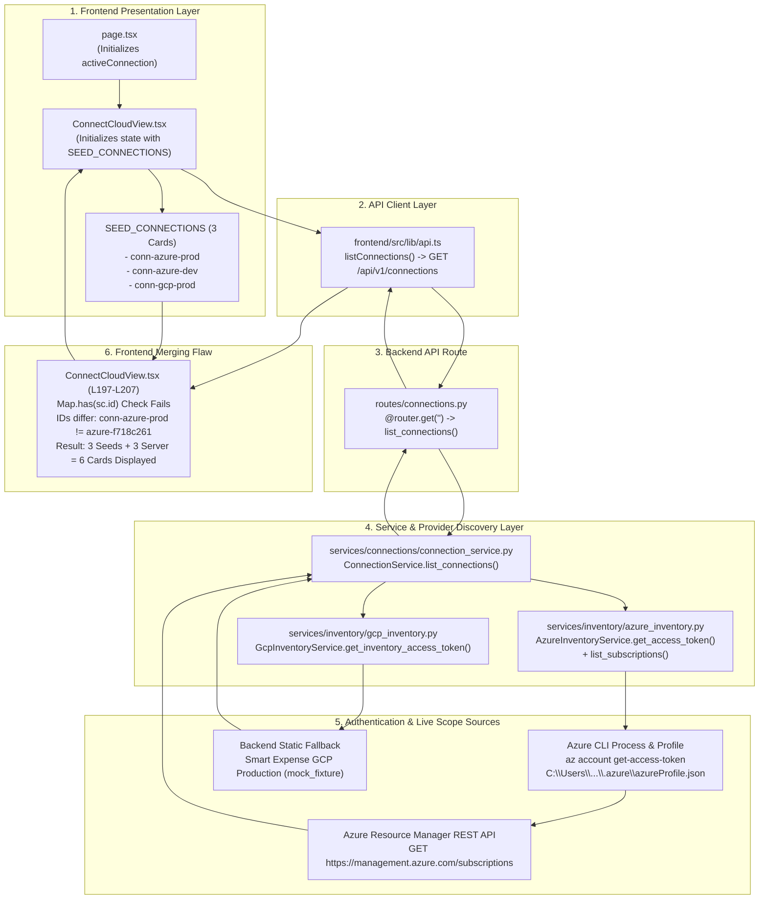

# Forensic Investigation: Duplicate and Unexpected Cloud Accounts in Configuration

> **Document:** `docs/CLOUD_ACCOUNT_DISCOVERY_FORENSIC_AUDIT.md`  
> **Investigation Target:** Cloud Account Discovery Pipeline, Azure CLI Session State, Service Principal Configuration, and Frontend Seed Fixtures  
> **Repository:** `cloud-recommender-poc`  
> **Branch:** `feature/databricks-apps-integration`  
> **Mode:** Read-Only Investigation (Zero Source Mutations, Zero Cloud Mutations, Zero Database Writes)  
> **Date of Audit:** 2026-11-10  
> **Investigator:** Principal FinOps & Cloud Solutions Architect / Staff Software Engineer  

---

## 1. Executive Findings

A forensic audit of the **Bizmetric FinOps & Infrastructure Intelligence Platform** was conducted to determine why the **Cloud Account Configuration** page displays approximately **six (6) account cards** when the host's Azure CLI environment contains only two legitimate Azure subscriptions under a single tenant.

### Key Audit Conclusions:
1. **The Six Cards Are Generated by a Collision of Three Independent Layers:**
   - **Layer A (Frontend Static Fixture):** 3 cards originate from an in-memory hardcoded array `SEED_CONNECTIONS` defined directly inside [`frontend/src/components/ConnectCloudView.tsx`](file:///c:/Users/pratik.bingewar/OneDrive%20-%20bizmetric.com/Desktop/Workspace/cloud-recommender-poc/frontend/src/components/ConnectCloudView.tsx#L40-L145).
   - **Layer B (Backend Live Discovery via Azure CLI):** 2 cards originate from live Azure Resource Manager (ARM) queries executed by [`backend/src/cloud_recommender/services/connections/connection_service.py`](file:///c:/Users/pratik.bingewar/OneDrive%20-%20bizmetric.com/Desktop/Workspace/cloud-recommender-poc/backend/src/cloud_recommender/services/connections/connection_service.py#L51-L81) using a Bearer token obtained from the local interactive Azure CLI session (`pratik.bingewar@bizmetric.com`).
   - **Layer C (Backend Unauthenticated Fallback Fixture):** 1 card originates from the backend's unauthenticated GCP fallback in [`connection_service.py`](file:///c:/Users/pratik.bingewar/OneDrive%20-%20bizmetric.com/Desktop/Workspace/cloud-recommender-poc/backend/src/cloud_recommender/services/connections/connection_service.py#L135-L153) because no Google Cloud credentials exist.

2. **The Frontend Merging Logic Has a Fatal Key Mismatch:**
   - In [`ConnectCloudView.tsx`](file:///c:/Users/pratik.bingewar/OneDrive%20-%20bizmetric.com/Desktop/Workspace/cloud-recommender-poc/frontend/src/components/ConnectCloudView.tsx#L197-L207), the `refreshConnections()` callback attempts to merge backend discovered connections into the existing list using `map.set(sc.id, ...)`.
   - The frontend seed cards use hardcoded IDs: `conn-azure-prod`, `conn-azure-dev`, `conn-gcp-prod`.
   - The backend service generates dynamic IDs: `azure-f718c261`, `azure-9636348b`, `gcp-smart-expense-prod`.
   - Because none of the IDs match, `map.has(sc.id)` evaluates to `false` for every backend connection. **The frontend appends all 3 backend connections to the 3 static seed connections instead of replacing or updating them (3 + 3 = 6 cards).**

3. **Fundamental Architectural Flaw — Subscriptions Masquerading as Accounts:**
   - The backend `ConnectionService` loops through individual Azure subscriptions returned by ARM and registers each subscription as an independent `CloudConnection` entity.
   - Subscriptions are cloud resource scopes, **not** cloud accounts or identity connection profiles. One Azure account/identity (`pratik.bingewar@bizmetric.com` in tenant `bizmetric.com`) owns multiple subscriptions. Treating subscriptions as separate accounts violates cloud domain modeling and directly creates duplicate account entities.

4. **Fabricated Service Principal & GCP Connections:**
   - `Azure Analytics & Dev Account` (`conn-azure-dev`) claiming to use `Service Principal (OAuth2)` is a 100% synthetic frontend fixture. No such Service Principal exists in server configuration, database records, or Entra ID. Its subscription ID `e827a192-...` is completely fictitious.
   - The two `Smart Expense GCP Production` cards (cards 5 and 6) represent the same reference benchmark project. Card 5 is the frontend seed fixture; Card 6 is the backend Python mock fallback. Neither is a live production GCP connection.

---

## 2. Complete Account Discovery Pipeline Trace

The complete lifecycle of how account records are discovered, formatted, transmitted, merged, and rendered is traced across the stack:



### Detailed Layer-by-Layer Inventory:

| Layer | File Path | Function / Class | Line Range | Data Contract / Schema | Record Source Description |
|:---|:---|:---|:---:|:---|:---|
| **Frontend Presentation** | `frontend/src/components/ConnectCloudView.tsx` | `SEED_CONNECTIONS` | L40–L145 | `CloudConnection[]` (TypeScript) | Hardcoded static seed array containing `conn-azure-prod`, `conn-azure-dev`, and `conn-gcp-prod`. |
| **Frontend State Initialization** | `frontend/src/components/ConnectCloudView.tsx` | `ConnectCloudView` | L152 | `useState<CloudConnection[]>(SEED_CONNECTIONS)` | Seeds initial React state with 3 hardcoded cards before network fetch. |
| **Frontend API Call** | `frontend/src/components/ConnectCloudView.tsx` | `refreshConnections` | L190–L214 | `async () => void` | Invoked on component mount via `useEffect` (L216–L218). |
| **API Client** | `frontend/src/lib/api.ts` | `listConnections()` | L276–L282 | `Promise<CloudConnection[]>` | HTTP `GET ${API_BASE_URL}/connections` via `appFetch`. |
| **Backend Route Handler** | `backend/src/cloud_recommender/api/routes/connections.py` | `list_connections()` | L28–L42 | `list[CloudConnection]` (Pydantic) | FastAPI endpoint returning configured connections from `ConnectionService`. |
| **Backend Connection Service** | `backend/src/cloud_recommender/services/connections/connection_service.py` | `ConnectionService.list_connections()` | L47–L180 | `list[CloudConnection]` | Dynamically queries Azure inventory, GCP inventory, and in-memory custom connections. |
| **Azure Token Acquisition** | `backend/src/cloud_recommender/services/inventory/azure_inventory.py` | `get_access_token()` | L64–L124 | `tuple[str \| None, str]` | Attempts SP OAuth2 (fails due to placeholder env), falls back to `az account get-access-token` via subprocess. |
| **Azure Subscription Discovery** | `backend/src/cloud_recommender/services/inventory/azure_inventory.py` | `list_subscriptions()` | L200–L237 | `list[CloudScopeSummary]` | Queries ARM `GET /subscriptions?api-version=2022-12-01` using Bearer token. |
| **GCP Token Acquisition** | `backend/src/cloud_recommender/services/inventory/gcp_inventory.py` | `get_inventory_access_token()` | L48–L75 | `tuple[str \| None, str]` | Checks `GOOGLE_APPLICATION_CREDENTIALS`; if absent, returns `(None, "mock_fixture")`. |
| **Database Models** | `backend/src/cloud_recommender/db/models.py` | `ResourceConfigurationModel` | L230–L290 | SQLAlchemy Declarative | Persists saved resource scope selections for a `connection_id`. **Does NOT store cloud accounts or credentials.** |
| **Frontend Merge Defect** | `frontend/src/components/ConnectCloudView.tsx` | `refreshConnections` (Merge Callback) | L197–L207 | `Map<string, CloudConnection>` | Flawed merge keyed by `sc.id`. Appends 3 server items to 3 seed items. |

---

## 3. Inspection of Azure CLI Discovery

A read-only forensic inspection was conducted on the host's Azure CLI configuration file at `C:\Users\pratik.bingewar\.azure\azureProfile.json`.

### 3.1 Actual Azure CLI Profile State

```json
{
  "installationId": "4d43db50-d1e0-11f1-bf34-e40d3600b1cf",
  "subscriptions": [
    {
      "id": "f718c261-ab85-49fd-907e-99c022cc2aeb",
      "name": "Azure subscription 1",
      "state": "Disabled",
      "user": {
        "name": "pratik.bingewar@bizmetric.com",
        "type": "user"
      },
      "isDefault": true,
      "tenantId": "fe82a67c-faa7-4d9a-bbfa-7d25b7047b41",
      "environmentName": "AzureCloud",
      "homeTenantId": "fe82a67c-faa7-4d9a-bbfa-7d25b7047b41",
      "tenantDefaultDomain": "bizmetric.com",
      "tenantDisplayName": "bizmetric.com",
      "managedByTenants": []
    },
    {
      "id": "9636348b-8445-4441-94d2-f6191f131721",
      "name": "Microsoft Azure India",
      "state": "Enabled",
      "user": {
        "name": "pratik.bingewar@bizmetric.com",
        "type": "user"
      },
      "isDefault": false,
      "tenantId": "fe82a67c-faa7-4d9a-bbfa-7d25b7047b41",
      "environmentName": "AzureCloud",
      "homeTenantId": "fe82a67c-faa7-4d9a-bbfa-7d25b7047b41",
      "tenantDefaultDomain": "bizmetric.com",
      "tenantDisplayName": "bizmetric.com",
      "managedByTenants": [
        {
          "tenantId": "2f4a9838-26b7-47ee-be60-ccc1fdec5953"
        }
      ]
    }
  ]
}
```

### 3.2 Findings on Azure CLI Mechanics
1. **How `az account list` Results Are Retrieved:**
   - The application does **not** execute `az account list`.
   - Instead, [`azure_inventory.py`](file:///c:/Users/pratik.bingewar/OneDrive%20-%20bizmetric.com/Desktop/Workspace/cloud-recommender-poc/backend/src/cloud_recommender/services/inventory/azure_inventory.py#L101-L121) executes:
     ```bash
     az account get-access-token --resource https://management.azure.com/ --output json
     ```
   - It parses `accessToken` from the JSON output and uses it to query the live ARM endpoint `https://management.azure.com/subscriptions?api-version=2022-12-01`.
2. **Subscriptions Treated as Separate Identities:**
   - **Confirmed Defect:** In [`connection_service.py` L56–L81](file:///c:/Users/pratik.bingewar/OneDrive%20-%20bizmetric.com/Desktop/Workspace/cloud-recommender-poc/backend/src/cloud_recommender/services/connections/connection_service.py#L56-L81), the backend iterates through each subscription in `subs` and creates an independent `CloudConnection` instance.
   - For Subscription `f718c261...`, it generates `id="azure-f718c261"` and `name="Azure subscription 1"`.
   - For Subscription `9636348b...`, it generates `id="azure-9636348b"` and `name="Microsoft Azure India"`.
   - Both subscriptions belong to the **same identity** (`pratik.bingewar@bizmetric.com`) and the **same tenant** (`fe82a67c-...`), but are represented as two separate top-level account cards.
3. **Multiple CLI Contexts:**
   - Exactly **one** CLI context exists on the host (`pratik.bingewar@bizmetric.com` in tenant `bizmetric.com`). No secondary CLI profiles or alternative environments (`AzureUSGovernment`, `AzureChinaCloud`) are loaded.
4. **Disabled / Expired Subscriptions:**
   - In `azureProfile.json`, Subscription 1 (`f718c261...`) has `"state": "Disabled"`.
   - The backend `list_subscriptions()` code extracts `state = item.get("state", "Enabled")`, but `connection_service.py` unconditionally sets `status="ready_to_connect"` regardless of whether the subscription is active or disabled in Azure.
5. **Account Name Generation:**
   - In live discovery, the card `name` is taken directly from the ARM subscription `displayName` (`"Azure subscription 1"` and `"Microsoft Azure India"`).
   - In the frontend seed fixture, the card `name` is overwritten with an arbitrary hardcoded alias (`"Azure Production Account"`).

---

## 4. Inspection of Service Principal Connections

A forensic search for Service Principal configurations was executed across the backend configuration, environment files, and database entities.

### 4.1 Service Principal Profile Audit Findings:
1. **No Stored Service Principal Profiles in Database or Files:**
   - There are zero Service Principal profiles stored in PostgreSQL or local state.
   - The `.env` and `backend/.env` files contain template placeholders:
     - `AZURE_TENANT_ID=your_azure_tenant_id_here`
     - `AZURE_CLIENT_ID=your_azure_client_id_here`
     - `AZURE_CLIENT_SECRET=your_azure_client_secret_here`
     - `AZURE_SUBSCRIPTION_ID=your_azure_subscription_id_here`
2. **`Azure Analytics & Dev Account` Is 100% Synthetic:**
   - Card 2 (`Azure Analytics & Dev Account` — `Service Principal (OAuth2)`) displayed in the UI originates entirely from `SEED_CONNECTIONS[1]` in [`ConnectCloudView.tsx`](file:///c:/Users/pratik.bingewar/OneDrive%20-%20bizmetric.com/Desktop/Workspace/cloud-recommender-poc/frontend/src/components/ConnectCloudView.tsx#L81-L120).
   - Its subscription ID is hardcoded as `e827a192-3bc1-49e0-812d-11c033bb1fea` (`sub-dev-02`).
   - This subscription ID does **not** exist in Azure CLI, does **not** exist in the tenant, and has never been registered in any live Azure API call.
3. **No Overlapping Real Service Principal:**
   - The platform is **not** connecting via both Azure CLI and a live Service Principal simultaneously.
   - Service Principal OAuth2 authentication in `AzureInventoryService.get_access_token()` always fails because the credentials are unpopulated template placeholders. The backend falls back exclusively to the interactive Azure CLI token provider.

---

## 5. Inspection of Database and Fixture Records

A code-wide search for observed strings was executed:

| Search String | Files Where Found | Nature of Record |
|:---|:---|:---|
| `azure_cli_session` | `backend/.../azure_inventory.py`<br>`backend/.../schemas/connections.py`<br>`fabric-integration/.../function_app.py` | Auth method label assigned by Azure token provider when using Azure CLI. |
| `mock_fixture` | `backend/.../azure_inventory.py`<br>`backend/.../gcp_inventory.py`<br>`backend/.../connection_service.py` | Auth method label returned by fallback logic when live cloud credentials are unavailable. |
| `Azure subscription 1` | `backend/.../azure_inventory.py`<br>`~/.azure/azureProfile.json` | Real ARM subscription display name in user's Azure CLI profile; also hardcoded as an unauthenticated fallback string in `azure_inventory.py`. |
| `Microsoft Azure India` | `~/.azure/azureProfile.json` | **Only found in live host Azure CLI profile.** Zero occurrences in repository source code, confirming it originates 100% from live discovery. |
| `Smart Expense GCP Production` | `frontend/.../ConnectCloudView.tsx`<br>`backend/.../connection_service.py`<br>`backend/.../gcp_inventory.py` | Benchmark reference fixture name hardcoded in frontend `SEED_CONNECTIONS` and backend `ConnectionService`. |
| `Azure Production Account` | `frontend/.../ConnectCloudView.tsx`<br>`frontend/.../page.tsx`<br>`frontend/.../ConfigurationView.tsx` | Hardcoded frontend seed title assigned to Subscription `f718c261...`. |
| `Azure Analytics & Dev Account` | `frontend/.../ConnectCloudView.tsx` | Hardcoded frontend seed title assigned to synthetic subscription `e827a192...`. |

### Database Integrity Confirmation:
- The PostgreSQL database contains **no connection tables**. All database tables (`workload_profiles`, `cloud_service_catalog`, `resource_configurations`, `configured_scope_items`, `billing_*`) manage application metadata and saved scope configurations.
- Connections exist entirely in memory: seeded in React component state, supplemented by transient server responses from `GET /api/v1/connections`.

---

## 6. Six-Card Forensic Reconciliation

The table below forensically reconciles every displayed card against its true origin, provider, authentication mechanism, and identity scopes (identifiers masked in compliance with reporting standards):

| # | Displayed Card Name | Provider | Displayed Auth Method | Tenant / Organization ID | Subscription / Project ID | Exact Origin / Source | Duplicate Status | Genuine Cloud Entity? |
|:---:|:---|:---:|:---|:---|:---|:---|:---:|:---:|
| **1** | **Azure Production Account** | Azure | Azure CLI Credentials | `fe82a67c-****-****-****-7d25b7047b41` | `f718c261-****-****-****-99c022cc2aeb` | Frontend Static Seed (`ConnectCloudView.tsx::SEED_CONNECTIONS[0]`) | **YES**<br>Duplicates Card #3 by Subscription ID | **NO**<br>(Static UI seed fixture with hardcoded service integrations) |
| **2** | **Azure Analytics & Dev Account** | Azure | Service Principal (OAuth2) | `fe82a67c-****-****-****-7d25b7047b41` | `e827a192-****-****-****-11c033bb1fea` | Frontend Static Seed (`ConnectCloudView.tsx::SEED_CONNECTIONS[1]`) | **NO**<br>(Unique synthetic ID) | **NO**<br>(100% fabricated mock fixture; no such SP or subscription exists) |
| **3** | **Azure subscription 1** | Azure | `azure_cli_session` | `fe82a67c-****-****-****-7d25b7047b41` | `f718c261-****-****-****-99c022cc2aeb` | Backend Live Discovery (`azure_inventory.py` via Azure CLI Bearer token -> ARM `/subscriptions`) | **YES**<br>Duplicates Card #1 by Subscription ID | **YES**<br>(Real subscription in user's Azure CLI profile; state is `Disabled`) |
| **4** | **Microsoft Azure India** | Azure | `azure_cli_session` | `fe82a67c-****-****-****-7d25b7047b41` | `9636348b-****-****-****-f6191f131721` | Backend Live Discovery (`azure_inventory.py` via Azure CLI Bearer token -> ARM `/subscriptions`) | **NO** | **YES**<br>(Real active subscription in user's Azure CLI profile; state is `Enabled`) |
| **5** | **Smart Expense GCP Production** | GCP | GCP Service Account (Read-Only) | `organizations/44910293817` | `smart-expense-prod-8812` | Frontend Static Seed (`ConnectCloudView.tsx::SEED_CONNECTIONS[2]`) | **YES**<br>Duplicates Card #6 by benchmark intent | **NO**<br>(Static UI seed fixture with simulated service integrations) |
| **6** | **Smart Expense GCP Production** | GCP | `mock_fixture` | `organizations/9014820194` | `smart-expense-gcp-prod` | Backend Fallback Fixture (`connection_service.py::list_connections()` L135–L153) | **YES**<br>Duplicates Card #5 by benchmark intent | **NO**<br>(Backend server fallback benchmark fixture) |

### Summary of Genuine vs. Artifact Entities:
- **Genuine Account Connections in Host Environment:** Exactly **1** (Azure CLI session for `pratik.bingewar@bizmetric.com` under Tenant `fe82a67c-...`).
- **Genuine Cloud Scopes in Host Environment:** Exactly **2** (Azure Subscriptions `f718c261-...` and `9636348b-...`).
- **GCP Genuine Connections / Scopes:** Exactly **0**.
- **Explanation for the 6 Cards:** The UI shows 6 cards because **3 static seed records** (cards 1, 2, 5) were merged with **3 backend responses** (cards 3, 4, 6) using an ID keying mechanism that failed to match, producing a duplicate Azure CLI card (cards 1 & 3), a duplicate GCP benchmark card (cards 5 & 6), a purely synthetic Dev card (card 2), and a live discovered Azure India card (card 4).

---

## 7. Root Cause Analysis for Each Duplicate or Unexpected Record

### 7.1 Record 1 (`Azure Production Account`) & Record 3 (`Azure subscription 1`)
- **Root Cause:** Both records refer to Subscription `f718c261-ab85-49fd-907e-99c022cc2aeb`.
- Record 1 is a frontend template authored during UI development to demonstrate nested service integrations (Databricks workspace, Fabric lakehouse). It was assigned arbitrary ID `conn-azure-prod`.
- Record 3 is discovered dynamically when the backend calls Azure ARM. The backend generates ID `azure-f718c261` from the subscription GUID.
- In `ConnectCloudView.tsx`, the merge check `if (map.has(sc.id))` compares `conn-azure-prod` against `azure-f718c261`. Because the strings differ, both records are retained.

### 7.2 Record 2 (`Azure Analytics & Dev Account`)
- **Root Cause:** In Milestone 3J.3, the UI design specification requested multi-account and multi-subscription support.
- A second Azure account card was hardcoded into `SEED_CONNECTIONS` with a fictitious subscription ID (`e827a192-...`) and labeled `Service Principal (OAuth2)`.
- No corresponding Service Principal was ever registered in Azure or configured in the backend. When backend discovery runs, this record is never validated or purged because it exists purely in frontend React state.

### 7.3 Record 5 (`Smart Expense GCP Production` - Service Account) & Record 6 (`Smart Expense GCP Production` - mock_fixture)
- **Root Cause:** Dual-layer mock fallbacks.
- The frontend created a static GCP seed (`conn-gcp-prod`) with `auth_method: "GCP Service Account (Read-Only)"` and `scope_id: "smart-expense-prod-8812"`.
- The backend created its own independent mock fallback in `connection_service.py` (`gcp-smart-expense-prod`) with `auth_method: "mock_fixture"` and `scope_id: "smart-expense-gcp-prod"`.
- When the frontend receives the backend's mock fallback, the ID `gcp-smart-expense-prod` does not match `conn-gcp-prod`, and the project IDs differ (`smart-expense-gcp-prod` vs `smart-expense-prod-8812`).
- Both mock fixtures render simultaneously, displaying the exact same title ("Smart Expense GCP Production") with different auth methods.

### 7.4 Record 4 (`Microsoft Azure India`)
- **Root Cause:** This is the only enabled, fully active Azure subscription in the user's Azure CLI profile.
- Because `connection_service.py` models subscriptions as top-level connections rather than scopes under the parent Azure account, it appears as an independent standalone account card alongside its disabled sibling `Azure subscription 1`.

---

## 8. Recommended Canonical Account Identity & Deduplication Model

To prevent duplicates and establish enterprise-grade cloud governance, the platform must cleanly separate **Identity**, **Tenant**, **Scopes**, and **Authentication Mechanisms**.

### 8.1 Conceptual Hierarchy Separation

```
[Level 1: Cloud Tenant / Organization]
  └── Azure Tenant ID (GUID) / Google Cloud Organization ID
        │
        ├── [Level 2: Cloud Connection / Identity Profile]
        │     ├── Identity Type: User Account (Azure CLI) OR Service Principal (Client Credentials)
        │     ├── Principal Identity: pratik.bingewar@bizmetric.com OR sp-finops-production (App ID)
        │     ├── Auth Method: azure_cli_session | service_principal_oauth2 | workload_identity
        │     └── Connection State: connected | unauthenticated | auth_failed | permission_denied
        │           │
        │           └── [Level 3: Authorized Cloud Scopes (1-to-Many)]
        │                 ├── Azure Subscription A (f718c261... - Disabled)
        │                 └── Azure Subscription B (9636348b... - Enabled)
        │                       │
        │                       └── [Level 4: Resource Groups & Services]
        │                             ├── Resource Groups (rg-*)
        │                             ├── Databricks Workspaces (adb-*)
        │                             └── Fabric Lakehouses / Capacities
        │
        └── [Level 5: Downstream Active Scope Selection (CloudScope)]
              └── Actively chosen subset of Subscriptions + Workspaces for FinOps analytics
```

### 8.2 Canonical Identity Schema Specifications

#### A. Backend Canonical Account Schema
```python
class CloudAccountIdentity(BaseModel):
    """Represents a unique, authenticated cloud account or connection profile."""

    account_id: str = Field(..., description="Deterministic hash or URN: provider:tenant_id:principal_id")
    provider: CloudProvider = Field(..., description="'azure' or 'gcp'")
    display_name: str = Field(..., description="e.g. 'Bizmetric Production Tenant (pratik.bingewar)'")
    tenant_or_org_id: str = Field(..., description="Azure Tenant GUID or GCP Org ID")
    principal_type: Literal["user_session", "service_principal", "managed_identity"]
    principal_identifier: str = Field(..., description="User UPN, SP App/Client ID, or Service Account Email")
    auth_method: str = Field(..., description="azure_cli, service_principal, gcp_service_account")
    connection_status: Literal["connected", "auth_failed", "standby", "unauthenticated"]
    last_verified_at: datetime | None
    is_live: bool
    authorized_scopes: list[CloudScopeSummary] = Field(
        default_factory=list,
        description="All subscriptions or projects accessible to this identity"
    )
```

#### B. Deduplication & Identity Rules:
1. **Rule 1 (Identity Primary Key):**
   An account card is uniquely identified by `(provider, tenant_or_org_id, principal_identifier)`.
   - Never generate an account card per subscription.
   - If an identity has access to 2 subscriptions, render **one account card** with a badge indicating `"2 Authorized Subscriptions"`.
2. **Rule 2 (Scope Uniqueness):**
   A subscription or project is uniquely identified by `(provider, scope_id)`.
   - If Subscription `f718c261...` is returned by discovery, it must never appear more than once in the scope catalog, even if multiple discovery passes run.
3. **Rule 3 (Zero Static Seeds in Production / Live Mode):**
   - The hardcoded `SEED_CONNECTIONS` array in `ConnectCloudView.tsx` must be deprecated or restricted strictly to offline test environments (`NEXT_PUBLIC_APP_ENV === "test"` with explicit mock provider).
   - In standard execution, the frontend must display an empty state or loading skeleton until `/api/v1/connections` responds, rather than populating fictional records.
4. **Rule 4 (No Silent Synthetic Fallbacks):**
   - When GCP credentials are missing, the backend must return `status="unauthenticated"` with an empty scope list, or clearly flag the connection with `is_live=false` and a prominent `DEMO FIXTURE` banner, rather than creating a phantom `mock_fixture` card that collides with frontend seeds.
5. **Rule 5 (Subscription State Respect):**
   - Disabled subscriptions (`state: "Disabled"`) must be displayed with a `Disabled` badge and disabled checkbox in the downstream Configuration view, preventing users from attempting to query unprovisioned resources.

---

## 9. Recommended Remediation Plan (For Subsequent Implementation)

When authorized to remediate this defect in a future task, execute the following phased plan:

### Phase 1: Backend Connection Architecture Refactoring
- Refactor `ConnectionService.list_connections()` to group discovered Azure subscriptions by `(tenant_id, principal_identifier)`.
- Return a single Azure account entity representing the authenticated identity (`pratik.bingewar@bizmetric.com` / `fe82a67c-faa7-4d9a-bbfa-7d25b7047b41`), containing child subscriptions:
  - `Azure subscription 1` (`f718c261-...` - Disabled)
  - `Microsoft Azure India` (`9636348b-...` - Enabled)
- If GCP credentials do not exist, return `status="not_configured"` rather than generating a synthetic card `gcp-smart-expense-prod`.

### Phase 2: Frontend Seed Removal & Identity Alignment
- Remove the hardcoded `SEED_CONNECTIONS` from `frontend/src/components/ConnectCloudView.tsx`.
- Update state initialization: `const [connections, setConnections] = useState<CloudConnection[]>([])`.
- Replace the buggy `map.set(sc.id, ...)` merge logic with a clean server-first state update:
  `setConnections(serverConns)`.
- Update the Account Card UI to show:
  - Account Title: `tenantDisplayName` or Tenant Name (e.g., `Bizmetric Azure Environment`).
  - Account User: `pratik.bingewar@bizmetric.com`.
  - Child Subscriptions: Pill badges for `"Microsoft Azure India"` (Active) and `"Azure subscription 1"` (Disabled).
  - Nested Service Integrations: Dynamically derived from discovered resources rather than hardcoded strings.

### Phase 3: Configuration & Scope Propagation Sync
- Update `handleSelectAccount` in `ConnectCloudView.tsx` so selecting the Azure Account selects the parent identity.
- In `ConfigurationView.tsx`, ensure the multi-subscription selector displays both discovered subscriptions, with `Microsoft Azure India` selected by default and `Azure subscription 1` unchecked or disabled.

---

## 10. Risks & Regression Test Requirements

### 10.1 Identified Risks:
1. **Frontend Test Regressions:**
   - [`frontend/test/azure-hierarchy.test.ts`](file:///c:/Users/pratik.bingewar/OneDrive%20-%20bizmetric.com/Desktop/Workspace/cloud-recommender-poc/frontend/test/azure-hierarchy.test.ts) asserts the presence of strings like `service_type: "arm"`, `service_type: "databricks"`, and `service_type: "fabric"` inside `ConnectCloudView.tsx`.
   - Any remediation that modifies or removes `SEED_CONNECTIONS` must ensure these service integration definitions are either preserved on live-discovered accounts or properly mocked in test harnesses.
2. **Onboarding / Demo Workflow Interruption:**
   - [`frontend/src/app/page.tsx` L655–L684](file:///c:/Users/pratik.bingewar/OneDrive%20-%20bizmetric.com/Desktop/Workspace/cloud-recommender-poc/frontend/src/app/page.tsx#L655-L684) contains an `onContinueToDemo` handler that references `id: "conn-azure-prod"` and scope `f718c261...`.
   - Modifying account IDs must update `page.tsx` to maintain demo/evaluation continuity.
3. **Backend Test Assertions:**
   - [`backend/tests/test_connections_and_tokens.py`](file:///c:/Users/pratik.bingewar/OneDrive%20-%20bizmetric.com/Desktop/Workspace/cloud-recommender-poc/backend/tests/test_connections_and_tokens.py#L48-L60) tests POST `/api/v1/connections/validate` with `scope_id="smart-expense-gcp-prod"`. The backend validation endpoint must preserve support for this test fixture in testing environments.

### 10.2 Mandatory Regression Test Suite:
Before and after implementing any remediation, execute:
```bash
# 1. Frontend automated tests
node frontend/test/run-all-tests.js

# 2. Frontend typecheck and lint
npm --prefix frontend run typecheck
npm --prefix frontend run lint

# 3. Backend connection test suite
pytest backend/tests/test_connections_and_tokens.py -v

# 4. Fabric baseline diff verification
git diff c2c87027f64b59fb784d990b9485781dde05e6f8 -- fabric-udf sync-agent function_app.py
```

---

## 11. Final Forensic Verdict

The presence of approximately six account cards in the UI is **not** caused by multiple Azure CLI logins or compromised credentials. It is the direct consequence of:
1. **Three hardcoded static seed records in frontend React state (`SEED_CONNECTIONS`).**
2. **A broken ID-based map merge function that appends rather than updates server discovery results.**
3. **Backend logic that incorrectly treats each discovered Azure subscription as an independent top-level account card.**
4. **Independent unauthenticated mock fixtures running in parallel in both frontend and backend for GCP.**

In the host environment, there is **only 1 genuine Azure identity** (`pratik.bingewar@bizmetric.com`), **2 genuine Azure subscriptions** (`Azure subscription 1` [Disabled] and `Microsoft Azure India` [Enabled]), and **0 genuine GCP accounts**.

*(Forensic investigation complete. Awaiting user review and authorization prior to implementing code remediation).*

