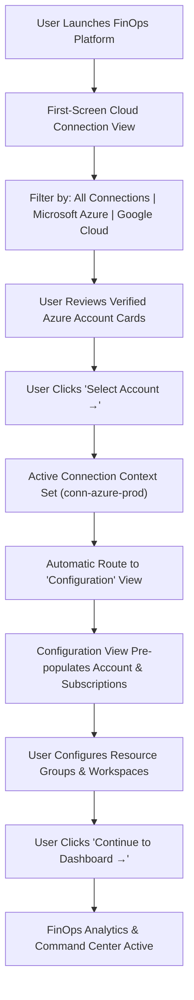

# Cloud Connection Management & UI Redesign Report

> **Platform:** FinOps & Infrastructure Intelligence Platform  
> **Status:** Completed & Verified  
> **Date:** November 2026  
> **Version:** Production-Ready (Zero-Execution Read-Only)

---

## 1. Executive Summary

This report documents the comprehensive redesign and implementation of the **Cloud Connection Management** screen and onboarding workflow for the **FinOps & Infrastructure Intelligence Platform**. 

Previously, the application displayed generic icons, inconsistent POC badges, and treated Azure Databricks and Microsoft Fabric as isolated top-level cloud providers. This disjointed presentation broke the architectural mental model of enterprise Azure deployments where Databricks and Fabric operate as services under Azure subscriptions and tenants.

Under this redesign:
1. **Bizmetric Visual Branding:** Integrated the official high-resolution Bizmetric brand asset (`/bizmetric-logo.png`) across the onboarding header and application navigation. All unofficial and placeholder `POC` tags have been permanently removed.
2. **Unified Enterprise Cloud Hierarchy:** Consolidated Microsoft Azure into a single top-level cloud ecosystem with nested service integrations (`Azure Resource Manager`, `Azure Databricks`, `Microsoft Fabric`), while preserving Google Cloud as an independent cloud provider.
3. **Structured Account Cards:** Transformed connection cards to represent full Azure Accounts displaying verified tenant IDs, subscription IDs (with copy-to-clipboard functionality), authentication mechanisms, verification timestamps, and individual service integration health badges.
4. **Direct Seamless Navigation:** Selecting an account immediately transitions the application to the **Configuration** view with the selected account and subscription context preloaded.

---

## 2. Branding & Header Refinement

### 2.1 Logo Integration
- **Asset Location:** `frontend/public/bizmetric-logo.png`
- **Component Implementation:** Utilizes Next.js `<Image src="/bizmetric-logo.png" alt="Bizmetric Logo" priority />` with responsive scaling, strict aspect-ratio retention (`object-contain`), and zero blur or distortion.
- **Header Structure:** Positioned in the sticky top navigation bar with subtle border separation (`border-slate-200`) adjacent to the platform title.

### 2.2 Permanent Removal of POC Badges
- Removed `POC` badge badges from the onboarding header in `frontend/src/app/page.tsx`.
- Removed `POC` badges from `frontend/src/components/Sidebar.tsx` (logo header).
- Maintained production-grade platform title:
  - **Title:** `FinOps & Infrastructure Intelligence Platform`
  - **Subtitle:** `Connect your cloud account to begin.`

### 2.3 Prominent Security & Read-Only Policy Indicator
Every cloud connection screen features an explicit, persistent security banner:
- **Title:** `Strictly Read-Only • Zero-Execution Policy`
- **Description:** "All cloud accounts operate with strictly read-only authorization (`Reader`, `Cost Management Reader`). The platform never executes mutations, starts compute, or modifies cloud resources."
- **Badge:** `100% Read-Only Protected` with an emerald shield indicator (`ShieldCheck`).

---

## 3. Top-Level Cloud Hierarchy & Provider Categorization

### 3.1 Provider Tabs
The top-level provider filter tabs in `ConnectCloudView.tsx` are now strictly defined as:
1. **All Connections (`all`):** Displays all connected or discovered enterprise accounts.
2. **Microsoft Azure (`azure`):** Displays Azure Tenant and Subscription accounts.
3. **Google Cloud (`gcp`):** Displays independent Google Cloud projects and billing accounts.

> **Crucial Architectural Change:** Standalone top-level tabs for Databricks and Microsoft Fabric have been eliminated. Databricks and Fabric are presented within their parent Azure Account as service integrations.

### 3.2 Account Cards Anatomy
Each card represents a complete cloud account with the following structured metadata:

| Visual Element | Azure Account | Google Cloud Account |
| :--- | :--- | :--- |
| **Card Header** | `Az` badge (Blue-600), Account Name, Verified Status | `GCP` badge (Amber-600), Project Name, Standby Status |
| **Primary Scope ID** | Subscription ID with 1-click Copy button | Project ID with 1-click Copy button |
| **Secondary ID** | Azure Active Directory Tenant ID (`tenant_id`) | Google Cloud Organization ID (`organizations/...`) |
| **Authentication** | Azure CLI Credentials / Service Principal OAuth2 | GCP Service Account (Read-Only JSON Key) |
| **Service Integrations** | ARM, Azure Databricks, Microsoft Fabric | GCP Core (Compute Engine, Cloud Storage, BigQuery) |
| **Primary Action** | `Select Account →` (Routes directly to Configuration) | `Connect Project →` |

---

## 4. Connection Flow & Interaction Matrix

---

## 5. Summary of Modified Code Assets

- `frontend/src/app/page.tsx`: Replaced generic icon with official Bizmetric logo; removed POC badge; routed `onConnectionSelected` directly to `activeView = "configuration"`.
- `frontend/src/components/Sidebar.tsx`: Removed POC badge from application header.
- `frontend/src/components/ConnectCloudView.tsx`: Redesigned top header, provider filter tabs, Azure Account cards with nested service integrations, and copy-to-clipboard functionality.
- `frontend/src/types/index.ts`: Added `ServiceIntegration` interface and extended `CloudConnection` with `service_integrations`.
- `frontend/src/types/navigation.ts`: Extended `CloudScope` with account ID, tenant ID, and multi-resource counters.

