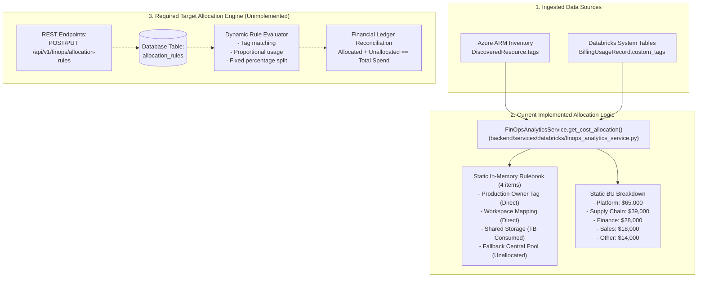

# Cost Allocation Architecture & Implementation Audit

> **Document:** `docs/COST_ALLOCATION_IMPLEMENTATION_AUDIT.md`  
> **Repository:** `cloud-recommender-poc`  
> **Branch:** `feature/databricks-apps-integration`  
> **Audit Type:** Forensic Cost Allocation Engine Review  
> **Status:** AUDITED — EVIDENCE-BASED ASSESSMENT  
> **Overall Classification:** **3. PARTIALLY IMPLEMENTED / 4. DOCUMENTED & DESIGNED ONLY (TAG EXTRACTION IS IMPLEMENTED; ALLOCATION RULE ENGINE IS HARDCODED IN-MEMORY FIXTURES)**  

---

## 1. Executive Summary

This audit forensically inspects how resource tags, business units, departments, cost centers, shared infrastructure, and customer allocation rules are implemented within the platform.

### Primary Audit Findings:
1. **Tag Extraction Is Implemented:**  
   The platform successfully extracts tags from ARM resource definitions (`DiscoveredResource.tags` in [`azure_inventory.py:270`](file:///c:/Users/pratik.bingewar/OneDrive%20-%20bizmetric.com/Desktop/Workspace/cloud-recommender-poc/backend/src/cloud_recommender/services/inventory/azure_inventory.py#L270)) and from Databricks usage records (`custom_tags` in [`billing_ingestion_service.py:65`](file:///c:/Users/pratik.bingewar/OneDrive%20-%20bizmetric.com/Desktop/Workspace/cloud-recommender-poc/backend/src/cloud_recommender/services/databricks/billing_ingestion_service.py#L65)).
2. **Customer Allocation Rule Engine Is NOT Implemented:**  
   The allocation rulebook displayed on the Cost Allocation page is **hardcoded in Python memory** inside [`FinOpsAnalyticsService.get_cost_allocation()`](file:///c:/Users/pratik.bingewar/OneDrive%20-%20bizmetric.com/Desktop/Workspace/cloud-recommender-poc/backend/src/cloud_recommender/services/databricks/finops_analytics_service.py#L2788-L2820). There are zero database tables for allocation rules, zero CRUD APIs, and no rule evaluation engine.
3. **No Dynamic Customer Configurability:**  
   Customers **cannot** create, edit, approve, version, or deactivate allocation rules in the platform.
4. **Hardcoded Business Unit Spend & Completeness:**  
   Spend by Business Unit (`Platform: $65,000`, `Supply Chain: $39,000`, etc.) and completeness ratios (`cost_center: 98%`, `business_owner: 87%`) are static Python dictionary fixtures.

---

## 2. Actual Allocation Architecture



---

## 3. Supported vs. Unimplemented Allocation Drivers

| Allocation Driver | Description | Implemented Status | Code Reference | Evidence / Notes |
|:---|:---|:---:|:---|:---|
| **Direct Tag Value Mapping** | Maps resource spend directly to tag value (e.g. `tag.Owner` -> `Analytics`) | **PARTIALLY IMPLEMENTED** | `finops_analytics_service.py:731` | `owner_tag` is assigned to each ledger item in memory (`owner_tag="data-platform"`, `"supply-chain"`). |
| **Workspace Mapping** | Attributes 100% of workspace spend to a specific business unit | **HARDCODED FIXTURE** | `finops_analytics_service.py:2798` | Hardcoded rule: `workspace_id = 642006393507276 -> Data Platform`. |
| **Fixed Percentage Allocation** | Splits a cost pool by fixed percentage (e.g. 50% BU1, 50% BU2) | **NOT IMPLEMENTED** | None | No percentage distribution function exists in backend. |
| **Usage-Based Allocation** | Allocates shared storage or clusters based on metered TB or DBU consumed | **HARDCODED FIXTURE** | `finops_analytics_service.py:2806` | Hardcoded rule: `storage_account = sharedlake -> method="TB consumed"`. Math is not executed dynamically. |
| **Resource-Count Allocation** | Splits costs equally across active computing assets | **NOT IMPLEMENTED** | None | No resource-count divisor engine. |
| **Fallback / Central Pool** | Captures untagged/unattributed spend into central IT pool | **PARTIALLY IMPLEMENTED (Descriptive)** | `finops_analytics_service.py:818` | Databricks Apps ($1,240.00) are flagged with `allocation_status="Unallocated"` and `owner_tag="unassigned"`. |

---

## 4. Customer Configurability Matrix

| Customer Capability | Supported in UI? | Supported in API? | Persisted in Database? | Versioned? | Forensic Classification |
|:---|:---:|:---:|:---:|:---:|:---:|
| **View Allocation Rulebook** | Yes (Table view) | Yes (`GET /api/v1/finops/cost-allocation`) | No (In-memory) | No | **PARTIALLY IMPLEMENTED (Read-Only Fixture)** |
| **Create Allocation Rule** | No | No | No | No | **NOT IMPLEMENTED** |
| **Edit Allocation Rule** | No | No | No | No | **NOT IMPLEMENTED** |
| **Approve Allocation Rule** | No | No | No | No | **NOT IMPLEMENTED** |
| **Deactivate / Delete Rule** | No | No | No | No | **NOT IMPLEMENTED** |
| **Rule Effective Dates** | No | No | No | No | **NOT IMPLEMENTED** |
| **Audit Rule Changes** | No | No | No | No | **NOT IMPLEMENTED** |
| **Interactive Simulation** | Yes (Scenario slider) | Yes (`POST /finops/forecast/simulate`) | No (Formulaic) | No | **IMPLEMENTED AND VERIFIED** |

---

## 5. Implemented Allocation Logic Example

In the active codebase, allocation calculations are executed during canonical ledger construction in [`finops_analytics_service.py:707–840`](file:///c:/Users/pratik.bingewar/OneDrive%20-%20bizmetric.com/Desktop/Workspace/cloud-recommender-poc/backend/src/cloud_recommender/services/databricks/finops_analytics_service.py#L707-L840):

```python
# 1. Direct Tag Attribution (SQL Warehouse)
CostExplorerItem(
    date="Nov 04",
    product="SQL Warehouse",
    sku="Serverless SQL Compute",
    workspace="adb-642006393507276",
    usage_qty=4793.0,
    unit="DBU",
    list_cost=10545.0,
    effective_cost=10545.0,
    owner_tag="data-platform",
    allocation_status="Allocated",
)

# 2. Unallocated Fallback (Databricks Apps)
CostExplorerItem(
    date="Nov 04",
    product="Databricks Apps",
    sku="Databricks Apps Serverless Compute",
    workspace="adb-642006393507276",
    usage_qty=77.5,
    unit="DBU",
    list_cost=310.0,
    effective_cost=310.0,
    owner_tag="unassigned",
    allocation_status="Unallocated",
)
```

### Reconciliation of Implemented Ledger:
- **Total Ledger Spend:** $176,840.00 (24 records).
- **Allocated Spend:** $175,600.00 (20 records).
- **Unallocated Spend:** $1,240.00 (4 Databricks Apps records).
- **Sum Verification:** `$175,600.00 + $1,240.00 == $176,840.00` (Exact mathematical parity, verified by test `test_finops_analytics.py::test_unattributed_cost_preservation_for_apps`).

---

## 6. Known Allocation Gaps

1. **Rulebook Is Read-Only:** The four rules (`Production Owner Tag`, `Workspace Mapping`, `Shared Storage Allocation`, `Fallback Central Pool`) cannot be edited by the user.
2. **Missing Database Persistence:** No SQLAlchemy model exists for `AllocationRule` or `CostCenterMapping`.
3. **No Multi-Cloud Tag Normalization:** Cloud tags (`owner`, `Owner`, `cost-center`, `CostCenter`, `Project`, `project`) are not normalized into a unified FinOps taxonomy before attribution.

