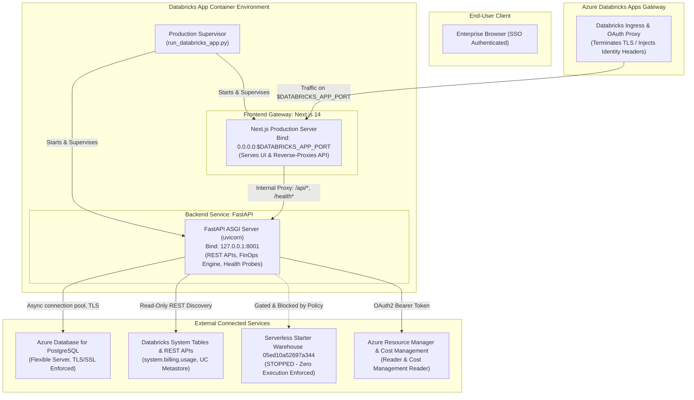

# Azure Databricks Apps Deployment Architecture

> **Target Workspace:** Azure Databricks Workspace `642006393507276`  
> **Workspace URL:** `https://adb-642006393507276.16.azuredatabricks.net`  
> **Application Name:** `bizmetric-finops`  
> **Platform Version:** Production Deployment Architecture V1.0  
> **Repository:** `cloud-recommender-poc`  
> **Status:** Deployment Ready — Awaiting Cloud Execution Approval  

---

## 1. Architectural Overview

The **Bizmetric FinOps & Infrastructure Intelligence Platform** is packaged and configured for production deployment as an **Azure Databricks App**. 

Databricks Apps provides a secure, serverless application container runtime managed natively inside Azure Databricks workspaces. The deployment preserves our unified 21-module architecture while adhering strictly to **Zero-Execution** and **Least-Privilege Read-Only** security boundaries.

---

## 2. Unified Single-Endpoint Routing Design

### 2.1 The Single Public Port Invariant
Databricks Apps exposes **exactly one port** per application container, dynamically provided via the `$DATABRICKS_APP_PORT` environment variable (default: `8000` or `8080`).

Two independent processes cannot each expose their own public port to the Databricks ingress. To resolve this without forcing Docker or sacrificing Next.js capabilities, the platform implements a **Reverse-Proxy Gateway Architecture**:

1. **Next.js Production Server as Public Gateway:**
   - Binds to `0.0.0.0:$DATABRICKS_APP_PORT`.
   - Directly receives all inbound traffic from Databricks Apps ingress.
   - Serves React UI pages, CSS stylesheets, JavaScript chunks, and static assets from `frontend/.next`.
2. **Internal API Routing (`next.config.mjs` Rewrites):**
   - Inbound requests matching `/api/:path*` are transparently rewritten to internal FastAPI on `http://127.0.0.1:8001/api/:path*`.
   - Inbound requests matching `/health` and `/health/:path*` are rewritten to `http://127.0.0.1:8001/health`.
   - OpenAPI documentation requests (`/docs`, `/openapi.json`) are rewritten to FastAPI.
3. **Browser Relative Pathing:**
   - In the client browser (`frontend/src/lib/api.ts`), API requests default to relative `/api/v1/...`.
   - The browser never makes cross-origin requests; CORS is completely bypassed.
4. **Standalone Python Gateway Fallback:**
   - If the Node.js runtime is unavailable or `STANDALONE_PYTHON=1` is specified, `run_databricks_app.py` switches to direct Python mode where FastAPI binds directly to `0.0.0.0:$DATABRICKS_APP_PORT`.

---

## 3. Production Process Supervision & Lifecycle Management

The `run_databricks_app.py` supervisor script manages application lifecycle:
- **Port Coordination:** Reads `$DATABRICKS_APP_PORT`, assigns internal backend port (`8001` or `8000`), and exports `INTERNAL_BACKEND_URL`.
- **Dependency Sequencing:** Starts FastAPI backend first; polls `http://127.0.0.1:8001/health` until HTTP 200 is confirmed; then launches Next.js server.
- **Graceful Shutdown:** Intercepts `SIGTERM` and `SIGINT` signals from Databricks container management, cleanly terminating child processes within a 2-second timeout.
- **Structured Production Logging:** Emits ISO 8601 UTC timestamped logs for operational visibility.

---

## 4. Security & Isolation Boundaries

### 4.1 Zero-Execution Enforcement
- The Serverless Starter Warehouse (`05ed10a52697a344`) remains strictly **STOPPED**.
- The backend never issues resume commands, SQL execution calls, or cluster mutations.
- When live SQL compute is stopped, the application surfaces clear diagnostic statuses (`STOPPED_WAREHOUSE`, `APPROVAL_REQUIRED`) rather than fabricating numbers.

### 4.2 Read-Only Azure & Databricks Access
- Azure integration is strictly restricted to Microsoft Entra ID Service Principal with:
  - `Reader` (on target Azure Subscriptions / Resource Groups)
  - `Cost Management Reader` (on target Billing Accounts / Subscriptions)
- No `Contributor` or `Owner` roles are ever requested or utilized.
- Databricks App service principal is granted read-only workspace metadata and billing catalog permissions.

### 4.3 Production PostgreSQL Security
- External PostgreSQL (Azure Database for PostgreSQL Flexible Server) requires:
  - Encrypted TLS connections (`sslmode=require`).
  - Connection pooling with `pool_size=10`, `max_overflow=10`, and `pool_recycle=1800` (recycles connections to avoid Azure firewall drops).
  - Pre-flight connection verification (`SELECT 1`).
  - Decoupled migrations: Migrations are executed via `backend/scripts/run_migrations.py` as a separate controlled task, never on container startup.

---

## 5. Unified 21-Module Scope Parity

The application retains all 21 unified modules under Databricks Workspace navigation:
- **Workspace & Operations (11 Modules):** Overview, Clusters, Warehouses, Jobs & Workflows, Pipelines, Model Serving, Unity Catalog, Databricks Apps, System Tables, Query History, Audit & Governance.
- **FinOps & Cost Intelligence (10 Modules):** Executive Overview (with exclusive AI FinOps Intelligence panel), Cost Explorer, Cost Allocation, Cost & Billing, Forecast & Budgets, Anomaly Detection, Optimization Advisor, AI Economics, Governance & Policies, Reports & Audit.

