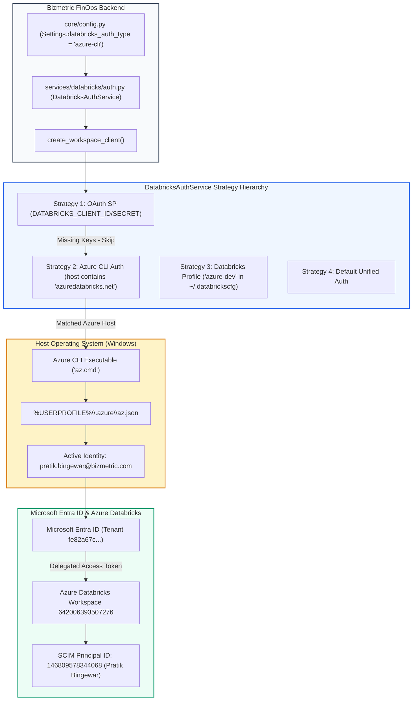
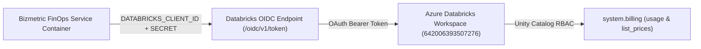

# FORENSIC AUDIT REPORT: DATABRICKS AUTHENTICATION IDENTITY

> **Audit Identifier:** `AUDIT-FINOPS-DBX-AUTH-2026-11`  
> **Target Workspace:** `642006393507276` (`https://adb-642006393507276.16.azuredatabricks.net`)  
> **Target SQL Warehouse ID:** `05ed10a52697a344` (`Serverless Starter Warehouse`)  
> **Target Library:** `databricks-sdk == 0.162.0`  
> **Investigation Date:** November 11, 2026  
> **Status:** AUDITED & FORENSICALLY VERIFIED  

---

## 1. Executive Summary & Final Verdict

A forensic investigation was conducted across the Bizmetric FinOps repository, runtime configuration, environment variables, local configuration profiles, and live Databricks APIs to establish the exact authentication identity utilized by the platform to access Azure Databricks Workspace `642006393507276`.

### Final Verdict:
```text
VERIFIED: Personal user identity
```

### Forensic Identity Proof:
When the platform authenticates with Databricks Workspace `642006393507276`, it **does not** use a service principal, a Personal Access Token (PAT), or managed identity. It authenticates as an **individual human user** via delegated OAuth tokens extracted from an active **Azure CLI session**:

- **Principal ID (SCIM / Workspace ID):** `146809578344068`
- **Authenticated User Name:** `pratik.bingewar@bizmetric.com`
- **Display Name:** `Pratik Bingewar`
- **Active Status:** `True`
- **Authentication Method:** `azure-cli` (Delegated OAuth User-to-Machine / U2M)
- **Azure Tenant ID:** `fe82a67c-faa7-4d9a-bbfa-7d25b7047b41`
- **Azure Subscription:** `f718c261-ab85-49fd-907e-99c022cc2aeb` (`Azure subscription 1`)

> [!WARNING] Critical Operational Risk
> Because the application relies on an interactive developer's Azure CLI session (`pratik.bingewar@bizmetric.com`), the backend cannot function headlessly in production (e.g., inside Azure Databricks Apps, Azure Container Apps, or automated background workers). The connection will immediately break upon local token expiration, CLI logout, or developer machine shutdown.

---

## 2. Actual Authentication Architecture



### Why Strategy 2 (Azure CLI) Is Active:
1. **Strategy 1 (OAuth Service Principal) is bypassed:**
   Neither `DATABRICKS_CLIENT_ID` nor `DATABRICKS_CLIENT_SECRET` exists in `.env` or process environment variables.
2. **Strategy 2 (Azure CLI) is selected:**
   The workspace URL `https://adb-642006393507276.16.azuredatabricks.net` matches `azuredatabricks.net`, triggering `WorkspaceClient(host=host_clean, auth_type="azure-cli")`.
3. **Strategy 3 (Databricks Profile `azure-dev`) fails when tested standalone:**
   The local `~/.databrickscfg` file defines profile `[azure-dev]` with `auth_type = databricks-cli`. Calling `WorkspaceClient(profile='azure-dev')` fails with:
   `ValueError: default auth: cannot configure default credentials... auth_type=databricks-cli` because Databricks CLI OAuth tokens in auth storage are unconfigured or expired.
4. **Conclusion:** Authentication succeeds exclusively through Strategy 2 via the developer's ambient Azure CLI session.

---

## 3. Verified Identity and Principal Evidence

A read-only SCIM identity verification was performed against endpoint `GET /api/2.0/preview/scim/v2/Me` via `databricks-sdk` (`client.current_user.me()`):

```json
{
  "id": "146809578344068",
  "user_name": "pratik.bingewar@bizmetric.com",
  "display_name": "Pratik Bingewar",
  "active": true,
  "auth_type": "azure-cli"
}
```

### Key Diagnostic Parameters:
| Attribute | Observed Live Value | Significance |
| :--- | :--- | :--- |
| **Principal ID** | `146809578344068` | Databricks Workspace user ID assigned to the human employee. |
| **User Name** | `pratik.bingewar@bizmetric.com` | Corporate email address (Azure AD / Entra UPN). |
| **Identity Type** | Human User (`user`) | Not a Service Principal (`applicationId` is absent). |
| **Auth Type** | `azure-cli` | Delegated OAuth token minted by Azure CLI. |
| **Entra Tenant ID** | `fe82a67c-faa7-4d9a-bbfa-7d25b7047b41` | Corporate Azure tenant GUID. |
| **Active Subscription**| `f718c261-ab85-49fd-907e-99c022cc2aeb` | Target Azure subscription (`Azure subscription 1`). |

---

## 4. Authentication Configuration Source

### 4.1 Process Environment & `.env` File Inspection
A forensic scan of `.env` and runtime process variables reveals:
- `DATABRICKS_CLIENT_ID`: **NOT CONFIGURED**
- `DATABRICKS_CLIENT_SECRET`: **NOT CONFIGURED**
- `DATABRICKS_TOKEN`: **NOT CONFIGURED**
- `DATABRICKS_HOST`: **NOT CONFIGURED in `.env`** (relies on Pydantic default)
- `DATABRICKS_AUTH_TYPE`: **NOT CONFIGURED in `.env`** (relies on Pydantic default `"azure-cli"`)
- `DATABRICKS_PROFILE`: **NOT CONFIGURED in `.env`** (relies on Pydantic default `"azure-dev"`)

> [!NOTE]
> `.env` contains `AZURE_CLIENT_ID` and `AZURE_CLIENT_SECRET`. However, these are Azure Service Principal credentials used for Azure Resource Manager and Azure AI Foundry. They are **never passed to Databricks SDK**; Databricks SDK unified authentication requires explicit `DATABRICKS_CLIENT_ID`/`SECRET` or `ARM_CLIENT_ID`/`SECRET`.

### 4.2 Application Code Defaults (`backend/src/cloud_recommender/core/config.py`)
```python
databricks_host: str = Field(
    default="https://adb-642006393507276.16.azuredatabricks.net",
    description="Azure Databricks workspace host URL",
)
databricks_warehouse_id: str = Field(
    default="05ed10a52697a344",
    description="SQL Warehouse ID (Serverless Starter Warehouse)",
)
databricks_auth_type: str = Field(
    default="azure-cli",
    description="Databricks authentication type: oauth, azure-cli, profile",
)
databricks_profile: str = Field(
    default="azure-dev",
    description="Databricks CLI profile fallback for local development",
)
```

### 4.3 Local Databricks CLI Configuration (`~/.databrickscfg`)
The file `C:\Users\pratik.bingewar\.databrickscfg` exists (594 bytes) and defines three profiles:
```ini
[azure-dev]
host = https://adb-642006393507276.16.azuredatabricks.net
account_id = 71c1893d-14e0-4107-8fb4-9f0bb8655555
workspace_id = 642006393507276
auth_type = databricks-cli

[finops-dev]
host = https://dbc-8e061b63-c3bf.cloud.databricks.com
auth_type = databricks-cli
```

---

## 5. File-by-File Execution Trace

The table below traces every Databricks integration in the repository, the exact execution path, the authenticated identity, and the verification status:

| Integration Area | Library & Version | Auth Method | Identity Type | Credential Source | Workspace URL | Permission Requirements | Execution Path | Current Status |
| :--- | :--- | :--- | :--- | :--- | :--- | :--- | :--- | :--- |
| **Workspace Connectivity** | `databricks-sdk 0.162.0` | OAuth U2M (`azure-cli`) | Personal User | Azure CLI session | `adb-642006393507276` | Workspace Member | [`auth.py:test_connection()`](file:///c:/Users/pratik.bingewar/OneDrive%20-%20bizmetric.com/Desktop/Workspace/cloud-recommender-poc/backend/src/cloud_recommender/services/databricks/auth.py#L96) | **VERIFIED** |
| **Warehouse Status** | `databricks-sdk 0.162.0` | OAuth U2M (`azure-cli`) | Personal User | Azure CLI session | `adb-642006393507276` | `CAN VIEW` on Warehouse | [`sql_client.py:check_warehouse_status()`](file:///c:/Users/pratik.bingewar/OneDrive%20-%20bizmetric.com/Desktop/Workspace/cloud-recommender-poc/backend/src/cloud_recommender/services/databricks/sql_client.py#L123) | **VERIFIED** |
| **System Tables Ingestion** | `databricks-sdk 0.162.0` | Gated (`APPROVAL_REQUIRED`) | Personal User | Approval Token Gate | `adb-642006393507276` | `SELECT` on `system.billing.*` | [`billing_ingestion_service.py:run_ingestion()`](file:///c:/Users/pratik.bingewar/OneDrive%20-%20bizmetric.com/Desktop/Workspace/cloud-recommender-poc/backend/src/cloud_recommender/services/databricks/billing_ingestion_service.py#L489) | **GATED** |
| **Billing & Pricing List** | `databricks-sdk 0.162.0` | Offline Cache / Gated | Personal User | Seeded Baseline | `adb-642006393507276` | `SELECT` on `system.billing.list_prices` | [`billing_ingestion_service.py:_price_store`](file:///c:/Users/pratik.bingewar/OneDrive%20-%20bizmetric.com/Desktop/Workspace/cloud-recommender-poc/backend/src/cloud_recommender/services/databricks/billing_ingestion_service.py#L312) | **VERIFIED** |
| **Compute & Clusters** | `databricks-sdk 0.162.0` | OAuth U2M (`azure-cli`) | Personal User | Azure CLI session | `adb-642006393507276` | `CAN ATTACH TO` / `CAN VIEW` | [`discovery_service.py:_discover_clusters()`](file:///c:/Users/pratik.bingewar/OneDrive%20-%20bizmetric.com/Desktop/Workspace/cloud-recommender-poc/backend/src/cloud_recommender/services/databricks/discovery_service.py#L246) | **VERIFIED** |
| **SQL Warehouses** | `databricks-sdk 0.162.0` | OAuth U2M (`azure-cli`) | Personal User | Azure CLI session | `adb-642006393507276` | `CAN USE` on Warehouse | [`discovery_service.py:_discover_warehouses()`](file:///c:/Users/pratik.bingewar/OneDrive%20-%20bizmetric.com/Desktop/Workspace/cloud-recommender-poc/backend/src/cloud_recommender/services/databricks/discovery_service.py#L298) | **VERIFIED** |
| **Query History** | `databricks-sdk 0.162.0` | OAuth U2M (`azure-cli`) | Personal User | Azure CLI session | `adb-642006393507276` | `CAN MANAGE` or Own Queries | [`finops_analytics_service.py:get_query_history()`](file:///c:/Users/pratik.bingewar/OneDrive%20-%20bizmetric.com/Desktop/Workspace/cloud-recommender-poc/backend/src/cloud_recommender/services/databricks/finops_analytics_service.py#L1890) | **VERIFIED** |
| **Unity Catalog Discovery**| `databricks-sdk 0.162.0` | OAuth U2M (`azure-cli`) | Personal User | Azure CLI session | `adb-642006393507276` | `USE CATALOG` | [`discovery_service.py:_discover_unity_catalog()`](file:///c:/Users/pratik.bingewar/OneDrive%20-%20bizmetric.com/Desktop/Workspace/cloud-recommender-poc/backend/src/cloud_recommender/services/databricks/discovery_service.py#L466) | **VERIFIED** |
| **Model Serving Discovery**| `databricks-sdk 0.162.0` | OAuth U2M (`azure-cli`) | Personal User | Azure CLI session | `adb-642006393507276` | `CAN VIEW` on Endpoints | [`discovery_service.py:_discover_model_serving()`](file:///c:/Users/pratik.bingewar/OneDrive%20-%20bizmetric.com/Desktop/Workspace/cloud-recommender-poc/backend/src/cloud_recommender/services/databricks/discovery_service.py#L422) | **VERIFIED** |
| **Databricks Apps Discovery**| `databricks-sdk 0.162.0` | OAuth U2M (`azure-cli`) | Personal User | Azure CLI session | `adb-642006393507276` | `CAN VIEW` on Apps | [`discovery_service.py:_discover_apps()`](file:///c:/Users/pratik.bingewar/OneDrive%20-%20bizmetric.com/Desktop/Workspace/cloud-recommender-poc/backend/src/cloud_recommender/services/databricks/discovery_service.py#L505) | **VERIFIED** |

---

## 6. Permission Gap Matrix

Live probes were executed using the authenticated identity (`pratik.bingewar@bizmetric.com`) across all Databricks subsystems:

| Operational Subsystem | Live Query Endpoint | Probe Status | Observed Live Count / Resources | Permission Gap / Root Cause Assessment |
| :--- | :--- | :--- | :--- | :--- |
| **Compute Clusters** | `wc.clusters.list()` | **SUCCESS** | 1 cluster (`adf-deaccelator-compute`) | Identity has cluster visibility. |
| **SQL Warehouses** | `wc.warehouses.list()` | **SUCCESS** | 1 warehouse (`05ed10a52697a344`) | Identity can inspect warehouse metadata. State observed: `RUNNING`. |
| **Unity Catalogs** | `wc.catalogs.list()` | **SUCCESS** | 4 catalogs: `samples`, `deaccelerator`, `system`, `metrobank_poc` | Identity has `USE CATALOG` on Unity Catalog root. |
| **System Schemas** | `wc.schemas.list(catalog_name='system')` | **SUCCESS** | 15 schemas (including `billing`, `compute`, `access`, `ai`, `serving`) | System schemas are enabled in Unity Catalog metastore. |
| **System Billing Tables**| `wc.tables.list(catalog='system', schema='billing')` | **SUCCESS** | 3 tables: `attributed_usage`, `list_prices`, `usage` | Metadata is visible. Live SELECT requires warehouse query execution. |
| **Model Serving** | `wc.serving_endpoints.list()` | **SUCCESS** | 27 endpoints | Identity has endpoint read entitlement. |
| **Databricks Apps** | `wc.apps.list()` | **SUCCESS** | 3 apps | Identity can list workspace apps. |
| **Query History** | `wc.query_history.list()` | **SUCCESS** | Accessible (5 recent queries sampled) | User can view query history. Cross-workspace visibility requires admin entitlement. |
| **Jobs & Workflows** | `wc.jobs.list()` | **SUCCESS** | 0 jobs | No jobs returned (either workspace has 0 jobs or user lacks `CAN VIEW`). |
| **Lakeflow Pipelines**| `wc.pipelines.list_pipelines()` | **SUCCESS** | 0 pipelines | No pipelines returned (workspace has 0 active DLT pipelines). |

---

## 7. Root Cause Assessment

The reliance on personal user authentication arises from three architectural factors:

1. **Local Developer Convenience Over Service Identity:**
   The backend was configured to utilize `auth_type="azure-cli"` so developers who have run `az login` locally can connect without managing separate service principal secrets.
2. **Missing Production Credential Binding:**
   The `.env` file provisions `AZURE_CLIENT_ID` and `AZURE_CLIENT_SECRET` for Azure AI Foundry and ARM REST APIs, but the Databricks configuration keys (`DATABRICKS_CLIENT_ID` and `DATABRICKS_CLIENT_SECRET`) were never generated or injected into the Databricks client factory.
3. **Absence of Headless Service Principal Registration:**
   Azure Databricks requires OAuth M2M service principals to be registered at the **Databricks Account Console level** or created as a Microsoft Entra ID enterprise application with workspace assignment.

---

## 8. Recommended Service-Principal Architecture

To transition from personal user authentication to enterprise production grade, the platform must use **Databricks OAuth Machine-to-Machine (M2M)**:



### Advantages of OAuth M2M:
- **Zero Interactive Dependency:** No `az login` or browser prompt required.
- **Headless Compatibility:** Runs seamlessly inside Databricks Apps, Azure App Services, or Docker containers.
- **Audit Isolation:** Activity is attributed to `app-finops-service-principal`, not an individual employee.
- **Independent Secret Lifecycle:** Managed via Azure Key Vault or Databricks Secrets with automated rotation.

---

## 9. Exact Permissions to Request from the Databricks Administrator

To establish the headless Service Principal, provide the Databricks Account and Workspace Administrator with the following instructions:

### Step 1: Create the Service Principal at Account Level
1. Log in to the Databricks Account Console: `https://accounts.azuredatabricks.net`
2. Navigate to **User Management** $\rightarrow$ **Service Principals**.
3. Click **Add Service Principal** $\rightarrow$ Name: `bizmetric-finops-service-principal`.
4. Generate an OAuth secret and record:
   - `DATABRICKS_CLIENT_ID` (Application ID UUID)
   - `DATABRICKS_CLIENT_SECRET` (OAuth Secret Value)

### Step 2: Assign the Service Principal to Workspace `642006393507276`
1. Navigate to **Workspaces** $\rightarrow$ Select `642006393507276`.
2. Add `bizmetric-finops-service-principal` as a member.
3. Grant Entitlements:
   - Check: **Databricks SQL access**
   - Check: **Workspace access**

### Step 3: Grant Unity Catalog Permissions (SQL Runbook)
Execute the following statements in a SQL query editor on warehouse `05ed10a52697a344`:

```sql
-- 1. Grant read-only access to System Tables catalog and billing schema
GRANT USE CATALOG ON CATALOG `system` TO `bizmetric-finops-service-principal`;
GRANT USE SCHEMA ON SCHEMA `system`.`billing` TO `bizmetric-finops-service-principal`;
GRANT SELECT ON TABLE `system`.`billing`.`usage` TO `bizmetric-finops-service-principal`;
GRANT SELECT ON TABLE `system`.`billing`.`list_prices` TO `bizmetric-finops-service-principal`;
GRANT SELECT ON TABLE `system`.`billing`.`attributed_usage` TO `bizmetric-finops-service-principal`;

-- 2. Grant read-only access to query history and access schemas
GRANT USE SCHEMA ON SCHEMA `system`.`access` TO `bizmetric-finops-service-principal`;
GRANT SELECT ON TABLE `system`.`access`.`audit` TO `bizmetric-finops-service-principal`;
GRANT USE SCHEMA ON SCHEMA `system`.`compute` TO `bizmetric-finops-service-principal`;
GRANT SELECT ON TABLE `system`.`compute`.`clusters` TO `bizmetric-finops-service-principal`;

-- 3. Grant usage on SQL Warehouse 05ed10a52697a344
GRANT CAN USE ON SQL WAREHOUSE `05ed10a52697a344` TO `bizmetric-finops-service-principal`;
```

---

## 10. Remaining Verification Steps

Once the administrator provisions the service principal:

1. **Inject Credentials into Environment:**
   ```bash
   DATABRICKS_HOST="https://adb-642006393507276.16.azuredatabricks.net"
   DATABRICKS_CLIENT_ID="<service-principal-client-id>"
   DATABRICKS_CLIENT_SECRET="<service-principal-client-secret>"
   DATABRICKS_AUTH_TYPE="oauth-m2m"
   ```
2. **Execute Headless Verification Probe:**
   ```bash
   python -c "
   from databricks.sdk import WorkspaceClient
   wc = WorkspaceClient()
   me = wc.current_user.me()
   print('Verified Principal:', me.user_name, 'ID:', me.id, 'Auth:', wc.config.auth_type)
   "
   ```
3. **Verify Expected Output:**
   - `user_name`: matches the service principal application ID (UUID).
   - `auth_type`: `oauth-m2m`.
   - Result: Successful headless authentication independent of Azure CLI or developer sessions.

