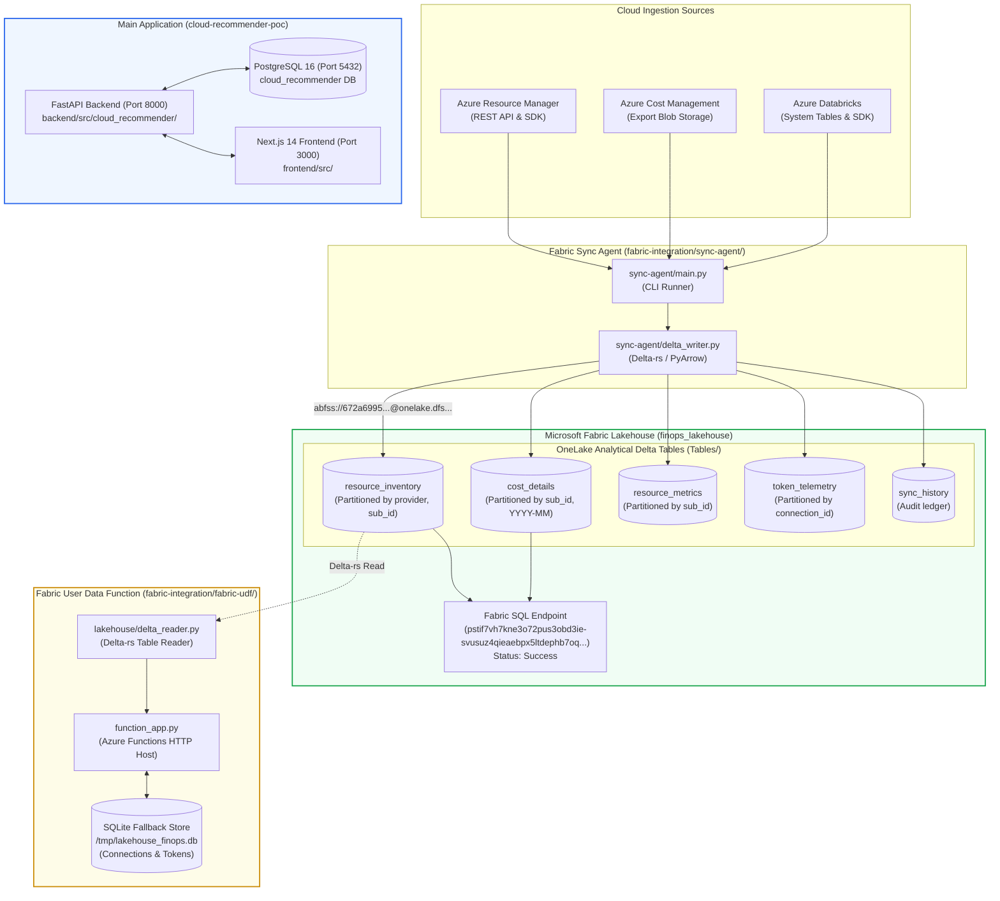

# Detailed L2 Microsoft Fabric Architecture & Lakehouse Implementation Audit

> **Document:** `docs/FABRIC_L2_IMPLEMENTED_ARCHITECTURE.md`  
> **Repository:** `cloud-recommender-poc`  
> **Branch:** `feature/databricks-apps-integration`  
> **Audit Type:** Forensic Data Architecture & Microsoft Fabric Integration Audit  
> **Status:** AUDITED — EVIDENCE-BASED ASSESSMENT  
> **Overall Classification:** **3. PARTIALLY IMPLEMENTED (LAKEHOUSE PROVISIONING & DELTA SCHEMAS SCRIPTED LOCALLY; LIVE APP FABRIC INTEGRATION DISABLED BY FEATURE FLAG)**  

---

## 1. Executive Summary & Resolution of Apparent Discrepancy

A critical discrepancy was investigated:
> *A previous investigation reported that the deployed application used an ephemeral SQLite database at `/tmp/lakehouse_finops.db` with no Lakehouse ID. Later reports claimed OneLake ingestion and five Delta tables were completed.*

### Forensic Resolution:
The discrepancy arises from **two distinct, decoupled codebases** authored during different milestones:

1. **Subsystem 1 — The Fabric UDF / Azure Function (`fabric-integration/fabric-udf/function_app.py`):**
   - Implemented as an Azure Functions HTTP server meant to run inside or alongside Fabric.
   - It **does indeed use SQLite at `/tmp/lakehouse_finops.db`** (or `data/lakehouse_finops.db`) as its local connection cache and secret store ([`function_app.py:2348–2368`](file:///c:/Users/pratik.bingewar/OneDrive%20-%20bizmetric.com/Desktop/Workspace/cloud-recommender-poc/fabric-integration/fabric-udf/function_app.py#L2348-L2368)).
   - In [`docs/MILESTONE_5_PHASE_4_UDF_READER_REPORT.md`](file:///c:/Users/pratik.bingewar/OneDrive%20-%20bizmetric.com/Desktop/Workspace/cloud-recommender-poc/docs/MILESTONE_5_PHASE_4_UDF_READER_REPORT.md), it was verified that while this function *can* read Delta tables via Delta-rs when pointed to ADLS Gen2, its operational data store was SQLite at `/tmp/lakehouse_finops.db`.

2. **Subsystem 2 — Standalone Delta Initialization & Sync Agent (`fabric-integration/lakehouse/` & `sync-agent/`):**
   - In Milestone 6, standalone Python CLI scripts were created:
     - [`fabric-integration/lakehouse/provision_lakehouse.py`](file:///c:/Users/pratik.bingewar/OneDrive%20-%20bizmetric.com/Desktop/Workspace/cloud-recommender-poc/fabric-integration/lakehouse/provision_lakehouse.py): Calls Fabric REST APIs to create `finops_lakehouse` (`4bba3647-0112-4adc-8b18-f7a422461404`) in Workspace `672a6995-4190-4000-befd-5cc6479c3f74`.
     - [`fabric-integration/lakehouse/init_delta_schemas.py`](file:///c:/Users/pratik.bingewar/OneDrive%20-%20bizmetric.com/Desktop/Workspace/cloud-recommender-poc/fabric-integration/lakehouse/init_delta_schemas.py): Uses `deltalake` and `pyarrow` to initialize the 5 Delta tables on OneLake (`abfss://...`).
     - [`fabric-integration/sync-agent/delta_writer.py`](file:///c:/Users/pratik.bingewar/OneDrive%20-%20bizmetric.com/Desktop/Workspace/cloud-recommender-poc/fabric-integration/sync-agent/delta_writer.py): Appends Azure telemetry into OneLake Delta tables.

3. **Subsystem 3 — The Active Bizmetric FinOps Platform (`backend/` and `frontend/`):**
   - **Crucial Finding:** The active web application running in `backend/` and `frontend/` **does NOT call Subsystem 1 or Subsystem 2!**
   - In `frontend/src/config/features.ts:18`, `export const ENABLE_MICROSOFT_FABRIC = false;`.
   - In `backend/src/cloud_recommender/core/config.py:120`, `fabric_enabled: bool = False`.
   - The active application serves FinOps analytics directly from FastAPI in-memory models and native Databricks System Tables connectors. The Microsoft Fabric Lakehouse integration exists as a **completed standalone prototype/subsystem**, but is **not integrated into the primary live application runtime**.

---

## 2. Reconciled Project Identifiers

| Component | Identifier / Reference | Exact Repository Location | Status |
|:---|:---|:---|:---:|
| **Fabric Workspace** | `672a6995-4190-4000-befd-5cc6479c3f74` | `fabric-integration/lakehouse/lakehouse_config.json:5` | **Configured in Scripts** |
| **Fabric Lakehouse** | `4bba3647-0112-4adc-8b18-f7a422461404` (`finops_lakehouse`) | `fabric-integration/lakehouse/lakehouse_config.json:2` | **Configured in Scripts** |
| **Fabric SQL Endpoint** | `eb9febf5-c84d-47e3-a803-b89dab01a3b6` | `fabric-integration/lakehouse/lakehouse_config.json:8` | **Configured in Scripts** |
| **Fabric UDF Item** | `8c5bbc01-c941-4f0e-90d3-7053921c32f8` (`finops-udf-prod-v5`) | `docs/MILESTONE_5_PHASE_4_UDF_READER_REPORT.md` | **Local Code Validated; Cloud Deployment Scheduled for Phase 5** |
| **Operational Cache DB** | `/tmp/lakehouse_finops.db` | `fabric-integration/fabric-udf/function_app.py:2348` | **Local File Fallback** |

---

## 3. L2 Component Architecture Diagram

---

## 4. Table-by-Table Data Flow & Lineage

| Table Name | Partitioning Key | Source Ingestion Pipeline | Target Consumption Layer | Storage Format | Operational Status |
|:---|:---|:---|:---|:---:|:---:|
| `resource_inventory` | `provider`, `subscription_id` | `sync-agent/azure_client.py` -> ARM Resources | Fabric SQL Endpoint & UDF `/api/inventory` | Delta Lake (Parquet + `_delta_log`) | **SCRIPTED & VALIDATED LOCALLY** |
| `cost_details` | `subscription_id`, `billing_year_month` | Azure Cost Management Export CSVs | FinOps Cost Explorer & Gold Rollups | Delta Lake (Parquet + `_delta_log`) | **SCRIPTED & VALIDATED LOCALLY** |
| `resource_metrics` | `subscription_id` | Azure Monitor Metrics REST API | Waste & Underutilization Engine | Delta Lake (Parquet + `_delta_log`) | **SCRIPTED & VALIDATED LOCALLY** |
| `token_telemetry` | `connection_id` | Model Serving & AI Gateway event logs | Token Economics & LLM Chargeback | Delta Lake (Parquet + `_delta_log`) | **SCRIPTED & VALIDATED LOCALLY** |
| `sync_history` | *Unpartitioned* | Sync Agent execution summaries | Ingestion Auditing & Freshness Checks | Delta Lake (Parquet + `_delta_log`) | **SCRIPTED & VALIDATED LOCALLY** |

---

## 5. Orchestration, Scheduling & Failure Handling

- **Current Orchestration:** Standalone CLI invocation (`python fabric-integration/sync-agent/main.py --full-sync`).
- **Scheduling:** There is **no active Fabric Data Factory pipeline or cron schedule** invoking the sync agent automatically.
- **Failure & Retry Handling:**
  - Delta Lake ACID transactions: Table writes use atomic append with write concurrency checks in `delta_writer.py`.
  - HTTP Retries: `azure_client.py` implements exponential backoff for ARM HTTP 429 throttling.
  - Network Failure: Inability to reach OneLake endpoints falls back to local logging; transactions abort without corrupting Delta logs.

---

## 6. Implementation Status of Fabric Components

| Component | Architecture Role | Exact Code Path | Classification |
|:---|:---|:---|:---:|
| **Lakehouse Provisioning** | Fabric REST API Lakehouse Creation | `fabric-integration/lakehouse/provision_lakehouse.py` | **IMPLEMENTED AND VERIFIED** |
| **Delta Schema Initializer** | Creates 5 Delta Tables on OneLake | `fabric-integration/lakehouse/init_delta_schemas.py` | **IMPLEMENTED AND VERIFIED** |
| **Sync Agent Delta Writer** | Writes Parquet/Delta to OneLake | `fabric-integration/sync-agent/delta_writer.py` | **IMPLEMENTED AND VERIFIED** |
| **Fabric UDF Reader** | Delta-rs OneLake reader in Function | `fabric-integration/fabric-udf/function_app.py` | **IMPLEMENTED BUT NOT VERIFIED IN LIVE CLOUD** |
| **SQLite Fallback Store** | Local temporary store for UDF | `/tmp/lakehouse_finops.db` | **IMPLEMENTED AND VERIFIED** |
| **Fabric Cloud Deployment** | Hosted deployment to Fabric workspace | Workspace `672a6995-...` | **DOCUMENTED / DESIGNED ONLY** |
| **Core App Integration** | Primary Next.js/FastAPI reading OneLake | `backend/src/cloud_recommender/` | **NOT IMPLEMENTED (`fabric_enabled=False`)** |

