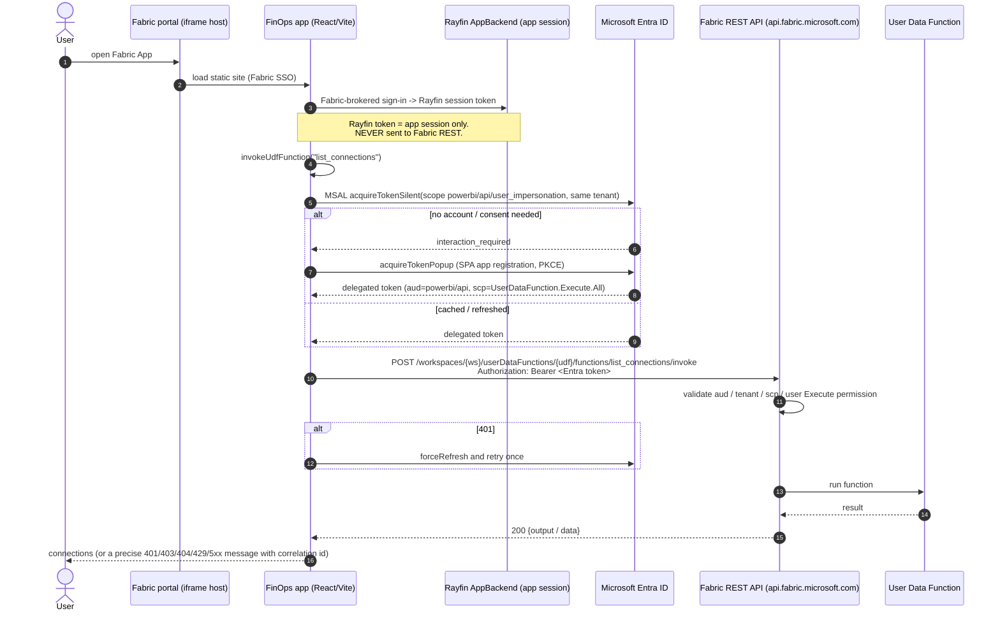

# Fabric UDF 401 and Frontend Deployment — Engineering Report

Date 2026-11-16 · repository `cloud-recommender-poc` · branch `feature/backend-security-hardening` · HEAD `05cf431` ("update for fabric deploy") · working tree dirty (uncommitted work by the cloud-connections effort plus the changes below).
Fabric frontend (authoritative): `fabric-integration/finops-app/packages/frontend` (React 19 + Vite, Rayfin). The Next.js app in `frontend/` is a separate, non-Fabric UI.

## 0. Summary

| Question | Answer |
|---|---|
| Why 401? | The UDF client sent the **Fabric App (Rayfin) session token** — or no token — to `api.fabric.microsoft.com`. Fabric only accepts a **delegated Microsoft Entra token for the Power BI/Fabric audience**. The app had no code or configuration that could acquire one. |
| Fixed in code? | **Yes** — the client now acquires a Fabric-audience Entra token with MSAL (silent → forced refresh on 401 → popup), never sends the Rayfin/backend token to Fabric, and reports precise errors. |
| Fixed in production? | **Not yet.** One manual step remains: an **Entra SPA app registration** (client ID) must be created and its ID set as `VITE_ENTRA_CLIENT_ID`; without it the app now fails with a clear `ENTRA_NOT_CONFIGURED` error instead of an opaque 401. |
| Why was the latest frontend not in production? | The last deployment was **2026-11-05**; no `rayfin up` ran afterwards. Local builds (including the one dated Nov 16) were never uploaded. |
| Deployed now? | **Yes** — static deploy to the verified existing target succeeded (`deploy-20261116171446-0e053d7a`). |
| Definition of done met? | **No.** Deployment is done; SSO + `list_connections` HTTP 200 could **not** be verified (no interactive browser session here) and cannot succeed until the app registration exists. See §7. |

## 1. Root cause analysis (UDF 401)

Evidence, from the code and configuration, not from observing a live token:

1. `lib/fabric-udf-client.ts` called `getAuthToken()` from `lib/api.ts`. That function returns, in order: (a) a stored Entra token (`fabric_entra_access_token`) — **nothing in the app ever stores one** (`setStoredEntraToken` has no caller); (b) the registered token provider, which `use-auth.tsx` wires to `RayfinAuthService.getAccessToken()` = the **Rayfin session access token**; (c) a scan of `localStorage` for a Rayfin `authSession`.
2. So the header was either missing or `Bearer <Rayfin session token>`. That token's audience is the Rayfin AppBackend service, not Fabric. Fabric's UDF invoke endpoint rejects it: **wrong token audience / wrong token type** (a Fabric Apps internal session token passed where a delegated Entra token is required).
3. The app also had **no way** to obtain a Fabric-audience token: the Entra/MSAL setup (`entra-token.service.ts`) only requests the **backend API scope** (`api://<backend>/access_as_user`), and `VITE_ENTRA_CLIENT_ID` is not set in `.env`, `.env.local` or `.env.production`.
4. The visible message "Authentication required. Please sign in via Microsoft Entra ID." is **fabricated by the client for every 401** (it overwrote the server's body), so the real Fabric error text was never shown.

Ruled out / not the cause: expired token (none was acquired), tenant mismatch (not reached), admin consent (never requested), CORS or `function_app.py` (the function has no auth code; Fabric's gateway authenticates before the function runs), duplicate auth initialisation, header overwriting.

**Official requirements** ([Tutorial: invoke user data functions from an application](https://learn.microsoft.com/en-us/fabric/data-engineering/user-data-functions/tutorial-invoke-from-python-app); Rayfin's packaged `direct-entra-auth` guide): an Entra app registration with the **Power BI Service delegated permission `UserDataFunction.Execute.All` (or `Item.Execute.All`)**, a **delegated user token** (not app-only) for the Power BI audience (`https://analysis.windows.net/powerbi/api`) issued in the workspace's tenant, and the user needs Execute permission on the item. The tutorial's Python sample requests `https://analysis.windows.net/powerbi/api/user_impersonation`; **Update:** the app now defaults to the documented `user_impersonation` scope (it first defaulted to `.default`, which Microsoft does not document for this call); configurable via `VITE_FABRIC_UDF_SCOPE`. See `FABRIC_UDF_AUTH_OPTIONS_INVESTIGATION.md`.

Fabric App SSO (`rayfin.yml` → `fabric.enabled`, `externalEntraExchange: true`) authenticates the user **to the Rayfin app**. It is a different credential and cannot be reused for the Fabric REST API; the two are not interchangeable.

## 2. Frontend deployment analysis

| Stage | Finding |
|---|---|
| Build | `npm run build:fabric` works (3 985 modules, exit 0; large-chunk warnings only). `rayfin.yml` → `staticHosting: path packages/frontend, folder dist, buildCommand build:fabric, indexDocument index.html` — correct and points at the real output. |
| Packaging / deploy | **Failure point = deployment never executed after Nov 5.** `rayfin/.deployments.json` recorded `deployedAt 2026-11-05T09:38:04Z`; the last Rayfin logs (`~/.rayfin/logs`) are from Oct 30 – Nov 4; a `dist/` dated Nov 16 existed locally but was produced by a plain build, not by `rayfin up`. |
| Wrong target? | No — workspace `672a6995-4190-4000-befd-5cc6479c3f74`, item `31c70ef5-3a22-4bb8-aab5-3e2f0850b087` (AppBackend `finops-app`), hosting `https://true-holly-e4e36b6da6-northcentralus.webapp.fabricapps.net`. `rayfin up --dry-run` and `rayfin up status` confirmed the target and that the Fabric management endpoint is reachable. |
| Network | An earlier deploy (Nov 2) failed with a **Zscaler 403** block page on the Fabric `…/webapp/deploy` call (`fabric-deployment-error.log`); the Nov 4 deploy succeeded and today's succeeded, so the proxy is not currently blocking. |
| Stale assets / cache | Not the cause: the hosting URL serves only to authenticated sessions (anonymous GET → `401 {"error":"Authentication required."}`), and asset names are content-hashed. After this deploy a hard refresh is still advisable. |
| No version marker | Nothing in the app identified the build, so "which version is live" could not be answered. **Fixed**: see §3 (build id). |

## 3. Files modified (all under `fabric-integration/finops-app/packages/frontend/`)

| File | Change |
|---|---|
| `src/lib/fabric-udf-client.ts` | **Rewritten auth/error path.** Token comes from an injectable `FabricUdfTokenProvider` (default: MSAL Fabric token); Rayfin/backend tokens are never sent; a stored token is used only if its `aud` is Fabric/Power BI; no token ⇒ 401 `UNAUTHENTICATED` without sending (never an empty success); on 401 renew once with `forceRefresh` and retry; typed errors for 401/403/404/429/5xx/timeout with `diagnostics` (function name, HTTP status, client correlation id, Fabric `requestid`, token state/audience/scopes/tenant/expiry — never the token), body sanitised (Bearer/JWT stripped); business errors kept distinct from auth errors. Typed operations (the 10 UDF wrappers) unchanged. |
| `src/lib/jwt-claims.ts` (new) | Safe decode of only `aud, iss, tid, scp, roles, exp, nbf`; `classifyFabricToken` → ok / expired / not_yet_valid / wrong_audience / malformed. |
| `src/config/entra.ts` | `getFabricEntraConfig()` (client id + tenant; tenant falls back to the existing `VITE_FABRIC_TENANT_ID`; scope default `…/powerbi/api/user_impersonation`, override `VITE_FABRIC_UDF_SCOPE`), `missingFabricEntraSettings()`. Independent of the backend API scope. |
| `src/services/entra-token.service.ts` | `getFabricAccessToken({forceRefresh})` on the **same MSAL instance** (one initialisation): silent first, popup only when interaction is required; works without the backend API scope; sign-out already clears the MSAL cache. |
| `src/vite-env.d.ts`, `vite.config.ts`, `vitest.config.ts`, `src/lib/build-info.ts` (new), `src/main.tsx` | **Build identity**: commit, branch, dirty flag, UTC time exposed as `__BUILD_INFO__`, `window.__FINOPS_BUILD__`, a console line at start-up, `<meta name="finops-build">` and `/build-info.json` in the output. |
| `src/test/fabric-udf-client.spec.ts` (updated), `src/test/jwt-claims.spec.ts`, `src/test/fabric-token.spec.ts` (new) | See §6. |

Not changed: `function_app.py`, backend, `rayfin.yml`, any `.env*` file, Databricks code. The pre-existing uncommitted edits to `api.ts`, `entra-token.service.ts` and others (cloud-connections work) were preserved; mine are additive.

## 4. Authentication flow (corrected)

## 5. Deployment verification

| Item | Value |
|---|---|
| Git branch / HEAD | `feature/backend-security-hardening` / `05cf431` (working tree dirty; **the deployed bundle includes uncommitted changes**) |
| Build | `npm run build:fabric` exit 0 (3 985 modules); the deploy command rebuilt and packaged 124 files (6.5 MB) |
| Build identifier | `05cf4311b286+dirty`, built `2026-11-16T17:14:25.336Z` (local `dist/build-info.json`, meta tag, `window.__FINOPS_BUILD__`) |
| Entry bundle | `assets/main-C43raRdD.js` in the packaged `dist/` (the local build before this work was `main-DAvkRDY_`; the bundle hash changes with every build) |
| Fabric workspace ID | `672a6995-4190-4000-befd-5cc6479c3f74` |
| Fabric app / item ID | `31c70ef5-3a22-4bb8-aab5-3e2f0850b087` (AppBackend `finops-app`) |
| Command | `npx rayfin up --dry-run --workspace-id …` (plan: reuse workspace/item, no changes), then `npx rayfin up staticapp deploy` (static content only; backend and data untouched) |
| Result | `Static content deployed (124 files, 6.5 MB)`, attempt 1/5, **Deployment ID `deploy-20261116171446-0e053d7a`**, `.deployments.json` `deployedAt 2026-11-16T17:14:49Z` |
| Hosting URL | https://true-holly-e4e36b6da6-northcentralus.webapp.fabricapps.net |
| Evidence that the latest build is served | **Partial.** Rayfin reported a successful deploy to the verified target and recorded it. I could **not** read the served HTML/JS: the host returns `401 Authentication required` to anonymous requests, and there is no browser session here. To confirm, open the app and check the console line `[FinOps] frontend build 05cf4311b286+dirty (2026-11-16T17:14:25.336Z)` or `window.__FINOPS_BUILD__`. |

## 6. Testing results

Automated (run locally, offline): vitest **18 files / 179 tests pass**; production build passes. New coverage: 22 UDF-client cases (header is the Fabric token; Rayfin token never used; no token ⇒ 401 without a request; token-acquisition failure surfaces; 401 ⇒ one forced refresh then retry; persistent 401 diagnostics incl. wrong audience and no token leakage; 404; 5xx + sanitising; business error vs auth error; timeout; dedupe; 10 operation contracts), 6 JWT-claim cases (whitelist only, accepted audiences, wrong/expired/not-yet-valid, scopes/tenant/expiry), 8 MSAL cases (Fabric scope not backend scope, works without backend scope, forceRefresh, popup only when interaction is required, no popup on other errors, single initialisation, config required, sign-out clears cache).

| Test | Expected result | Actual result | Status |
|---|---|---|---|
| Entra SSO (production) | Successful login | Not run: no interactive browser | **NOT VERIFIED** |
| Session initialisation | Authenticated | Not run | **NOT VERIFIED** |
| Token acquisition (code) | Correct delegated Fabric token | Unit-tested with a fake MSAL; real acquisition needs the app registration | **PASS (unit) / NOT VERIFIED (live)** |
| UDF `list_connections` | HTTP 200 | Not run — cannot succeed until `VITE_ENTRA_CLIENT_ID` exists | **BLOCKED (manual config)** |
| Connections response | Valid data | Not run | **NOT VERIFIED** |
| Production frontend | Latest build | Deploy succeeded to the verified target; served bundle not readable anonymously | **PARTIAL** |
| FinOps dashboards / Databricks / other UDFs | Unchanged and functional | Existing frontend suite passes (179 tests); no live check; Databricks code untouched | **PASS (tests) / NOT VERIFIED (live)** |

## 7. Remaining manual configuration

1. **Entra admin centre → Identity → Applications → App registrations**: create (or reuse) a **single-tenant** app (tenant `fe82a67c-faa7-4d9a-bbfa-7d25b7047b41`).
   - **Authentication → Add a platform → Single-page application**, redirect URIs: `https://true-holly-e4e36b6da6-northcentralus.webapp.fabricapps.net/redirect.html` (and `http://localhost:5173/redirect.html` for local dev). Needed so MSAL can run PKCE and relay the popup.
   - **API permissions → Add → APIs my organisation uses → Power BI Service → Delegated → `UserDataFunction.Execute.All`** (and `Item.Execute.All`). Why: they authorise the delegated call to the UDF invoke endpoint. Per the tutorial admin consent should not be needed; if your tenant blocks user consent, grant admin consent.
   - Copy the **Application (client) ID**.
2. **Build configuration**: set `VITE_ENTRA_CLIENT_ID=<client id>` (public identifier, not a secret) in `packages/frontend/.env.production` (tenant already comes from `VITE_FABRIC_TENANT_ID`; scope defaults to `https://analysis.windows.net/powerbi/api/user_impersonation`). Then redeploy: `npx rayfin up staticapp deploy` from `fabric-integration/finops-app`. I did not edit any `.env` file.
3. **Fabric portal → workspace `672a6995…` → the User Data Functions item `8c5bbc01-c941-4f0e-90d3-7053921c32f8` → Manage permissions**: each user needs at least **Execute** (workspace Contributor or higher, or the item shared with Execute). A 403 after step 2 means this is missing.
4. **Check the tenant allows REST access**: Fabric admin portal → Tenant settings → Developer settings (users can call Fabric APIs), if a 403 persists.
5. **Hosting reachability of the MSAL helper pages**: `rayfin.yml` says `assetAccess: public`, yet an anonymous request to `/redirect.html` and `/popup-relay.html` returned 401. Verify the popup flow inside the signed-in Fabric session; if the pages are blocked, MSAL sign-in will fail and the hosting setting needs review.
6. **Commit the working tree** so the served build (`+dirty`) corresponds to a commit. I did not commit or push.

I did not create or modify any Entra registration, consent, Fabric permission or secret, and did not run any database operation.
