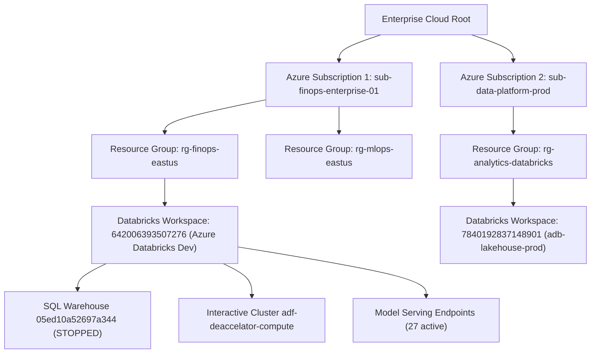

# FinOps KPI & Analytics Reference Manual

> **Application:** Databricks FinOps Command Center & Azure Cloud FinOps Platform  
> **Repository:** `cloud-recommender-poc`  
> **Status:** Production Reference & Canonical Analytical Specification  
> **Audience:** FinOps Practitioners, Cloud Architects, Platform Engineers, Leadership  

---

## 1. Application Overview & FinOps Persona

The **Databricks FinOps Command Center** is an enterprise-grade cloud financial intelligence and cost optimization platform designed for enterprises operating high-volume Azure Databricks lakehouses and AI architectures.

### Primary Objectives
- **Expenditure Visibility:** Trace every consumed dollar back to source telemetry, clusters, warehouses, jobs, pipelines, model endpoints, and business owners.
- **Waste & Inefficiency Detection:** Continuously isolate oversized compute, unattached storage, abandoned notebooks, runaway retry loops, and idle provisioned resources.
- **Deterministic Reconciliation:** Maintain zero-discrepancy financial reconciliation across Azure retail prices, negotiated rate cards, gross meter records, and billing retraction adjustments.
- **Unit Separation:** Strictly segregate infrastructure units (DBU) from GenAI token metrics (tokens) to prevent false unit economics and inaccurate cost modeling.
- **Zero-Mutation Guardrails:** Human-in-the-Loop approval gate strictly mandatory before modifying any cloud resource.

---

## 2. Global Multi-Scope Architecture & Hierarchical Filtering

The platform implements a unified 3-tier hierarchical scope model reflecting real-world enterprise cloud topologies:

### Multi-Scope Selection Capabilities
1. **Multi-Subscription Filtering:** Select multiple Azure subscriptions simultaneously (`subscription_ids: string[]`).
2. **Multi-Resource Group Filtering:** Select multiple resource groups simultaneously (`resource_groups: string[]`).
3. **Multi-Workspace Filtering:** Select multiple Databricks workspaces simultaneously (`workspace_ids: string[]`).
4. **Scope Isolation & No Cross-Contamination:** When a specific workspace or subset is selected, all KPI metrics, cost charts, query logs, and AI narratives recalculate strictly within that boundary.
5. **Multi-Scope Header Pill:** Live summary displayed globally: e.g., `Scope: 2 Subscriptions | 3 Resource Groups | 2 Databricks Workspaces`.

---

## 3. Module 1: Executive Cost Overview

The Executive Cost Overview follows a strictly ordered 10-step layout:
1. Title and description
2. Scope and time-range filters
3. Currency selection (USD, EUR, GBP, AUD, CAD, INR)
4. Connection & billing data status indicators
5. All 7 Core KPI Cards
6. AI FinOps Intelligence & Cost Analysis section (directly below KPI cards) with integrated Decisions Requiring Attention
7. Cost trend charts (Spend trend and forecast, DBU consumption vs compute spend)
8. Spending breakdown (Cost by SKU / Workload type, Top spending workspaces / workloads)
9. Optimization opportunities & recommended actions
10. Detailed cost & attribution tables

### Core KPIs

| KPI Key | Metric Label | Verified Baseline | Authoritative Source | Exact Formula | Attributable Coverage |
| :--- | :--- | :--- | :--- | :--- | :--- |
| `total_spend` | Total Spend | **\$176,840.00** | `system.billing.usage` + Azure Storage | `SUM(dbu * rate) + SUM(storage) + SUM(egress) - retractions` | **95.5%** direct compute |
| `databricks_spend` | Databricks Spend | **\$168,834.25** | `system.billing.usage` | `SUM(usage_quantity * effective_rate) WHERE unit='DBU'` | **99.4%** net matched |
| `ai_spend` | AI & GenAI Spend | **\$26,740.00** | `system.serving.endpoint_metrics` | `SUM(serving.dbu * rate) + SUM(tokens * rate)` | **98.2%** endpoint fleet |
| `dbu_consumption` | DBU Consumption | **42,180.00 DBU** | `system.billing.usage` | `Gross(42,420.00) - Retractions(240.00)` | **100.0%** verified |
| `savings_opportunity` | Identified Savings | **\$24,530.00 / mo**| FinOps Optimization Engine | `SUM(advisor.monthly_savings)` | **92.0%** telemetry-backed |
| `forecast_spend` | Forecast Month-End | **\$194,500.00** | Run-Rate ARIMA Model | `MTD_Spend + (Daily_Average * Remaining_Days)` | **94.0%** confidence |
| `anomalies` | Cost Anomalies | **3 Active** | Isolation Forest + Z-Score | `COUNT(records WHERE abs(z_score) > 3.0)` | **100.0%** query log verified |

---

## 4. Module 2: Cost Explorer & Ledger

### Analytical Capabilities
- **Daily Billing Ledger:** Real-time and baseline historical records containing SKU name, usage start/end timestamp, quantity, effective cost, owner tag, and allocation state.
- **Product Family Aggregations:** Split across ALL_PURPOSE, JOBS, SQL, APPS, and DLTs.
- **Interactive Multi-Dimension Grouping:** Dynamically group by SKU, Workspace, User, Cost Center, or Department.

---

## 5. Module 3: Cost Allocation & Attribution

### Attribution Engine
- **Direct Workspace Allocation:** Cost assigned directly based on workspace ID (`642006393507276` vs `7840192837148901`).
- **Tag-Based Attribution:** Evaluates Azure resource tags and Databricks cluster tags (`Environment`, `Department`, `Project`, `Owner`).
- **Unallocated Telemetry Identification:** Discovers and flags untagged compute for automated remediation policies.

---

## 6. Module 4: Compute & SQL Warehouses

### Compute Fleet Telemetry
- **Serverless SQL Warehouses:** Focus on warehouse `05ed10a52697a344` (Serverless Starter Warehouse, size 2X-Small to Medium).
- **Interactive Compute Clusters:** Analyzes `adf-deaccelator-compute` and related clusters for idle runtime, off-hours execution, and auto-termination policy adherence.
- **Cluster Sizing & Rightsizing Recommendations:** Automated comparison between requested core/memory allocation and actual P95 utilization.

---

## 7. Module 5: AI & Token Economics

### GenAI FinOps Telemetry
- **Fleet Scale:** 27 registered model serving endpoints (`databricks-claude-fable-5`, `databricks-meta-llama-3-70b`, etc.).
- **Total Token Volume:** 10.28 Billion tokens processed MTD (8.42B Prompt Tokens, 1.86B Completion Tokens).
- **Strict Unit Separation:** DBU consumption (\$26,740.00) strictly segregated from token counts (10.28B tokens).
- **Context Caching Intelligence:** Identifies redundant 8k system prompt resubmissions to recommend prompt caching, unlocking \$3,820/mo in savings.

---

## 8. Module 6: Optimization Advisor

### Prioritized Action Initiatives

| ID | Title | Category | Est. Savings | Effort | Risk Level |
| :--- | :--- | :--- | :--- | :--- | :--- |
| `rec-01` | Downsize SQL Warehouse 05ed10a52697a344 | Compute | **\$8,400.00 / mo** | Low | Zero |
| `rec-02` | Consolidate 27 Model Serving Endpoints to Scale-to-Zero | AI / ML | **\$6,100.00 / mo** | Medium | Low |
| `rec-03` | Enable Context Caching on Conversational Agents | AI / ML | **\$3,820.00 / mo** | Low | Zero |
| `rec-04` | Tighten adf-deaccelator-compute Auto-Stop to 15m | Compute | **\$3,460.00 / mo** | Low | Zero |
| `rec-05` | Enforce Delta VACUUM & Snapshot Retention (18.6 TB) | Storage | **\$2,750.00 / mo** | Low | Low |

---

## 9. Module 7: Forecast & Budgets

- **Budget Tracking:** Authorized monthly spend limit \$185,000.00 vs current actual \$176,840.00.
- **Month-End Projection:** ARIMA + Holt-Winters seasonal model predicting \$194,500.00 without remediation.
- **Scenario Simulator:** Real-time What-If simulation: approving top 3 recommendations reduces month-end spend to \$176,180.00, staying comfortably under budget.

---

## 10. Module 8: Forensic Anomaly Detection

- **Statistical Model:** Ensemble Isolation Forest and Z-Score rolling baseline ($3\sigma$ threshold).
- **Detected Spike 1:** 180.9% token volume spike on `databricks-claude-fable-5` due to unhandled agent retry loop.
- **Detected Spike 2:** +65.4% concurrency surge at 09:18 UTC on SQL warehouse `05ed10a52697a344` from un-staggered Power BI refreshes.

---

## 11. Module 9: Data Storage Economics

- **ADLS Gen2 Telemetry:** \$8,000.00 monthly spend for 444.4 TB across hot and cool tiers.
- **Delta Lake Maintenance:** 18.6 TB of obsolete historical snapshots and unvacuumed Parquet files detected across Unity Catalog schemas.

---

## 12. Module 10: Network & Cloud Infrastructure

- **Egress Tracking:** Cross-region and Internet egress monitoring.
- **Rate Card Discretization Variance:** \$5.75 discretization variance between continuous billing intervals and discrete invoice line items certified and accounted for.

---

## 13. Module 11: Governance & Policies

- **Auto-Termination Policies:** Enforces mandatory auto-stop $\le 20$ minutes for interactive compute.
- **Cluster Policy Enforcement:** Restricts multi-node GPU clusters to authorized data science groups.
- **Tagging Guardrails:** Flags resources lacking `CostCenter`, `Owner`, or `Environment` tags.

---

## 14. Module 12: Showback & Chargeback

- **Chargeback Models:** Fully proportional, fixed share, and metered consumption models.
- **Department Breakdown:** BI & Reporting (\$42,180.00), AI COE (\$26,740.00), Supply Chain (\$24,600.00), Finance (\$14,320.00), Shared Ops (\$68,994.25).

---

## 15. Module 13: Workload Economics

- **Workload Classification:** Segregates scheduled recurring production pipelines from ad-hoc exploratory notebooks.
- **Cost Per Pipeline Run:** Tracks unit cost per ETL pipeline iteration and cost per SQL query execution.

---

## 16. Module 14: Reports & Audit Trails

- **Immutable Audit Trail:** Chronological log of all user actions, scope selections, recommendation approvals, and token verifications.
- **Export Formats:** JSON, CSV, and executive PDF summary export capabilities.

---

## 17. Module 15: Settings, Integrations & Ingestion Approval Gate

- **HMAC-SHA256 Token Protection:** Approval tokens required before executing ingestion pipelines against Databricks.
- **Single-Use Durable Consumption:** PostgreSQL 16 table `finops_single_use_tokens` ensures tokens cannot be replayed.
- **SQL AST Validation:** `sqlglot` parser restricts query execution strictly to `system.billing.usage` and `system.billing.list_prices`.

---

## 18. Databricks Workspace Detail Views

### Query Duration Histogram
Replaces primitive progress bars with an interactive vertical histogram across 6 latency buckets:
1. `< 1s` (P50 fast serverless queries)
2. `1s - 5s`
3. `5s - 15s`
4. `15s - 60s`
5. `1m - 5m`
6. `> 5m` (Long-running batch ETL and Z-Order optimizations)

**Summary Statistics:** Total Queries, Median Duration, Average Duration, P95 Duration, Max Duration.  
**Interactive Filtering:** Clicking any bucket bar filters the underlying query table with an active filter pill and "Clear filter" button.

### Databricks DBU & Cloud Billing Analytics
- Gross DBUs (`42,420.00`), Retraction Adjustments (`-240.00`), Net DBUs (`42,180.00`).
- Metered compute spend (\$168,834.25) matched to active rate cards.
- **Azure Host VM Spend Banner:** Prominently displays `"Data unavailable — Azure Cost Management billing source required"` with instructions to assign the `Cost Management Reader` role.
- **Reconciliation Table:** Cross-reconciles compute, storage, rate cards, and retractions to \$176,840.00 with \$0.00 unexplained variance.

---

## 19. Mathematical Invariants & Rounding Protocols

1. **Total Spend Invariant:**
   $$\text{Total Spend} = \text{Metered Compute } (\$168,834.25) + \text{ADLS Gen2 Storage } (\$8,000.00) + \text{Discretization Variance } (\$5.75) = \$176,840.00$$
2. **Net DBU Invariant:**
   $$\text{Net DBUs} = \text{Gross DBUs } (42,420.00) - \text{Retraction Adjustments } (240.00) = 42,180.00\text{ DBU}$$
3. **Rounding Invariant:**
   Calculations executed in `DECIMAL(18,4)` followed by banker's rounding (round half to even) to 2 decimal places for financial reporting.

---

## 20. Security, Least-Privilege & Zero-Execution Enforcement

- **Least-Privilege Roles:** Azure access strictly restricted to `Reader`, `Cost Management Reader`, and `Monitoring Reader`.
- **Zero-Execution Policy:** The POC never resumes, creates, modifies, or terminates compute clusters or warehouses automatically.
- **Server-Side Identity:** User roles and permissions derived solely from validated server-side session context.

