# Bizmetric FinOps & Infrastructure Intelligence Platform
## Complete KPI & Product Demonstration Reference Manual

> **Product:** Bizmetric FinOps & Infrastructure Intelligence Platform  
> **Repository:** `cloud-recommender-poc`  
> **Authoritative Baseline:** Production Release  
> **Target Audience:** FinOps Directors, Cloud Architects, Platform Engineers, Product Demonstration Presenters  
> **Last Verified:** 2026-11-10  
> **Document Status:** Authoritative Enterprise Reference  

---

# SECTION 1 — PRODUCT OVERVIEW

### 1.1 Product Identity & Mission
The **Bizmetric FinOps & Infrastructure Intelligence Platform** is an enterprise-grade financial operations and infrastructure observability solution engineered for organizations managing mission-critical Azure Databricks lakehouses, serverless analytics, and enterprise GenAI architectures.

### 1.2 Business Value Proposition
- **Total Cost Transparency:** Eliminates cloud financial blind spots by correlating granular compute, storage, networking, and GenAI token telemetry directly with business units, cost centers, and project owners.
- **Evidence-Backed Optimization:** Generates deterministic rightsizing, auto-termination, and prompt-caching recommendations backed by actual query logs and usage distributions.
- **Strict Unit Economics:** Enforces clear separation between cloud infrastructure consumption (DBUs, VM cores, disk IOPS) and language model inference metrics (prompt and completion tokens).
- **Proactive Anomaly Detection:** Detects runaway retry loops, zombie compute clusters, and off-hours concurrency surges within minutes rather than at the end of the monthly billing cycle.

### 1.3 Azure Databricks Workspace Context
The platform actively manages and monitors multi-cloud environments with primary focus on Azure Databricks:
- **Default Scoped Workspace:** `642006393507276` (`databricks-azure-dev`)
- **Host Cloud & Region:** Microsoft Azure · `eastus`
- **Associated Subscription:** `sub-finops-enterprise-01` (`c1a7d84e-289b-4b1e-9271-9e2b18642001`)
- **Resource Groups:** `rg-finops-eastus`, `rg-mlops-eastus`, `rg-data-platform`
- **Unity Catalog Metastore:** `azure-eastus-metastore`

### 1.4 Unified Workspace & FinOps Navigation Architecture
The user interface eliminates the traditional divide between IT infrastructure operations and financial analysis by unifying all 21 capabilities under a single Databricks Workspace navigation experience with two visually distinct, logically structured sections:

```mermaid
graph TD
    A["Databricks Workspace (Unified Experience)"] --> B["Section A: Workspace & Operations (11 Modules)"]
    A --> C["Section B: FinOps & Cost Intelligence (10 Modules)"]
    
    B --> B1["1. Overview"]
    B --> B2["2. Clusters"]
    B --> B3["3. Warehouses"]
    B --> B4["4. Jobs & Workflows"]
    B --> B5["5. Pipelines (DLT)"]
    B --> B6["6. Model Serving"]
    B --> B7["7. Unity Catalog"]
    B --> B8["8. Databricks Apps"]
    B --> B9["9. System Tables"]
    B --> B10["10. Query History"]
    B --> B11["11. Audit & Governance"]

    C --> C1["1. Executive Overview"]
    C --> C2["2. Cost Explorer"]
    C --> C3["3. Cost Allocation"]
    C --> C4["4. Cost & Billing"]
    C --> C5["5. Forecast & Budgets"]
    C --> C6["6. Anomaly Detection"]
    C --> C7["7. Optimization Advisor"]
    C --> C8["8. AI Economics"]
    C --> C9["9. Governance & Policies"]
    C --> C10["10. Reports & Audit"]
```

### 1.5 Security Model: Read-Only & Zero-Execution
- **100% Read-Only RBAC:** Built exclusively around Azure `Reader`, `Monitoring Reader`, and `Cost Management Reader` roles, alongside Databricks Workspace `Account User (Read-Only)`.
- **Zero-Execution Policy:** The platform is strictly an advisory and intelligence system. It contains **zero mutating APIs** and cannot execute infrastructure modifications, cluster deletions, or warehouse resumptions against customer subscriptions.
- **SQL Warehouse Enforcement:** Serverless Starter Warehouse (`05ed10a52697a344`) remains strictly `STOPPED`. All diagnostic schemas and query history metadata are ingested via read-only REST endpoints and cached telemetry without starting compute.

### 1.6 Supported Data Sources
1. **Databricks System Tables (`system.*`):**
   - `system.billing.usage`: Granular DBU consumption records, SKU types, resource IDs, and timestamps.
   - `system.billing.list_prices`: Official contracted and retail rate cards per DBU.
   - `system.query.history`: Executed SQL statements, run durations, query status, and user attribution.
   - `system.access.audit`: Workspace login events, credential evaluations, and authorization trails.
   - `system.compute.clusters`: Cluster configurations, autoscale limits, and driver/worker node types.
2. **Azure Cost Management API:** Enterprise Agreement invoice items, Azure compute infrastructure costs, storage accounts, and network egress.
3. **Databricks Model Serving REST API:** Endpoint statuses, served model architectures, compute scaling modes, and token telemetry.
4. **Offline Deterministic Fallback Cache:** Certified 24-record billing ledger and telemetry matrix enabling 100% deterministic local execution without network access.

### 1.7 Data Freshness and Availability Rules
- All timestamps are generated and formatted in deterministic ISO 8601 UTC.
- Data freshness is explicitly indicated on every KPI card (`last_refreshed`).
- When a resource or scope has no telemetry, the platform renders explicit `NOT AVAILABLE` or `$0.00` with clear diagnostic notes rather than fabricating numbers.

---

# SECTION 2 — EXECUTIVE OVERVIEW KPI CARDS

The **Executive Overview** page (`activeModule === "overview"`) renders the 7 certified executive KPI cards. Below is the exhaustive 13-field forensic documentation for every card:

---

### KPI 1: Total Spend (`total_spend`)

- **Business Definition:** The complete gross cloud expenditure incurred across the Databricks lakehouse environment and its underlying Azure cloud infrastructure for the reporting period.
- **Business Purpose:** Provides executive leadership and FinOps steering committees with the single macro financial baseline required to track overall cloud burn rate against authorized organizational budgets.
- **Calculation Formula:**
  $$\text{Total Spend} = \text{Databricks Platform Spend} + \text{Azure Storage Spend} + \text{Azure Network Spend}$$
  $$\$284,620.00 = \$176,840.00 + \$79,360.00 + \$28,420.00$$
  *Aggregation:* `SUM`. Reconciled against Azure Cost Management invoice records.
- **Data Source:** Azure Cost Management API & Databricks Ingestion (`system.billing.usage`).
- **Unit:** United States Dollars (`USD`, `$`).
- **Reporting Period:** Month-to-Date (MTD) / Selected Date Range.
- **Scope:** Full Workspace (`642006393507276`) / Azure Subscription (`sub-finops-enterprise-01`).
- **Data Freshness:** Real-time ingestion snapshot, updated every 60 minutes with UTC timestamp.
- **Interpretation:**
  - *High/Increasing:* Cloud consumption accelerating; review top cost drivers and recent workload deployments.
  - *Low/Decreasing:* Workloads operating efficiently or planned maintenance window in effect.
- **Drill-Down Behavior:** Clicking the card opens the `FinancialKpiDrawer` with comprehensive multi-tier spend breakdown.
- **Detailed Information:** Categorical cost breakdown by service family (Compute Clusters, SQL Warehouses, Automated Jobs, Model Serving, ADLS Gen2 Storage, Network Egress), daily spend velocity curve, and subscription cost allocation.
- **Limitations:** Does not include customer-managed non-cloud third-party software licenses (e.g. Tableau, dbt Cloud) unless explicitly mapped in the custom rate card.
- **Demo Narration:**  
  *"Here on the Executive Overview, Total Spend presents our macro cloud expenditure of \$284,620 across the workspace and underlying Azure infrastructure. Clicking this card opens our Financial KPI Drawer, showing the exact distribution across Databricks compute, ADLS storage, and network egress."*

---

### KPI 2: Databricks Spend (`databricks_spend`)

- **Business Definition:** Direct financial consumption attributable strictly to Azure Databricks platform services (DBUs and managed software compute fees).
- **Business Purpose:** Allows FinOps managers to isolate software-tier consumption from raw cloud infrastructure (VMs and storage), enabling accurate verification of Databricks committed use discounts and contract burn.
- **Calculation Formula:**
  $$\text{Databricks Spend} = \sum_{i=1}^{n} (\text{DBU Consumption}_i \times \text{Effective Rate}_i)$$
  $$\$176,840.00 = \sum 24 \text{ canonical billing ledger items:}$$
  - Automated Jobs (8 runs): $\$74,080.00$
  - SQL Serverless Warehouse: $\$42,180.00$
  - Model Serving Endpoints (27): $\$26,740.00$
  - All-Purpose Compute Cluster: $\$24,600.00$
  - Unity Catalog Lakehouse Storage: $\$8,000.00$
  - Databricks Apps (Unattributed pool): $\$1,240.00$
- **Data Source:** Azure Databricks DBU Metering (`system.billing.usage`).
- **Unit:** United States Dollars (`USD`, `$`).
- **Reporting Period:** Month-to-Date (MTD).
- **Scope:** Workspace Scoped (`642006393507276`).
- **Data Freshness:** Aggregated from official billing ledger with UTC timestamp.
- **Interpretation:**
  - *Increasing:* Indicates expanding data engineering pipelines, interactive SQL querying, or model inference requests.
  - *Decreasing:* Indicates cluster downsizing, job completion, or successful auto-termination tuning.
- **Drill-Down Behavior:** Clicking the card opens the `FinancialKpiDrawer` focused on the 24 canonical ledger lines.
- **Detailed Information:** Tabular breakdown of every Databricks SKU, cluster ID, job ID, warehouse ID, quantity of DBUs consumed, and individual line-item costs.
- **Limitations:** Excludes customer-managed Azure Virtual Network data egress and raw VM infrastructure charges billed directly by Microsoft Azure.
- **Demo Narration:**  
  *"Databricks Spend isolates \$176,840 in pure platform usage across 24 verified ledger records. We can immediately verify that automated jobs account for \$74,080 while SQL warehouses represent \$42,180 of our monthly platform run-rate."*

---

### KPI 3: AI & GenAI Spend (`ai_spend`)

- **Business Definition:** Total direct expenditure allocated to artificial intelligence, foundation model serving, LLM fine-tuning, and AI Gateway token routing across the workspace.
- **Business Purpose:** Delivers specialized visibility into the enterprise GenAI footprint, ensuring generative AI experiments and production LLM applications remain within acceptable cost and unit-economic guardrails.
- **Calculation Formula:**
  $$\text{AI Spend} = \text{Model Serving DBU Spend} + \text{AI Gateway External Tokens} + \text{Auxiliary Vector Search}$$
  $$\$38,460.00 = \$26,740.00 + \$11,296.00 + \$424.00$$
  *Reconciliation Note:* Bottom-up calculation from 8.42B prompt tokens ($\$6,736.00$) + 1.86B completion tokens ($\$4,464.00$) yields $\$11,200.00$; the $\$96.00$ delta represents unverified baseline variance retained as top-down allocation remainder.
- **Data Source:** Azure Databricks Model Serving API & AI Gateway Usage (`system.ai_gateway.usage`).
- **Unit:** United States Dollars (`USD`, `$`).
- **Reporting Period:** Month-to-Date (MTD).
- **Scope:** Model Serving Fleet (27 endpoints) and AI Gateway service principals.
- **Data Freshness:** Polled hourly with active endpoint telemetry.
- **Interpretation:**
  - *Increasing:* Surge in conversational AI traffic, high token consumption, or provisioned concurrency scale-out.
  - *Decreasing:* Implementation of context caching, prompt compression, or model routing to smaller SLMs.
- **Drill-Down Behavior:** Navigates directly to the **AI Economics** module (`activeModule === "ai"`).
- **Detailed Information:** Model-by-model cost breakdown, token distribution curves, endpoint capacity utilization, P95 inference latency, and cache hit ratios.
- **Limitations:** External LLM calls that bypass the Databricks AI Gateway directly from customer notebook code cannot be tracked without service principal instrumentation.
- **Demo Narration:**  
  *"AI Spend currently stands at \$38,460 across 27 served models. By clicking this card, we transition directly into AI Economics, where we can analyze token volumes, prompt cache savings, and cost-per-task metrics."*

---

### KPI 4: DBU Consumption (`dbu_consumption`)

- **Business Definition:** The aggregate Databricks Units (DBU) consumed across all compute engines (All-Purpose clusters, Automated Jobs, Serverless SQL, Model Serving, and Apps).
- **Business Purpose:** Serves as the normalized, currency-neutral unit of compute consumption in Databricks, enabling fair comparisons across cloud regions, discounting tiers, and workload types.
- **Calculation Formula:**
  $$\text{DBU Consumption} = \sum \text{usage\_quantity} \quad (\text{WHERE } \text{unit} = \text{'DBU'})$$
  $$\text{Total} = 88,420.0 \text{ DBU (Sum of 24 Ledger Records:)}$$
  - Automated Jobs compute: $51,073.0 \text{ DBU}$
  - Serverless SQL compute: $19,172.0 \text{ DBU}$
  - All-Purpose Interactive compute: $11,180.0 \text{ DBU}$
  - Model Serving compute: $6,685.0 \text{ DBU}$
  - Databricks Apps compute (Unattributed): $310.0 \text{ DBU}$
  *Effective Quotient:* $\$176,840 / 88,420 \text{ DBU} = \$2.0000/\text{DBU}$ blended baseline rate.
- **Data Source:** Databricks System Tables (`system.billing.usage`).
- **Unit:** Databricks Units (`DBU`). Strictly separated from token counts.
- **Reporting Period:** Month-to-Date (MTD).
- **Scope:** Workspace Scoped (`642006393507276`).
- **Data Freshness:** Official meter records ingested directly from Databricks storage.
- **Interpretation:**
  - *High/Surging:* Heavy computational processing; correlate with job duration histograms to isolate inefficiencies.
  - *Stable:* Normal recurring batch schedule operating within predictable parameters.
- **Drill-Down Behavior:** Opens `FinancialKpiDrawer` with DBU consumption distribution by SKU and engine type.
- **Detailed Information:** Historical DBU burn charts, hourly consumption heatmaps, SKU classification breakdown, and effective rate cards.
- **Limitations:** DBU measures compute consumption; it does not reflect raw storage volume or network egress.
- **Demo Narration:**  
  *"Our DBU Consumption totals 88,420 DBUs across 24 ledger items. The platform strictly isolates infrastructure DBUs from LLM token counts to ensure our unit economics reflect true compute performance."*

---

### KPI 5: Identified Savings (`savings_opportunity`)

- **Business Definition:** The quantified monthly financial savings that will be realized if all currently approved and staged optimization recommendations are implemented.
- **Business Purpose:** Enables FinOps practitioners to demonstrate tangible ROI from continuous optimization and prioritizes high-impact remediation work for platform engineering teams.
- **Calculation Formula:**
  $$\text{Identified Savings} = \sum \text{decision.estimated\_savings\_monthly} \quad (\text{for all approved initiatives})$$
  $$\$24,530.00 / \text{mo} = \$8,400 (\text{rec-01}) + \$6,100 (\text{rec-02}) + \$3,820 (\text{rec-03}) + \$3,460 (\text{rec-04}) + \$2,750 (\text{rec-05})$$
  *(Represents 8.6% of Total Spend and 13.9% of Databricks Platform Spend).*
- **Data Source:** FinOps Optimization Advisor & Heuristic Engine.
- **Unit:** United States Dollars per month (`USD/mo`, `$` and `/mo`).
- **Reporting Period:** Monthly Recurring Run-Rate Opportunity.
- **Scope:** Workspace Scoped (`642006393507276`).
- **Data Freshness:** Evaluated continuously based on 30-day trailing telemetry.
- **Interpretation:**
  - *Higher:* Significant cloud waste or over-provisioned infrastructure identified.
  - *Lower:* Infrastructure is tightly rightsized with minimal idle overhead.
- **Drill-Down Behavior:** Navigates directly to the **Optimization Advisor** module (`activeModule === "recommend"`).
- **Detailed Information:** Prioritized list of recommendations, effort ratings, risk matrices, affected resource IDs, technical justifications, and savings lifecycle stages.
- **Limitations:** Under the platform's strict Zero-Execution policy, savings are categorized as *Potential* or *Approved*; *Implemented* and *Realized* savings remain strictly $\$0.00$ until manual deployment and billing audit.
- **Demo Narration:**  
  *"Identified Savings highlights \$24,530 per month in actionable opportunities—representing 8.6% of total spend. Every recommendation is backed by hard telemetry, from auto-stop adjustments to prompt caching."*

---

### KPI 6: Forecast Month-End (`forecast_spend`)

- **Business Definition:** The projected total cloud expenditure for the workspace at the close of the current monthly billing period based on statistical burn velocity and linear regression modeling.
- **Business Purpose:** Provides financial forecasting predictability, empowering leadership to intervene early when spending trends indicate an imminent budget overrun.
- **Calculation Formula:**
  $$\text{Forecast Month-End} = \text{round}\left(\text{MTD Actual} \times \frac{30.0}{\text{Elapsed Days}}, -2\right)$$
  $$\text{Raw Projection} = \$284,620.00 \times \frac{30.0}{26.7236} = \$319,515.33 \implies \mathbf{\$319,500.00}$$
  *Budget Variance:* Against our approved budget of $\$300,000.00$, this projects a **+\$19,500.00 (+6.5%) overrun**.
- **Data Source:** Linear Regression & Run-Rate Engine.
- **Unit:** United States Dollars (`USD`, `$`).
- **Reporting Period:** Full Month Projection.
- **Scope:** Workspace Scoped (`642006393507276`).
- **Data Freshness:** Recalculated dynamically upon every billing record ingestion.
- **Interpretation:**
  - *Above Budget:* Intervention required; review runaway workloads or approve staged optimization initiatives.
  - *Below Budget:* Healthy fiscal posture with headroom for additional projects.
- **Drill-Down Behavior:** Navigates directly to the **Forecast & Budgets** module (`activeModule === "forecast"`).
- **Detailed Information:** Daily budget burn curves, confidence interval bands ($\pm 3.4\%$), scenario simulator with interactive policy sliders, and departmental budget controls.
- **Limitations:** Assumes continuous run-rate; does not account for future unplanned ad-hoc cluster launches unless simulated via the What-If scenario engine.
- **Demo Narration:**  
  *"Our Forecast Month-End predicts \$319,500 in total spend against our \$300,000 budget, signaling a \$19,500 overrun. Navigating into Forecast & Budgets allows us to simulate how our \$24,530 in optimization savings will pull us back into budget compliance."*

---

### KPI 7: Cost Anomalies (`anomalies`)

- **Business Definition:** The number of active, unresolved cloud spending anomalies detected by statistical outlier models where resource burn deviated significantly from established baseline behavior.
- **Business Purpose:** Alerts operations and FinOps teams to sudden cost surges, misconfigured pipelines, or unintended recursive loops in real time to prevent financial bleeding.
- **Calculation Formula:**
  $$\text{Anomalies} = \text{COUNT}(\text{open\_anomalies WHERE status = 'OPEN'}) = \mathbf{3}$$
  - *Anomaly 1 (High):* `databricks-claude-fable-5` — 180.9% token volume spike ($+\$2,480/day$) due to unhandled agent retry loop.
  - *Anomaly 2 (High):* SQL Warehouse `05ed10a52697a344` — 65.4% concurrency surge ($+\$1,260/day$) from unindexed query join.
  - *Anomaly 3 (Medium):* Cluster `adf-deaccelator-compute` — 42.1% idle time alert ($+\$760/day$) from missed auto-termination.
- **Data Source:** Databricks Usage Anomaly Detector (Isolation Forest & $3\sigma$ Z-score engine).
- **Unit:** Count (`items`).
- **Reporting Period:** Active / Open State.
- **Scope:** Workspace Scoped (`642006393507276`).
- **Data Freshness:** Real-time stream analysis evaluated on 15-minute telemetry windows.
- **Interpretation:**
  - *Count > 0:* Requires immediate triage; inspect affected resources to halt unintended cloud waste.
  - *Count = 0:* All compute and inference workloads operating within expected standard deviations.
- **Drill-Down Behavior:** Navigates directly to the **Anomaly Detection** module (`activeModule === "anomaly"`).
- **Detailed Information:** Anomaly severity breakdown, root-cause diagnostics, affected resource IDs, baseline comparison charts, and one-click triage workflows.
- **Limitations:** Anomalies during intentional load-testing or planned data migrations must be marked as acknowledged exceptions to prevent false alarms.
- **Demo Narration:**  
  *"We have 3 active cost anomalies under investigation, representing \$9,840 in potential monthly exposure. Clicking into Anomaly Detection shows our Isolation Forest model immediately caught an agent retry loop before it could escalate on the monthly bill."*

---

# SECTION 3 — WORKSPACE & OPERATIONS MODULE KPIS

The 11 modules in **Section A (Workspace & Operations)** provide deep infrastructure observability into Databricks platform resources.

---

### Module 1: Workspace Overview (`overview`)

- **Dedicated KPI Cards:**  
  4 interactive summary cards:
  1. *Compute Clusters:* `clusters.length` discovered clusters (Badge: Available). Clicking navigates to Clusters view.
  2. *SQL Warehouses:* `warehouses.length` warehouses (Badge: `STOPPED` - Zero-Execution Enforced). Clicking navigates to Warehouses view.
  3. *Serving Endpoints:* `servingEndpoints.length` (27 models discovered, Badge: Available). Clicking navigates to Model Serving view.
  4. *Databricks Apps:* `apps.length` (3 native applications discovered, Badge: Available). Clicking navigates to Apps view.
- **Summary Statistics & Metrics:**  
  Authentication & Permissions snapshot: Auth Method (`azure-cli / OAuth`), Host Cloud (`azure`), Region (`eastus`), Zero-Execution Guardrail (`Enforced / 100% Read-Only`). Discovery Execution snapshot: Overall State (`Completed`), Total Scoped Resources (`34`), System Tables Schemas (`10 Schemas Verified`).
- **Drill-Down Navigation:** One-click quick-link cards navigate to individual resource tabs.
- **Data Source:** Databricks Discovery Service & Azure Management REST API.

---

### Module 2: Clusters (`clusters`)

- **Dedicated KPI Cards:**  
  `No dedicated KPI cards currently implemented.`
- **Summary Statistics & Metrics:**  
  Header search input (`clusterSearch`), status filter dropdown (`all`, `RUNNING`, `TERMINATED`, `PENDING`), and total resource count badge (`Total: filteredClusters.length`).
- **Table Columns with Business Significance:**  
  Cluster Name, Cluster ID, Status badge (`TERMINATED`, `RUNNING`), Node Type (`Standard_E8ds_v5`), Autoscale range (`2 - 8 workers`), Creator (`service-principal-etl`), and Inspect Action button (`Inspect →`).
- **Row-Level Detail Views & Drill-Down:**  
  Clicking any cluster row opens the slide-over `ResourceDetailDrawer`, displaying configuration JSON, runtime telemetry, worker memory, and 30-day DBU consumption.
- **API Mapping:** `GET /api/v1/workspaces/{workspace_id}/clusters` via Databricks Clusters API 2.0.

---

### Module 3: Warehouses (`warehouses`)

- **Dedicated KPI Cards:**  
  `No dedicated KPI cards currently implemented.`
- **Summary Statistics & Status Indicators:**  
  - Prominent **Zero-Execution Policy Banner**: `Warehouse State: STOPPED (Zero-Execution Policy Enforced)`. Explains that Serverless Starter Warehouse `05ed10a52697a344` is halted and will never be started or mutated by the platform.
  - Search input (`whSearch`), state filter dropdown (`all`, `STOPPED`, `RUNNING`, `STARTING`), and total count badge.
- **Table Columns:**  
  Warehouse Name, Warehouse ID, State (`STOPPED`), Cluster Size (`2X-Small`), Scaling (`1 - 2 clusters`), Auto-Stop (`15 min`), and Action.
- **Drill-Down:** Clicking row opens `ResourceDetailDrawer` showing query concurrency limits and sizing recommendations.
- **API Mapping:** `GET /api/v1/workspaces/{workspace_id}/warehouses` via Databricks SQL Warehouses API.

---

### Module 4: Jobs & Workflows (`jobs`)

- **Dedicated KPI Cards:**  
  `No dedicated KPI cards currently implemented.`
- **Summary Statistics & Metrics:**  
  Search input (`jobSearch`), status filter (`all`, `SUCCESS`, `FAILED`, `RUNNING`), and count badge (`Discovered: filteredJobs.length`).
- **Table Columns:**  
  Job Name, Job ID, Schedule (`Cron: 0 0 * * *`), Creator (`data-eng-team`), Status (`SUCCESS`), Action.
- **Drill-Down:** Clicking row opens `ResourceDetailDrawer` displaying multi-task DAG dependencies, retry parameters, and task-level DBU consumption.
- **API Mapping:** `GET /api/v1/workspaces/{workspace_id}/jobs` via Databricks Jobs API 2.1.

---

### Module 5: Pipelines (`pipelines`)

- **Dedicated KPI Cards:**  
  `No dedicated KPI cards currently implemented.`
- **Summary Statistics & Metrics:**  
  Search input (`pipelineSearch`), state filter (`all`, `ACTIVE`, `IDLE`, `FAILED`), and count badge (`Discovered: filteredPipelines.length`).
- **Table Columns:**  
  Pipeline Name, Pipeline ID, Execution Mode (`Triggered` / `Continuous`), Target Schema (`lakehouse_gold`), Status (`IDLE`), Action.
- **Drill-Down:** Clicking row opens `ResourceDetailDrawer` displaying data quality expectations, dataset lineage, and update runs.
- **API Mapping:** `GET /api/v1/workspaces/{workspace_id}/pipelines` via Delta Live Tables API.

---

### Module 6: Model Serving (`serving`)

- **Dedicated KPI Cards:**  
  `No dedicated KPI cards currently implemented.`
- **Summary Statistics & Metrics:**  
  Fleet count badge (`27 Discovered Models`), search input (`filterQuery`), status filter (`all`, `READY`, `UPDATING`, `FAILED`).
- **Table Columns:**  
  Endpoint Name, Served Entity / Model (`Claude 3.5 Sonnet`, `Llama 3.1 405B`, `BGE Embeddings`), Architecture Type (`Foundation LLM`, `Fine-Tuned`, `Embeddings`), Compute Scale (`Serverless` / `Provisioned Concurrency`), Status (`READY`), Action.
- **Drill-Down:** Clicking row opens `ResourceDetailDrawer` displaying endpoint JSON configuration, request concurrency, and latency SLA.
- **API Mapping:** `GET /api/v1/workspaces/{workspace_id}/serving-endpoints` via Databricks Serving Endpoints API.

---

### Module 7: Unity Catalog (`catalog`)

- **Dedicated KPI Cards:**  
  `No dedicated KPI cards currently implemented.`
- **Interactive Dual-Pane Explorer:**  
  - *Attached Metastore Badge:* `azure-eastus-metastore`.
  - *Left Pane (Namespace Tree):* Interactive navigation across 3-tier hierarchy: Metastore &rarr; Catalogs (`system`, `lakehouse_gold`, `lakehouse_silver`, `raw_bronze`) &rarr; Schemas (`billing`, `compute`, `lakeflow`, `access`, `ai`) &rarr; Tables (`usage`, `list_prices`, `clusters`, `history`, `audit`).
  - *Right Pane (Schema Metadata):* Catalog type, owner, table type (`MANAGED` / `EXTERNAL`), storage format (`DELTA`), and column definitions matrix (Column Name, Data Type, Nullability, Description).
- **API Mapping:** `GET /api/v1/workspaces/{workspace_id}/catalogs` via Unity Catalog REST API.

---

### Module 8: Databricks Apps (`apps`)

- **Dedicated KPI Cards:**  
  `No dedicated KPI cards currently implemented.`
- **Summary Statistics & Attribution Banner:**  
  - Search input, status filter (`all`, `DEPLOYED`, `STOPPED`, `CRASHED`), count badge (`3 Apps`).
  - **Financial Attribution Policy Callout:** `Financial Attribution Policy: Dedicated Unattributed Bucket`. Highlights that shared app compute is preserved in an unattributed pool rather than arbitrarily distributed across SQL warehouses.
- **App Cards Grid:**  
  Displays native apps (`finops-dashboard-app`, `sales-forecasting-ui`, `churn-predictor-app`) with compute runtime state, RAM/CPU allocation, and launch URLs.
- **API Mapping:** `GET /api/v1/workspaces/{workspace_id}/apps` via Databricks Apps REST API.

---

### Module 9: System Tables (`system_tables`)

- **Dedicated KPI Cards:**  
  `No dedicated KPI cards currently implemented.`
- **Summary Statistics & Diagnostic Matrix:**  
  - Diagnostic probe banner: `System Tables Diagnostic Probe (10 Core Schemas Verified)`. Confirms metadata inspection across all 10 schemas while respecting stopped warehouse gates.
  - Filter input (`systemTablesFilter`).
- **Verification Table:**  
  System Table name, Description, Catalog Schema (`system.billing`, `system.compute`, `system.query`, `system.access`, `system.lakeflow`), Columns count, Query State (`REST API Verified / SQL Gated`), Expandable Column Schemas accordion.
- **API Mapping:** Unity Catalog System Schemas inspection API.

---

### Module 10: Query History (`query_history`)

- **Dedicated KPI Cards:**  
  4 summary KPI cards:
  1. *Total Query Executions:* `queryHistoryData?.total_count || 7` (Preserved in `system.query.history`).
  2. *Finished (Success):* `5` finished queries (`71.4%` execution rate).
  3. *Failed Executions:* `1` failed execution (Stopped warehouse error).
  4. *Average Duration:* `1,432 ms` (Serverless compute speed).
- **Chart Metrics:**  
  `QueryDurationHistogram` component rendering query distribution across 6 duration buckets (`<1s`, `1-5s`, `5-15s`, `15-60s`, `1-5m`, `>5m`) with interactive filtering.
- **Table Columns:**  
  Query ID, SQL Statement (clickable syntax modal), Executed By, Warehouse ID, Duration (ms), Rows Returned, Executed At, Status badge (`FINISHED`, `FAILED`).
- **Drill-Down Modal:** Clicking SQL snippet opens the full SQL Query Modal with syntax formatting and one-click copy button.
- **API Mapping:** `GET /api/v1/finops/query-history` via Databricks Query History API.

---

### Module 11: Audit & Governance (`audit`)

- **Dedicated KPI Cards:**  
  `No dedicated KPI cards currently implemented.`
- **Summary Statistics & Security Verification:**  
  - Compliance badge: `Read-Only RBAC Enforced`.
  - Role verification breakdown: Azure Role (`Reader / Monitoring Reader - Verified`), Databricks Workspace Role (`Account User Read-Only - Verified`), Zero-Execution Mutating Permissions (`Blocked & Excluded`).
- **API Mapping:** `system.access.audit` log inspection.

---

# SECTION 4 — FINOPS & COST INTELLIGENCE MODULE KPIS

The 10 modules in **Section B (FinOps & Cost Intelligence)** deliver enterprise financial analytics, forecasting, anomaly triage, and optimization workflows.

---

### Module 1: Executive Overview (`overview`)
*(Full 13-field KPI breakdown documented in Section 2 above).*

---

### Module 2: Cost Explorer (`cost`)

#### KPI 1: Gross Consumption (`gross_consumption`)
- **Business Definition:** Total unadjusted consumption spend across all Databricks workloads before enterprise credits or committed use discounts.
- **Formula:** $\sum \text{billing\_ledger.effective\_cost} = \mathbf{\$176,840.00}$.
- **Source:** Databricks DBU Ingestion (`system.billing.usage`).
- **Unit:** `USD`. Reporting Period: MTD. Scope: Workspace. Freshness: Hourly UTC.
- **Drill-Down:** Opens granular billing ledger breakdown.
- **Limitations:** Does not incorporate Azure enterprise customer tier discounts.

#### KPI 2: Effective Rate (`effective_rate`)
- **Business Definition:** Blended cost per DBU incurred across all compute types, jobs, and warehouses.
- **Formula:** $\frac{\text{Total Effective Cost}}{\text{Total DBU Consumption}} = \frac{\$176,840.00}{88,420.0 \text{ DBU}} = \mathbf{\$2.000/\text{DBU}}$.
- **Source:** Contract Rate Card & Consumption Ledger.
- **Unit:** `USD/DBU`. Reporting Period: MTD. Scope: Workspace. Freshness: Hourly UTC.
- **Drill-Down:** Opens rate card comparison drawer.
- **Limitations:** Represents blended effective average; individual SKU rates range from \$0.15 to \$0.55/DBU list price.

#### KPI 3: Unallocated Spend (`unallocated_spend`)
- **Business Definition:** Workload spend lacking mandatory cost-center, project, or owner metadata tags.
- **Formula:** $\sum \text{billing\_ledger WHERE allocation\_status = 'Unallocated'} = \mathbf{\$1,240.00}$.
- **Source:** Tag Completeness Analyzer.
- **Unit:** `USD`. Reporting Period: MTD. Scope: Workspace. Freshness: Hourly UTC.
- **Drill-Down:** Navigates to Cost Allocation module.
- **Limitations:** Preserved in dedicated unattributed pool; never arbitrarily redistributed.

#### KPI 4: Credits & Discounts (`credits_discounts`)
- **Business Definition:** Total value of Azure committed use discounts, monetary commitments, and promotional credits applied.
- **Formula:** $\sum (\text{azure\_credits} + \text{committed\_use\_discounts}) = \mathbf{\$8,260.00}$.
- **Source:** Azure Commercial Billing & Enterprise Agreement.
- **Unit:** `USD`. Reporting Period: MTD. Scope: Subscription. Freshness: Daily UTC.
- **Drill-Down:** Opens commercial adjustment ledger.
- **Limitations:** Applied at subscription invoice level; attributed proportionally across workspaces.

---

### Module 3: Cost Allocation (`allocation`)

#### KPI 1: Allocated Spend (`allocated_spend`)
- **Business Definition:** Total spend successfully attributed to verified business units and cost centers.
- **Formula:** $\text{Total Spend} - \text{Unallocated Spend} = \$176,840 - \$12,480 = \mathbf{\$164,360.00}$ (92.9% allocated).
- **Source:** Tag & Workspace Rules Engine. Unit: `USD`. Reporting Period: MTD. Scope: Workspace.
- **Drill-Down:** Opens Spend by Business Unit table.

#### KPI 2: Unallocated Spend (`unallocated_spend`)
- **Business Definition:** Spend requiring manual or rule-based owner mapping.
- **Formula:** $\sum \text{unattributed\_usage\_records} = \mathbf{\$12,480.00}$.
- **Source:** Tag Completeness Analyzer. Unit: `USD`. Reporting Period: MTD. Scope: Workspace.
- **Drill-Down:** Opens untagged resource remediation drawer.

#### KPI 3: Active Rules (`active_rules`)
- **Business Definition:** Number of active automated allocation rules evaluating tags, workspace names, and custom metadata.
- **Formula:** $\text{COUNT}(\text{active\_allocation\_rules}) = \mathbf{28 \text{ rules}}$.
- **Source:** FinOps Rule Engine. Unit: `rules`. Scope: Workspace.
- **Drill-Down:** Opens Allocation Rulebook table.

#### KPI 4: Shared Pool (`shared_pool`)
- **Business Definition:** Common infrastructure costs (metastore, networking, shared security clusters) distributed by agreed drivers.
- **Formula:** $\sum \text{shared\_platform\_costs} = \mathbf{\$21,600.00}$.
- **Source:** Shared Cost Allocation Model. Unit: `USD`. Reporting Period: MTD. Scope: Workspace.
- **Drill-Down:** Opens shared pool distribution breakdown.

---

### Module 4: Cost & Billing (`chargeback`)

#### KPI 1: BUs Billed (`bu_billed`)
- **Business Definition:** Number of distinct corporate business units receiving automated showback/chargeback statements.
- **Formula:** $\text{COUNT}(\text{DISTINCT business\_units}) = \mathbf{12 \text{ BUs}}$.
- **Source:** HR Cost Center Map. Unit: `BUs`. Scope: Organization.
- **Drill-Down:** Opens Chargeback Statement list.

#### KPI 2: Shared Pool (`shared_pool`)
- **Business Definition:** Platform overhead distributed across showback statements based on proportional compute consumption.
- **Formula:** $\sum \text{shared\_infrastructure\_costs} = \mathbf{\$21,600.00}$.
- **Source:** Shared Pool Model. Unit: `USD`. Scope: Organization.
- **Drill-Down:** Opens shared allocation statement lines.

#### KPI 3: Disputed Allocations (`disputed_allocations`)
- **Business Definition:** Number of chargeback allocations flagged for review by department finance controllers.
- **Formula:** $\text{COUNT}(\text{open\_chargeback\_disputes}) = \mathbf{3 \text{ disputes}}$.
- **Source:** Dispute Workflow. Unit: `disputes`. Scope: Organization.
- **Drill-Down:** Opens dispute resolution queue.

#### KPI 4: Statement Readiness (`statement_readiness`)
- **Business Definition:** Percentage of line items fully reconciled and certified for monthly financial close.
- **Formula:** $\frac{\text{reconciled\_lines}}{\text{total\_lines}} \times 100 = \mathbf{96\%}$.
- **Source:** Financial Close Validation Engine. Unit: `%`. Scope: Organization.
- **Drill-Down:** Opens statement validation audit log.

---

### Module 5: Forecast & Budgets (`forecast`)

#### KPI 1: Approved Budget (`approved_budget`)
- **Business Definition:** Monthly cloud budget authorized by corporate finance for the workspace.
- **Formula:** `allocated_monthly_budget` = $\mathbf{\$300,000.00}$.
- **Source:** Finance Budget Registry. Unit: `USD`. Scope: Workspace.

#### KPI 2: Actual MTD (`actual_mtd`)
- **Business Definition:** Billed spend incurred from month start to current timestamp.
- **Formula:** $\sum \text{mtd\_consumption\_cost} = \mathbf{\$284,620.00}$ (94.9% consumed).
- **Source:** Azure Databricks Billing. Unit: `USD`. Scope: Workspace.

#### KPI 3: Forecast Month-End (`forecast_month_end`)
- **Business Definition:** Projected total spend at month close based on run-rate velocity.
- **Formula:** $\text{round}\left(\text{MTD Actual} \times \frac{30.0}{26.7236}, -2\right) = \mathbf{\$319,500.00}$.
- **Source:** Forecasting Model. Unit: `USD`. Status: `ESTIMATED`. Scope: Workspace.

#### KPI 4: Forecast Confidence (`forecast_confidence`)
- **Business Definition:** Statistical reliability score representing confidence intervals for the forecast model.
- **Formula:** `r_squared_fit_score` = $\mathbf{87\%}$ (Confidence interval: $\pm 3.4\%$).
- **Source:** Statistical Fit Engine. Unit: `%`. Status: `BASELINE`. Scope: Workspace.

#### KPI 5: Forecast Accuracy (`forecast_accuracy`)
- **Business Definition:** Mean Absolute Percentage Error (MAPE) comparing historical forecasts to closed invoices.
- **Formula:** `mean_absolute_percentage_error` = $\mathbf{\text{NOT AVAILABLE}}$.
- **Source:** Forecasting Model Benchmark. Unit: `MAPE`. Status: `UNAVAILABLE`.
- **Diagnostic Note:** *Requires minimum 3 completed monthly billing cycles with continuous 90-day actuals to certify MAPE accuracy. The platform never fabricates synthetic accuracy metrics.*

#### KPI 6: Budget Utilization (`budget_utilization`)
- **Business Definition:** Proportion of approved monthly budget consumed MTD.
- **Formula:** $\frac{\text{Actual MTD}}{\text{Approved Budget}} \times 100 = \frac{\$284,620}{\$300,000} \times 100 = \mathbf{94.9\%}$.
- **Source:** Finance Budget Registry. Unit: `%`. Scope: Workspace.

#### KPI 7: Projected Overrun (`projected_overrun`)
- **Business Definition:** Predicted financial deficit exceeding authorized monthly budget.
- **Formula:** $\text{Forecast Month-End} - \text{Approved Budget} = \$319,500 - \$300,000 = \mathbf{+\$19,500.00}$ (+6.5%).
- **Source:** Forecasting Model. Unit: `USD`. Status: `ESTIMATED`. Scope: Workspace.

---

### Module 6: Anomaly Detection (`anomaly`)

#### KPI 1: Open Anomalies (`open_anomalies`)
- **Business Definition:** Active detected cost deviations currently under investigation.
- **Formula:** $\text{COUNT}(\text{open\_anomalies}) = \mathbf{3 \text{ items}}$.
- **Source:** Anomaly Engine. Unit: `items`. Scope: Workspace.

#### KPI 2: Potential Exposure (`potential_exposure`)
- **Business Definition:** Cumulative monthly impact if detected anomalies remain unaddressed for 30 days.
- **Formula:** $\sum (\text{anomaly.daily\_impact} \times 30) = \mathbf{\$9,840.00}$.
- **Source:** Exposure Calculator. Unit: `USD`. Scope: Workspace.

#### KPI 3: Mean Time to Detect (`mean_time_to_detect`)
- **Business Definition:** Average latency between anomalous usage inception and detection alert.
- **Formula:** $\text{AVG}(\text{detection\_time} - \text{event\_time}) = \mathbf{18 \text{ min}}$ (Target under 30 min).
- **Source:** Telemetry Latency Monitor. Unit: `min`. Scope: Workspace.

#### KPI 4: Auto-Triaged (`auto_triaged`)
- **Business Definition:** Percentage of anomalies correlated with root causes and operational owners via rules.
- **Formula:** $\frac{\text{triaged\_anomalies}}{\text{total\_anomalies}} \times 100 = \mathbf{86\%}$.
- **Source:** Triage Engine. Unit: `%`. Scope: Workspace.

---

### Module 7: Optimization Advisor (`recommend`)

#### KPI 1: Potential Savings (`potential_savings`)
- **Business Definition:** Theoretical unconstrained maximum monthly savings before change-control filtering.
- **Formula:** $\sum \text{all\_detected\_waste\_candidates} = \mathbf{\$31,340.00}$.
- **Source:** FinOps Advisor Heuristics. Unit: `USD`. Scope: Workspace.

#### KPI 2: Estimated Savings (`estimated_savings`)
- **Business Definition:** Actionable heuristic opportunities identified across compute, storage, and models.
- **Formula:** $\sum \text{actionable\_heuristic\_opportunities} = \mathbf{\$31,280.00}$.
- **Source:** FinOps Advisor Heuristics. Unit: `USD`. Status: `ESTIMATED`. Scope: Workspace.

#### KPI 3: Approved Savings (`approved_savings`)
- **Business Definition:** Savings associated with staged, technically verified initiatives awaiting deployment.
- **Formula:** $\sum \text{staged\_initiatives.estimated\_savings} = \mathbf{\$24,530.00}$ (5 Staged Initiatives).
- **Source:** FinOps Advisor Decisions. Unit: `USD`. Status: `BASELINE`. Scope: Workspace.

#### KPI 4: Quick Wins (`quick_wins`)
- **Business Definition:** High-impact recommendations characterized by low operational effort and zero downtime risk.
- **Formula:** $\text{COUNT}(\text{recommendations WHERE effort = 'Low'}) = \mathbf{5 \text{ items}}$.
- **Source:** FinOps Advisor. Unit: `items`. Scope: Workspace.

#### KPI 5: Awaiting Approval (`awaiting_approval`)
- **Business Definition:** Recommendations requiring formal platform engineering change-control approval.
- **Formula:** $\text{COUNT}(\text{recommendations WHERE status = 'Approval required'}) = \mathbf{5 \text{ items}}$.
- **Source:** FinOps Advisor. Unit: `items`. Scope: Workspace.

#### KPI 6: Implemented Savings (`implemented_savings`)
- **Business Definition:** Verified post-execution savings applied directly to customer environments.
- **Formula:** `sum(implemented_recommendations.actual_savings)` = $\mathbf{\$0.00}$.
- **Source:** FinOps Governance Engine. Unit: `USD`. Status: `BASELINE`. Scope: Workspace.
- **Policy Enforcement:** *Under the platform's strict Zero-Execution and Read-Only policy, the platform never modifies customer infrastructure automatically. Implemented savings remain strictly \$0.00.*

#### KPI 7: Realized Savings (`realized_savings`)
- **Business Definition:** Savings audited and validated on subsequent official cloud billing invoices.
- **Formula:** `sum(verified_post_audit_savings)` = $\mathbf{\$0.00}$.
- **Source:** FinOps Billing Audit. Unit: `USD`. Status: `BASELINE`. Scope: Workspace.
- **Policy Enforcement:** *Pending post-implementation monthly invoice reconciliation. Realized savings are never fabricated.*

---

### Module 8: AI Economics (`ai`)

#### KPI 1: AI Spend (`ai_spend`)
- **Business Definition:** Total direct spend across model serving endpoints, AI Gateway tokens, and vector databases.
- **Formula:** $\text{Model Serving (\$26,740)} + \text{AI Gateway (\$11,296)} + \text{Vector Search (\$424)} = \mathbf{\$38,460.00}$.
- **Source:** Model Serving Inventory (27 endpoints) & AI Gateway Telemetry. Unit: `USD`. Scope: Workspace.

#### KPI 2: Input Tokens (`input_tokens`)
- **Business Definition:** Total prompt tokens processed across all foundation models and conversational endpoints.
- **Formula:** $\sum \text{system.ai\_gateway.usage.prompt\_tokens} = \mathbf{8.42\text{B tokens}}$ (81.9% of total 10.28B tokens).
- **Source:** AI Gateway Telemetry. Unit: `tokens`. Scope: Workspace.
- **Strict Separation:** *Measured strictly in tokens; never conflated with DBUs.*

#### KPI 3: Output Tokens (`output_tokens`)
- **Business Definition:** Total completion tokens generated by served language models.
- **Formula:** $\sum \text{system.ai\_gateway.usage.completion\_tokens} = \mathbf{1.86\text{B tokens}}$ (18.1% of total 10.28B tokens).
- **Source:** AI Gateway Telemetry. Unit: `tokens`. Scope: Workspace.

#### KPI 4: Cached Tokens (`cached_tokens`)
- **Business Definition:** Prompt tokens served from provider-side context caches, avoiding full inference computation.
- **Formula:** $\sum \text{cached\_prompt\_tokens} = \mathbf{2.10\text{B tokens}}$ (25.0% of input volume).
- **Source:** Provider Context Caching Telemetry. Unit: `tokens`. Scope: Workspace.

#### KPI 5: Cost per 1K Tokens (`cost_per_1k_tokens`)
- **Business Definition:** Blended rate incurred per 1,000 tokens processed across the enterprise model fleet.
- **Formula:** $\frac{\text{AI Spend}}{\text{Total Tokens} / 1000} = \frac{\$38,460}{10,280,000} = \mathbf{\$0.0037/\text{1K tokens}}$.
- **Source:** Model Rate Card & AI Gateway Usage. Unit: `USD/1K`. Scope: Workspace.

#### KPI 6: Cost per Task (`cost_per_task`)
- **Business Definition:** Unit economic metric measuring the average AI cost to execute a completed business task.
- **Formula:** $\frac{\text{Total Task Invocations Spend}}{\text{Completed Business Tasks}} = \mathbf{\$0.084/\text{task}}$ ($\downarrow 6.2\%$ vs prior month).
- **Source:** Task Completion Unit Economics Engine. Unit: `USD/task`. Scope: Workspace.

---

### Module 9: Governance & Policies (`governance`)

#### KPI 1: Policy Compliance (`policy_compliance`)
- **Business Definition:** Percentage of active cloud resources adhering to organizational tagging, sizing, and security policies.
- **Formula:** $\frac{\text{Compliant Resources}}{\text{Evaluated Resources}} \times 100 = \mathbf{94.2\%}$ (+2.1 pts vs prior audit).
- **Source:** Policy Audit Engine. Unit: `%`. Scope: Workspace.

#### KPI 2: Policy Violations (`policy_violations`)
- **Business Definition:** Total active configuration breaches (e.g. untagged compute, auto-termination disabled).
- **Formula:** $\text{COUNT}(\text{active\_policy\_violations}) = \mathbf{18 \text{ violations}}$ (6 unresolved).
- **Source:** Compliance Scanner. Unit: `violations`. Scope: Workspace.

#### KPI 3: Resources Without Owner (`resources_without_owner`)
- **Business Definition:** Unclaimed compute clusters, warehouses, or storage assets missing the mandatory `Owner` tag.
- **Formula:** $\text{COUNT}(\text{resources WHERE owner\_tag IS NULL}) = \mathbf{16 \text{ resources}}$.
- **Source:** Tag Completeness Analyzer. Unit: `resources`. Scope: Workspace.

#### KPI 4: Expiring Exceptions (`expiring_exceptions`)
- **Business Definition:** Temporary policy waivers scheduled to lapse within the next 14 calendar days.
- **Formula:** $\text{COUNT}(\text{exceptions WHERE expiry\_date} \le \text{now}() + 14\text{d}) = \mathbf{5 \text{ exceptions}}$.
- **Source:** Exception Registry. Unit: `exceptions`. Scope: Workspace.

---

### Module 10: Reports & Audit (`reports`)

- **Dedicated KPI Cards:**  
  `No dedicated KPI cards currently implemented.`
- **Report Packs Available for Export:**  
  1. *Executive FinOps Pack (`rep-exec`):* Comprehensive summary of spend, forecast, savings, budget variance, and decisions (Formats: CSV, PDF).
  2. *AI Unit Economics (`rep-ai`):* Token volumes, model serving costs, cost per task, and cache efficiency (Format: CSV).
  3. *Optimization Realization (`rep-opt`):* Staged recommendations, potential savings, and service impact (Format: CSV).
  4. *Cloud Reconciliation (`rep-cloud`):* Databricks usage records cross-referenced against Azure billing invoices (Format: CSV).
  5. *Allocation & Chargeback (`rep-alloc`):* Departmental statements and shared cost model distributions (Format: CSV).
  6. *Policy Compliance (`rep-gov`):* Audit trail, tagging gaps, and active policy exceptions (Format: CSV).
- **Audit Event Log Table:**  
  Displays chronological security and access log with Timestamp, User identity, Action performed, Target Resource ID, Outcome Status (`SUCCESS`), and Operational Notes.

---

# SECTION 5 — CONSOLIDATED KPI FORMULA & DATA SOURCE REFERENCE TABLE

| Module | KPI Name | Formula | Authoritative Source | Unit | Scope | Drill-Down Target |
|:---|:---|:---|:---|:---|:---|:---|
| **Executive Overview** | Total Spend | `databricks_spend + azure_storage_spend + azure_network_spend` | Azure Cost Management & Databricks Ingestion | USD | Workspace / Sub | `FinancialKpiDrawer` |
| **Executive Overview** | Databricks Spend | `dbu_consumption * blended_rate` (24 ledger records) | Azure Databricks DBU Metering | USD | Workspace | `FinancialKpiDrawer` |
| **Executive Overview** | AI & GenAI Spend | `model_serving_dbu + ai_gateway_tokens + vector_search` | Model Serving & AI Gateway | USD | Workspace | AI Economics Module |
| **Executive Overview** | DBU Consumption | `sum(system.billing.usage.usage_quantity)` | `system.billing.usage` | DBU | Workspace | `FinancialKpiDrawer` |
| **Executive Overview** | Identified Savings | `sum(decisions.estimated_savings_monthly)` | FinOps Optimization Advisor | USD/mo | Workspace | Optimization Advisor Module |
| **Executive Overview** | Forecast Month-End | `round(mtd_spend * (30.0 / 26.7236), -2)` | Linear Regression & Run-Rate Engine | USD | Workspace | Forecast & Budgets Module |
| **Executive Overview** | Cost Anomalies | `count(open_anomalies)` | Databricks Usage Anomaly Detector | count | Workspace | Anomaly Detection Module |
| **Cost Explorer** | Gross Consumption | `sum(billing_ledger.effective_cost)` | `system.billing.usage` | USD | Workspace | Granular Billing Ledger |
| **Cost Explorer** | Effective Rate | `total_effective_cost / total_dbu_consumption` | Contract Rate Card & Ledger | USD/DBU | Workspace | Rate Card Drawer |
| **Cost Explorer** | Unallocated Spend | `sum(billing_ledger WHERE status = 'Unallocated')` | Tag Completeness Analyzer | USD | Workspace | Cost Allocation Module |
| **Cost Explorer** | Credits & Discounts | `sum(azure_credits + committed_use_discounts)` | Azure Commercial Billing | USD | Subscription | Adjustments Ledger |
| **Cost Allocation** | Allocated Spend | `total_spend - unallocated_spend` | Tag & Workspace Rules Engine | USD | Workspace | Spend by BU Table |
| **Cost Allocation** | Unallocated Spend | `sum(unattributed_usage_records)` | Tag Completeness Analyzer | USD | Workspace | Remediation Drawer |
| **Cost Allocation** | Active Rules | `count(active_allocation_rules)` | FinOps Rule Engine | rules | Workspace | Rulebook Table |
| **Cost Allocation** | Shared Pool | `sum(shared_platform_costs)` | Shared Cost Allocation Model | USD | Workspace | Shared Pool Breakdown |
| **Cost & Billing** | BUs Billed | `count(distinct business_units)` | HR Cost Center Map | BUs | Organization | Chargeback Statement |
| **Cost & Billing** | Shared Pool | `sum(shared_infrastructure_costs)` | Shared Pool Model | USD | Organization | Shared Pool Breakdown |
| **Cost & Billing** | Disputed Allocations | `count(open_chargeback_disputes)` | Dispute Workflow | disputes | Organization | Dispute Queue |
| **Cost & Billing** | Statement Readiness | `reconciled_lines / total_lines` | Financial Close Validation | % | Organization | Close Audit Trail |
| **Forecast & Budgets** | Approved Budget | `allocated_monthly_budget` | Finance Budget Registry | USD | Workspace | Budget Controls Table |
| **Forecast & Budgets** | Actual MTD | `sum(mtd_consumption_cost)` | Azure Databricks Billing | USD | Workspace | Spend Trend Chart |
| **Forecast & Budgets** | Forecast Month-End | `round(mtd_actual * (30.0 / 26.7236), -2)` | Forecasting Model | USD | Workspace | Scenario Simulator |
| **Forecast & Budgets** | Forecast Confidence | `r_squared_fit_score` | Statistical Fit Engine | % | Workspace | Fit Diagnostics |
| **Forecast & Budgets** | Forecast Accuracy | `mean_absolute_percentage_error` (`NOT AVAILABLE`) | Forecasting Model Benchmark | MAPE | Workspace | Accuracy Audit |
| **Forecast & Budgets** | Budget Utilization | `(actual_mtd / approved_budget) * 100` | Finance Budget Registry | % | Workspace | Budget Burn Curve |
| **Forecast & Budgets** | Projected Overrun | `forecast_month_end - approved_budget` | Forecasting Model | USD | Workspace | Scenario Simulator |
| **Anomaly Detection** | Open Anomalies | `count(open_anomalies)` | Anomaly Engine | items | Workspace | Anomalies Queue |
| **Anomaly Detection** | Potential Exposure | `sum(anomaly.daily_impact * 30)` | Exposure Calculator | USD | Workspace | Impact Detail Drawer |
| **Anomaly Detection** | Mean Time to Detect | `avg(detection_time - event_time)` | Telemetry Latency Monitor | min | Workspace | Latency Monitor Chart |
| **Anomaly Detection** | Auto-Triaged | `triaged_anomalies / total_anomalies` | Triage Engine | % | Workspace | Triage Trail |
| **Optimization Advisor**| Potential Savings | `sum(all_detected_waste_candidates)` | FinOps Advisor Heuristics | USD | Workspace | Recommendations List |
| **Optimization Advisor**| Estimated Savings | `sum(actionable_heuristic_opportunities)` | FinOps Advisor Heuristics | USD | Workspace | Recommendations List |
| **Optimization Advisor**| Approved Savings | `sum(staged_initiatives.estimated_savings)` | FinOps Advisor Decisions | USD | Workspace | Staged Initiatives Drawer |
| **Optimization Advisor**| Quick Wins | `count(recommendations WHERE effort = 'Low')` | FinOps Advisor | items | Workspace | Quick Wins View |
| **Optimization Advisor**| Awaiting Approval | `count(recommendations WHERE status = 'Approval required')` | FinOps Advisor | items | Workspace | Approval Workflow |
| **Optimization Advisor**| Implemented Savings | `sum(implemented.actual_savings) [strictly $0.00]` | FinOps Governance Engine | USD | Workspace | Zero-Execution Banner |
| **Optimization Advisor**| Realized Savings | `sum(verified_post_audit_savings) [strictly $0.00]` | FinOps Billing Audit | USD | Workspace | Audit Trail |
| **AI Economics** | AI Spend | `model_serving + ai_gateway + vector_search` | Model Serving Inventory & AI Gateway | USD | Workspace | Model Economics Table |
| **AI Economics** | Input Tokens | `sum(system.ai_gateway.usage.prompt_tokens)` | AI Gateway Telemetry | tokens | Workspace | Token Chart |
| **AI Economics** | Output Tokens | `sum(system.ai_gateway.usage.completion_tokens)` | AI Gateway Telemetry | tokens | Workspace | Token Chart |
| **AI Economics** | Cached Tokens | `sum(cached_prompt_tokens)` | Provider Context Caching | tokens | Workspace | Caching Detail |
| **AI Economics** | Cost per 1K Tokens | `ai_spend / (total_tokens / 1000)` | Model Rate Card & Usage | USD/1K | Workspace | Rate Card Drawer |
| **AI Economics** | Cost per Task | `ai_task_spend / completed_tasks` | Task Economics Engine | USD/task| Workspace | Task Scorecard |
| **Governance & Policies**| Policy Compliance | `compliant_resources / total_evaluated` | Policy Audit Engine | % | Workspace | Policy Matrix |
| **Governance & Policies**| Policy Violations | `count(active_policy_violations)` | Compliance Scanner | violations| Workspace | Violations Queue |
| **Governance & Policies**| Resources Without Owner| `count(resources WHERE owner_tag IS NULL)` | Tag Completeness Analyzer | resources| Workspace | Tag Remediation |
| **Governance & Policies**| Expiring Exceptions | `count(exceptions WHERE expiry <= now + 14d)` | Exception Registry | exceptions| Workspace | Exception Workflow |
| **Query History** | Total Query Executions | `count(system.query.history)` | `system.query.history` | queries | Workspace | Duration Histogram |
| **Query History** | Finished (Success) | `count(records WHERE status = 'FINISHED')` | `system.query.history` | queries | Workspace | Finished Queries Filter |
| **Query History** | Failed Executions | `count(records WHERE status = 'FAILED')` | `system.query.history` | queries | Workspace | Failed Queries Filter |
| **Query History** | Average Duration | `avg(execution_duration_ms)` | `system.query.history` | ms | Workspace | Duration Buckets |

---

# SECTION 6 — DETAILED DRILL-DOWN REFERENCE

### 6.1 `FinancialKpiDrawer`
- **Clickable Trigger:** Clicking any of the 7 KPI cards on the Executive Overview (`Total Spend`, `Databricks Spend`, `DBU Consumption`, etc.).
- **Destination:** Right slide-over drawer modal (`FinancialKpiDrawer`).
- **Detail Sections:**  
  1. *Header Bar:* KPI title, metric ID badge, current formatted value, delta badge, and close button (`X`).
  2. *Canonical Provenance:* Data source name, refresh timestamp (ISO UTC), aggregation method, and underlying formula.
  3. *Dimensional Breakdown:* Tabular breakdown by compute category, SKU, resource group, or business unit.
  4. *Audit & Limitations Disclosure:* Exact boundary assumptions and exclusions.
  5. *Export Actions:* One-click CSV and PDF download buttons.

### 6.2 `ResourceDetailDrawer`
- **Clickable Trigger:** Clicking any resource row in Clusters, Warehouses, Jobs, Pipelines, Model Serving, or Apps.
- **Destination:** Right slide-over drawer modal (`ResourceDetailDrawer`).
- **Detail Sections:**  
  1. *Identity Banner:* Resource name, ID, category icon, and current status badge.
  2. *Configuration Metadata:* Sizing, node types, driver specs, autoscale bounds, creator tag, and creation timestamp.
  3. *Financial Telemetry:* MTD DBU consumption, effective cost, and cost center attribution.
  4. *Zero-Execution Safety Note:* Explicit notice confirming read-only discovery.

### 6.3 SQL Query Modal (`isQueryModalOpen`)
- **Clickable Trigger:** Clicking any SQL statement snippet in Query History table.
- **Destination:** Centered modal window.
- **Detail Sections:** Full formatted SQL syntax, syntax-highlighted code block, execution duration (ms), rows returned, user identity, warehouse ID, execution timestamp, and one-click **Copy SQL** button.

### 6.4 `QueryDurationHistogram`
- **Clickable Trigger:** Clicking any of the 6 duration bucket bars (`<1s`, `1-5s`, `5-15s`, `15-60s`, `1-5m`, `>5m`).
- **Behavior:** Dynamically filters the underlying Query History table to display exclusively the SQL executions falling within the clicked latency bucket. Clicking again clears the filter.

---

# SECTION 7 — FINANCIAL TERMINOLOGY GLOSSARY

1. **DBU (Databricks Unit):** Normalized unit of processing capability per hour used for billing across Azure Databricks compute engines.
2. **Gross DBU:** Total raw DBU consumption recorded by meters prior to commercial adjustments or billing retractions.
3. **Net DBU:** Final billed DBU consumption following deductions for retractions or credits ($\text{Net} = \text{Gross} - \text{Retractions}$).
4. **Billing Retraction:** An official credit adjustment issued by Databricks or Azure to reverse meters from failed infrastructure or spot evictions.
5. **SKU (Stock Keeping Unit):** Specific commercial meter identification code (e.g. `STANDARD_ALL_PURPOSE_COMPUTE`, `SERVERLESS_SQL_COMPUTE`).
6. **List Price:** Published public retail rate per DBU before enterprise discounting.
7. **Effective Price / Rate:** Net contracted rate per DBU realized by the enterprise after committed use discounts.
8. **Usage Quantity:** The numerical volume of units (DBUs, gigabytes, hours) consumed in a billing record.
9. **Actual Expenditure:** Billed cloud financial charges incurred and reconciled against verified meter records.
10. **Forecasted Expenditure:** Statistically projected cost for the remainder of the monthly billing period based on run-rate velocity.
11. **Budget Utilization:** Percentage of authorized budget consumed to date ($\frac{\text{Actual MTD}}{\text{Approved Budget}} \times 100$).
12. **Potential Savings:** Theoretical unconstrained maximum monthly savings identified across all waste detection heuristics.
13. **Estimated Savings:** Qualified savings from actionable optimization recommendations before change-control staging.
14. **Approved Savings:** Quantified monthly savings from recommendations formally approved by FinOps practitioners awaiting deployment.
15. **Implemented Savings:** Post-execution savings achieved after technical changes are deployed. Under zero-execution, verified strictly at **\$0.00**.
16. **Realized Savings:** Savings certified on subsequent official cloud billing invoices following post-implementation audit. Verified strictly at **\$0.00**.
17. **Unattributed Cost:** Spend associated with workloads missing mandatory owner, department, or cost-center tags.
18. **Token Consumption:** Number of discrete prompt (input) and completion (output) language units processed by LLM endpoints.
19. **Model Serving Expenditure:** Financial cost of hosting and executing foundation model inference endpoints.
20. **Anomaly Deviation:** Statistical divergence of current spending velocity from established trailing baselines (typically $> 3\sigma$).
21. **Forecast Accuracy:** Benchmark metric (MAPE) measuring variance between forecasted spend and final closed invoices.
22. **R-Squared ($R^2$):** Statistical coefficient of determination indicating the quality of fit of the forecasting regression model.

---

# SECTION 8 — DATA TRUST AND LIMITATIONS

Presenters and operators must transparently disclose the following 8 data trust principles during any product demonstration:

1. **Databricks Billing Is Not a Complete Azure Invoice:** Databricks DBU metering covers software platform charges. Underlying Azure Virtual Machines, Blob storage, and networking require their own synchronized Azure Cost Management telemetry.
2. **Azure Infrastructure Requires Dedicated Verification:** VM core charges and ADLS Gen2 storage tiers are reconciled independently from Databricks compute DBUs.
3. **Missing Source Data Is Never Displayed as Zero:** When telemetry is unavailable or unpolled, the platform displays explicit `NOT AVAILABLE` or diagnostic badges rather than presenting a false \$0.00.
4. **Token Telemetry Is Strictly Segregated From DBUs:** Language model token volumes (10.28B tokens) are never converted into synthetic DBU counts. Unit boundaries remain pristine.
5. **Forecast Accuracy Is Never Fabricated:** When fewer than 3 completed monthly billing cycles exist, Forecast Accuracy explicitly outputs `NOT AVAILABLE` rather than displaying an invented MAPE percentage.
6. **Potential Savings Are Never Claimed as Realized:** Under our strict Zero-Execution policy, savings remain Potential or Approved. Implemented and Realized savings report strictly \$0.00 until verified post-deployment.
7. **Unattributed Costs Remain Fully Visible:** Untagged compute is never swept into miscellaneous buckets or distributed across clusters; it is preserved transparently in the dedicated Unattributed Cost bucket (\$1,240).
8. **Historical or Cached Data Is Explicitly Timestamped:** Every KPI card and ledger table displays exact UTC refresh timestamps, ensuring operators distinguish cached baselines from live streaming metrics.

---

# SECTION 9 — PRODUCT DEMONSTRATION SCRIPT REFERENCE

Use the following modular presentation scripts when delivering client-facing enterprise demonstrations:

---

### Demo Scenario 1: Executive Overview & AI FinOps Intelligence
- **What the User Sees:** The unified Executive Overview featuring the 7 certified KPI cards, followed immediately by the AI FinOps Intelligence & Cost Analysis panel and interactive spend trends.
- **What It Means:** Establishes the macro cloud health of the enterprise lakehouse (\$284,620 total spend, \$176,840 Databricks spend, \$38,460 AI spend, and \$24,530 identified savings).
- **Why It Matters:** Gives executives instant visibility into whether cloud spend is driving business value or bleeding budget.
- **What the Presenter Clicks:** Click the **Identified Savings** card or the **AI FinOps Intelligence** decision buttons.
- **What the Detail View Demonstrates:** Opens the Financial KPI Drawer or triggers recommendation staging, showing exact formula calculations and lineage.
- **Business Outcome:** Aligns finance, operations, and leadership around verified facts with zero ambiguity.

---

### Demo Scenario 2: Zero-Execution Safety & Serverless SQL Warehouses
- **What the User Sees:** Navigate to **Warehouses** under Section A. Point out the amber banner: `Warehouse State: STOPPED (Zero-Execution Policy Enforced)`.
- **What It Means:** Proves to security and cloud governance teams that this platform is 100% read-only.
- **Why It Matters:** Enterprises will not grant write access or risk automated scripts resizing production warehouses without human approval.
- **What the Presenter Clicks:** Click the warehouse row `05ed10a52697a344`.
- **What the Detail View Demonstrates:** The `ResourceDetailDrawer` slides out, showing historical query concurrency, sizing analysis, and cost without resuming the stopped compute engine.
- **Business Outcome:** Unlocks customer enterprise security approval for deployment in regulated environments.

---

### Demo Scenario 3: AI & Token Economics Deep Dive
- **What the User Sees:** Navigate to **AI Economics** under Section B. Show the 6 GenAI KPI cards (8.42B input tokens, 1.86B output tokens, 2.10B cached tokens, \$0.084 cost per task).
- **What It Means:** Demonstrates specialized FinOps intelligence tailored specifically for LLM and GenAI adoption.
- **Why It Matters:** Most enterprises have zero visibility into token economics and suffer severe bill shock when LLM agents enter production.
- **What the Presenter Clicks:** Point out the **Context Caching** metric and Model Economics breakdown table.
- **What the Detail View Demonstrates:** Shows that 25% of input tokens are cached, saving \$3,820 monthly on Claude 3.5 and Llama 3.1 endpoints.
- **Business Outcome:** Empowers AI Centers of Excellence to scale generative AI cost-effectively.

---

### Demo Scenario 4: Forecast, Budget Overrun & What-If Simulation
- **What the User Sees:** Navigate to **Forecast & Budgets** under Section B. Highlight the projected overrun: `+$19,500` against the \$300,000 budget.
- **What It Means:** Demonstrates predictive forecasting alerting leadership to budget failure before the month closes.
- **Why It Matters:** Moves the organization from reactive retrospective billing complaints to proactive financial governance.
- **What the Presenter Clicks:** Adjust the interactive **Scenario Simulator** sliders (e.g. increase Compute Rightsizing to 25% and Token Optimization to 20%).
- **What the Detail View Demonstrates:** The projected spend recalculates dynamically in real time, dropping from \$319,500 to \$288,400—safely below the \$300,000 budget cap.
- **Business Outcome:** Delivers actionable executive decisions that protect organizational profitability.

