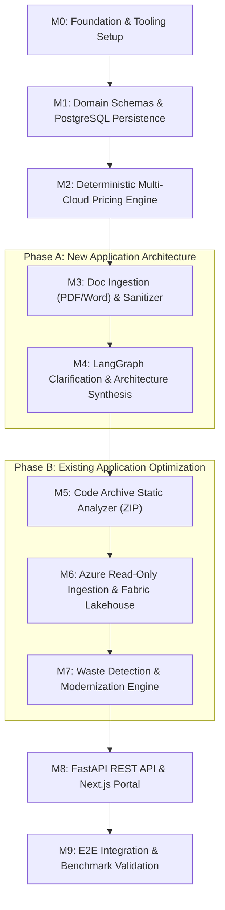

# Implementation Roadmap & Milestone Validation Guide

| Document Metadata | Value |
| :--- | :--- |
| **Project** | Cloud Recommender POC |
| **Execution Model** | Phased, Test-Driven Milestone Delivery |
| **Status** | Active Execution Plan |
| **Last Updated** | October 2026 |

---

## 1. Roadmap Overview & Execution Philosophy

This roadmap details the sequential, test-verified implementation plan for the **Cloud Recommender POC**, encompassing both **Phase A (New Application Architecture)** and **Phase B (Existing Application Optimization)**.

### Rules of Engagement for Coding Agents:
1. **Strict Linear Progression:** Complete milestones sequentially ($M0 \to M1 \to M2 \dots$). Never start building downstream consumers before foundational schemas, data contracts, and engines are tested.
2. **Offline-First Verification:** Every milestone must be fully verified and testable offline using mock providers and local cache datasets.
3. **Mandatory Validation Protocol:** Run the specified validation commands and verify an exit code of 0 before declaring any milestone complete.

---

## 2. Milestone Overview Flow



---

### Milestone 0: Foundation, Project Configuration & Tooling Setup
- **Objective:** Establish the project workspace, dependency configurations, linters, static type checkers, and test harness.
- **Deliverables:**
  - `backend/pyproject.toml` (FastAPI, LangGraph, SQLAlchemy, asyncpg, Pydantic v2, Pytest, Ruff, Mypy).
  - Directory skeleton matching `docs/ARCHITECTURE.md`.
  - Smoke test suite validating the test runner.
- **Validation Protocol:**
  ```bash
  ruff check backend/
  ruff format --check backend/
  mypy backend/
  pytest backend/tests/ -v
  ```
- **Exit Criteria:** Clean execution with 0 errors and 0 warnings.

---

### Milestone 1: Domain Schemas, PostgreSQL Persistence & Service Catalog
- **Objective:** Implement core domain models (`WorkloadProfile`, `RecommendationReport`, `OptimizationAudit`), PostgreSQL database migrations/models, and the multi-cloud seed service catalog.
- **Deliverables:**
  - `backend/app/schemas/domain.py`: Typed Pydantic v2 domain models.
  - `backend/app/database.py`: Async PostgreSQL engine, sessionmaker, and base declarative models.
  - `backend/app/catalog/data/`: Curated service registries (`azure_services.json`, `aws_services.json`, `gcp_services.json`).
  - `backend/app/catalog/registry.py`: In-memory catalog querying and filtering.
  - `backend/tests/test_catalog.py` & `backend/tests/test_schemas.py`.
- **Validation Protocol:**
  ```bash
  pytest backend/tests/test_catalog.py backend/tests/test_schemas.py -v
  mypy backend/app/schemas/ backend/app/catalog/
  ```
- **Exit Criteria:** Complete type compliance, and 100% of catalog items validate against Pydantic schemas.

---

### Milestone 2: Deterministic Multi-Cloud Pricing Engine & Official API Adapters
- **Objective:** Implement the deterministic pricing calculation core, querying official cloud pricing APIs with local caching and offline fallback.
- **Deliverables:**
  - `backend/app/pricing/engine.py`: Mathematical monthly and annual cost calculators.
  - `backend/app/pricing/azure_retail_client.py`: Client for Azure Retail Prices API.
  - `backend/app/pricing/aws_pricing_client.py`: Client for AWS Price List API.
  - `backend/app/pricing/gcp_pricing_client.py`: Client for GCP Billing Catalog API.
  - `backend/app/pricing/cache.py`: Local JSON/SQLite cache with 24h TTL.
  - `backend/tests/test_pricing_engine.py`: Unit tests validating mathematical accuracy and offline fallback.
- **Validation Protocol:**
  ```bash
  pytest backend/tests/test_pricing_engine.py -v
  ```
- **Exit Criteria:** Zero pricing hallucination; calculations deterministically match official rate models; offline fallback functions when network is disabled.

---

### Milestone 3: Phase A — Document Ingestion (PDF/Word), Text Parsing & Secret Sanitizer
- **Objective:** Ingest requirement descriptions from text, PDF (`.pdf`), and Microsoft Word (`.docx`), and scrub sensitive credentials before AI processing.
- **Deliverables:**
  - `backend/app/ingestion/document_parser.py`: PDF (`pypdf`) and Word (`python-docx`) extractors.
  - `backend/app/ingestion/sanitizer.py`: Secret, token, and PII sanitizer removing API keys and passwords.
  - Ephemeral file storage manager enforcing 25 MB limits and file extension whitelists.
  - `backend/tests/test_document_parser.py` & `backend/tests/test_sanitizer.py`.
- **Validation Protocol:**
  ```bash
  pytest backend/tests/test_document_parser.py backend/tests/test_sanitizer.py -v
  ```
- **Exit Criteria:** Robust extraction across various document layouts; regex/AST secret sanitizer successfully catches and redacts test API keys and connection strings.

---

### Milestone 4: Phase A — LangGraph Clarification Loop & Multi-Cloud Architecture Synthesis
- **Objective:** Implement the stateful LangGraph agent that extracts workload requirements, triggers interactive clarifying questions when specs are incomplete, and synthesizes Azure, AWS, and GCP architectures.
- **Deliverables:**
  - `backend/app/agents/phase_a_graph.py`: LangGraph state machine with checkpointing.
  - `backend/app/agents/nodes/requirement_extractor.py`: Extracts `WorkloadProfile`.
  - `backend/app/agents/nodes/clarification_node.py`: Evaluates completeness and generates clarifying questions.
  - `backend/app/agents/nodes/architecture_synthesizer.py`: Generates comparative architectures and Mermaid diagrams.
  - `backend/app/providers/mock_provider.py`: Deterministic mock LLM adapter.
  - `backend/tests/test_phase_a_graph.py`.
- **Validation Protocol:**
  ```bash
  pytest backend/tests/test_phase_a_graph.py -v
  ```
- **Exit Criteria:** Graph halts and outputs clarifying questions when critical fields are omitted; resumes upon receiving user answers; produces valid Mermaid flowcharts.

---

### Milestone 5: Phase B — Application Source Code & Dependency Analyzer (ZIP Ingestion)
- **Objective:** Analyze application source code from uploaded ZIP archives to assess code quality, outdated dependencies, security vulnerabilities, and architectural patterns.
- **Deliverables:**
  - `backend/app/ingestion/zip_extractor.py`: Safe ZIP unpacker with zip-bomb prevention and path traversal safeguards.
  - `backend/app/agents/nodes/code_analyzer.py`: AST parsing, dependency manifest inspection (`package.json`, `requirements.txt`), and architecture classifier (monolith vs microservices).
  - Code maintainability scoring and CVE detection heuristics.
  - `backend/tests/test_code_analyzer.py`.
- **Validation Protocol:**
  ```bash
  pytest backend/tests/test_code_analyzer.py -v
  ```
- **Exit Criteria:** Successfully scans sample Python/Node repositories, identifies known vulnerable packages, and outputs structured code health metrics.

---

### Milestone 6: Phase B — Read-Only Azure Telemetry Ingestion & Microsoft Fabric Lakehouse Integration
- **Objective:** Connect to Azure with strictly authorized read-only credentials, ingest resource inventory, metrics, and billing, and stage data in Microsoft Fabric Delta Parquet tables.
- **Deliverables:**
  - `backend/app/cloud/azure_client.py`: Read-only Azure SDK wrapper enforcing `Reader` role limits.
  - `backend/app/cloud/resource_graph.py`: Ingests VM, disk, database, and container inventory.
  - `backend/app/cloud/cost_management.py`: Ingests billing and amortized spend.
  - `backend/app/cloud/monitor.py`: Ingests CPU, memory, and IOPS metrics.
  - `backend/app/analytics/fabric_client.py`: Microsoft Fabric OneLake Delta Parquet writer.
  - `backend/app/analytics/local_lakehouse.py`: Local DuckDB / Parquet offline fallback.
  - `backend/tests/test_azure_client.py` & `backend/tests/test_fabric_lakehouse.py`.
- **Validation Protocol:**
  ```bash
  pytest backend/tests/test_azure_client.py backend/tests/test_fabric_lakehouse.py -v
  ```
- **Exit Criteria:** Aborts if credentials have write access; stages mock and live telemetry into Delta Parquet tables cleanly.

---

### Milestone 7: Phase B — Cloud Waste Detection & Modernization Optimization Engine
- **Objective:** Detect cloud waste (idle VMs, orphaned disks, over-provisioned databases) and propose PaaS/serverless modernization plans with projected cost savings.
- **Deliverables:**
  - `backend/app/agents/nodes/waste_detector.py`: Heuristic waste detection on 30-day utilization curves.
  - Modernization recommendation engine (IaaS-to-PaaS blueprints: e.g. VM $\to$ Azure Container Apps).
  - Financial savings modeler (Current spend vs Optimized spend, implementation effort estimation).
  - Human approval gate integration (Zero-execution advisory report).
  - `backend/tests/test_waste_detector.py`.
- **Validation Protocol:**
  ```bash
  pytest backend/tests/test_waste_detector.py -v
  ```
- **Exit Criteria:** Accurately flags simulated idle resources and calculates projected savings without making any infrastructure changes.

---

### Milestone 8: FastAPI REST API Gateway & Next.js Frontend Portal
- **Objective:** Expose Phase A and Phase B workflows via clean REST endpoints and build the interactive Next.js web application.
- **Deliverables:**
  - `backend/app/api/v1/`: Complete API endpoints with streaming support and OpenAPI docs.
  - `frontend/src/app/phase-a/`: Document upload, interactive clarification chat, comparison matrix, and Mermaid diagram viewer.
  - `frontend/src/app/phase-b/`: Source ZIP upload, Azure read-only connection dialog, waste dashboard, and human approval modal.
  - Frontend type safety, styling, and API integration.
- **Validation Protocol:**
  ```bash
  pytest backend/tests/test_api_integration.py -v
  npm --prefix frontend run lint
  npm --prefix frontend run typecheck
  npm --prefix frontend run build
  ```
- **Exit Criteria:** Frontend builds with 0 errors; full API integration verified via FastAPI TestClient.

---

### Milestone 9: End-to-End System Integration & Acceptance Benchmark Validation
- **Objective:** Run complete end-to-end integration tests validating all four benchmark acceptance scenarios from `docs/PRODUCT_REQUIREMENTS.md`.
- **Deliverables:**
  - Verification of Benchmark A1 (Document upload with missing requirements and clarification loop).
  - Verification of Benchmark A2 (Natural language multi-cloud comparison).
  - Verification of Benchmark B1 (Source code ZIP analysis).
  - Verification of Benchmark B2 (Azure read-only waste detection & modernization).
  - Final documentation review in `README.md`.
- **Validation Protocol:**
  ```bash
  ruff check backend/
  mypy backend/
  pytest backend/tests/ -v --cov=backend/app --cov-report=term-missing
  npm --prefix frontend run build
  ```
- **Exit Criteria:** Code coverage $>85\%$, zero lint/type errors, all benchmark scenarios pass.
