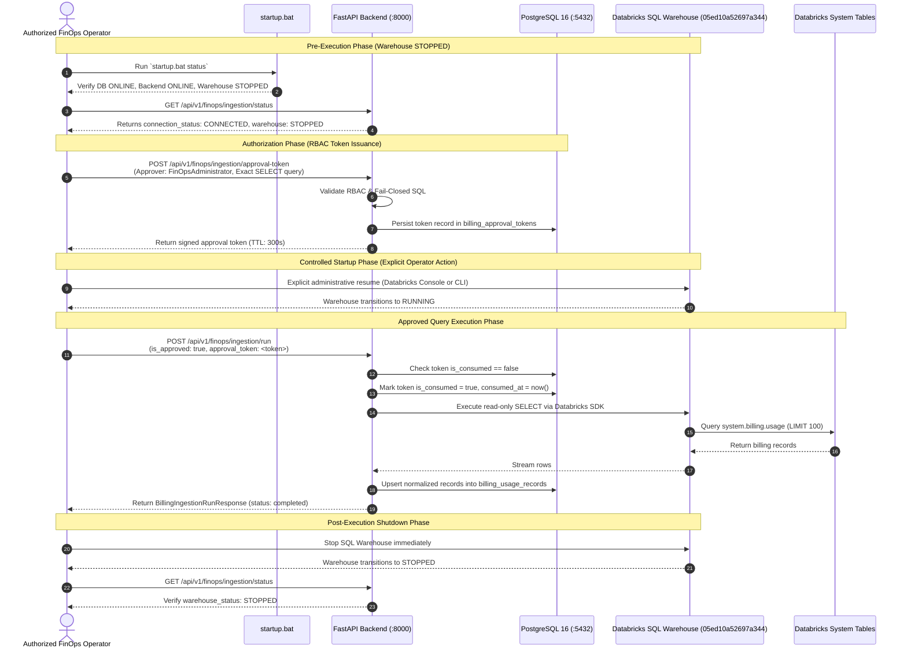

# Milestone 3J.2 — Controlled Live Testing Runbook
## Step-by-Step Operator Procedures for Azure Databricks Live Testing Stage

| Parameter | Specification |
| :--- | :--- |
| **Stage** | Post-3J.2 Controlled Live Testing |
| **Target Tenant** | Azure Databricks Workspace `642006393507276` |
| **Target Compute** | SQL Warehouse `05ed10a52697a344` (`Serverless Starter Warehouse`) |
| **Initial Compute State** | `STOPPED` |
| **Post-Execution State** | `STOPPED` |
| **Estimated Compute Cost** | ~$0.15 - $0.35 DBU serverless burst charge |
| **Target System Tables** | `system.billing.usage`, `system.billing.list_prices` |

---

## 1. Safety Guardrails & Non-Negotiable Rules

1. **Strict Human Gate**: Automated scripts or loops must NEVER start the SQL warehouse. Compute startup must be initiated by an authorized human operator.
2. **Zero Mutation**: Live execution is restricted to read-only `SELECT` projections from `system.billing.usage` and `system.billing.list_prices`.
3. **Single-Use Tokens**: Every query execution requires a freshly minted, cryptographically signed approval token with an exact query hash match.
4. **Immediate Auto-Stop**: The target SQL warehouse has an auto-stop policy configured (10-minute maximum idle window). Compute must be verified in state `STOPPED` immediately upon completion of test queries.

---

## 2. Operator Execution Procedure



---

## 3. Detailed Step-by-Step Protocol

### Step 1: Pre-Execution Verification
1. Open PowerShell and navigate to repository root:
   ```cmd
   cd C:\Workspace\cloud-recommender-poc
   ```
2. Verify system health:
   ```cmd
   .\startup.bat status
   ```
   *Expected Output*: Database is `ONLINE`, Backend is `ONLINE`, SQL Warehouse is `STOPPED`.

3. Call the validation endpoint:
   ```powershell
   Invoke-RestMethod -Uri 'http://127.0.0.1:8000/api/v1/finops/ingestion/validate' -Method POST
   ```
   *Verify*: `can_run == false`, `warehouse_state == 'STOPPED'`.

### Step 2: Request Role-Authorized Approval Token
Request a short-lived token using an identity with `FinOpsAdministrator` or `Admin` privileges:
```powershell
$body = @{
    query = "SELECT record_id, sku_name, usage_start_time, usage_end_time, usage_quantity, usage_unit FROM system.billing.usage WHERE workspace_id = '642006393507276' AND usage_date >= '2026-10-01' LIMIT 50"
    warehouse_id = "05ed10a52697a344"
    workspace_id = "642006393507276"
    approver_sub = "operator@bizmetric.com"
    approver_roles = @("FinOpsAdministrator")
    ttl_seconds = 300
} | ConvertTo-Json

$tokenResp = Invoke-RestMethod -Uri 'http://127.0.0.1:8000/api/v1/finops/ingestion/approval-token' -Method POST -Body $body -ContentType 'application/json'
$approvalToken = $tokenResp.token
Write-Host "Minted token: $approvalToken"
```

### Step 3: Explicit Warehouse Startup
In the Azure Databricks administrative console (`https://adb-642006393507276.16.azuredatabricks.net`):
1. Navigate to **SQL Warehouses**.
2. Locate `Serverless Starter Warehouse` (`05ed10a52697a344`).
3. Click **Start**. Wait until the status pill changes from `STOPPED` to `RUNNING`.

### Step 4: Submit Approved Execution Request
Execute the live ingestion run:
```powershell
$runBody = @{
    workspace_id = "642006393507276"
    start_date = "2026-10-01"
    end_date = "2026-11-04"
    is_approved = $true
    approval_token = $approvalToken
    limit = 50
} | ConvertTo-Json

$runResult = Invoke-RestMethod -Uri 'http://127.0.0.1:8000/api/v1/finops/ingestion/run' -Method POST -Body $runBody -ContentType 'application/json'
$runResult | Format-List
```
*Verify*: `status == "completed"`, `extracted_count > 0`.

### Step 5: Immediate Warehouse Shutdown
Immediately return the SQL warehouse to `STOPPED` state:
1. In the Databricks console, click **Stop** on `Serverless Starter Warehouse`.
2. Confirm the state transition to `STOPPED`.
3. Confirm via launcher CLI:
   ```cmd
   .\startup.bat status
   ```

### Step 6: Post-Run Financial Reconciliation Inspection
Inspect the updated reconciliation ledger:
```powershell
Invoke-RestMethod -Uri 'http://127.0.0.1:8000/api/v1/finops/billing/reconciliation'
```
*Verify*: `reconciliation_status == "RECONCILED"`.

---

## 4. Emergency & Rollback Procedures

| Incident Scenario | Immediate Action |
| :--- | :--- |
| **Warehouse Remains Running After Test** | In the Databricks console, click **Stop** immediately. Auto-stop policy terminates compute within 10 minutes automatically if unstopped. |
| **Query Rejection / 400 Bad Request** | Check `error_message`. If comments or semicolons were submitted, re-format the query without comments or semicolons. |
| **403 Forbidden on Token Request** | Principal lacks required role. Ensure `approver_roles` includes `FinOpsAdministrator` or `Admin`. |
| **Token Replay Error** | Tokens are strictly single-use. If a query failed or was interrupted, mint a new approval token. |

