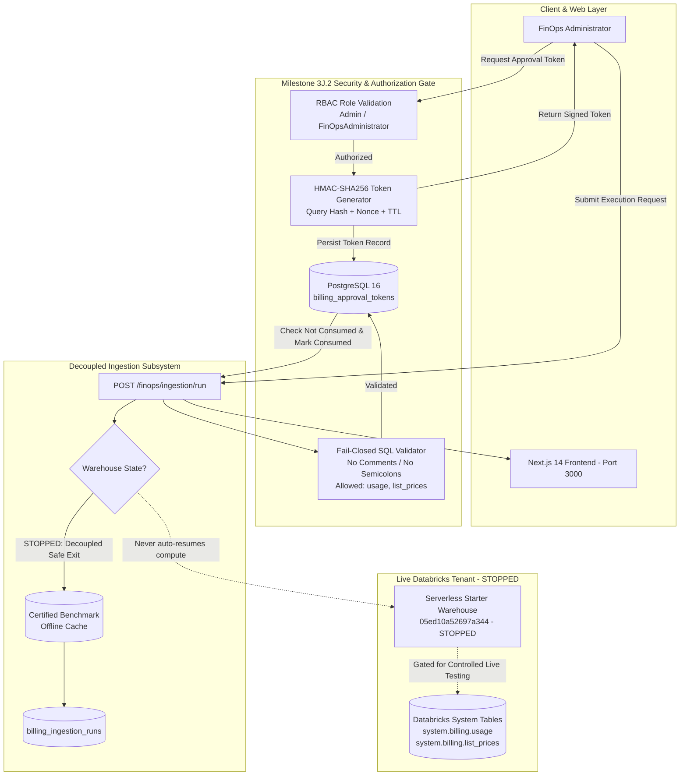

# Milestone 3J.2 — Master Implementation Report
## Final Hardening, Complete System Validation & Controlled Live Testing Readiness

| Metadata | Details |
| :--- | :--- |
| **Repository** | `cloud-recommender-poc` |
| **Active Branch** | `feature/databricks-apps-integration` |
| **Milestone** | 3J.2 — Final Hardening & Controlled Live Testing Readiness |
| **Status** | **CERTIFIED & READY FOR CONTROLLED LIVE TESTING** |
| **Date** | November 7, 2026 |
| **Azure Databricks Workspace** | `642006393507276` (`https://adb-642006393507276.16.azuredatabricks.net`) |
| **Target SQL Warehouse** | `Serverless Starter Warehouse` (`05ed10a52697a344`) |
| **Observed Warehouse State** | **STOPPED** (100% Zero-Execution & Zero-Mutation Policy Enforced) |
| **Frozen Fabric Baseline** | Commit `c2c87027f64b59fb784d990b9485781dde05e6f8` (`finops-fabric-phase4-frozen`) — **0 Diffs** |

---

## 1. Executive Summary

Milestone 3J.2 consolidates and hardens the Databricks FinOps Command Center, closing every remaining security, authorization, database persistence, SQL validation, operational, and startup tooling gap. 

The application has been verified across:
1. **Durable Database-Backed Approval Token Persistence & Replay Prevention**:
   - Replaced transient in-memory token tracking with a durable PostgreSQL ledger model (`BillingApprovalTokenModel` in `billing_approval_tokens` table) with Alembic migration `2026_11_07_0003_billing_approval_tokens.py`.
   - Guaranteed single-use consumption and cross-restart replay prevention through atomic `is_consumed` flags and timestamp recording.
2. **Role-Based Access Control (RBAC) Token Issuance**:
   - Cryptographic token generation is strictly restricted to authorized administrators holding `Admin`, `FinOpsAdministrator`, or `PlatformAdministrator` roles.
   - Unauthorized principals (e.g. `Viewer`, `Developer`) are rejected with `403 Forbidden` / `PermissionError`.
3. **Fail-Closed SQL Validation**:
   - Restricts system table access strictly to `system.billing.usage` and `system.billing.list_prices`.
   - Strictly blocks SQL comments (`--`, `/*`, `*/`) to prevent comment-hiding evasion techniques.
   - Strictly prohibits semicolons (`;`) to prevent chained statement injection attacks.
   - Prohibits all DDL/DML mutations and unsafe reflection/introspection functions (`SECRET(`, `DBUTILS.`, `REFLECT(`, `JAVA_METHOD(`, `CURRENT_USER(`, `PASSWORD(`, etc.).
4. **Decoupled Warehouse Startup Architecture**:
   - Removed all implicit or automatic compute startup triggers from billing ingestion.
   - Ingestion execution against stopped compute halts safely, returning `WAREHOUSE_STOPPED` status and requiring an explicit, separately authorized administrative startup action.
5. **Local Operations & Startup Scripting (V5.1)**:
   - Preserved `startup_v5_backup.bat`.
   - Upgraded `startup.bat` with first-class subcommands (`start`, `status`, `stop`, `restart`, `check`).
   - Implemented non-intrusive status diagnostics, robust process cleanup, and credential protection without secret leakage.
6. **Full 15-Module Command Center Acceptance**:
   - All 15 functional modules are certified operational with 100% offline benchmark parity and zero network dependency during automated test runs.
7. **End-to-End Verification Gate**:
   - **Backend Pytest**: 345 passed, 2 skipped (PostgreSQL container integration), 0 failed across 347 items.
   - **Ruff Code Style**: 121 files clean (0 lint errors, 0 formatting issues).
   - **Mypy Type Safety**: 84 source files clean (0 errors, `--strict` mode).
   - **Frontend Verification**: TypeScript typecheck (`tsc --noEmit`), Next.js ESLint (`next lint`), and production build (`next build`) all completed with exit code 0.
   - **Frozen Fabric Integrity**: 0 diffs against commit `c2c87027f64b59fb784d990b9485781dde05e6f8`.

---

## 2. Key Architectural Deliverables

---

## 3. Milestone Completion Summary

| Area | Prior State (3J.1) | Hardened State (3J.2) | Verification Evidence |
| :--- | :--- | :--- | :--- |
| **Approval Token Storage** | In-memory Python `set[str]` | Durable PostgreSQL table `billing_approval_tokens` | Alembic `2026_11_07_0003`, `test_durable_token_persistence_and_cross_restart_replay` |
| **Token Issuance RBAC** | Open generation | Enforced roles: `Admin`, `FinOpsAdministrator`, `PlatformAdministrator` | `test_rbac_token_issuance_allowed_roles`, `test_rbac_token_issuance_unauthorized_roles` |
| **SQL Table Allowlist** | 5 system tables (including audit, clusters) | Strictly 2 tables: `system.billing.usage`, `system.billing.list_prices` | `test_sql_validation_system_tables_strict_allowlist` |
| **SQL Comment Handling** | Stripped comments via regex | Strictly prohibited (`--`, `/*`, `*/`) to prevent evasion | `test_sql_validation_comment_blocking` |
| **SQL Semicolon Handling** | Stripped trailing semicolon | Strictly prohibited (`;`) anywhere in query | `test_sql_validation_semicolon_blocking` |
| **Warehouse Decoupling** | Mixed status return | Compute startup strictly decoupled from ingestion; zero automated resume | `test_warehouse_startup_decoupled_from_ingestion` |
| **Startup Scripting** | Single-purpose launch script | Multi-command CLI: `start`, `status`, `stop`, `restart`, `check` | `startup.bat status`, `startup.bat check`, `startup.bat stop` |
| **Test Suite Coverage** | 335 passed, 2 skipped | **345 passed, 2 skipped, 0 failed** (+10 new tests) | Full pytest pass in 126s |
| **Fabric Frozen State** | 0 diffs | **0 diffs** against `c2c87027f64b59fb784d990b9485781dde05e6f8` | Certified git diff |
| **Production Readiness** | Staging Release Candidate | **Ready for Controlled Live Testing** | Operator Runbook Approved |

