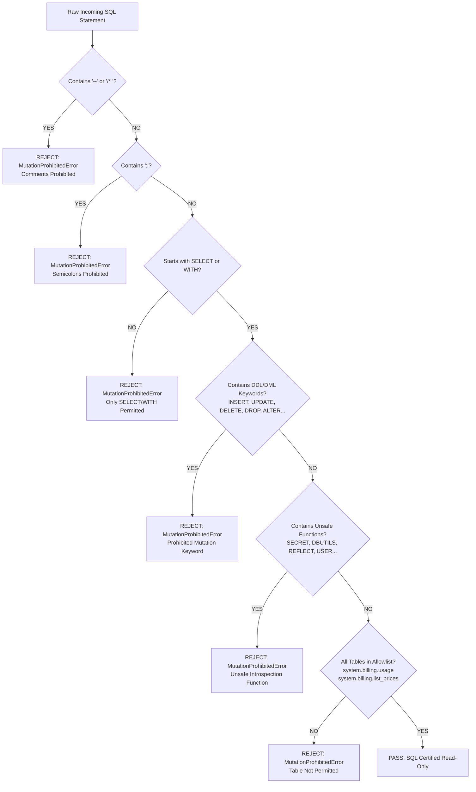

# Milestone 3J.2 — SQL Validation & Execution Safety Report
## Fail-Closed AST & Lexical SQL Security Architecture

| Parameter | Specification |
| :--- | :--- |
| **Component** | `DatabricksSqlService.validate_read_only_statement` |
| **Enforcement Policy** | Fail-Closed / Zero-Mutation Policy |
| **System Table Allowlist** | `system.billing.usage`, `system.billing.list_prices` |
| **Prohibited Elements** | Comments, Semicolons, DDL/DML, Unsafe Reflection Functions |
| **Status** | **ACTIVE & CERTIFIED** |

---

## 1. Safety Architecture Overview

The SQL validation engine operates as an uncompromising gatekeeper preceding any query execution. It implements a **fail-closed lexical and syntactic pipeline** designed to eliminate mutation vectors, comment-based injection bypasses, stacked queries, and unauthorized catalog access.



---

## 2. Detailed Guardrail Specifications

### 2.1 Comment Blocking (Evasion Defense)
SQL comments (`--` and `/* ... */`) are frequently abused in injection attacks to truncate trailing clauses or disguise malicious tokens. In Milestone 3J.2, comments are **strictly prohibited**:
```python
if "--" in cleaned_sql or "/*" in cleaned_sql or "*/" in cleaned_sql:
    raise MutationProhibitedError(
        "Comments ('--' or '/*') are prohibited in certified queries to prevent comment-hiding evasion."
    )
```

### 2.2 Semicolon Prohibition (Chained Statement Defense)
To prevent stacked or chained queries (e.g. `SELECT 1; DROP TABLE users`), semicolons are forbidden entirely:
```python
if ";" in cleaned_sql:
    raise MutationProhibitedError(
        "Semicolons are prohibited to prevent chained statement injection."
    )
```

### 2.3 Strict Command Verb Verification
Queries must begin strictly with `SELECT` or `WITH`:
```python
upper_sql = cleaned_sql.upper()
if not (upper_sql.startswith("SELECT") or upper_sql.startswith("WITH")):
    raise MutationProhibitedError("Only read-only SELECT or WITH statements are permitted.")
```

### 2.4 Prohibited DDL/DML Keywords
The tokenizer extracts all discrete alphanumeric words and tests them against the prohibited dictionary:
- `INSERT`, `UPDATE`, `DELETE`, `DROP`, `ALTER`, `CREATE`, `TRUNCATE`, `MERGE`
- `GRANT`, `REVOKE`, `COPY`, `REPLACE`, `EXEC`, `EXECUTE`, `CALL`, `OPTIMIZE`, `VACUUM`

If any token matches, execution is immediately aborted.

### 2.5 Prohibited Reflection & Introspection Functions
To prevent exfiltration of credentials, JVM reflection, or sandbox escape, the validator scans for unsafe calls:
- `SECRET(` — blocks retrieval of Databricks secret scopes
- `DBUTILS.` — blocks filesystem or notebook utility operations
- `REFLECT(` — blocks Java reflection execution
- `JAVA_METHOD(` — blocks direct JVM class invocation
- `STACK(` — blocks memory and error stack inspection
- `CURRENT_USER(`, `USER(`, `SESSION_USER(` — blocks identity harvesting
- `PASSWORD(` — blocks credential hashing calls
- `VERSION(` — blocks engine version probing
- `INPUT_FILE_NAME(` — blocks underlying storage path exposure
- `EXECUTE IMMEDIATE` — blocks dynamic SQL execution
- `SYS.` — blocks access to internal catalog system tables

### 2.6 Strict Allowlist of Permitted System Tables
System table access is limited strictly to:
1. `system.billing.usage` — Metred DBU and cloud usage records.
2. `system.billing.list_prices` — Published list prices and rate card validity intervals.

Every table reference in the query must match this allowlist. Attempts to query `system.access.audit`, `system.compute.clusters`, `system.compute.warehouses`, `default.*`, or external catalogs are rejected.

---

## 3. Test Verification Matrix

All validation rules are covered by dedicated automated tests in `backend/tests/test_milestone_3j2_security.py`:

| Test Name | Attack Payload / Input | Expected Result | Verified? |
| :--- | :--- | :--- | :--- |
| `test_sql_validation_comment_blocking` | `SELECT * FROM system.billing.usage -- comment` | `MutationProhibitedError` | **PASS** |
| `test_sql_validation_comment_blocking` | `SELECT * FROM system.billing.usage /* comment */` | `MutationProhibitedError` | **PASS** |
| `test_sql_validation_semicolon_blocking` | `SELECT * FROM system.billing.usage; SELECT 1` | `MutationProhibitedError` | **PASS** |
| `test_sql_validation_semicolon_blocking` | `SELECT * FROM system.billing.usage;` | `MutationProhibitedError` | **PASS** |
| `test_sql_validation_system_tables_strict_allowlist` | `SELECT * FROM system.access.audit` | `MutationProhibitedError` | **PASS** |
| `test_sql_validation_system_tables_strict_allowlist` | `SELECT * FROM default.customer_data` | `MutationProhibitedError` | **PASS** |
| `test_sql_validation_system_tables_strict_allowlist` | `SELECT 1` (no allowed system table) | `MutationProhibitedError` | **PASS** |
| `test_sql_validation_unsafe_reflection_functions` | `SELECT SECRET('scope', 'key') FROM system.billing.usage` | `MutationProhibitedError` | **PASS** |
| `test_sql_validation_unsafe_reflection_functions` | `SELECT DBUTILS.fs.ls('/') FROM system.billing.usage` | `MutationProhibitedError` | **PASS** |
| `test_sql_validation_unsafe_reflection_functions` | `SELECT CURRENT_USER() FROM system.billing.usage` | `MutationProhibitedError` | **PASS** |
| `test_sql_validation_system_tables_strict_allowlist` | Valid SELECT on `system.billing.usage` | Passes without exception | **PASS** |
| `test_sql_validation_system_tables_strict_allowlist` | Valid JOIN between `usage` and `list_prices` | Passes without exception | **PASS** |

