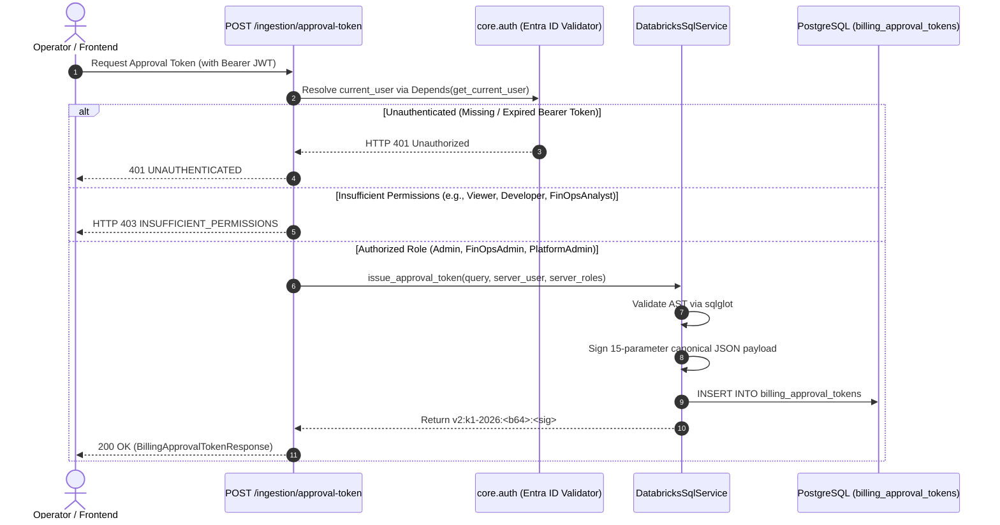

# Milestone 3J.3: Authentication & Role-Based Access Control (RBAC) Report
## Identity Verification, Role Hierarchies & Anti-Spoofing Architecture

### 1. Identity Architecture Overview

The Databricks FinOps Command Center relies on Microsoft Entra ID (Azure Active Directory) for enterprise single sign-on (SSO), OAuth2, and OpenID Connect JWT tokens. 

In Milestone 3J.3, the token issuance lifecycle was fully reconciled with the server-side authentication layer defined in `cloud_recommender.core.auth`.



---

### 2. Role Permissions Matrix

The platform classifies identities into authorized and unauthorized roles for issuing live Databricks execution tokens:

| Role Name | Authority Scope | Can Issue Live Query Tokens? | Rationale |
| :--- | :--- | :---: | :--- |
| **Admin** | Global platform administrator | **YES** | Full governance and infrastructure oversight. |
| **FinOpsAdministrator** | FinOps team lead / cost manager | **YES** | Authorized to audit billing data and trigger financial reconciliations. |
| **PlatformAdministrator** | Databricks workspace administrator | **YES** | Authorized to manage compute infrastructure and inspect system tables. |
| **FinOpsAnalyst** | Read-only financial analyst | **NO (HTTP 403)** | Read-only reporting access; cannot authorize compute-waking tokens. |
| **Developer** | Data engineer / application developer | **NO (HTTP 403)** | Standard developer role; restricted from approving billing pipeline runs. |
| **Viewer / Reader** | General dashboard viewer | **NO (HTTP 403)** | Minimal read-only privilege; zero authorization authority. |
| **Anonymous / Unauthenticated** | Public caller | **NO (HTTP 401)** | Missing cryptographic identity claims. |

---

### 3. Server-Derived Identity vs. Client Spoofing Protection

In previous iterations, the JSON payload accepted `approver_sub` and `approver_roles` directly from the client. An attacker could impersonate a high-privilege identity by simply injecting JSON properties.

In Milestone 3J.3:
1. `BillingApprovalTokenRequest` declares `approver_sub` and `approver_roles` as deprecated, ignored fields.
2. In `backend/src/cloud_recommender/api/routes/finops.py`:
   ```python
   # Extract server-verified identity strictly from current_user
   approver_sub = (
       getattr(current_user, "preferred_username", None)
       or getattr(current_user, "sub", None)
       or "authenticated-operator"
   )
   approver_roles = getattr(current_user, "roles", []) or []
   ```
3. If an unprivileged user (such as a `Viewer`) includes `{"approver_roles": ["FinOpsAdministrator"]}` in the request body, the server ignores the client body, inspects `current_user.roles`, detects `["Viewer"]`, and immediately raises `HTTPException(status_code=403, detail="Caller lacks required roles...")`.
4. Automated verification in `test_anti_spoofing_client_payload_ignored` confirms this anti-spoofing protection.

---

### 4. Audit Trail & Identity Persistence

When a token is minted:
- The actual server-verified `approver_sub` (e.g. `finops-lead@bizmetric.com`) is recorded in the PostgreSQL `billing_approval_tokens` table.
- The validated role set (`approver_roles`) is persisted as a JSON array.
- This creates an immutable audit trail tying every live query attempt to the specific human operator who authorized it.

