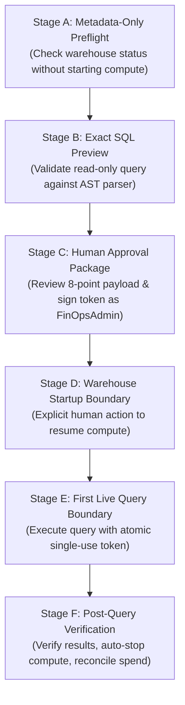

# Milestone 3J.3: Controlled Live Testing Approval Package
## Stages A through F Operational Procedure for First Live Databricks System Tables Query

### 1. Controlled Live Testing Protocol Overview

Live query execution against customer Azure Databricks System Tables requires waking the stopped serverless SQL warehouse `05ed10a52697a344` or consuming serverless compute DBUs. To ensure zero unintended spend, the first live test must follow this 6-stage operational protocol:



---

### 2. Detailed Stage-by-Stage Instructions

#### Stage A: Metadata-Only Preflight
1. **Target**: Databricks Workspace `642006393507276` (`https://adb-642006393507276.16.azuredatabricks.net`).
2. **Target Warehouse**: `Serverless Starter Warehouse` (`05ed10a52697a344`).
3. **Execution**:
   ```bash
   curl -s http://127.0.0.1:8000/api/v1/finops/ingestion/status
   ```
4. **Verification**: Confirm `warehouse_status` is `WAREHOUSE_STOPPED` or metadata is accessible. Ensure no compute resume API call is triggered.

#### Stage B: Exact SQL Preview
1. Submit preview request with bounded date range:
   ```bash
   curl -X POST http://127.0.0.1:8000/api/v1/finops/ingestion/validate \
     -H "Content-Type: application/json" \
     -d '{
       "workspace_id": "642006393507276",
       "warehouse_id": "05ed10a52697a344",
       "start_date": "2026-10-01",
       "end_date": "2026-11-04"
     }'
   ```
2. **Verification**: Confirm `allowed_tables` contains strictly `["system.billing.usage", "system.billing.list_prices"]`, `can_run: false`, and `approval_status: "APPROVAL_REQUIRED"`.

#### Stage C: Human Approval Package & Token Issuance
1. The human operator holding `FinOpsAdministrator` or `Admin` role requests an authorization token:
   ```bash
   curl -X POST http://127.0.0.1:8000/api/v1/finops/ingestion/approval-token \
     -H "Content-Type: application/json" \
     -H "Authorization: Bearer <VALID_ENTRA_ID_JWT>" \
     -d '{
       "query": "SELECT record_id, workspace_id, usage_date, sku_name, usage_quantity, usage_unit FROM system.billing.usage WHERE usage_date >= '\''2026-10-01'\'' AND usage_date <= '\''2026-11-04'\'' LIMIT 100",
       "warehouse_id": "05ed10a52697a344",
       "workspace_id": "642006393507276",
       "start_date": "2026-10-01",
       "end_date": "2026-11-04",
       "max_rows": 1000,
       "approval_purpose": "First controlled live query verification for FinOps Command Center",
       "ttl_seconds": 600
     }'
   ```
2. **Verification**: Note the returned `token` (format: `v2:k1-2026:<b64>:<sig>`) and `token_id`. Confirm the token is recorded in `billing_approval_tokens` with `is_consumed: false`.

#### Stage D: Warehouse Startup Boundary
1. **CRITICAL SAFETY BOUNDARY**: The application backend will **NEVER** automatically resume the warehouse.
2. The authorized cloud platform engineer logs into the Azure Databricks console or runs an authorized CLI command to start the warehouse:
   ```bash
   databricks sql-warehouses start 05ed10a52697a344 --profile azure-dev
   ```
3. Verify warehouse transitions to `RUNNING`. Auto-stop must be verified as configured (10-15 minute threshold).

#### Stage E: First Live Query Boundary
1. Execute the authorized ingestion run passing `is_approved: true` and the signed `approval_token`:
   ```bash
   curl -X POST http://127.0.0.1:8000/api/v1/finops/ingestion/run \
     -H "Content-Type: application/json" \
     -H "Authorization: Bearer <VALID_ENTRA_ID_JWT>" \
     -d '{
       "workspace_id": "642006393507276",
       "start_date": "2026-10-01",
       "end_date": "2026-11-04",
       "is_approved": true,
       "approval_token": "<TOKEN_FROM_STAGE_C>",
       "limit": 100
     }'
   ```
2. **Verification**: The backend verifies the token signature, binds all 15 parameters, atomically marks the token consumed in PostgreSQL, and queries the Databricks Statement Execution API.

#### Stage F: Post-Query Verification & Teardown
1. Confirm extracted records are inserted with deduplication on `record_id`.
2. Confirm the token cannot be reused (resubmitting the same request must fail with `Token has already been consumed`).
3. Stop the warehouse immediately in Databricks console or CLI:
   ```bash
   databricks sql-warehouses stop 05ed10a52697a344 --profile azure-dev
   ```
4. Verify warehouse state returns to `STOPPED`.

