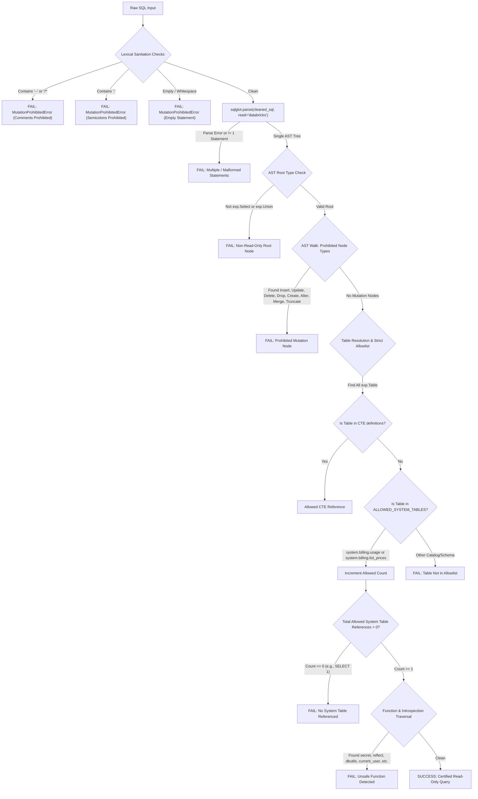

# Milestone 3J.3: SQL Parser & AST Validation Report
## Fail-Closed Databricks SQL AST Parsing via sqlglot & Semantic Validation

### 1. Abstract Syntax Tree (AST) Architecture

In Milestone 3J.2, SQL validation relied on regex pattern matching and keyword tokenization (`set(re.findall(r"\b[A-Z_]+\b", upper_sql))`). While effective against simple strings, lexical tokenizers suffer from two fundamental vulnerabilities:
1. **False Positives**: Legitimate business queries searching for string literals like `WHERE sku_name = 'MERGE_RECORD'` or `WHERE record_id = 'DELETE-01'` were falsely blocked because the token scanner detected `MERGE` or `DELETE`.
2. **False Negatives / Evasion**: Comment hiding, multi-statement tricks, or nested table functions in complex subqueries could evade superficial regex filters.

To permanently resolve this architectural weakness, Milestone 3J.3 integrated `sqlglot>=25.0.0` configured for the **Databricks SQL dialect** (`read="databricks"`).

---

### 2. AST Validation Pipeline

The AST validation in `DatabricksSqlService.validate_read_only_statement()` executes through a strict, multi-stage pipeline:



---

### 3. Allowed System Tables Allowlist

Live statement execution is strictly restricted to two System Tables:
1. `system.billing.usage`: Metered DBU records, SKU types, resource identifiers, and usage quantities.
2. `system.billing.list_prices`: Official list pricing rate cards, pricing tiers, effective start/end dates, and currency mappings.

All other catalogs and schemas are rejected:
- Hive metastore catalogs (`hive_metastore.*`) -> **REJECTED**
- User schemas (`default.*`, `main.*`) -> **REJECTED**
- System security tables (`system.access.audit`) -> **REJECTED**
- System compute tables (`system.compute.clusters`, `system.compute.warehouses`) -> **REJECTED**
- Metadata tables (`information_schema.*`, `sys.*`) -> **REJECTED**

---

### 4. Prohibited Introspection & Reflection Functions

The AST walker traverses all `exp.Func` and `exp.Anonymous` nodes to block dangerous execution and secret leakage primitives:

| Prohibited Function | AST Representation | Attack Vector Prevented |
| :--- | :--- | :--- |
| `secret(scope, key)` | `exp.Secret` | Unauthorized retrieval of Databricks secret scopes and API keys. |
| `dbutils.fs.ls()` | `exp.Dot` | File system directory traversal and ADLS/S3 container enumeration. |
| `reflect(...)` | `exp.Anonymous` | Java Virtual Machine (JVM) arbitrary class loading and code execution. |
| `java_method(...)` | `exp.Anonymous` | Direct invocation of Java runtime methods (`java.lang.Runtime.exec`). |
| `current_user()`, `user()` | `exp.CurrentUser` | Environment fingerprinting and user spoofing reconnaissance. |
| `password(...)` | `exp.Anonymous` | Cryptographic function misuse. |
| `version()` | `exp.Anonymous` | Runtime version fingerprinting. |
| `input_file_name()` | `exp.Anonymous` | Underlying Parquet/Delta lake storage path discovery. |
| `execute_immediate` | `exp.Anonymous` | Dynamic SQL evaluation within SQL scripts. |

---

### 5. Adversarial Testing & Certification Evidence

The AST parser was tested against 15 adversarial and boundary cases in `test_ast_parser_valid_complex_queries` and `test_ast_parser_adversarial_rejections`:

1. **String Literals with SQL Keywords**:
   ```sql
   SELECT * FROM system.billing.usage WHERE sku_name = 'DROP_RECORDS_SKU'
   ```
   *Outcome*: Passed successfully. Demonstrates that AST parsing eliminates lexical false positives.
2. **Multi-Table CTE with Projection Joins**:
   ```sql
   WITH usage_rollup AS (
       SELECT sku_name, sum(usage_quantity) as total_qty
       FROM system.billing.usage
       GROUP BY sku_name
   )
   SELECT u.sku_name, u.total_qty, p.pricing.default as list_price
   FROM usage_rollup u
   JOIN system.billing.list_prices p ON u.sku_name = p.sku_name
   ```
   *Outcome*: Passed successfully. Confirms that in-query CTE references are recognized without tripping external table allowlist checks.
3. **Comment Hiding Injection**:
   ```sql
   SELECT * FROM system.billing.usage -- inline comment
   ```
   *Outcome*: Rejected with `MutationProhibitedError: Comments ('--' or '/*') are prohibited`.
4. **External Schema Query**:
   ```sql
   SELECT * FROM system.access.audit
   ```
   *Outcome*: Rejected with `MutationProhibitedError: Access to table 'system.access.audit' is not permitted by allowlist`.

