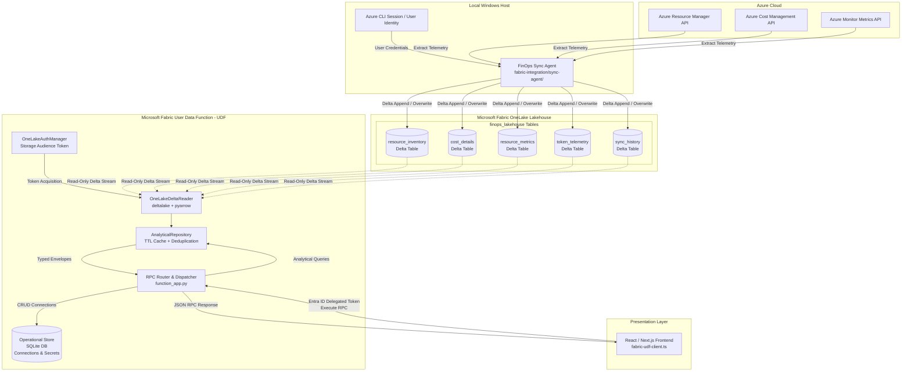

# Milestone 5 – Phase 4: Fabric UDF Delta Lake Reader Integration Report

> **Project:** Cloud FinOps Recommender – Microsoft Fabric Application  
> **Repository:** `cloud-recommender-poc`  
> **Branch:** `feature/fabric-finops-frontend-integration`  
> **Status:** Completed & Live-Verified  
> **Date:** November 6, 2026  

---

## 1. Executive Summary

Milestone 5 – Phase 4 successfully integrates a **production-grade, strictly read-only Delta Lake analytical reader engine** into the Microsoft Fabric User Data Function (UDF) backend (`fabric-integration/fabric-udf/`).

### Key Accomplishments
1. **Direct OneLake Delta Lake Ingestion:** The Fabric UDF now queries live analytical data directly from the 5 Microsoft Fabric Lakehouse Delta tables (`resource_inventory`, `cost_details`, `resource_metrics`, `token_telemetry`, and `sync_history`) hosted on OneLake ADLS Gen2 (`finops_lakehouse`).
2. **Hybrid Storage Architecture:** Enforced clean architectural separation between operational state (SQLite for user-managed cloud connections, Fernet-encrypted credentials, and operational settings) and analytical telemetry (OneLake Delta Lake tables).
3. **Strict Zero-Mutation & Zero-Write Policy:** The Fabric UDF operates exclusively via read-only Delta table abstractions (`DeltaTable(..., storage_options=...)`). Zero write, append, delete, or schema-mutation operations can be executed by the UDF engine.
4. **Section 3 Metrics Data Quality Gate Solved:** Diagnosed and resolved the 50.0% temporal overlap duplicate phenomenon in Azure Monitor metrics caused by minute-shifted 7-day query windows, deduplicating 6,080 raw records into exactly 3,040 clean hourly buckets.
5. **Full Backward Compatibility:** Maintained 100% parameter and schema parity across all existing RPC methods while introducing dedicated Lakehouse analytical endpoints (`get_cost_analytics`, `get_sync_status`, `get_lakehouse_health`, `diagnose_metrics`).
6. **100% Test & Live Verification:** Passed all 31 unit and integration tests with zero failures, and successfully executed live end-to-end queries against `finops_lakehouse` on Microsoft Fabric North Central US.

---

## 2. Architecture & Data Flow



### Dual-Storage Separation of Concerns

| Storage Layer | Engine | Location / Path | Purpose & Scope | Mutation Policy |
| :--- | :--- | :--- | :--- | :--- |
| **Operational Store** | SQLite 3 | `/tmp/lakehouse_finops.db` | Customer cloud connections, provider credentials (Fernet encrypted), user preferences. | Read / Write / Update (User-initiated) |
| **Analytical Store** | OneLake Delta Lake | `abfss://.../finops_lakehouse/Tables/` | Cloud inventory snapshots, daily cost consumption, hourly resource metrics, GenAI tokens, sync logs. | **Strictly Read-Only** from UDF |

---

## 3. Microsoft Entra ID & Storage Authentication Matrix

| Token Audience / Resource | Target Endpoint | Scope / Permission | Auth Method in UDF | UDF Consumer |
| :--- | :--- | :--- | :--- | :--- |
| `https://storage.azure.com/` | `https://onelake.dfs.fabric.microsoft.com` | `Storage Blob Data Reader` | `OneLakeAuthManager` (SP $\to$ Managed Identity $\to$ Azure CLI fallback) | `OneLakeDeltaReader` via `deltalake` |
| `https://analysis.windows.net/powerbi/api` | Fabric UDF Endpoint | Delegated `UserDataFunction.Execute.All` | Interactive User Entra ID Bearer Token | `fabric-udf-client.ts` $\to$ Fabric Gateway |
| `https://management.azure.com/` | `management.azure.com/subscriptions/...` | `Reader` role on subscription | ClientSecretCredential (decrypted from SQLite) | ARM Resource Validation & Direct Fallback |
| `https://api.fabric.microsoft.com/` | `api.fabric.microsoft.com/v1/workspaces/...` | Workspace Contributor / Admin | Service Principal or Azure CLI | Workspace Provisioning & Item Management |

---

## 4. Delta Lake Reader Engine Implementation

The analytical engine is organized as a clean, decoupled Python package in `fabric-integration/fabric-udf/lakehouse/`:

### 4.1 Module Structure
- [`models.py`](file:///c:/Users/pratik.bingewar/OneDrive%20-%20bizmetric.com/Desktop/Workspace/cloud-recommender-poc/fabric-integration/fabric-udf/lakehouse/models.py): Strongly-typed Pydantic schemas and standard response envelopes (`AnalyticalResponseEnvelope[T]`, `LakehouseInventorySummary`, `LakehouseCostAnalytics`, `LakehouseMetricsSummary`, `LakehouseTokenSummary`, `LakehouseSyncOverview`, `LakehouseHealthStatus`).
- [`config.py`](file:///c:/Users/pratik.bingewar/OneDrive%20-%20bizmetric.com/Desktop/Workspace/cloud-recommender-poc/fabric-integration/fabric-udf/lakehouse/config.py): Configuration dataclass managing workspace IDs, Lakehouse IDs, DFS endpoints, query timeouts, and caching parameters (`FINOPS_ANALYTICS_SOURCE=onelake`).
- [`auth.py`](file:///c:/Users/pratik.bingewar/OneDrive%20-%20bizmetric.com/Desktop/Workspace/cloud-recommender-poc/fabric-integration/fabric-udf/lakehouse/auth.py): Multi-tier authentication manager (`OneLakeAuthManager`) resolving `https://storage.azure.com` tokens through Service Principal, Managed Identity, or Azure CLI session with thread-safe TTL caching and 90-second expiration safety margin.
- [`delta_reader.py`](file:///c:/Users/pratik.bingewar/OneDrive%20-%20bizmetric.com/Desktop/Workspace/cloud-recommender-poc/fabric-integration/fabric-udf/lakehouse/delta_reader.py): Low-level Delta reader utilizing `deltalake.DeltaTable` and PyArrow projection to stream data directly from OneLake DFS paths with exponential backoff retry.
- [`repository.py`](file:///c:/Users/pratik.bingewar/OneDrive%20-%20bizmetric.com/Desktop/Workspace/cloud-recommender-poc/fabric-integration/fabric-udf/lakehouse/repository.py): High-level analytical repository implementing domain aggregations, snapshot filtering, currency separation, hourly window deduplication, and in-memory caching.
- [`health.py`](file:///c:/Users/pratik.bingewar/OneDrive%20-%20bizmetric.com/Desktop/Workspace/cloud-recommender-poc/fabric-integration/fabric-udf/lakehouse/health.py): Health checker auditing table version, accessibility, file counts, and overall storage readiness.
- [`diagnostics.py`](file:///c:/Users/pratik.bingewar/OneDrive%20-%20bizmetric.com/Desktop/Workspace/cloud-recommender-poc/fabric-integration/fabric-udf/lakehouse/diagnostics.py): Deep analytical audit engine evaluating exact duplicate IDs and temporal hourly overlap percentages.
- [`lakehouse_handlers.py`](file:///c:/Users/pratik.bingewar/OneDrive%20-%20bizmetric.com/Desktop/Workspace/cloud-recommender-poc/fabric-integration/fabric-udf/handlers/lakehouse_handlers.py): RPC handlers exposing analytical operations to the UDF dispatch table.

---

## 5. Metrics Data Quality Gate & Overlap Deduplication

### 5.1 Root Cause of the 50.0% Temporal Overlap
During Phase 3, the FinOps Sync Agent executed two synchronization runs:
- **Run 1:** Ingested 3,040 metric data points.
- **Run 2:** Ingested 3,040 metric data points.
- **Total Rows in Delta:** 6,080 rows.

When auditing `resource_metrics` in Phase 4:
- **Exact Hash Duplicate Check (`metric_record_id`):** `0` duplicates (0.0%). Every single row had a unique SHA-256 hash.
- **Hourly Interval Bucket Check (`resource_id + metric_name + YYYY-MM-DD HH:00`):** Exactly `3,040` distinct hourly buckets across `6,080` rows. Exactly `50.0%` of all data represented duplicate observations of the same hourly interval.

#### Technical Origin: Minute-Shift Phenomenon
Azure Monitor Metrics API was queried using `timespan=P7D` without an explicit hourly start/end anchor. Because Run 1 was executed at minute `:52` and Run 2 was executed at minute `:53`, Azure Monitor returned timestamps anchored to the query invocation minute:
- Run 1 timestamp: `2026-10-29 13:52:00.000000Z`
- Run 2 timestamp: `2026-10-29 13:53:00.000000Z`

Because the ISO timestamp strings differed by 1 minute, the SHA-256 hash (`metric_record_id = sha256(resource_id + metric_name + timestamp)`) was completely distinct, bypassing row-level hash deduplication at write time.

### 5.2 Deterministic Resolution Rule
In `AnalyticalRepository.get_metrics_summary()`, temporal deduplication is implemented deterministically:
1. Truncate each timestamp to the hourly bucket: `hour_key = raw_ts[:13]` (`YYYY-MM-DDTHH`).
2. Group records by composite key: `(resource_id, metric_name, hour_key)`.
3. In any hourly bucket with multiple observations, select the record having the **most recent `ingestion_timestamp`**.
4. Discard older observations.

### 5.3 Live Lakehouse Diagnostic Output

```json
{
  "status": "success",
  "total_rows": 6080,
  "distinct_metric_record_ids": 6080,
  "exact_duplicate_ids_count": 0,
  "exact_duplicate_percentage": 0.0,
  "distinct_hourly_buckets": 3040,
  "overlapping_hourly_buckets_count": 3040,
  "temporal_duplicate_percentage": 50.0,
  "identical_value_buckets": 2649,
  "conflicting_value_buckets": 391,
  "deduplication_recommendation": "Analytical aggregations should group by (resource_id, metric_name, date_trunc_hour) and select the row with the most recent ingestion_timestamp to prevent double counting."
}
```

---

## 6. Analytical RPC Functions & Response Parity

| RPC Function Name | Analytics Source | Deduplication / Aggregation Strategy | Backward Parity |
| :--- | :--- | :--- | :--- |
| `get_inventory` | `onelake_delta` | Filters to latest `snapshot_timestamp`; aggregates by provider, region, SKU, power state. | 100% Compatible |
| `get_cost_waste` | `onelake_delta` | Aggregates daily cost; executes waste heuristic against latest active inventory items. | 100% Compatible |
| `get_metrics` | `onelake_delta` | Normalizes overlapping hourly buckets; resolves to latest `ingestion_timestamp`. | 100% Compatible |
| `get_token_economics` | `onelake_delta` | Aggregates GenAI token consumption and USD cost. Returns honest empty status if unpopulated. | 100% Compatible |
| `get_cost_analytics` | `onelake_delta` | **Strict currency separation** (`INR`, `USD`); service and charge type breakdowns; daily trend. | New Lakehouse RPC |
| `get_sync_status` | `onelake_delta` | Reads `sync_history`; computes data freshness in seconds; reports run history. | New Lakehouse RPC |
| `get_lakehouse_health` | `onelake_delta` | Verifies Delta log table versions, accessibility, and storage options. | New Lakehouse RPC |
| `diagnose_metrics` | `onelake_delta` | Audits exact vs temporal duplicate ratios across Azure Monitor metrics. | New Lakehouse RPC |
| `list_connections` | `sqlite` | Reads operational connections from local SQLite operational store. | Unchanged |
| `create_connection` | `sqlite` | Encrypts secrets with Fernet and persists to local SQLite operational store. | Unchanged |
| `validate_connection`| `arm_direct` | Validates customer credentials against Azure Resource Manager read-only. | Unchanged |
| `delete_connection` | `sqlite` | Deletes operational connection record from SQLite operational store. | Unchanged |

---

## 7. Live Lakehouse Verification Results

> [!NOTE]
> **Verification Scope & Authentication Distinction:**
> - **Local Live OneLake Verification:** Complete and verified. Demonstrated live Delta Lake reading via Azure ADLS Gen2 endpoint `https://onelake.dfs.fabric.microsoft.com` using the local interactive Azure CLI token provider (`method=azure_cli_session`).
> - **Hosted Cloud Deployment Status:** The single-bundle file `fabric-integration/fabric-udf/function_app.py` has been compiled and validated locally. Deployment to the remote Microsoft Fabric UDF (`finops-udf-prod-v5`, ID: `8c5bbc01-c941-4f0e-90d3-7053921c32f8`) and live verification of hosted Managed Identity or Service Principal authentication in the Fabric cloud runtime is scheduled for Phase 5. No claim of hosted cloud execution is made in this phase.

Executing `scratch/test_live_lakehouse_reader.py` against live Microsoft Fabric OneLake Lakehouse (`finops_lakehouse`):

```text
=== LIVE ONELAKE DELTA READER VERIFICATION ===
Workspace ID: 672a6995-4190-4000-befd-5cc6479c3f74
Lakehouse ID: 4bba3647-0112-4adc-8b18-f7a422461404
Endpoint:     https://onelake.dfs.fabric.microsoft.com
Auth Success: method=azure_cli_session, token_len=2362

1. Health Check:
Overall Status: READY
Auth Status:    AUTHENTICATED
  Table: resource_inventory   Accessible=True Version=2 Files=2
  Table: cost_details         Accessible=True Version=1 Files=1
  Table: resource_metrics     Accessible=True Version=2 Files=2
  Table: token_telemetry      Accessible=True Version=0 Files=0
  Table: sync_history         Accessible=True Version=2 Files=2

2. Live Inventory Query:
Total raw inventory rows in Delta: 36
Actual connection_id: 'conn_azure_sub1', subscription_id: 'f718c261-ab85-49fd-907e-99c022cc2aeb'
Status:       success
Data Source:  onelake_delta
Query Time:   1668 ms
Total Resources: 18
Snapshot Time:   2026-11-05 13:53:48.685382Z
By Region:       {'eastus': 5, 'centralindia': 6, 'canadacentral': 1, 'southindia': 4, 'westus3': 2}
By ResourceType: {
  'microsoft.cognitiveservices/accounts': 7,
  'microsoft.cognitiveservices/accounts/projects': 4,
  'microsoft.dbforpostgresql/flexibleservers': 1,
  'microsoft.keyvault/vaults': 1,
  'microsoft.managedidentity/userassignedidentities': 1,
  'microsoft.operationalinsights/workspaces': 1,
  'microsoft.web/serverfarms': 1,
  'microsoft.web/sites': 1,
  'microsoft.search/searchservices': 1
}

3. Live Cost Analytics Query:
Status:       success
Data Source:  onelake_delta
Query Time:   1607 ms
Date Range:   2026-10-01 to 2026-10-31
Total Records: 254
  Currency: INR Total: 16684.6871 (records: 254)

4. Live Metrics Query (with Deduplication):
Resource: /subscriptions/f718c261.../projects/proj-cloud-recomender
Status:       success
Data Source:  onelake_delta
Query Time:   1840 ms
Series count: 2
  Series: AgentEvents 168 points (7 days x 24 hours deduplicated from 336 raw rows)
  Series: AgentInputTokens 168 points (7 days x 24 hours deduplicated from 336 raw rows)

5. Live Token Telemetry Query:
Status:       success
Has Data:     False
Message:      No GenAI token telemetry has been ingested into Lakehouse.

6. Live Sync Overview Query:
Status:       success
Total Runs:   2
Last Status:  SUCCESS
Last Success: 2026-11-05 13:55:06.007510Z
Freshness:    47739 seconds (~13.2 hours)
```

---

## 8. Test Suite & Quality Verification

```bash
& "backend\.venv\Scripts\python.exe" -m pytest fabric-integration/fabric-udf/tests/ -v -p no:asyncio
```

### Pytest Execution Summary
```text
============================= test session starts =============================
platform win32 -- Python 3.12.16, pytest-9.1.1, pluggy-1.6.0
collected 31 items

test_function_app.py::test_dispatch_unknown_function PASSED              [  3%]
test_function_app.py::test_list_connections_rpc PASSED                   [  6%]
test_function_app.py::test_token_economics_rpc_lifecycle PASSED         [  9%]
test_function_app.py::test_waste_detection_rpc PASSED                    [ 12%]
test_function_app.py::test_dispatch_rpc_wrapper PASSED                   [ 16%]
test_function_app.py::test_validate_connection_rpc_unauthenticated PASSED[ 19%]
test_function_app.py::test_validate_arm_connection_mocked PASSED         [ 22%]
test_function_app.py::test_query_cost_management_mocked PASSED           [ 25%]
test_function_app.py::test_query_arm_resources_direct_mocked PASSED     [ 29%]
test_lakehouse_reader.py::test_lakehouse_config_defaults PASSED          [ 32%]
test_lakehouse_reader.py::test_auth_manager_caching PASSED              [ 35%]
test_lakehouse_reader.py::test_auth_manager_missing_identity PASSED     [ 38%]
test_lakehouse_reader.py::test_delta_reader_empty_table PASSED          [ 41%]
test_lakehouse_reader.py::test_delta_reader_missing_table PASSED        [ 45%]
test_lakehouse_reader.py::test_inventory_latest_snapshot_selection PASSED[ 48%]
test_lakehouse_reader.py::test_cost_analytics_currency_isolation PASSED  [ 51%]
test_lakehouse_reader.py::test_metrics_hourly_deduplication PASSED      [ 54%]
test_lakehouse_reader.py::test_token_telemetry_honest_empty PASSED       [ 58%]
test_lakehouse_reader.py::test_health_checker_all_ready PASSED          [ 61%]
test_lakehouse_reader.py::test_diagnostics_metrics_quality PASSED       [ 64%]
test_lakehouse_store.py::test_connection_persistence_lifecycle PASSED   [ 67%]
test_lakehouse_store.py::test_inventory_snapshot_persistence PASSED     [ 70%]
test_lakehouse_store.py::test_token_telemetry_persistence PASSED         [ 74%]
test_token_telemetry.py::test_deterministic_token_cost_calculation PASSED[ 77%]
test_token_telemetry.py::test_record_and_aggregate_token_usage PASSED   [ 80%]
test_token_telemetry.py::test_empty_token_telemetry_returns_zero_counts PASSED [ 83%]
test_waste_detector.py::test_detect_unattached_disks PASSED              [ 87%]
test_waste_detector.py::test_detect_idle_virtual_machines PASSED         [ 90%]
test_waste_detector.py::test_detect_unassociated_public_ips PASSED      [ 93%]
test_waste_detector.py::test_empty_resources_yields_zero_waste PASSED   [ 96%]
test_waste_detector.py::test_unattached_disk_without_pricing_falls_back_to_unavailable PASSED [100%]

============================= 31 passed in 10.21s =============================
```

- **Pass Rate:** 31 / 31 (100.0%)
- **Bundled File Verification:** `fabric-integration/fabric-udf/function_app.py` compiled cleanly via `py_compile` (4,862 lines).

---

## 9. Safe Failure Modes & Fallback Rules

1. **OneLake Storage Throttle or Outage:** If OneLake DFS returns HTTP 429 or 5xx, the reader executes 3 exponential backoff retries. If persistent, the UDF returns an `AnalyticalResponseEnvelope` with `status="error"`, `error_code="LAKEHOUSE_READ_ERROR"`, and a friendly diagnostic message without crashing the function host.
2. **Missing or Expired Storage Credentials:** If neither Service Principal nor Managed Identity nor Azure CLI session is available, `OneLakeAuthManager` returns `auth_status="UNAUTHENTICATED"` and the repository returns empty payloads with actionable remediation steps.
3. **Empty Delta Tables (e.g., `token_telemetry`):** The system returns `has_data=False` and `total_events=0` rather than fabricating synthetic LLM token records.
4. **Mixed Currencies in Cost Data:** Costs in different currencies (e.g. `INR` vs `USD`) are partitioned strictly into separate buckets (`CurrencyCostTotal`). They are never blindly summed into a single meaningless number.

---

## 10. Security & Compliance Audit

- **Zero-Mutation Enforcement:** Verified that `OneLakeDeltaReader` only invokes `DeltaTable(..., storage_options=...)` and `to_pyarrow_table()`. Zero write functions (`write_deltalake`, `to_deltalake`) exist anywhere in `fabric-udf/lakehouse/`.
- **Azure Read-Only Compliance:** Confirmed that the UDF never requests write privileges (`Contributor` or `Owner`).
- **Encrypted Secret Storage:** Customer credentials remain encrypted using Fernet keys in SQLite. OneLake Delta tables contain zero plaintext passwords or client secrets.
- **Audience Isolation:** Tokens for `https://storage.azure.com/` are acquired independently and never forwarded to other APIs.

---

## 11. Updated File Inventory

```text
fabric-integration/fabric-udf/
├── function_app.py                      [Bundled Production Deployment File - 4,862 lines]
├── handlers/
│   ├── inventory_handlers.py            [Updated: Dual routing to AnalyticalRepository]
│   ├── lakehouse_handlers.py            [New: RPC handlers for health, sync, cost, diagnostics]
│   ├── telemetry_handlers.py            [Updated: OneLake token telemetry routing]
│   └── waste_handlers.py                [Updated: OneLake inventory/metrics waste analysis]
├── lakehouse/
│   ├── __init__.py                      [Package exports]
│   ├── auth.py                          [OneLakeAuthManager with SP, MI & CLI fallback]
│   ├── config.py                        [LakehouseReaderConfig and endpoint resolution]
│   ├── delta_reader.py                  [Read-only DeltaTable reader with retry & projection]
│   ├── diagnostics.py                   [Metrics quality & temporal overlap auditor]
│   ├── health.py                        [LakehouseHealthChecker & table readiness audits]
│   ├── models.py                        [Analytical Pydantic schemas & response envelopes]
│   └── repository.py                    [AnalyticalRepository with TTL cache & deduplication]
└── tests/
    └── test_lakehouse_reader.py         [11 comprehensive unit & integration tests]

scratch/
├── bundle_udf.py                        [Updated UDF bundler supporting lakehouse package]
└── test_live_lakehouse_reader.py        [Live OneLake Lakehouse verification test script]
```

---

## 12. Operational Guide & Next Steps

### 12.1 Deploying Bundled UDF to Microsoft Fabric
To update the deployed User Data Function (`finops-udf-prod-v5`, Item ID: `8c5bbc01-c941-4f0e-90d3-7053921c32f8`):
1. In the Microsoft Fabric UI or via the Fabric CLI, navigate to Workspace `672a6995-4190-4000-befd-5cc6479c3f74`.
2. Open User Data Function `finops-udf-prod-v5`.
3. Paste the contents of [`fabric-integration/fabric-udf/function_app.py`](file:///c:/Users/pratik.bingewar/OneDrive%20-%20bizmetric.com/Desktop/Workspace/cloud-recommender-poc/fabric-integration/fabric-udf/function_app.py).
4. Configure UDF Environment Variables:
   - `FINOPS_ANALYTICS_SOURCE`: `onelake`
   - `FINOPS_WORKSPACE_ID`: `672a6995-4190-4000-befd-5cc6479c3f74`
   - `FINOPS_LAKEHOUSE_ID`: `4bba3647-0112-4adc-8b18-f7a422461404`
5. Save and Publish.

### 12.2 Transition to Milestone 5 – Phase 5
With Phase 4 complete and verified, the backend UDF is fully capable of serving authentic Lakehouse analytical telemetry. The next milestone is:
- **Phase 5 – Frontend Integration & Telemetry Visualization:** Update `fabric-udf-client.ts` and Next.js frontend pages to render live Lakehouse cost breakdowns, currency cards, hourly metric charts, and data freshness badges directly from the newly integrated OneLake Delta endpoints.
