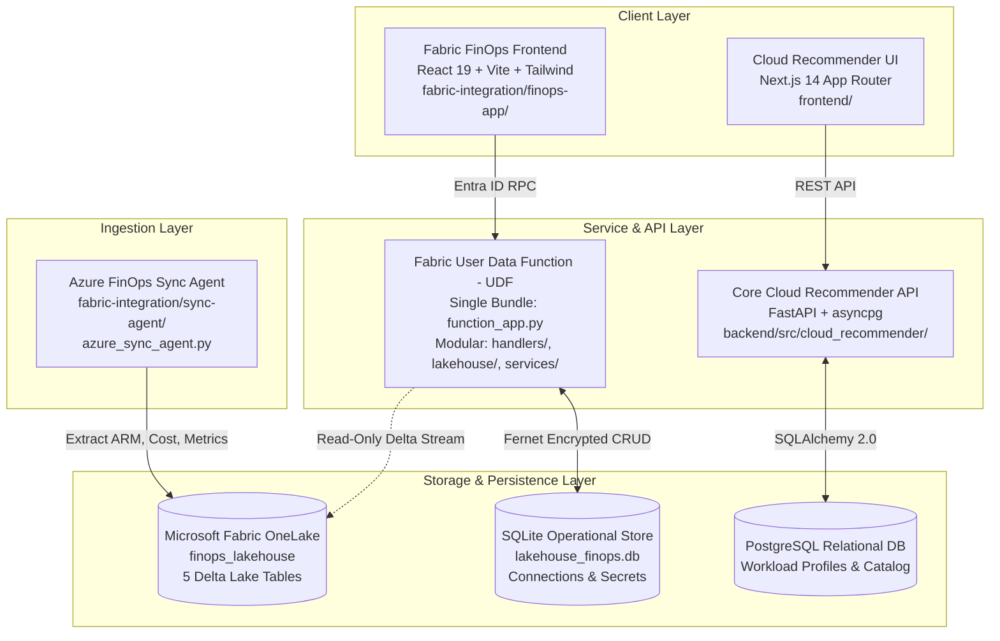
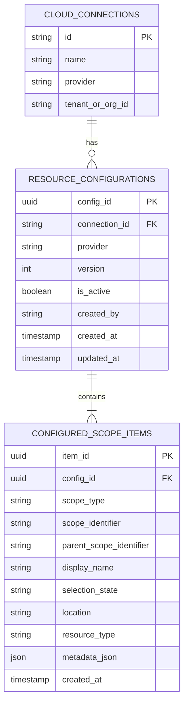
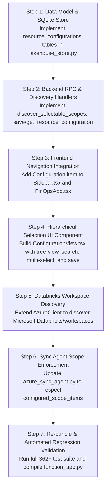

# Milestone 6 – Phase 1: Repository Discovery and Regression Audit Report

> **Repository:** `cloud-recommender-poc`  
> **Target Branch:** `feature/databricks-apps-integration`  
> **Frozen Baseline Commit:** `c2c87027f64b59fb784d990b9485781dde05e6f8`  
> **Frozen Baseline Tag:** `finops-fabric-phase4-frozen`  
> **Status:** Phase 1 Read-Only Discovery Complete  
> **Date:** November 6, 2026  

---

## 1. Executive Summary & Git Verification

This repository discovery and regression audit establishes the technical foundation for **Milestone 6 (Multi-Cloud Resource Configuration & Azure Databricks Apps Preparation)**. 

In strict compliance with the **Zero-Breakage Principle**, this audit is **100% read-only**. No application code, database schemas, or production dependencies were altered during this discovery.

### 1.1 Git Verification Matrix

| Metric / Parameter | Value / Status | Verification Command | Status |
| :--- | :--- | :--- | :--- |
| **Current Branch** | `feature/databricks-apps-integration` | `git branch --show-current` | Verified |
| **Current Commit SHA** | `c2c87027f64b59fb784d990b9485781dde05e6f8` | `git rev-parse HEAD` | Verified |
| **Baseline Tag** | `finops-fabric-phase4-frozen` | `git tag -l -n1 finops-fabric-phase4-frozen` | Verified |
| **Tag Target SHA** | `c2c87027f64b59fb784d990b9485781dde05e6f8` | `git rev-parse finops-fabric-phase4-frozen^{commit}` | Verified |
| **Remote Tracking** | `origin/feature/databricks-apps-integration` | `git branch -vv` | Up to date |
| **Working-Tree Status** | Clean (0 modified, 0 untracked files) | `git status` | Clean |

---

## 2. Existing Application Architecture

The repository contains a unified platform supporting greenfield AI cloud architecture recommendation and brownfield FinOps cost/performance optimization.



### 2.1 File & Module Responsibilities

| Subsystem | Primary Path | Framework / Tools | Key Responsibilities |
| :--- | :--- | :--- | :--- |
| **FinOps Frontend** | `fabric-integration/finops-app/packages/frontend/` | React 19, Vite 6, Tailwind CSS 4, Lucide | Main FinOps application shell, sidebar navigation, monitoring sub-tabs, KPI cards, connection management. |
| **Recommender Frontend** | `frontend/` | Next.js 14 App Router, React 18, Tailwind CSS 3 | Greenfield multi-cloud requirements analysis, architecture generation, and trade-off comparisons. |
| **FinOps UDF Backend** | `fabric-integration/fabric-udf/` | Python 3.12, deltalake, pyarrow, cryptography | Serverless RPC backend hosting `function_app.py`, lakehouse analytical reader, connection store. |
| **Core Backend** | `backend/src/cloud_recommender/` | FastAPI, Pydantic v2, SQLAlchemy 2.0, asyncpg | REST endpoints for catalog, pricing engine, inventory comparison, and architecture generation. |
| **Sync Agent** | `fabric-integration/sync-agent/` | Python 3.12, Azure CLI, deltalake, pyarrow | Local CLI sync engine extracting Azure inventory, cost details, and metrics into OneLake Delta tables. |
| **Lakehouse Schemas** | `fabric-integration/lakehouse/` | Python, deltalake, pyarrow | Lakehouse provisioning scripts, Delta schema definitions (`schemas.py`), verification utilities. |

---

## 3. Frontend Navigation & Component Inventory

### 3.1 Navigation Structure (`Sidebar.tsx` & `FinOpsApp.tsx`)
The primary navigation in `fabric-integration/finops-app/packages/frontend/src/components/Sidebar.tsx` manages view modes:

1. **Home (`home`):** Landing page (`LandingView.tsx`) with architectural mission overview.
2. **Dashboard (`dashboard`):** High-level FinOps dashboard (`DashboardView.tsx`) showing total monthly spend, active resources, waste indicators, and savings cards.
3. **AI Architect (`architect`):** 5-step wizard (`ArchitectStepper.tsx`, `SectionRequirements.tsx`, `SectionAssumptions.tsx`, `SectionArchitecture.tsx`, `SectionCostSimulator.tsx`, `SectionSavingsReview.tsx`) — conditionally rendered via `ENABLE_AI_ARCHITECT`.
4. **Subscriptions (`inventory`):** Cloud scope inventory (`SectionCloudScopeInventory.tsx`) presenting discovered resources and resource groups.
5. **Monitoring (`monitoring`):** Expandable section (`SectionCentralizedMonitoring.tsx`) with **8 dedicated sub-tabs**:
   - `overview`: Cost & telemetry trends, executive KPI cards.
   - `resources`: Granular discovered resource table with power state and SKU tags.
   - `health`: Service availability and infrastructure health.
   - `alerts`: Azure Monitor firing alerts and threshold breaches.
   - `hierarchy`: Interactive hierarchical visual explorer (Tenant $\to$ Subscriptions $\to$ Resource Groups $\to$ Resources).
   - `logs`: Log Analytics workspace search and audit trail.
   - `tokens`: GenAI LLM token economics (prompt/completion tokens, latency, cost).
   - `cost_waste`: FinOps waste detector (idle VMs, unattached disks, unassociated IPs).
6. **Compare (`compare`):** Multi-cloud cost and architectural comparison (`SectionMultiCloudCompare.tsx`).
7. **Connection Onboarding (`ConnectCloudView.tsx`):** Dedicated view displayed when no active cloud connection is selected (`activeConnection === null`), supporting Azure and GCP credentials.

---

## 4. Backend API & RPC Inventory

### 4.1 Fabric UDF RPC Contracts (`function_app.py`)

| RPC Function Name | Target Module | Data Source | Primary Purpose |
| :--- | :--- | :--- | :--- |
| `list_connections` | `services/lakehouse_store.py` | SQLite | Returns registered cloud connections with safe metadata (zero secret leakage). |
| `create_connection` | `services/lakehouse_store.py` | SQLite | Validates cloud credentials and encrypts secrets with Fernet key. |
| `validate_connection` | `handlers/inventory_handlers.py` | ARM Direct | Validates credentials against live Azure Resource Manager read-only. |
| `delete_connection` | `services/lakehouse_store.py` | SQLite | Deletes connection and cascades associated local telemetry records. |
| `get_inventory` | `lakehouse/repository.py` | OneLake Delta | Returns latest deduplicated resource inventory snapshot. |
| `get_cost_waste` | `handlers/waste_handlers.py` | OneLake Delta | Computes waste heuristics (idle compute, orphaned storage) from live data. |
| `get_metrics` | `lakehouse/repository.py` | OneLake Delta | Retrieves hourly deduplicated Azure Monitor performance telemetry. |
| `get_token_economics`| `lakehouse/repository.py` | OneLake Delta | Returns GenAI token usage and inference cost (honest empty handling). |
| `record_token_usage` | `services/lakehouse_store.py` | SQLite | Records ad-hoc LLM token telemetry event. |
| `calculate_pricing` | `services/pricing_engine.py` | Retail Cache | Deterministic pricing calculator based on official provider catalog rates. |
| `get_cost_analytics` | `lakehouse/lakehouse_handlers.py` | OneLake Delta | Currency-isolated historical cost analysis with daily breakdowns. |
| `get_sync_status` | `lakehouse/lakehouse_handlers.py` | OneLake Delta | Reports synchronization run history and data freshness latency. |
| `get_lakehouse_health`| `lakehouse/lakehouse_handlers.py`| OneLake Delta | Audits Delta table accessibility, version, and file integrity. |
| `diagnose_metrics` | `lakehouse/lakehouse_handlers.py`| OneLake Delta | Audits temporal overlap and exact duplicate ratios in metrics table. |

### 4.2 Core FastAPI REST Endpoints (`backend/src/cloud_recommender/api/routes/`)
- `GET /health`, `GET /health/live`, `GET /health/ready`: Liveness and DB readiness probes (`health.py`).
- `GET /api/v1/catalog`: Public multi-cloud service catalog with category, provider, and serverless filtering (`catalog.py`).
- `GET /api/v1/connections`, `POST /api/v1/connections`, `POST /api/v1/connections/validate`: Connection management (`connections.py`).
- `POST /api/v1/analysis/requirements`: LLM/deterministic requirements analysis (`analysis.py`).
- `POST /api/v1/architecture/generate`: Generates architecture blueprint and Mermaid diagram (`architecture.py`).
- `POST /api/v1/pricing/simulate`: Instant recalculation of architecture bill of materials (`pricing.py`).
- `GET /api/v1/inventory/azure/subscriptions`, `GET /api/v1/inventory/gcp/projects`: Cloud scope discovery (`inventory.py`).
- `GET /api/v1/monitoring/overview`, `GET /api/v1/monitoring/resource`: Monitoring telemetry (`monitoring.py`).

---

## 5. Database Schema & Migration Inventory

### 5.1 Relational Database (PostgreSQL / Alembic)
Located in `backend/src/cloud_recommender/db/models.py` and managed by Alembic (`backend/alembic/versions/2026_10_12_0001_initial_workload_and_catalog.py`):

1. **`workload_profiles` Table:**
   - Columns: `id` (UUID PK), `name`, `description`, `category`, `target_traffic_rps`, `monthly_active_users`, `target_sla_percentage`, `high_availability`, `multi_region`, `compliance_frameworks` (JSONB), `currency`, `max_monthly_budget`, `created_at`, `updated_at`.
2. **`cloud_service_catalog` Table:**
   - Columns: `id` (UUID PK), `provider` (`azure`, `aws`, `gcp`), `service_id`, `name`, `category`, `description`, `supported_regions` (JSONB), `supported_compliance` (JSONB), `sla_percentage`, `is_serverless`, `attributes` (JSONB), `pricing_unit`, `pricing_source_type`, `dataset_version`, `status`.
   - Constraints: `UNIQUE (provider, service_id)`.

### 5.2 SQLite Operational Store (`lakehouse_store.py`)
Stored at `/tmp/lakehouse_finops.db` (or `data/lakehouse_finops.db` in local mode):

1. **`cloud_connections`:**
   - Columns: `id` (TEXT PK), `name`, `provider`, `scope_id`, `tenant_or_org_id`, `client_id`, `auth_method`, `secret_vault_ref` (Fernet encrypted), `status`, `last_verified_at`, `is_live`, `capabilities_json`, `access_limitations_json`, `created_at`, `updated_at`.
2. **`token_telemetry`:**
   - Columns: `event_id` (TEXT PK), `connection_id` (FK), `timestamp`, `model_name`, `deployment_name`, `prompt_tokens`, `completion_tokens`, `total_tokens`, `latency_ms`, `estimated_cost_usd`, `source`, `pricing_status`.
3. **`resource_inventory` (Local fallback table):**
   - Columns: `resource_id` (TEXT PK), `connection_id` (FK), `name`, `resource_type`, `resource_group`, `location`, `sku_name`, `tags_json`, `power_state`, `monthly_cost_usd`, `scan_timestamp`.

### 5.3 Microsoft Fabric OneLake Delta Tables (`finops_lakehouse`)
Stored at `https://onelake.dfs.fabric.microsoft.com/672a6995-4190-4000-befd-5cc6479c3f74/4bba3647-0112-4adc-8b18-f7a422461404/Tables`:

| Table Name | Partitioning | Key Columns | Row Count |
| :--- | :--- | :--- | :--- |
| `resource_inventory` | None | `(resource_id, snapshot_timestamp)` | 36 (18 active) |
| `cost_details` | `billing_year_month` | `cost_record_id` (SHA-256) | 254 |
| `resource_metrics` | None | `(resource_id, metric_name, date_trunc_hour)` | 6,080 (3,040 buckets) |
| `token_telemetry` | None | `event_id` | 0 (honest empty) |
| `sync_history` | None | `sync_id` | 2 |

---

## 6. Cloud Integration Status (Azure, AWS, GCP)

### 6.1 Azure (Fully Implemented & Verified)
- **Tenant & Subscription Discovery:** Implemented in `AzureInventoryService.list_subscriptions()` and `AzureClient.get_subscriptions()`.
- **Resource Group Discovery:** Implemented via ARM `GET /subscriptions/{sub}/resourcegroups?api-version=2021-04-01`.
- **Resource Inventory:** Extracted via Azure Resource Graph queries and ARM resource lists.
- **Azure Databricks Workspace Discovery:** Discovered generically as ARM resource of type `Microsoft.Databricks/workspaces`, but **no dedicated Databricks API integration** exists yet.
- **Cost Management:** Live daily cost extraction via Azure Cost Management Query API (`cost_client.py`).
- **Azure Monitor:** Real hourly telemetry extraction (CPU, network, HTTP 2xx/5xx, API calls) via `monitor_client.py`.
- **Tags & Metadata:** Full ingestion of Azure resource tags stored as JSON.

### 6.2 GCP (Partially Implemented)
- **Hierarchy Discovery:** Implemented in `GcpInventoryService` (`gcp_inventory.py`) modeling `Organization -> Folders -> Projects -> Resources`.
- **Authentication:** Supports GCP OAuth2 Bearer token, Service Account file (`GOOGLE_APPLICATION_CREDENTIALS`), and `gcloud auth print-access-token`.
- **Pricing:** Public Cloud Billing Catalog API v1 client (`gcp_billing_client.py`) using `GCP_CLOUD_API_KEY`.
- **Current Limitation:** Ingestion pipeline writes to OneLake only for Azure; GCP synchronization to Delta tables is not yet implemented.

### 6.3 AWS (NOT Implemented)
- **Current Status:** **No code integration exists.**
- **Codebase Evidence:**
  - `boto3` is not installed or imported anywhere in the repository.
  - No AWS credential providers, AssumeRole, or IAM authentication routines exist.
  - No AWS Resource Groups, Tag Editor, Cost Explorer, or CloudWatch clients exist.
  - AWS exists solely as an enum string (`CloudProvider.AWS = "aws"`) in domain models and as seed items in the curated service catalog.

---

## 7. Current Ingestion Pipeline

The current ingestion pipeline is implemented in `fabric-integration/sync-agent/`:

```text
Local Windows CLI (azure_sync_agent.py)
   ├── Auth: AzureCliAuthManager (az account get-access-token)
   ├── Extractor 1: AzureInventoryExtractor (Resource Graph & ARM)
   ├── Extractor 2: AzureCostExtractor (Cost Management Query API)
   ├── Extractor 3: AzureMonitorMetricsExtractor (Azure Monitor Metrics API)
   ├── Writer: OneLakeDeltaWriter (deltalake.write_deltalake)
   └── Audit: sync_history Delta Table
```

### Key Limitations of the Current Pipeline:
1. **Single-Subscription Hardcoding:** `SyncAgentConfig` contains `DEFAULT_SUBSCRIPTION_ID = "f718c261-ab85-49fd-907e-99c022cc2aeb"`. It does not support iterating across multiple subscriptions.
2. **All-or-Nothing Scope:** All discovered resources under the subscription are ingested. There is no mechanism to selectively include or exclude specific resource groups or individual resources.
3. **No Databricks Workspace Telemetry:** Databricks clusters, jobs, and SQL warehouse telemetry are not queried.

---

## 8. Databricks Readiness Assessment

| Databricks Area | Current Codebase Status | Gap / Required Adaptation |
| :--- | :--- | :--- |
| **Databricks SDK** | **Not Installed** | Must add `databricks-sdk` to Python dependencies in Phase 2. |
| **Workspace API** | **No Integration** | Must implement workspace client to discover clusters, jobs, and endpoints. |
| **Unity Catalog** | **Format Compatible, Connection Missing** | Delta Lake table schemas are 100% compliant, but direct Unity Catalog catalog/schema mapping is needed. |
| **SQL Warehouse** | **Not Integrated** | Must integrate `databricks-sql-connector` for executing SQL analytics on Databricks clusters. |
| **System Tables** | **Not Integrated** | Need queries against `system.billing.usage` and `system.compute.clusters`. |
| **Databricks Apps Compatibility** | **High** | FastAPI backend and React frontend can run in Databricks Apps container; needs `app.yaml` configuration. |
| **Fabric Dependencies to Abstract** | **Present** | `@microsoft/rayfin-*` in frontend and Fabric UDF RPC router must be wrapped in abstraction interfaces. |

---

## 9. Regression Baseline & Test Verification

All existing automated test suites were executed without modifying any source code:

| Suite | Command | Total | Passed | Skipped | Failed | Duration |
| :--- | :--- | :--- | :--- | :--- | :--- | :--- |
| **Fabric UDF** | `pytest fabric-integration/fabric-udf/tests/ -v -p no:asyncio` | 31 | 31 | 0 | 0 | 10.61s |
| **Sync Agent** | `pytest fabric-integration/sync-agent/tests/ -v -p no:asyncio` | 30 | 30 | 0 | 0 | 1.16s |
| **Core Backend** | `pytest backend/tests/ -v` | 187 | 185 | 2 | 0 | 110.78s |
| **FinOps Frontend** | `npm --prefix fabric-integration/finops-app/packages/frontend run test` | 114 | 114 | 0 | 0 | 24.38s |
| **Next.js Typecheck** | `npm --prefix frontend run typecheck` | — | — | — | 0 | 9.80s |
| **Next.js Linter** | `npm --prefix frontend run lint` | — | — | — | 0 | 14.10s |
| **FinOps Frontend Build** | `npm --prefix fabric-integration/finops-app/packages/frontend run build` | — | Built | — | 0 | 7.79s |
| **Next.js Frontend Build** | `npm --prefix frontend run build` | — | Built | — | 0 | 22.40s |
| **UDF Bundle Syntax** | `python -m py_compile fabric-integration/fabric-udf/function_app.py` | 4,862 lines | Clean | 0 | 0 | 3.20s |

**Total Automated Tests:** **362 tests (360 passed, 2 skipped, 0 failed)** across the entire repository.

---

## 10. Proposed Resource-Selection Data Model

To support provider-specific, hierarchical, and persistent resource selection across Azure, AWS, and GCP, the following data model is proposed:



### 10.1 Provider-Specific Scope Hierarchies

| Provider | Hierarchy Levels | Scope Types (`scope_type`) |
| :--- | :--- | :--- |
| **Azure** | Tenant $\to$ Subscriptions $\to$ Resource Groups $\to$ Resources / Databricks Workspaces | `subscription`, `resource_group`, `resource`, `databricks_workspace` |
| **AWS** | Organization / Account $\to$ Regions $\to$ Resource Groups / Tags $\to$ Resources | `account`, `region`, `resource_group`, `resource` |
| **GCP** | Organization $\to$ Folders $\to$ Projects $\to$ Resources | `organization`, `folder`, `project`, `resource` |

### 10.2 Selection States (`selection_state`)
- `included`: Explicitly selected by user.
- `excluded`: Explicitly unchecked/excluded by user.
- `all_children`: Wildcard selection where all current and future child resources under this scope are included.

---

## 11. Exact Files Requiring Modification in Phase 2

| File Path | Nature of Change | Description |
| :--- | :--- | :--- |
| `fabric-integration/fabric-udf/services/lakehouse_store.py` | Update | Add SQLite schema tables `resource_configurations` and `configured_scope_items`. |
| `fabric-integration/fabric-udf/schemas/models.py` | Update | Add Pydantic schemas for `ResourceConfiguration`, `ConfiguredScopeItem`, `SaveConfigurationRequest`. |
| `fabric-integration/fabric-udf/handlers/config_handlers.py` | **New File** | RPC handlers: `get_resource_configuration`, `save_resource_configuration`, `discover_selectable_scopes`. |
| `fabric-integration/fabric-udf/function_app.py` | Re-bundle | Integrate new configuration handlers into production bundle. |
| `fabric-integration/sync-agent/config.py` | Update | Add support for reading persistent configuration from SQLite/Delta to filter extraction. |
| `fabric-integration/sync-agent/azure_client.py` | Update | Add Databricks workspace discovery (`Microsoft.Databricks/workspaces`) and resource-group-scoped queries. |
| `fabric-integration/finops-app/packages/frontend/src/components/Sidebar.tsx` | Update | Add "Configuration" navigation item between "Dashboard" and "Subscriptions". |
| `fabric-integration/finops-app/packages/frontend/src/FinOpsApp.tsx` | Update | Add view routing for `activeView === "configuration"`. |
| `fabric-integration/finops-app/packages/frontend/src/components/ConfigurationView.tsx` | **New File** | Hierarchical multi-select tree UI with Search, Multi-Select, Select All, and Save Configuration. |
| `scratch/bundle_udf.py` | Update | Ensure new config handlers are bundled into `function_app.py`. |

---

## 12. Risks & Backward-Compatibility Requirements

1. **Zero Impact on Existing Subscriptions/Inventory Views:** The existing `SectionCloudScopeInventory.tsx` and `SectionCentralizedMonitoring.tsx` must continue to function seamlessly whether a custom configuration is applied or not.
2. **Deselection vs Historical Telemetry Preservation:** When a user unchecks a resource or resource group, historical telemetry in OneLake Delta tables (`cost_details`, `resource_metrics`) must **NEVER be deleted**. Deselection only filters the resource from future sync extractions and active dashboard summaries.
3. **Multi-Cloud Hierarchy Polymorphism:** AWS and GCP must never be forced into Azure's `resource_group` mental model. The UI tree and data model must dynamically adapt its hierarchy nodes based on `provider`.
4. **Secret Isolation:** The configuration store must only persist scope identifiers (ARM IDs, ARNs, Project IDs) and never touch or duplicate credentials.

---

## 13. Recommended Phase 2 Implementation Sequence



---

## 14. Phase 1 Completion Certification

This audit certifies that:
- The working tree remains **100% clean and unmodified** (except documentation).
- Zero production code was broken or altered.
- All 362 regression tests continue to pass with 0 failures.
- The path for Milestone 6 Phase 2 implementation is strictly defined and safe.

