# MILESTONE 6 – PHASE 2C IMPLEMENTATION REPORT
## Scope-Aware Ingestion & Configuration Enforcement

> **Date:** November 6, 2026  
> **Repository:** `cloud-recommender-poc`  
> **Branch:** `feature/databricks-apps-integration`  
> **Frozen Baseline Commit:** `c2c87027f64b59fb784d990b9485781dde05e6f8`  
> **Target Deployment Platform:** Azure Databricks Apps  
> **Status:** Implementation Complete & Verified  

---

## 1. Executive Summary

Milestone 6 Phase 2C establishes **Scope-Aware Ingestion and Configuration Enforcement** for the Cloud FinOps Recommender platform. Following the completion of Phase 2A/2B (multi-cloud resource discovery and hierarchical selection), Phase 2C binds saved resource configurations directly to the backend ingestion pipeline. 

### Key Accomplishments
1. **Pre-Flight Ingestion Readiness Service:** Prevents unconfigured or unauthorized ingestion attempts with deterministic state machine verification (`READY`, `NOT_CONFIGURED`, `NO_RESOURCES_SELECTED`, `CONNECTION_ERROR`, `PERMISSION_DENIED`, `CONFIGURATION_INVALID`).
2. **Effective Scope Enforcement Engine:** Resolves hierarchical inclusion rules, child exclusion overrides, partial resource group selections, and Databricks workspace scoping without ingesting unselected cloud assets.
3. **Modular Multi-Cloud Ingestors:** Standardized `BaseProviderIngestor` interface with concrete adapters for **Azure** (ARM resource graph, subscriptions, resource groups, Databricks workspaces), **Databricks** (workspace-level clusters, jobs, and SQL warehouses without requiring System Tables), **GCP** (projects and compute), and **AWS** (unconfigured stub).
4. **Configuration Version Lineage & Audit Trail:** Every ingestion run captures the immutable `configuration_version` from which its scope was derived, ensuring reproducible cost and inventory snapshots.
5. **Robust Execution Lifecycle & Dual Persistence:** Implemented `IngestionOrchestrator` with duplicate run protection (`IngestionConflictError`), partial failure classification (`PARTIAL_FAILURE`), per-resource record tracking, and resilient dual persistence (PostgreSQL/SQLite DB repository + in-memory store).
6. **Databricks Apps Frontend Integration:** Enhanced `ConfigurationView.tsx` with a pre-flight readiness badge, single-click "Trigger Ingestion" workflow, and a live "Recent Ingestion Runs & Configuration Lineage" audit table.
7. **Zero Fabric Coupling & Zero Cloud Mutations:** The implementation requires no runtime dependencies on Microsoft Fabric and performs strictly read-only cloud queries (`Reader`, `Cost Management Reader`).

---

## 2. System Architecture

```mermaid
flowchart TD
    subgraph UI ["Databricks App Frontend (React/TypeScript)"]
        CV["ConfigurationView"]
        TB["Trigger Ingestion Button"]
        RB["Readiness Status Badge"]
        LT["Ingestion Lineage Table"]
    end

    subgraph API ["FastAPI Ingestion Engine"]
        R_Ready["GET /api/v1/ingestion/{connection_id}/readiness"]
        R_Run["POST /api/v1/ingestion/{connection_id}/runs"]
        R_List["GET /api/v1/ingestion/{connection_id}/runs"]
        R_Retry["POST /api/v1/ingestion/runs/{run_id}/retry"]
    end

    subgraph Services ["Core Ingestion Services"]
        IRS["IngestionReadinessService"]
        SES["ScopeEnforcementService"]
        ORCH["IngestionOrchestrator"]
    end

    subgraph Providers ["Modular Cloud Ingestors"]
        AZ_ING["AzureProviderIngestor\n(ARM & Cost API)"]
        DB_ING["DatabricksWorkspaceIngestor\n(Workspace REST APIs)"]
        GCP_ING["GcpProviderIngestor\n(Cloud Asset / Compute)"]
        AWS_ING["AwsProviderIngestor\n(Unconfigured Guard)"]
    end

    subgraph Storage ["Persistent Lineage Storage"]
        DB_RUNS[("ingestion_runs\n(run_id, version, status)")]
        DB_RECS[("ingestion_resource_records\n(resource_id, status, error)")]
    end

    CV --> R_Ready
    TB --> R_Run
    LT --> R_List
    TB -.-> R_Retry

    R_Ready --> IRS
    R_Run --> ORCH
    R_Retry --> ORCH

    ORCH --> IRS
    ORCH --> SES
    SES --> AZ_ING
    SES --> DB_ING
    SES --> GCP_ING
    SES --> AWS_ING

    ORCH --> DB_RUNS
    ORCH --> DB_RECS
```

---

## 3. Workstream Implementations

### 3.1 Workstream 1: Ingestion Readiness Service
- **Module:** `backend/src/cloud_recommender/services/ingestion/readiness_service.py`
- **Class:** `IngestionReadinessService`
- **State Machine (`IngestionReadinessState`):**
  - `READY`: Connection valid, configuration saved (version $\ge 1$), effective resource count $> 0$, read-only permissions confirmed.
  - `NOT_CONFIGURED`: Connection exists but no resource configuration has been created yet.
  - `NO_RESOURCES_SELECTED`: Configuration exists but effective selected resource count is zero.
  - `CONNECTION_ERROR`: Provider credentials invalid, revoked, or inaccessible.
  - `PERMISSION_DENIED`: Caller lacks required read-only permissions (`Reader`, `Cost Management Reader`).
  - `CONFIGURATION_INVALID`: Malformed configuration payload or missing required provider scopes.

### 3.2 Workstream 2: Effective Scope Enforcement
- **Module:** `backend/src/cloud_recommender/services/ingestion/scope_service.py`
- **Class:** `ScopeEnforcementService`
- **Resolution Rules:**
  - Cascading Parent Inclusion: Selecting a subscription or resource group with `all_children=True` automatically includes all child resources.
  - Explicit Child Exclusions: Individual resources marked with `excluded=True` override parent container selections.
  - Partial Container Selections: Individual resource inclusions without container-level selection are strictly honored.
  - Filtering Functions: `is_resource_in_scope()` and `filter_records_by_scope()` guarantee that out-of-scope resources are scrubbed before persistence or cost calculation.

### 3.3 Workstream 3: Modular Provider Ingestion Architecture
- **Base Interface:** `backend/src/cloud_recommender/services/ingestion/providers/base.py` (`BaseProviderIngestor`)
- **Implementations:**
  - `AzureProviderIngestor` (`backend/.../providers/azure.py`): Ingests Azure subscriptions, resource groups, individual ARM resources, and detects managed Databricks workspaces.
  - `DatabricksWorkspaceIngestor` (`backend/.../providers/databricks.py`): Connects to Databricks workspaces via standard REST APIs to ingest clusters, jobs, and SQL warehouses without assuming System Tables or Unity Catalog admin privileges.
  - `GcpProviderIngestor` (`backend/.../providers/gcp.py`): Ingests scoped GCP projects, compute instances, and storage buckets.
  - `AwsProviderIngestor` (`backend/.../providers/aws.py`): Stub provider returning clean unconfigured status without throwing unexpected runtime errors.

### 3.4 Workstream 4: Configuration Version Lineage & Schemas
- **Module:** `backend/src/cloud_recommender/schemas/ingestion.py`
- **Lineage Tracking:**
  - Every ingestion run records `configuration_version: int` alongside `connection_id` and `run_id`.
  - Future cost and telemetry analyses can deterministically trace back to the exact resource filter set active during ingestion.
- **Data Models:**
  - `IngestionScope`: Normalized container and resource ID sets.
  - `IngestionReadinessResponse`: Status, reason, missing permissions, and selected resource count.
  - `IngestionRunResponse` & `IngestionRunSummaryResponse`: Granular run metrics (resources extracted, skipped, failed, runtime seconds).

### 3.5 Workstream 5: Execution, Monitoring & Persistence
- **Database Models (`backend/src/cloud_recommender/db/models.py`):**
  - `IngestionRunModel`: Table `ingestion_runs` with composite indexes on `(connection_id, status)` and `(connection_id, configuration_version)`.
  - `IngestionResourceRecordModel`: Table `ingestion_resource_records` tracking per-resource status (`ingested`, `skipped`, `failed`) and error logs.
- **Repository:** `backend/src/cloud_recommender/db/repositories/ingestion_repo.py` (`IngestionRepository`).
- **Orchestrator:** `backend/src/cloud_recommender/services/ingestion/ingestion_orchestrator.py` (`IngestionOrchestrator`).
  - Pre-flight gating via `IngestionReadinessService`.
  - Duplicate run prevention: Throws `IngestionConflictError` (HTTP 409) if an active run is in progress for the connection.
  - Partial failure handling: Classifies run as `PARTIAL_FAILURE` if some resources succeed while others encounter non-fatal errors.
  - Retry capability: Re-executes failed runs while preserving configuration lineage.

---

## 4. Ingestion API Endpoint Reference

| Method | Endpoint | Description | Auth Required |
| :--- | :--- | :--- | :--- |
| `GET` | `/api/v1/ingestion/{connection_id}/readiness` | Pre-flight readiness check for saved configuration | Yes (Bearer) |
| `POST` | `/api/v1/ingestion/{connection_id}/runs` | Trigger scope-aware ingestion run | Yes (Bearer) |
| `GET` | `/api/v1/ingestion/{connection_id}/runs` | List ingestion history with configuration version lineage | Yes (Bearer) |
| `GET` | `/api/v1/ingestion/runs/{run_id}` | Get detailed execution telemetry and resource records | Yes (Bearer) |
| `POST` | `/api/v1/ingestion/runs/{run_id}/retry` | Retry failed or partially failed ingestion run | Yes (Bearer) |

---

## 5. Frontend Integration (Databricks Apps)

The frontend `ConfigurationView` was updated to surface Phase 2C capabilities directly to users:

1. **Header Readiness Badge:** Displays real-time ingestion readiness status (`Ready`, `Not Configured`, `No Selection`, `Permission Error`) with explanatory tooltip guidance.
2. **"Trigger Ingestion" Button:** Located in the card action bar with an animated spinner, disabled automatically when readiness checks fail.
3. **Ingestion History & Version Lineage Panel:**
   - Displays recent runs with run ID, timestamp, and duration.
   - Highlights the configuration version badge: `Scope v{version}`.
   - Shows extracted, skipped, and failed resource tallies.
   - Provides an inline "Retry" button for interrupted or partially failed runs.

---

## 6. Automated Verification & Quality Results

| Verification Test Suite | Target Module | Scope | Status | Result |
| :--- | :--- | :--- | :--- | :--- |
| **Ingestion Enforcement** | `backend/tests/test_ingestion_enforcement.py` | Readiness, scope, orchestrator, APIs | **PASSED** | 16 passed, 0 failed |
| **Multi-Cloud Configuration** | `backend/tests/test_configuration.py` | Discovery, selection, persistence | **PASSED** | 15 passed, 0 failed |
| **Backend Regression Suite** | `backend/tests/` | Full platform test suite | **PASSED** | 216 passed, 2 skipped, 0 failed |
| **Backend Type Safety** | `mypy backend/src/cloud_recommender/` | Strict static typing across 73 files | **PASSED** | 0 errors |
| **Backend Code Style** | `ruff check backend/` & `ruff format` | Linting & formatting across 104 files | **PASSED** | 0 warnings, all formatted |
| **Frontend View Spec** | `src/test/configuration-view.spec.tsx` | Configuration & ingestion UI components | **PASSED** | 7 passed, 0 failed |
| **Frontend Test Suite** | `finops-app/packages/frontend` | 11 unit & integration test files | **PASSED** | 121 passed, 0 failed |
| **Frontend Production Build** | `npm --prefix frontend run build` | Next.js / React production bundling | **PASSED** | Built in 9.40s, 0 errors |

---

## 7. Next Steps for Azure Databricks Apps Deployment

As confirmed by user direction, **no further effort will be spent on Fabric deployments**. The project is dedicated exclusively to Azure Databricks Apps hosting.

### Databricks Apps Transition Plan
1. **App Definition Manifest (`app.yaml`):** Create the Databricks App manifest defining FastAPI backend startup command, static asset serving, and environment configuration.
2. **Single-Port Unified Proxy:** Configure FastAPI to serve the built React frontend static files (`dist/`) directly, enabling a clean single-service deployment inside the Databricks App container.
3. **Unity Catalog Volume Mounts:** Map persistent SQLite/DuckDB operational databases and Delta Lake caches to Databricks Unity Catalog Volumes for persistent storage across app restarts.
4. **Databricks OAuth Token Forwarding:** Leverage Databricks Apps built-in OAuth headers (`X-Databricks-User-Token`, `X-Databricks-User-Email`) for transparent user identity propagation.
5. **Databricks CLI Deployment:** Package and deploy the application using `databricks apps create` and `databricks apps deploy`.

