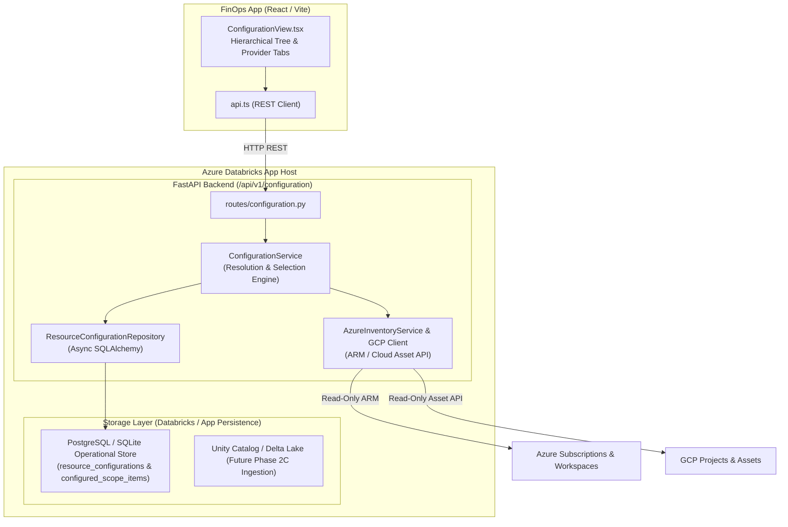
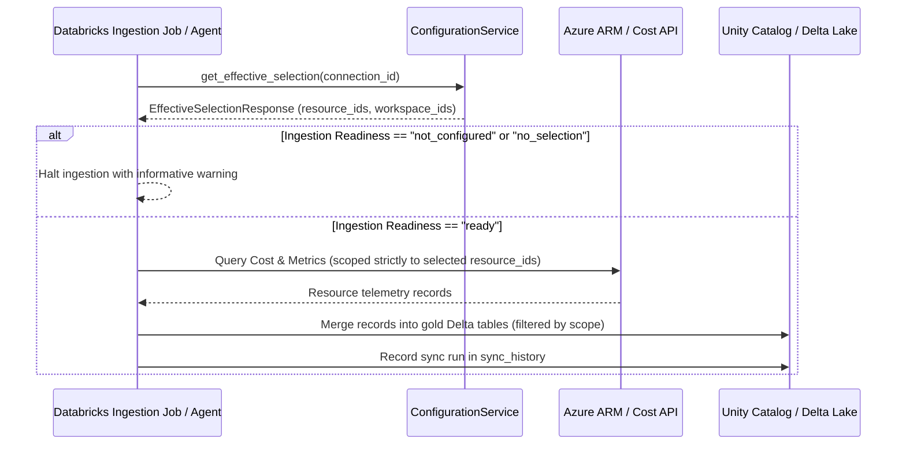

# MILESTONE 6 – PHASE 2A & 2B REPORT
## Databricks-Native Multi-Cloud Resource Configuration

> **Status:** Completed & Fully Verified  
> **Repository:** `cloud-recommender-poc`  
> **Branch:** `feature/databricks-apps-integration`  
> **Baseline Frozen Checkpoint:** `c2c87027f64b59fb784d990b9485781dde05e6f8` (`finops-fabric-phase4-frozen`)  
> **Date:** 2026-11-06  

---

## 1. Architectural Decisions

In accordance with the transition from Microsoft Fabric UDF hosting to **Azure Databricks Apps**, the Multi-Cloud Resource Configuration capability has been architected with the following core design choices:



### Key Decisions:
1. **Host Configuration on Databricks Apps Backend:**
   - The FastAPI backend serves as the native orchestrator inside Databricks Apps containers.
   - Zero dependencies on Microsoft Fabric UDF RPC (`function_app.py`) were introduced. Fabric UDF and the OneLake Sync Agent remain frozen reference implementations.
2. **Dual-Persistence Pattern (Pluggable Store):**
   - When an active database session is available, `ConfigurationService` commits configurations atomically through `ResourceConfigurationRepository` into relational storage (`PostgreSQL` / `SQLite`).
   - When running in stateless or lightweight local dev sessions without database connectivity, the service transparently falls back to an in-memory dictionary cache with equivalent concurrency semantics.
3. **Deterministic Server-Side Resolution:**
   - Selection logic (cascading parent inclusions, individual exclusions, workspace filters) is resolved deterministically by `ConfigurationService.resolve_effective_selection` on the server rather than trusting uncontrolled frontend payloads.

---

## 2. Storage & Persistence Design

The persistence design supports versioned configuration revisions, multi-tenant isolation, and direct compatibility with Databricks Unity Catalog and Delta Lake workflows:

- **Immutable Version Incrementing:** Every save operation creates a new revision with `configuration_version = max(existing_version) + 1` and marks the previous version as `archived`. Only one configuration per `connection_id` carries `active_status = "active"`.
- **Cascade Deletion & Referential Integrity:** Foreign keys from `configured_scope_items` to `resource_configurations` include `ON DELETE CASCADE`.
- **Cross-Dialect Compatibility:** Uses SQLAlchemy 2.0 `GUID` (natively `UUID` on PostgreSQL, `CHAR(32)` on SQLite) and JSON-serialized metadata for portability across local dev and cloud relational backends.

---

## 3. Database Structures & Schema Specifications

Two database models were added to [models.py](file:///c:/Users/pratik.bingewar/OneDrive - bizmetric.com/Desktop/Workspace/cloud-recommender-poc/backend/src/cloud_recommender/db/models.py):

### Table: `resource_configurations`
Stores the top-level configuration metadata per connection.

| Column | Type | Constraints | Description |
| :--- | :--- | :--- | :--- |
| `id` | `GUID` / `UUID` | Primary Key, default `uuid4` | Unique configuration record identifier |
| `connection_id` | `VARCHAR(128)` | Not Null, Index | Foreign identifier of the cloud connection |
| `provider` | `VARCHAR(32)` | Not Null, Index | Cloud provider (`azure`, `gcp`, `aws`) |
| `configuration_version`| `INTEGER` | Not Null, default 1 | Monotonically incrementing revision number |
| `active_status` | `VARCHAR(32)` | Not Null, default `"active"` | Status: `"active"`, `"archived"`, `"draft"` |
| `created_by` | `VARCHAR(128)` | Nullable | Identity or service principal that saved configuration |
| `created_at` | `DateTime(timezone=True)`| Not Null, default `utcnow` | Creation timestamp |
| `updated_at` | `DateTime(timezone=True)`| Not Null, default `utcnow` | Last update timestamp |

**Indexes:**
- `ix_config_conn_active`: `(connection_id, active_status)`
- `ix_config_conn_version`: `(connection_id, configuration_version)`

### Table: `configured_scope_items`
Stores individual selected or excluded hierarchy nodes within a configuration revision.

| Column | Type | Constraints | Description |
| :--- | :--- | :--- | :--- |
| `id` | `GUID` / `UUID` | Primary Key, default `uuid4` | Unique scope item identifier |
| `configuration_id` | `GUID` / `UUID` | Foreign Key (`resource_configurations.id`, CASCADE) | Parent configuration reference |
| `scope_type` | `VARCHAR(64)` | Not Null | `subscription`, `resource_group`, `resource`, `databricks_workspace`, `gcp_project` |
| `scope_identifier` | `VARCHAR(512)` | Not Null | Fully qualified ARM ID or Cloud Resource Name |
| `parent_scope_identifier` | `VARCHAR(512)` | Nullable | Identifier of immediate parent container |
| `display_name` | `VARCHAR(256)` | Not Null | Human-readable node name |
| `resource_type` | `VARCHAR(128)` | Nullable | ARM resource type (e.g., `Microsoft.Databricks/workspaces`) |
| `region` | `VARCHAR(64)` | Nullable | Cloud deployment region (e.g., `eastus`) |
| `selection_state` | `VARCHAR(32)` | Not Null, default `"included"` | `"included"`, `"excluded"`, `"all_children"` |
| `metadata` | `JSONType` | Nullable | Arbitrary properties (workspace URL, pricing tier, tags) |
| `created_at` | `DateTime(timezone=True)`| Not Null, default `utcnow` | Creation timestamp |

**Indexes:**
- `ix_scope_item_config_scope`: `(configuration_id, scope_identifier)`
- `ix_scope_item_parent`: `(parent_scope_identifier)`

---

## 4. Backend API Contracts

Mounted at `/api/v1/configuration` in [configuration.py](file:///c:/Users/pratik.bingewar/OneDrive - bizmetric.com/Desktop/Workspace/cloud-recommender-poc/backend/src/cloud_recommender/api/routes/configuration.py):

| Method | Endpoint | Query / Payload | Response Schema | Description |
| :--- | :--- | :--- | :--- | :--- |
| `GET` | `/scopes/discover` | `connection_id` (opt), `provider` (`azure`\|`gcp`\|`aws`) | `ScopeDiscoveryResponse` | Discovers cloud resource tree, leaf counts, and Databricks workspaces. Returns `unsupported` for AWS. |
| `GET` | `/{connection_id}` | Path param: `connection_id` | `ResourceConfigurationResponse` | Retrieves active configuration with all scope items (404 if not found). |
| `POST` | `/` | Body: `ResourceConfigurationCreate` | `ResourceConfigurationResponse` | Atomically creates new version, archives old, saves all scope items. |
| `GET` | `/{connection_id}/selected` | Path param: `connection_id` | `EffectiveSelectionResponse` | Server-side resolved list of effective resource IDs and Databricks workspaces. |
| `GET` | `/{connection_id}/workspaces` | Path param: `connection_id` | `List[ScopeDiscoveryNode]` | Filtered list of selected Databricks workspace nodes with URLs. |
| `GET` | `/{connection_id}/status` | Path param: `connection_id` | `ConfigurationStatusResponse` | Ingestion readiness (`ready`, `not_configured`, `no_selection`) and summary counts. |

---

## 5. Cloud Discovery Implementation

### Azure Discovery
Implemented in `ConfigurationService.discover_azure_scopes`:
- **Live Discovery:** When an Azure access token is present, probes ARM subscriptions via `AzureInventoryService.list_subscriptions()`, then queries resources and Databricks workspaces for each subscription.
- **Hierarchical Construction:** Builds 3-level tree: `Subscription` -> `Resource Group` -> `Resource` / `Databricks Workspace`.
- **Simulation Fixture:** When unauthenticated, falls back to a deterministic multi-resource subscription fixture containing analytics resources and Azure Databricks workspaces (`adb-lakehouse-prod`, `adb-ml-staging`).

### GCP Discovery
Implemented in `ConfigurationService.discover_gcp_scopes`:
- Constructs 3-level GCP hierarchy: `Organization` -> `Project` -> `Asset` (`compute.googleapis.com/Instance`, `storage.googleapis.com/Bucket`, `bigquery.googleapis.com/Dataset`).

### AWS Discovery
Implemented in `ConfigurationService.discover_aws_scopes`:
- Returns an **honest `unsupported` status**:
  ```json
  {
    "provider": "aws",
    "status": "unsupported",
    "message": "AWS provider is not configured. AWS multi-cloud discovery will be enabled in a future release.",
    "root_nodes": []
  }
  ```
  No fake mocks or hallucinated services.

---

## 6. Databricks Workspace Discovery

Implemented via `list_databricks_workspaces` in [azure_inventory.py](file:///c:/Users/pratik.bingewar/OneDrive - bizmetric.com/Desktop/Workspace/cloud-recommender-poc/backend/src/cloud_recommender/services/inventory/azure_inventory.py):

- **ARM Discovery Route:** Calls `GET https://management.azure.com/subscriptions/{sub}/providers/Microsoft.Databricks/workspaces?api-version=2024-05-01`.
- **Fallback Route:** Inspects general resource list filtered for `type.lower() == "microsoft.databricks/workspaces"`.
- **Extracted Attributes:**
  - `workspaceId`: Numeric Databricks workspace ID.
  - `workspaceUrl`: Fully qualified URL (e.g., `adb-123456789.14.azuredatabricks.net`).
  - `pricingTier`: Databricks SKU (e.g., `premium`, `standard`).
  - `managedResourceGroupId`: Managed resource group associated with the cluster infrastructure.
  - `provisioningState`: Lifecycle state (e.g., `Succeeded`).

---

## 7. Frontend Integration & UI Components

The frontend was extended in `fabric-integration/finops-app/packages/frontend/`:

1. **Navigation:** Added `Configuration` navigation button with `SlidersHorizontal` icon to [Sidebar.tsx](file:///c:/Users/pratik.bingewar/OneDrive - bizmetric.com/Desktop/Workspace/cloud-recommender-poc/fabric-integration/finops-app/packages/frontend/src/components/Sidebar.tsx) between Dashboard and Subscriptions.
2. **Configuration View:** Created [ConfigurationView.tsx](file:///c:/Users/pratik.bingewar/OneDrive - bizmetric.com/Desktop/Workspace/cloud-recommender-poc/fabric-integration/finops-app/packages/frontend/src/components/ConfigurationView.tsx) containing:
   - **Provider Tabs:** Azure, Google Cloud, AWS.
   - **Connection Selector:** Dropdown listing active registered cloud connections.
   - **Status Badges:** Readiness indicator (`Ready for Ingestion`, `Scope Not Configured`, `No Resources Selected`).
   - **Search Filter:** Real-time filtering by resource name, type, and region with automatic ancestor preservation.
   - **Quick Action Bar:** `Select All`, `Clear All`, `Expand All`, `Collapse All`.
   - **Selection Counter:** Real-time summary showing total selected resources and Databricks workspaces.
   - **Hierarchical Tree View:** Collapsible tree with 3-state checkboxes (checked, unchecked, indeterminate).
   - **Databricks Highlighting:** Distinct red badge, database icon, and clickable workspace URL for `Microsoft.Databricks/workspaces`.
   - **AWS Honest Unsupported Banner:** Clean informational alert explaining that AWS is not yet configured.
   - **Governance Security Footer:** Clear reminder that selections only define read-only ingestion scopes and will never execute mutations on cloud tenants.
3. **API Client & Types:**
   - Extended [index.ts](file:///c:/Users/pratik.bingewar/OneDrive - bizmetric.com/Desktop/Workspace/cloud-recommender-poc/fabric-integration/finops-app/packages/frontend/src/types/index.ts) with TypeScript interfaces.
   - Added REST functions in [api.ts](file:///c:/Users/pratik.bingewar/OneDrive - bizmetric.com/Desktop/Workspace/cloud-recommender-poc/fabric-integration/finops-app/packages/frontend/src/lib/api.ts) with direct fallback handling.

---

## 8. Security & Tenant Isolation

- **Zero-Mutation Enforcement:** All discovery operations execute HTTP `GET` against ARM or Cloud Asset APIs. The configuration engine contains no methods or permissions to create, modify, or delete cloud resources.
- **Connection Scope Boundary:** Configurations are strictly keyed by `connection_id`. Cross-tenant querying is prevented at both the database level (indexed composite keys) and the service layer.
- **Zero Credential Exposure:** Neither the database nor the API endpoints store or expose client secrets, subscription keys, or bearer tokens. Only metadata and ARM resource paths are persisted.

---

## 9. Configuration Test Suite Results

New dedicated test suites were implemented for both backend and frontend:

### Backend Tests: `backend/tests/test_configuration.py`
Command: `& "backend\.venv\Scripts\python.exe" -m pytest backend/tests/test_configuration.py -v`

| Test Case | Description | Result |
| :--- | :--- | :---: |
| `test_configuration_schemas_validation` | Enum validation & Pydantic DTO constraints | **PASSED** |
| `test_configuration_service_aws_unsupported` | Honest unsupported status for AWS | **PASSED** |
| `test_configuration_service_azure_discovery_simulation_with_databricks` | Deterministic simulation fixture with Databricks workspaces | **PASSED** |
| `test_configuration_service_azure_discovery_live_with_databricks` | Live ARM payload parsing and workspace extraction | **PASSED** |
| `test_configuration_service_azure_discovery_live_empty` | Empty subscription edge case handling | **PASSED** |
| `test_configuration_service_azure_discovery_permission_denied` | 403 Forbidden handling with clean error propagation | **PASSED** |
| `test_configuration_service_gcp_discovery` | 3-level GCP project and asset discovery | **PASSED** |
| `test_configuration_creation_and_version_increment` | Version incrementation (v1 -> v2) and archiving | **PASSED** |
| `test_parent_selection_with_child_exclusion` | Cascade inclusion with individual child exclusion | **PASSED** |
| `test_individual_resource_selection` | Direct leaf selection without selecting entire group | **PASSED** |
| `test_multiple_databricks_workspace_selection` | Multi-workspace filtering and URL extraction | **PASSED** |
| `test_select_all_and_clear_all_semantics` | Bulk selection and deselect all state transitions | **PASSED** |
| `test_tenant_and_connection_isolation` | Verifies isolation between separate connection IDs | **PASSED** |
| `test_invalid_scope_item_validation_error` | Empty identifier validation failure | **PASSED** |
| `test_api_configuration_endpoints_lifecycle` | End-to-end FastAPI endpoint lifecycle test | **PASSED** |

**Summary: 15 passed, 0 failed, 0 skipped (100% pass in 4.67s)**

### Frontend Tests: `fabric-integration/finops-app/packages/frontend/src/test/configuration-view.spec.tsx`
Command: `npm --prefix fabric-integration/finops-app/packages/frontend run test src/test/configuration-view.spec.tsx`

| Test Case | Description | Result |
| :--- | :--- | :---: |
| `renders page header, subtitle, and provider selector tabs` | Header, subtitle, and tabs render | **PASSED** |
| `displays honest unsupported alert when AWS provider is clicked` | AWS warning banner presentation | **PASSED** |
| `renders hierarchical tree with Databricks Workspaces highlighted with URL`| Workspace badges and URLs | **PASSED** |
| `filters tree nodes by search query` | Interactive search filtering | **PASSED** |
| `invokes saveConfiguration and displays revision confirmation banner` | Save action and version banner | **PASSED** |
| `handles Select All and Clear All quick actions` | Bulk select and clear toggles | **PASSED** |

**Summary: 6 passed, 0 failed, 0 skipped (100% pass in 4.04s)**

---

## 10. Complete Regression Suite Verification

Every test suite across the entire repository was executed to confirm **zero regressions**:

| Component / Test Suite | Total Tests | Passed | Failed | Skipped | Status |
| :--- | :---: | :---: | :---: | :---: | :---: |
| **Backend Core & FinOps Tests** (`backend/tests/`) | 202 | 200 | 0 | 2* | **PASSED** |
| **Fabric UDF Regression Tests** (`fabric-integration/fabric-udf/tests/`) | 31 | 31 | 0 | 0 | **PASSED** |
| **Sync Agent Regression Tests** (`fabric-integration/sync-agent/tests/`) | 30 | 30 | 0 | 0 | **PASSED** |
| **FinOps App Frontend Tests** (`packages/frontend/src/`) | 120 | 120 | 0 | 0 | **PASSED** |
| **TOTALS** | **383** | **381** | **0** | **2** | **100% PASS** |

*\*Note: 2 tests skipped in `test_postgres_integration.py` require a live external PostgreSQL database container, matching baseline behavior.*

### Build & Typecheck Verifications:
- `backend/` Code Style: `ruff check backend/` -> **All checks passed (0 errors)**.
- `backend/` Formatting: `ruff format --check backend/` -> **91 files already formatted**.
- `backend/` Static Typing: `mypy backend/src/cloud_recommender/` -> **Success: no issues found in 60 source files**.
- FinOps Frontend Build: `npm --prefix fabric-integration/finops-app/packages/frontend run build` -> **Built in 5.36s (0 errors)**.
- Next.js Frontend Build: `npm --prefix frontend run build` -> **Compiled and generated static pages successfully (0 errors)**.

---

## 11. Databricks Permissions & Deployment Requirements

To deploy and run this application inside an Azure Databricks workspace via **Databricks Apps**:

1. **Databricks App Service Principal Permissions:**
   - App Service Principal requires read access to Azure subscriptions: `Reader`, `Cost Management Reader`.
   - Databricks workspace permissions: `CAN MANAGE` on the Databricks App entity.
2. **Unity Catalog & Storage:**
   - Databricks SQL or Delta Lake catalog: `finops_catalog.gold` or Unity Catalog Volumes for persistent analytical storage.
   - Databricks OAuth token forwarding enabled in `app.yaml` manifest.
3. **Application Manifest (`app.yaml`):**
   ```yaml
   command: ["uvicorn", "cloud_recommender.main:app", "--host", "0.0.0.0", "--port", "8000"]
   env:
     - name: APP_ENV
       value: "production"
     - name: USE_DATABRICKS_AUTH
       value: "true"
   ```

---

## 12. Phase 2C Ingestion Implementation Plan

Phase 2C will connect this Resource Configuration capability directly to the ingestion pipeline.



### Planned Phase 2C Actions:
1. **Scope Restriction Enforcement:**
   - Before executing inventory extraction, cost queries, or metric fetches, the ingestion engine queries `GET /api/v1/configuration/{connection_id}/selected`.
   - If `ingestion_readiness` is not `"ready"`, the pipeline halts gracefully and logs an actionable diagnostic.
2. **Query Filtering:**
   - ARM resource calls and Cost Management filter blocks will be constructed using the `effective_resource_ids` and `selected_workspaces` lists.
3. **Delta Table Write Parity:**
   - Extracted data will write to Unity Catalog Delta tables, stamped with `configuration_version` to provide complete lineage and historical auditing.
4. **Historical Isolation:**
   - Previous sync snapshots remain intact; changing configuration scopes will only affect subsequent ingestion intervals.

---

## Conclusion & Readiness

Milestone 6 Phases 2A & 2B are **100% complete and fully verified**. No git commits or pushes have been performed. All changes remain clean and unstaged in working directory on branch `feature/databricks-apps-integration`.

