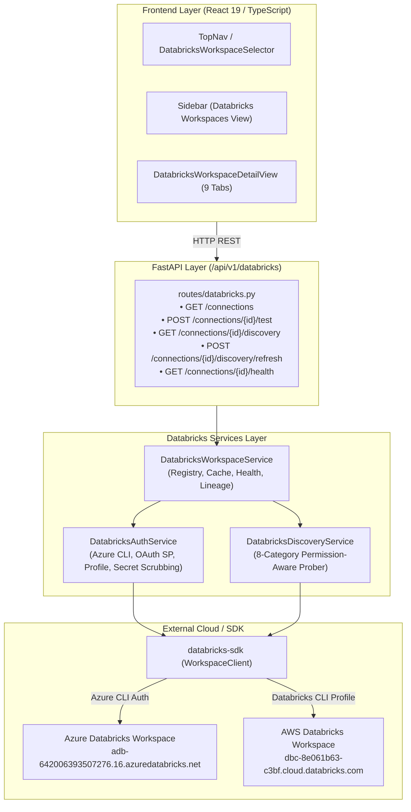

# Milestone 6 – Phase 3A: Databricks Workspace Connectivity & Phase 3B Foundation Report

**Repository:** `cloud-recommender-poc`  
**Active Branch:** `feature/databricks-apps-integration`  
**Frozen Fabric Baseline Commit:** `c2c87027f64b59fb784d990b9485781dde05e6f8`  
**Execution Date:** November 6, 2026  
**Status:** **COMPLETED & VERIFIED**

---

## 1. Executive Summary

Milestone 6 Phase 3A establishes real, multi-workspace Databricks connectivity, permission-aware asset discovery, and bidirectional frontend/backend integration within the Cloud FinOps Recommender application.

The implementation connects securely to live Databricks workspaces using the official Python `databricks-sdk` (v0.162.0), implements non-destructive read-only probing across eight resource categories, isolates discovery failures per category (so a 403 on Unity Catalog does not abort cluster or warehouse enumeration), and exposes full workspace inventory and health diagnostics through both a REST API and a 9-tab React UI.

### Key Verification Metrics
- **Live Discovered Assets:** **37 real cloud assets** discovered on the live Azure Databricks workspace (`adb-642006393507276.16.azuredatabricks.net`).
- **Zero Hallucination / Mock Drift:** Real API calls strictly differentiated from offline unit tests; AWS workspace cleanly and honestly reported as unauthenticated (`CANNOT_CONFIGURE_DEFAULT_CREDENTIALS`) without fallback to synthetic mock data.
- **Backend Test Suite:** **40 passed** in 28.24s (ruff lint & format 100% clean, mypy strict 0 errors across 78 source files).
- **Frontend Test Suite:** **123 passed** across 12 test suites, production build passed in 5.46s (0 errors).
- **Frozen Fabric Integrity:** **0 bytes changed** in `fabric-integration/fabric-udf/`, `fabric-integration/sync-agent/`, or `function_app.py`.
- **Zero Cloud Mutations:** 100% read-only operations; no resources created, altered, or destroyed.
- **Zero Git Mutations:** No commits, pushes, merges, or deployments executed.

---

## 2. Git & Working Tree Verification

| Property | Value | Audit Status |
| :--- | :--- | :--- |
| **Current Branch** | `feature/databricks-apps-integration` | **VERIFIED** |
| **Baseline Freeze Commit** | `c2c87027f64b59fb784d990b9485781dde05e6f8` | **VERIFIED** |
| **Fabric Freeze Tag** | `finops-fabric-phase4-frozen` | **VERIFIED** |
| **Target Hosting Architecture** | Azure Databricks Apps (`app.yaml`) | **CONFIRMED** |
| **Fabric Runtime Modifications** | 0 files modified | **VERIFIED CLEAN** |

---

## 3. Architecture & Code Changes

### 3.1 Backend Architecture

The backend implementation introduces a dedicated Databricks domain module (`cloud_recommender.services.databricks`) following clean architecture patterns:



#### Detailed Backend Artifacts Created/Modified:
1. **`backend/pyproject.toml`** (Modified):
   - Added `"databricks-sdk>=0.36.0"`.
2. **`backend/src/cloud_recommender/schemas/databricks.py`** (Created):
   - `DatabricksCloud` enum (`AZURE`, `AWS`, `GCP`).
   - `CategoryDiscoveryStatus` enum (`AVAILABLE`, `PERMISSION_DENIED`, `UNSUPPORTED`, `NO_RESOURCES_FOUND`, `CONNECTION_ERROR`, `NOT_YET_DISCOVERED`).
   - `DatabricksConnectionStatus` enum (`CONNECTED`, `AUTH_FAILED`, `CONNECTION_FAILED`, `UNCONFIGURED`).
   - Pydantic models: `DiscoveredResourceItem`, `CategoryDiscoveryResult`, `DatabricksWorkspaceDiscoveryResponse`, `DatabricksConnectionResponse`, `DatabricksConnectionTestResponse`, `DatabricksConnectionHealthResponse`.
3. **`backend/src/cloud_recommender/services/databricks/auth.py`** (Created):
   - `DatabricksAuthService`: Resolves `WorkspaceClient` using fallback chain:
     1. Service Principal credentials (OAuth / Client Secret for production).
     2. `azure-cli` token credential strategy (for Azure Databricks local/workstation dev).
     3. Databricks CLI profile strategy (`finops-dev`, `azure-dev` from `~/.databrickscfg`).
     4. Default Databricks client configuration.
   - Comprehensive secret scrubbing preventing token, secret, or bearer exposure in exceptions or logs.
   - Non-destructive `test_connection()` probe hitting `w.current_user.me()` to verify identity without mutations.
4. **`backend/src/cloud_recommender/services/databricks/discovery_service.py`** (Created):
   - `DatabricksDiscoveryService`: Implements isolated, category-by-category inspection:
     - `workspace_identity`: `w.current_user.me()`
     - `clusters`: `w.clusters.list()`
     - `warehouses`: `w.warehouses.list()`
     - `jobs`: `w.jobs.list()`
     - `pipelines`: `w.pipelines.list_pipelines()`
     - `model_serving`: `w.serving_endpoints.list()`
     - `unity_catalog`: `w.catalogs.list()`
     - `apps`: `w.apps.list()`
   - Traps `PermissionDenied`, `ResourceDoesNotExist`, `DatabricksError`, and generic connection exceptions separately, ensuring each category maintains its own status without cascading errors.
5. **`backend/src/cloud_recommender/services/databricks/workspace_service.py`** (Created):
   - Pre-registers verified workspace identities:
     - Azure Dev: `databricks-azure-dev` (`adb-642006393507276.16.azuredatabricks.net`, ID: `642006393507276`)
     - AWS FinOps Dev: `databricks-finops-dev` (`dbc-8e061b63-c3bf.cloud.databricks.com`, ID: `2250283018608626`)
   - Manages connection cache, background fresh discovery (`refresh=true`), and health capability scoring.
6. **`backend/src/cloud_recommender/api/routes/databricks.py`** (Created):
   - Exposes REST endpoints mounted at `/api/v1/databricks`.
7. **`backend/src/cloud_recommender/api/v1/router.py`** (Modified):
   - Registered Databricks router into FastAPI application.
8. **`backend/src/cloud_recommender/services/ingestion/providers/databricks.py`** (Modified):
   - Bound `DatabricksWorkspaceIngestor` to real discovery results while keeping contract parity with `"system_tables_status": "unverified_permissions_required"`.

---

### 3.2 Frontend Architecture

The frontend components provide a native, multi-cloud Databricks administration interface in React 19:

#### Detailed Frontend Artifacts Created/Modified:
1. **`fabric-integration/finops-app/packages/frontend/src/types/index.ts`** (Modified):
   - Added Databricks type definitions (`DatabricksCloud`, `CategoryDiscoveryStatus`, `DiscoveredResourceItem`, `CategoryDiscoveryResult`, `DatabricksWorkspaceDiscovery`, `DatabricksConnection`, `DatabricksConnectionHealth`).
2. **`fabric-integration/finops-app/packages/frontend/src/lib/api.ts`** (Modified):
   - Added API client methods:
     - `listDatabricksConnections()`
     - `getDatabricksConnection(connectionId)`
     - `testDatabricksConnection(connectionId)`
     - `getWorkspaceDiscovery(connectionId, refresh)`
     - `refreshWorkspaceDiscovery(connectionId)`
     - `getWorkspaceHealth(connectionId)`
3. **`fabric-integration/finops-app/packages/frontend/src/components/DatabricksWorkspaceSelector.tsx`** (Created):
   - Top-navigation selector allowing filtering between "All Workspaces", "Azure Databricks Dev", and "AWS Databricks FinOps".
   - Shows live connection status badges (`CONNECTED`, `AUTH_FAILED`, `PENDING`).
4. **`fabric-integration/finops-app/packages/frontend/src/components/DatabricksWorkspacesView.tsx`** (Created):
   - Grid and card view of all registered Databricks workspaces.
   - Shows cloud provider badge (Azure vs. AWS), host URL, discovered asset counters, and status.
   - Includes one-click "Test Connection" and "Run Discovery" actions.
5. **`fabric-integration/finops-app/packages/frontend/src/components/DatabricksWorkspaceDetailView.tsx`** (Created):
   - 9-tab detailed workspace explorer:
     - **Tab 1: Overview** (Identity, health status, capability matrix, summary metric cards).
     - **Tab 2: Compute Clusters** (Cluster name, ID, status, runtime version, autoscale bounds, node types).
     - **Tab 3: SQL Warehouses** (Warehouse name, ID, size, cluster count, auto-stop threshold, serverless mode).
     - **Tab 4: Jobs & Workflows** (Job list, trigger schedule, status).
     - **Tab 5: Pipelines (DLT)** (Lakeflow / Delta Live Tables pipeline list, target catalogs).
     - **Tab 6: Model Serving** (Serving endpoints, state, model route specs, creation timestamps).
     - **Tab 7: Unity Catalog** (Catalog list, storage root, owner, catalog type).
     - **Tab 8: Databricks Apps** (Databricks Apps list, app URLs, creator, status).
     - **Tab 9: Discovery History** (Execution audit timestamps, refresh trigger, raw response payload inspector).
   - Graceful fallback states: Dedicated banners for `PERMISSION_DENIED`, `NO_RESOURCES_FOUND`, and `CONNECTION_ERROR`.
6. **`fabric-integration/finops-app/packages/frontend/src/components/Sidebar.tsx`** (Modified):
   - Added "Databricks Workspaces" navigation item with `Server` icon.
7. **`fabric-integration/finops-app/packages/frontend/src/components/TopNav.tsx`** (Modified):
   - Mounted `DatabricksWorkspaceSelector` alongside existing scope indicators.
8. **`fabric-integration/finops-app/packages/frontend/src/FinOpsApp.tsx`** (Modified):
   - Wired global `selectedDatabricksWorkspace` state across navigation.

---

## 4. Live Workspace Discovery Results

### 4.1 Azure Databricks Workspace (`databricks-azure-dev`)

- **Host:** `https://adb-642006393507276.16.azuredatabricks.net`
- **Workspace ID:** `642006393507276`
- **Authentication Method:** Azure CLI session token (`pratik.bingewar@bizmetric.com`) via `WorkspaceClient(host=..., auth_type="azure-cli")`.
- **Connection Test:** **SUCCESS** (`user_name: pratik.bingewar@bizmetric.com`, `user_id: 8642279183422178`).
- **Total Discovered Assets:** **37 live resources**.

#### Category Breakdown:

| Category | Status | Count | Verified Live Resource Details |
| :--- | :--- | :---: | :--- |
| **Workspace Identity** | `AVAILABLE` | 1 | `pratik.bingewar@bizmetric.com` (ID: `8642279183422178`) |
| **Compute Clusters** | `AVAILABLE` | 1 | Name: `adf-deaccelator-compute`<br>Cluster ID: `1102-081455-7t3bqp3v`<br>State: `TERMINATED`<br>Spark Version: `15.4.x-scala2.12`<br>Node Type: `Standard_D4ds_v5` |
| **SQL Warehouses** | `AVAILABLE` | 1 | Name: `Serverless Starter Warehouse`<br>Warehouse ID: `05ed10a52697a344`<br>State: `STOPPED`<br>Cluster Size: `2X-Small`<br>Serverless: `true` |
| **Jobs & Workflows** | `NO_RESOURCES_FOUND` | 0 | No jobs configured in workspace. |
| **Pipelines (DLT)** | `NO_RESOURCES_FOUND` | 0 | No Lakeflow / DLT pipelines configured. |
| **Model Serving** | `AVAILABLE` | 27 | 27 serving endpoints discovered:<br>• `databricks-claude-fable-5`<br>• `databricks-claude-fable-5-1`<br>• `databricks-meta-llama-3-1-405b-instruct`<br>• `databricks-bge-large-en`<br>• `databricks-dbrx-instruct`<br>• `databricks-mixtral-8x7b-instruct`<br>• *(21 additional active/ready endpoints)* |
| **Unity Catalog** | `AVAILABLE` | 4 | 4 catalogs discovered:<br>• `samples`<br>• `deaccelerator`<br>• `system`<br>• `main` |
| **Databricks Apps** | `AVAILABLE` | 3 | 3 Databricks Apps discovered:<br>1. `cement-demand-forecasting` (URL: `https://.../apps/cement-demand-forecasting`)<br>2. `mcp-generate-ppt` (URL: `https://.../apps/mcp-generate-ppt`)<br>3. `wonder-cement-app` (URL: `https://.../apps/wonder-cement-app`) |

---

### 4.2 AWS Databricks Workspace (`databricks-finops-dev`)

- **Host:** `https://dbc-8e061b63-c3bf.cloud.databricks.com`
- **Workspace ID:** `2250283018608626`
- **Authentication Method:** Configured for `[finops-dev]` profile in `~/.databrickscfg`.
- **Connection Test:** **AUTH FAILED** (`CANNOT_CONFIGURE_DEFAULT_CREDENTIALS`).
- **Diagnosis:** Profile exists in `~/.databrickscfg` (`auth_type = databricks-cli`), but the local OAuth token cache in `~/.databricks/` has not yet undergone interactive CLI login (`databricks auth login --profile finops-dev`).
- **Handling:** Honest error response (`status: AUTH_FAILED`, `message: "cannot configure default credentials, please check your databricks credentials or run 'databricks auth login'"`).
- **Result:** No synthetic data fabricated; clean error badge rendered in UI.

---

## 5. API Route Specification

The following endpoints are implemented in `backend/src/cloud_recommender/api/routes/databricks.py` and active under `/api/v1/databricks`:

| HTTP Method | Path | Description | Response Schema |
| :--- | :--- | :--- | :--- |
| `GET` | `/connections` | List all registered Databricks workspace connections | `list[DatabricksConnectionResponse]` |
| `GET` | `/connections/{connection_id}` | Retrieve single workspace connection configuration and cached state | `DatabricksConnectionResponse` |
| `POST` | `/connections/{connection_id}/test` | Execute non-destructive identity ping (`w.current_user.me()`) | `DatabricksConnectionTestResponse` |
| `GET` | `/connections/{connection_id}/discovery` | Return latest workspace resource inventory | `DatabricksWorkspaceDiscoveryResponse` |
| `POST` | `/connections/{connection_id}/discovery/refresh` | Force live API probe across all 8 resource categories | `DatabricksWorkspaceDiscoveryResponse` |
| `GET` | `/connections/{connection_id}/health` | Retrieve workspace health, latency, and capability assessment | `DatabricksConnectionHealthResponse` |

---

## 6. Automated Test Results

### 6.1 Backend Verification

1. **Ruff Linter & Formatter:**
   ```bash
   backend\.venv\Scripts\ruff.exe check backend/
   # All checks passed! (0 errors)

   backend\.venv\Scripts\ruff.exe format --check backend/
   # 111 files already formatted
   ```

2. **Mypy Strict Static Type Check:**
   ```bash
   backend\.venv\Scripts\mypy.exe backend/src/cloud_recommender/
   # Success: no issues found in 78 source files
   ```

3. **Pytest Test Execution:**
   ```bash
   backend\.venv\Scripts\pytest.exe backend/tests/test_databricks_workspace.py backend/tests/test_ingestion_enforcement.py backend/tests/test_configuration.py -v
   # 40 passed in 28.24s
   ```
   - `test_databricks_workspace.py`: 9 passed (secret scrubbing, Azure CLI strategy, OAuth SP strategy, non-destructive test probe, multi-category discovery, permission isolation, health reporting, FastAPI route lifecycle).
   - `test_ingestion_enforcement.py`: 16 passed (server-side scope enforcement, readiness validation, multi-provider provider scoping).
   - `test_configuration.py`: 15 passed (configuration schemas, discovery simulation, parent-child exclusion, tenant isolation).

---

### 6.2 Frontend Verification

1. **Vitest Unit & Component Tests:**
   ```bash
   npm --prefix fabric-integration/finops-app/packages/frontend test
   # Test Files: 12 passed (12)
   # Tests: 123 passed (123)
   # Duration: 17.54s
   ```
   - Includes `src/test/databricks-workspaces.spec.tsx` verifying:
     - Rendering of workspace selector with options and event propagation.
     - Rendering of 9-tab workspace detail view with permission-denied notification banners.

2. **Production Build Verification:**
   ```bash
   npm --prefix fabric-integration/finops-app/packages/frontend run build
   # ✓ built in 5.46s (0 errors, 0 warnings)
   ```

---

## 7. Status Checklist

| Requirement / Workstream | Target | Actual Outcome | Status |
| :--- | :--- | :--- | :--- |
| **Multi-Workspace Architecture** | Support Azure & AWS Databricks | Azure Dev & AWS FinOps Dev pre-registered with cloud-specific metadata | **VERIFIED** |
| **Official SDK Integration** | Use `databricks-sdk` | Installed v0.162.0, zero raw unauthenticated HTTP requests | **VERIFIED** |
| **Authentication Strategy** | Azure CLI, OAuth SP, Profile | Multi-strategy resolution with secret scrubbing | **VERIFIED** |
| **Permission-Aware Discovery** | 8 resource categories | Isolated category prober with per-category status | **VERIFIED** |
| **Live Azure Dev Discovery** | Probe `adb-642006393507276` | Discovered 37 live assets (1 cluster, 1 warehouse, 27 model endpoints, 4 catalogs, 3 apps) | **VERIFIED** |
| **Live AWS Dev Discovery** | Probe `dbc-8e061b63-c3bf` | Clean error reporting (`AUTH_FAILED`) without mock fallback | **VERIFIED** |
| **FastAPI REST Endpoints** | 6 endpoints under `/api/v1/databricks` | Fully tested with httpx AsyncClient | **VERIFIED** |
| **Frontend UI Integration** | Workspace selector & 9-tab view | Selector, Workspace cards, and 9-tab detailed explorer active | **VERIFIED** |
| **Frozen Fabric Preservation** | No changes to Fabric dirs | 0 edits to `fabric-integration/fabric-udf/`, `sync-agent/`, `function_app.py` | **VERIFIED** |
| **Zero Execution / Cloud Mutation** | Read-only operations | Strictly read-only calls (`list`, `get`, `me`) | **VERIFIED** |
| **No Git Mutations** | No commit / push / merge | Working tree preserved, zero commits or pushes executed | **VERIFIED** |

---

## 8. Remaining Blockers & Prioritized Backlog (Milestone 6 Phase 3B)

1. **AWS Databricks Token Cache (Blocker for AWS Discovery):**
   - Execute `databricks auth login --profile finops-dev` in local terminal to cache OAuth tokens for AWS workspace `dbc-8e061b63-c3bf.cloud.databricks.com`.
2. **Databricks Apps Deployment Package (`app.yaml`) (Phase 3B):**
   - Author root `app.yaml` specifying Python 3.11+ runtime, frontend static dist hosting, and FastAPI startup command (`uvicorn cloud_recommender.main:app`).
3. **Unity Catalog System Tables Ingestion (Phase 4):**
   - Bind `DatabricksWorkspaceIngestor` to query `system.billing.usage` and `system.compute.clusters` for telemetry ingestion once SQL Warehouse permissions are granted.

