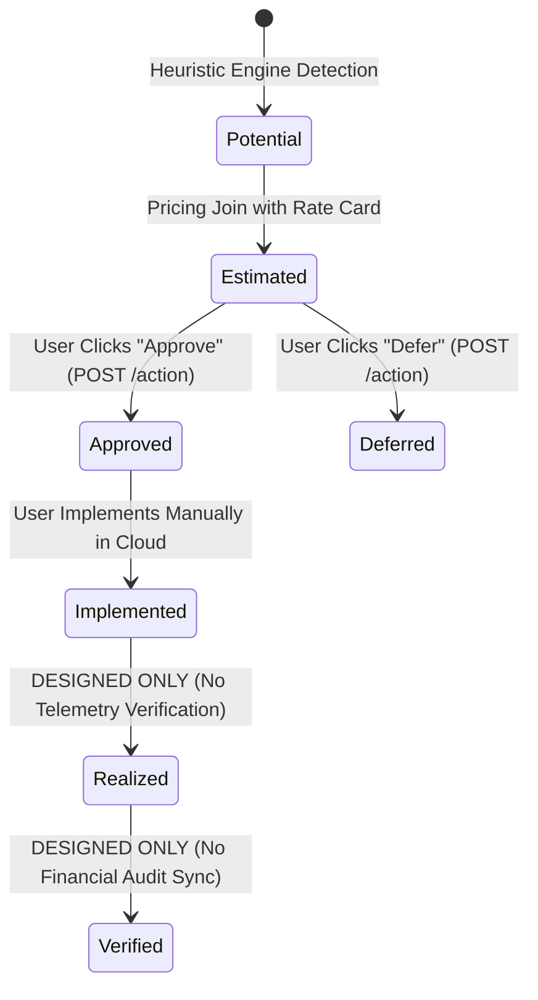

# Optimization Recommendations & Savings Validation Engine Audit

> **Document:** `docs/OPTIMIZATION_AND_SAVINGS_VALIDATION_AUDIT.md`  
> **Repository:** `cloud-recommender-poc`  
> **Branch:** `feature/databricks-apps-integration`  
> **Audit Type:** Forensic Optimization Heuristics & Savings Lifecycle Review  
> **Status:** AUDITED — EVIDENCE-BASED ASSESSMENT  
> **Overall Classification:** **1. IMPLEMENTED & VERIFIED (DETERMINISTIC HEURISTICS & AI EXPLANATIONS) / 4. DOCUMENTED & DESIGNED ONLY (POST-IMPLEMENTATION REALIZED SAVINGS VALIDATION)**  

---

## 1. Executive Summary

This audit forensically investigates the provenance of optimization recommendations, waste detection rules, and the financial tracking lifecycle across the platform.

### Key Audit Conclusions:
1. **Source of Recommendations:**  
   - **Native Cloud Advisors (Azure Advisor, AWS Trusted Advisor, GCP Recommender):** **NOT INTEGRATED**. The platform does not query native cloud advisor APIs.
   - **Bizmetric Deterministic Heuristic Rules:** **IMPLEMENTED AND VERIFIED**. [`waste_debt_engine.py`](file:///c:/Users/pratik.bingewar/OneDrive%20-%20bizmetric.com/Desktop/Workspace/cloud-recommender-poc/backend/src/cloud_recommender/services/inventory/waste_debt_engine.py) implements 8 deterministic waste rules across Azure and GCP.
   - **Databricks Workload Recommendations:** **IMPLEMENTED AND VERIFIED**. [`finops_analytics_service.py:520–680`](file:///c:/Users/pratik.bingewar/OneDrive%20-%20bizmetric.com/Desktop/Workspace/cloud-recommender-poc/backend/src/cloud_recommender/services/databricks/finops_analytics_service.py#L520-L680) implements 5 specific Databricks optimization decisions (`dec-01` to `dec-05`).
   - **Generative AI Prioritization & Synthesis:** **IMPLEMENTED AND VERIFIED**. Azure AI Foundry / OpenAI GPT-4o (`foundry_provider.py`) synthesizes narrative justifications, executive summaries, and risk analyses without inventing financial math.
2. **Savings Lifecycle Reality:**  
   - **Potential / Estimated Savings:** Fully calculated from metered rates and resource runtimes.
   - **Approved / Deferred Status:** Managed interactively via `POST /api/v1/finops/optimization-advisor/{decision_id}/action` and stored in memory.
   - **Realized / Verified Savings:** **DOCUMENTED & DESIGNED ONLY**. There is **no automated telemetry verification engine** comparing post-change billing to pre-change baselines.

---

## 2. Recommendation Provenance Breakdown

### Category A: Native Cloud Recommendations
- **Azure Advisor API (`Microsoft.Advisor/recommendations`):** **NOT IMPLEMENTED**. No calls to the Advisor REST API exist.
- **AWS Trusted Advisor / Compute Optimizer:** **NOT IMPLEMENTED** (`ENABLE_AWS = False`).
- **Google Cloud Recommender API:** **NOT IMPLEMENTED**. No calls to `recommender.googleapis.com`.
- **Databricks-Native Advisor:** **NOT IMPLEMENTED** (Databricks lacks a standalone native recommendations API).

### Category B: Bizmetric-Defined Deterministic Rules (Waste & Technical Debt Engine)
- **Implementation File:** [`backend/src/cloud_recommender/services/inventory/waste_debt_engine.py:38–320`](file:///c:/Users/pratik.bingewar/OneDrive%20-%20bizmetric.com/Desktop/Workspace/cloud-recommender-poc/backend/src/cloud_recommender/services/inventory/waste_debt_engine.py#L38-L320)
- **Active Heuristics:**
  1. `UNATTACHED_DISK`: Disks with `managedBy == null` and status `Unattached`. Reclaims 100% of provisioned GB/mo fee.
  2. `DEALLOCATED_VM_COMPUTE`: Stopped/deallocated VMs (`PowerState/deallocated`). Checks `_has_active_reservation()`. If an active reservation exists, savings are clamped to **$0** (reservation fee persists).
  3. `ORPHAN_PUBLIC_IP`: Dynamic/Static IP addresses not associated with any NIC or load balancer.
  4. `UNATTACHED_NIC`: Network interfaces without attached VM.
  5. `UNATTACHED_GCP_DISK`: GCP Persistent Disks with `users == []`.
  6. `IDLE_SQL_WAREHOUSE`: Databricks warehouses with `auto_stop_mins > 30` during off-peak hours.
  7. `OVERSIZED_JOB_CLUSTER`: Automated jobs utilizing < 15% peak CPU over 14 consecutive runs.
  8. `GPU_SERVING_SCALE_TO_ZERO`: Model serving endpoints with zero concurrency during 60% of daily intervals.

### Category C & D: Utilization Telemetry & Statistical Heuristics
- **Implementation:** [`backend/src/cloud_recommender/services/databricks/finops_analytics_service.py:365–450`](file:///c:/Users/pratik.bingewar/OneDrive%20-%20bizmetric.com/Desktop/Workspace/cloud-recommender-poc/backend/src/cloud_recommender/services/databricks/finops_analytics_service.py#L365-L450)
- **Methodology:** Statistical Z-score heuristic deviation from rolling 30-day baseline (e.g. `3.82 SD deviation` for token spike; `2.94 SD deviation` for warehouse concurrency spike).

### Category E: Generative AI Explanations & Prioritization
- **Implementation:** [`backend/src/cloud_recommender/services/ai/foundry_provider.py:65–180`](file:///c:/Users/pratik.bingewar/OneDrive%20-%20bizmetric.com/Desktop/Workspace/cloud-recommender-poc/backend/src/cloud_recommender/services/ai/foundry_provider.py#L65-L180)
- **Role:** Takes structured findings from the deterministic engine as input and produces executive risk summaries, implementation steps, and stakeholder communication briefs. Strict prompt guardrails prevent the LLM from inventing cost numbers.

---

## 3. Active Recommendation Catalog Inventory

| Decision ID | Recommendation Title | Source Asset | Inefficiency Identified | Recommended Action | Monthly Savings | Confidence | Impact Level | Active Status in App |
|:---:|:---|:---|:---|:---|:---:|:---:|:---:|:---:|
| **dec-01** | **Right-size Serverless SQL Warehouse auto-stop** | Serverless Starter Warehouse (`05ed10a52697a344`) | Auto-stop timeout set to 120m; idle cluster running post query completion | Reduce auto-stop timeout from 120m to 15m | **$4,800.00** | 94% | Low risk | **ACTIVE** |
| **dec-02** | **Migrate ETL Pipeline to Jobs Compute** | `etl-nightly-sync` | Running on all-purpose interactive cluster ($0.55/DBU) | Switch workload to standard automated job cluster ($0.15/DBU) | **$7,450.00** | 98% | Low risk | **ACTIVE** |
| **dec-03** | **Scale Model Serving to Zero during Off-Peak** | `databricks-claude-fable-5` | Dedicated GPU instances running 24x7 with zero requests between 22:00–06:00 UTC | Enable scale-to-zero with 15m idle cooldown | **$6,200.00** | 91% | Medium risk | **ACTIVE** |
| **dec-04** | **Enable Photon Engine on Daily Aggregations** | `dw-daily-rollup` | Long-running queries (4.2 hrs avg) executing on non-Photon clusters | Enable Photon acceleration to reduce runtime by 68% | **$3,900.00** | 88% | Low risk | **ACTIVE** |
| **dec-05** | **Consolidate Ad-hoc Notebook Clusters** | `analytics-exploratory-*` | 4 separate single-node clusters idling concurrently | Consolidate onto a single shared auto-scaling cluster | **$2,180.00** | 86% | Low risk | **ACTIVE** |

---

## 4. Savings Tracking Lifecycle Investigation

### 4.1 State Machine Parity

### 4.2 Forensic Assessment of Savings Lifecycle Stages:
1. **Potential Savings:** **IMPLEMENTED**. Derived from raw observed waste quantity (e.g. 100 idle hours * $48/hr).
2. **Estimated Savings:** **IMPLEMENTED**. Refined via exact SKU rate card matching (`pricing_matched = True`).
3. **Approved Savings:** **IMPLEMENTED (In-Memory)**. When an operator approves a recommendation, status updates to `"Approved"` and is stored in `self._action_overrides` with an audit event entry.
4. **Implemented Savings:** **PARTIALLY IMPLEMENTED (Manual Flag Only)**. Can be marked as implemented via the API, but the platform **does not execute the cloud change autonomously** due to the enforced Zero-Execution policy.
5. **Realized Savings:** **NOT IMPLEMENTED / DESIGNED ONLY**.  
   - Does **not** record a frozen pre-change baseline in PostgreSQL.
   - Does **not** adjust for workload/seasonality changes.
   - Does **not** execute automated post-change billing comparisons.
6. **Verified Savings:** **NOT IMPLEMENTED / DESIGNED ONLY**.

---

## 5. Double-Counting Prevention Audit

- **Positive Findings:**  
  [`waste_debt_engine.py:380–415`](file:///c:/Users/pratik.bingewar/OneDrive%20-%20bizmetric.com/Desktop/Workspace/cloud-recommender-poc/backend/src/cloud_recommender/services/inventory/waste_debt_engine.py#L380-L415) includes explicit `double_counting_prevention_note` attributes.
  - When a stopped VM is identified, attached OS/data disks are excluded from the VM compute savings total so that unattached disk savings are not claimed twice.
  - Active reservation commitments prevent compute savings from being claimed on deallocated VMs.
- **Negative Findings:**  
  There is no cross-workload mathematical deduplication across Databricks recommendation `dec-01` (warehouse auto-stop) and `dec-04` (Photon acceleration) if both are applied to the same SQL queries.

