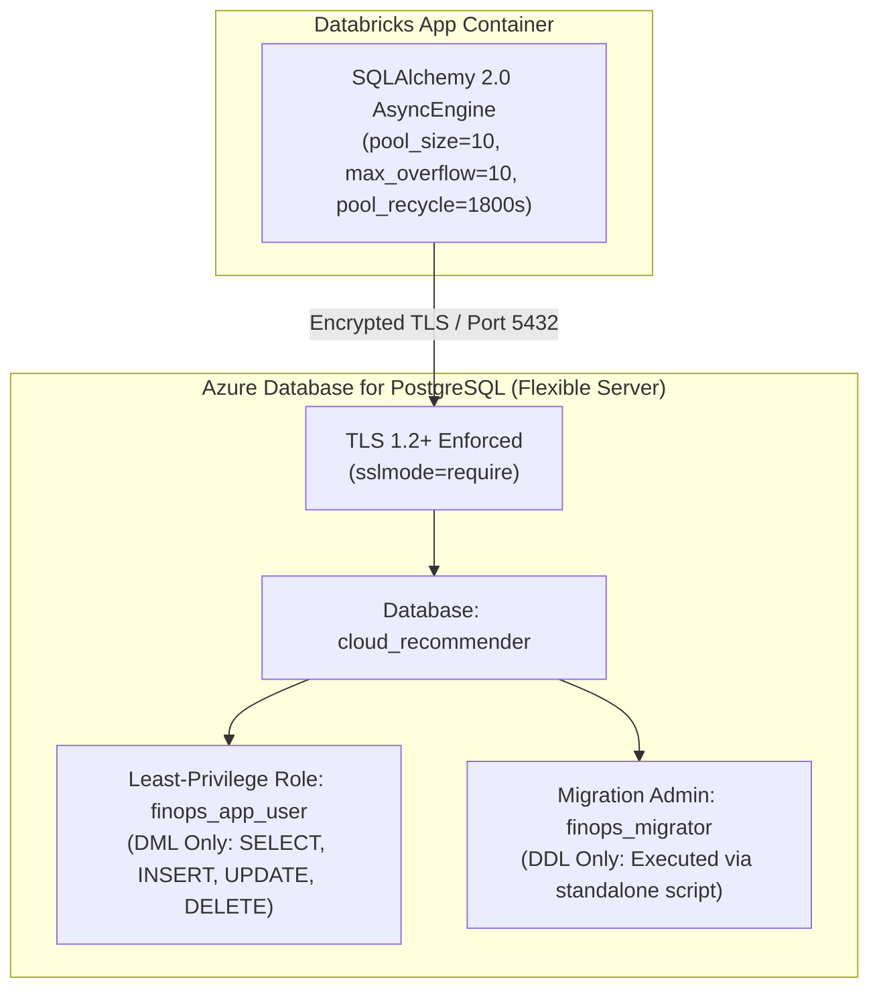

# Production Database Configuration & Hardening Guide

> **Application:** Bizmetric FinOps & Infrastructure Intelligence Platform  
> **Database Engine:** PostgreSQL 16+ (Azure Database for PostgreSQL Flexible Server)  
> **Driver:** Python `asyncpg` via SQLAlchemy 2.0 AsyncEngine  
> **Target Platform:** Azure Databricks Apps (`bizmetric-finops`)  
> **Status:** Production Reference  

---

## 1. Overview & Cloud Architecture

When deployed in Azure Databricks Apps, the application requires an external, enterprise-managed relational database. Local workstation PostgreSQL (`localhost:5432`) is not accessible from serverless container environments.

The approved production target is **Azure Database for PostgreSQL Flexible Server** in the same Azure region (`eastus`) as the Databricks workspace.



---

## 2. Least-Privilege Database Roles & Security Setup

In production, two separate database roles must be created to enforce least privilege:
1. `finops_app_user`: Used by the running Databricks App. Restricted strictly to Data Manipulation Language (DML). Cannot alter tables, drop schemas, or grant permissions.
2. `finops_migrator`: Used strictly during controlled migration jobs (`backend/scripts/run_migrations.py`). Granted Data Definition Language (DDL) permissions.

### Role Provisioning Script (PostgreSQL SQL)
```sql
-- 1. Create the application database
CREATE DATABASE cloud_recommender;
\c cloud_recommender;

-- 2. Create the application runtime role (DML only)
CREATE ROLE finops_app_user WITH LOGIN PASSWORD '<secure-app-password>' NOSUPERUSER NOCREATEDB NOCREATEROLE;

-- 3. Create the migration administrative role (DDL)
CREATE ROLE finops_migrator WITH LOGIN PASSWORD '<secure-migration-password>' NOSUPERUSER NOCREATEDB NOCREATEROLE;

-- 4. Grant schema usage and privileges
GRANT USAGE ON SCHEMA public TO finops_app_user, finops_migrator;
GRANT ALL PRIVILEGES ON SCHEMA public TO finops_migrator;

-- 5. Grant specific table and sequence permissions to runtime app user
GRANT SELECT, INSERT, UPDATE, DELETE ON ALL TABLES IN SCHEMA public TO finops_app_user;
GRANT USAGE, SELECT ON ALL SEQUENCES IN SCHEMA public TO finops_app_user;

-- 6. Ensure future tables inherit runtime permissions
ALTER DEFAULT PRIVILEGES IN SCHEMA public GRANT SELECT, INSERT, UPDATE, DELETE ON TABLES TO finops_app_user;
ALTER DEFAULT PRIVILEGES IN SCHEMA public GRANT USAGE, SELECT ON SEQUENCES TO finops_app_user;
```

---

## 3. Connection Pooling & TLS Hardening

### 3.1 Async Connection String Format
Azure PostgreSQL Flexible Server strictly requires TLS 1.2+. The connection URI must specify `ssl=require`:
```text
postgresql+asyncpg://finops_app_user:<password>@psql-finops-prod.postgres.database.azure.com:5432/cloud_recommender?ssl=require
```

### 3.2 Tuned Connection Pool Parameters
Configured in `backend/src/cloud_recommender/core/config.py`:
- `db_pool_size = 10`: Maintains up to 10 persistent connections per container instance.
- `db_max_overflow = 10`: Permits up to 10 temporary burst connections during high load.
- `db_pool_timeout = 30`: Fails gracefully if a connection cannot be checked out within 30 seconds.
- `db_pool_recycle = 1800`: **Recycles idle connections every 30 minutes**. Azure load balancers and firewalls terminate idle TCP sockets after 4-30 minutes; connection recycling prevents dead-pipe socket exceptions.
- `db_pool_pre_ping = True`: Executes `SELECT 1` pre-ping on checkout to detect dropped connections automatically.

---

## 4. Controlled Schema Migration Policy

> [!IMPORTANT]
> **Zero Automatic Migrations on Startup:** The application container NEVER runs database migrations on startup. Automatic migrations create split-brain race conditions across scaling containers and risk unintended downtime.

### Migration Procedure
Execute migrations before deploying or upgrading the Databricks App:
```bash
# 1. Export migration admin connection string
export DATABASE_URL="postgresql+asyncpg://finops_migrator:<password>@psql-finops-prod.postgres.database.azure.com:5432/cloud_recommender?ssl=require"

# 2. Check current database revision without applying changes
python backend/scripts/run_migrations.py --check-only

# 3. Apply pending migrations to head
python backend/scripts/run_migrations.py --revision head
```

### Production Tables Governed
1. `workload_profiles`: Requirements profiles, functional/non-functional criteria.
2. `architecture_recommendations`: Multi-cloud architectures, generated service mappings.
3. `cost_simulations`: Calculated monthly and annualized cloud cost models.
4. `billing_ingestion_ledger`: Normalized Databricks DBU usage records and pricing lineage.
5. `billing_reconciliation_snapshots`: Azure invoice cross-referencing audit entries.
6. `billing_approval_tokens`: Cryptographically signed approval tokens for change controls.

---

## 5. Backup & Point-in-Time Recovery (PITR)

- **Automated Azure Backups:** Azure Flexible Server performs continuous WAL archiving and daily automated snapshots with 35-day retention.
- **Point-in-Time Restore:** Can restore to any second within the retention window without disrupting active production databases.
- **Manual Export Command:**
  ```bash
  pg_dump -h psql-finops-prod.postgres.database.azure.com \
          -U finops_migrator \
          -d cloud_recommender \
          -F c -b -v \
          -f "cloud_recommender_backup_$(date +%Y%m%d_%H%M%S).dump"
  ```

---

## 6. Connection Failure Handling & Graceful Degradation

If the external PostgreSQL database becomes temporarily unreachable (e.g. during a database failover or maintenance window):
- The `check_db_health()` probe catches connection errors without throwing uncaught exceptions.
- The `/health/ready` probe reports HTTP 503 (`status: not_ready`, `database: disconnected`) while `/health` liveness remains operational.
- The UI displays an honest `CONNECTION INTERRUPTED` status banner while serving cached read-only FinOps analytics.

