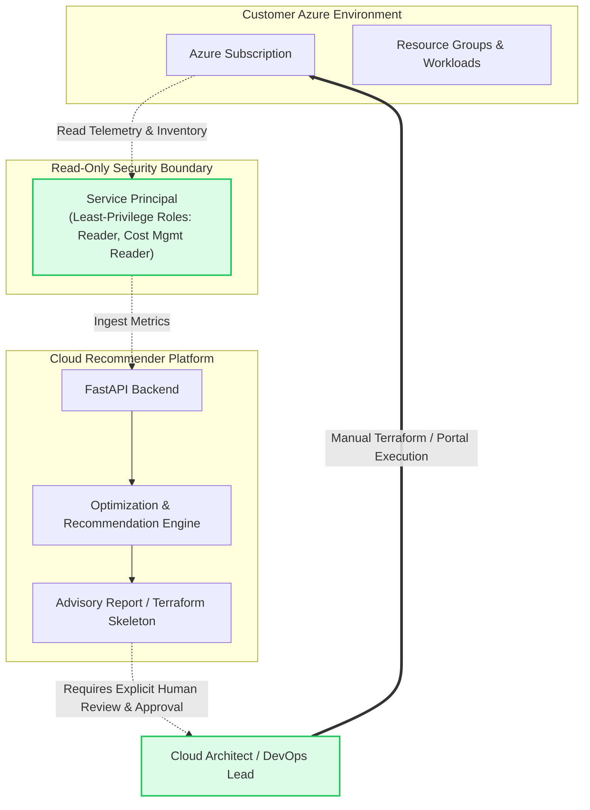

# Product Requirements Document (PRD) — Cloud Recommender POC

| Document Metadata | Value |
| :--- | :--- |
| **Product Name** | Cloud Recommender POC |
| **Status** | Approved Specification |
| **Target Stage** | Proof of Concept (POC) |
| **Target Audience** | Cloud Architects, Solutions Architects, Tech Leads, FinOps & Platform Engineers |
| **Last Updated** | October 2026 |

---

## 1. Executive Summary & Product Objective

The **Cloud Recommender** is an AI-powered cloud architecture and optimization platform designed to accelerate cloud decision-making, eliminate cross-cloud bias, prevent costly architectural mistakes, and uncover infrastructure waste.

The platform provides two primary workflows:

```mermaid
flowchart TD
    subgraph PhaseA ["Phase A: New Application Architecture"]
        A1["Input: Idea Text or Uploaded PDF / Word (.docx)"] --> A2["LangGraph Agent: Extract & Validate Functional & NFRs"]
        A2 --> A3{"Critical Requirements Missing?"}
        A3 -- Yes --> A4["Interactive Clarification Loop\n(Targeted Questions to User)"]
        A4 --> A2
        A3 -- No --> A5["Deterministic Multi-Cloud Architecture Generator\n(Azure First, AWS, GCP)"]
        A5 --> A6["Deterministic Official Pricing Engine\n(Azure Retail, AWS Price List, GCP Catalog)"]
        A6 --> A7["Monthly & Annual Cost Models + Trade-Off Comparison\n(Cost, Security, Reliability, Scalability, Simplicity)"]
    end

    subgraph PhaseB ["Phase B: Existing Application Optimization"]
        B1["Input: Application Source ZIP Archive (and GitHub Repo)"] --> B2["Static Code & Architecture Analyzer\n(Quality, Dependencies, Security, Tech Debt)"]
        B3["Authorized Read-Only Azure Connection"] --> B4["Telemetry & Inventory Ingestion\n(Resource Graph, Cost Management, Monitor)"]
        B2 --> B5["Microsoft Fabric Lakehouse Layer\n(Delta Parquet Ingestion & Transform)"]
        B4 --> B5
        B5 --> B6["Waste & Modernization Detection\n(Idle Assets, Oversizing, PaaS Opportunities)"]
        B6 --> B7["Optimization Proposal & Savings Forecast\n(Implementation Cost vs Ongoing Savings)"]
        B7 --> B8["Human Review & Explicit Approval Gate\n(Zero Automated Execution)"]
    end
```

---

## 2. Core Workflows & Functional Requirements

### 2.1 Phase A — New Application Architecture

#### FR-A1: Requirement Ingestion (Text & Document Upload)
- **FR-A1.1:** Accept free-form text descriptions of application concepts via a conversational input area.
- **FR-A1.2:** Support file uploads of requirement specifications in **PDF (`.pdf`)** and **Microsoft Word (`.docx`, `.doc`)** formats (up to 25 MB).
- **FR-A1.3:** Extract textual content, tables, and architectural constraints from uploaded documents using specialized document parsers (`pypdf`, `python-docx`).
- **FR-A1.4:** Enforce file validation, antivirus/malware sanity checks, and store uploads in isolated ephemeral storage.

#### FR-A2: Requirements Extraction & Validation
- **FR-A2.1:** Use a stateful **LangGraph** orchestration graph to parse inputs into a typed `WorkloadProfile`:
  - Workload classification (Web App, Microservices, Batch Processing, Data Pipeline, AI Inference, Event-Driven).
  - Scale & throughput (Requests per second, active users, peak multipliers).
  - Compute & hardware profiles (vCPU, Memory, GPU requirements).
  - Storage & data tier (volume in GB/TB, IOPS, relational vs NoSQL vs caching vs object store).
  - High availability, multi-region failover, and disaster recovery SLA targets (e.g. 99.9% vs 99.99%).
  - Compliance frameworks (HIPAA, GDPR, PCI-DSS, SOC2, FedRAMP).
  - Target budget ceilings (Monthly / Annual in USD).

#### FR-A3: Interactive Clarifying Questions Loop
- **FR-A3.1:** If any critical requirement necessary for an architectural decision is missing or ambiguous (e.g., unspecified SLA, unknown compliance requirement, unstated data volume), the LangGraph `clarification_node` interrupts synthesis.
- **FR-A3.2:** Generate concise, targeted multiple-choice or direct clarifying questions presented back to the user.
- **FR-A3.3:** Incorporate user clarification answers into the active `WorkloadProfile` state before proceeding to architecture generation.

#### FR-A4: Multi-Cloud Architecture Generation
- **FR-A4.1:** Generate comparable, production-grade cloud architectures across **Azure**, **AWS**, and **GCP**.
- **FR-A4.2:** Apply an **Azure-first** design orientation while maintaining full parity and objective mapping across AWS and GCP services:
  - Compute: Azure Container Apps / AKS vs AWS ECS Fargate / EKS vs GCP Cloud Run / GKE.
  - Relational Database: Azure Database for PostgreSQL / SQL DB vs AWS Aurora vs GCP Cloud SQL / AlloyDB.
  - Storage: Azure Blob Storage vs AWS S3 vs GCP Cloud Storage.
  - Networking & Ingress: Azure Front Door / App Gateway vs AWS CloudFront / ALB vs GCP Cloud CDN / Cloud Armor.
  - Observability & Secrets: Azure Monitor / Key Vault vs AWS CloudWatch / Secrets Manager vs GCP Cloud Monitoring / Secret Manager.
- **FR-A4.3:** Output renderable **Mermaid.js** architectural flowcharts for each cloud topology.

#### FR-A5: Deterministic Pricing Engine (Official Provider Sources)
- **FR-A5.1:** Pricing must NEVER be hallucinated or guessed by an LLM.
- **FR-A5.2:** Retrieve pricing through a deterministic calculation engine connected to official provider pricing sources:
  - **Azure:** Azure Retail Prices API (`https://prices.azure.com/api/retail/prices`).
  - **AWS:** AWS Price List API / Price List Query API.
  - **GCP:** Google Cloud Billing Catalog API.
- **FR-A5.3:** Support local offline pricing caching (JSON/SQLite) with a configurable TTL (default 24h) and deterministic offline fallback for air-gapped/CI environments.
- **FR-A5.4:** Calculate **Monthly Estimated Cost** and **Annual Estimated Cost** broken down by component (Compute, Database, Storage, Data Egress).
- **FR-A5.5:** Document all pricing assumptions explicitly (e.g., Pay-as-you-go vs 1-Year Reserved Instances, assumed 20% average network egress, multi-AZ storage replication).

#### FR-A6: Multi-Dimensional Trade-Off Comparison
- **FR-A6.1:** Score and compare proposed architectures across five explicit pillars:
  1. **Cost & FinOps Efficiency**
  2. **Security & Regulatory Compliance**
  3. **Reliability & Fault Tolerance**
  4. **Scalability & Performance**
  5. **Operational Complexity & Developer Ergonomics**
- **FR-A6.2:** Provide actionable architectural rationale explaining why each primary recommendation was selected and highlighting specific compromises or vendor lock-in risks.

---

### 2.2 Phase B — Existing Application Optimization

#### FR-B1: Source Code & Repository Analysis
- **FR-B1.1:** Ingest application source code via **ZIP archive upload** (up to 100 MB) with a roadmap for direct GitHub repository URL integration.
- **FR-B1.2:** Perform static analysis across:
  - Language and framework detection (Python, Node/TypeScript, Java, .NET, Go).
  - Dependency manifests (`package.json`, `requirements.txt`, `pom.xml`, `.csproj`) for outdated packages and known vulnerabilities (CVEs).
  - Architectural patterns (monolith vs microservices, stateful vs stateless services, synchronous bottlenecks).
  - Code maintainability index, cyclomatic complexity indicators, and technical debt hotspots.
- **FR-B1.3:** Sanitize source code files to strip hardcoded secrets, connection strings, or proprietary PII prior to any LLM prompt ingestion.

#### FR-B2: Azure Read-Only Telemetry & Inventory Ingestion
- **FR-B2.1:** Connect to customer Azure environments using **strictly authorized, read-only Service Principal or Managed Identity credentials**.
- **FR-B2.2:** Ingest infrastructure inventory via **Azure Resource Graph**:
  - VM sizes, OS disks, data disks, App Services, Container Apps, Databases, Storage Accounts.
- **FR-B2.3:** Ingest billing and consumption data via **Azure Cost Management API**:
  - Amortized daily spend, service-level cost attribution, reservation utilization.
- **FR-B2.4:** Ingest performance and utilization metrics via **Azure Monitor**:
  - Average and peak CPU percentage, memory utilization, disk IOPS, network throughput over a 30-day window.

#### FR-B3: Microsoft Fabric Analytics & Transformation Layer
- **FR-B3.1:** Utilize **Microsoft Fabric** as the central storage and transformation layer for ingested telemetry and cost metrics:
  - Store normalized raw telemetry and billing records in a **Microsoft Fabric Lakehouse** using **Delta Parquet** format via OneLake.
  - Execute scheduled or on-demand data transformation pipelines (Fabric Notebooks / Dataflows Gen2) to aggregate resource utilization and cost curves.
  - Maintain a local/mock Parquet analytics fallback layer when Fabric capacity is not yet connected.

#### FR-B4: Cloud Waste & Modernization Detection
- **FR-B4.1:** Identify concrete infrastructure waste:
  - **Idle / Underutilized VMs:** Instances running at $<5\%$ average CPU over 30 days.
  - **Orphaned Disks:** Unattached Managed Disks incurring storage fees.
  - **Over-Provisioned Databases:** Compute/DTU tiers with $<10\%$ peak utilization.
  - **Stale Snapshots & Backups:** Aging storage volumes exceeding retention schedules.
- **FR-B4.2:** Identify modernization opportunities:
  - Migrating legacy IaaS VMs hosting web applications to **Azure Container Apps** or **Azure App Service**.
  - Migrating self-hosted databases on VMs to **Azure Database for PostgreSQL Flexible Server**.

#### FR-B5: Optimization Proposal & Savings Forecast
- **FR-B5.1:** Propose a target optimized architecture blueprint.
- **FR-B5.2:** Quantify financial impact:
  - Current Monthly Run Rate vs Optimized Monthly Run Rate.
  - Projected Monthly & Annual Savings (USD and percentage).
  - Estimated Implementation Effort & Cost (engineering days / migration complexity rating).
- **FR-B5.3:** Generate an executive-ready FinOps modernization report.

---

## 3. Security Boundaries & Guardrails

### 3.1 Non-Negotiable Guardrails
1. **Zero-Execution Policy:** The Cloud Recommender platform is strictly an advisory, analysis, and architecture generation platform. It **MUST NOT** execute create, update, or delete commands against customer cloud infrastructure.
2. **Mandatory Human-in-the-Loop Approval:** Any configuration change, migration plan, or Terraform template produced must be explicitly reviewed and applied by an authorized human administrator outside the platform.
3. **Least-Privilege Credential Scope:**
   - Supported Azure roles: `Reader` (monitoring and inventory) and `Cost Management Reader` (billing data).
   - Forbidden Azure roles: `Owner`, `Contributor`, `User Access Administrator`, or any custom role with write permissions (`Microsoft.*/write`, `Microsoft.*/delete`).
4. **Data Sanitization & Privacy:**
   - Uploaded source code archives and requirement documents are stored ephemerally and scrubbed of detected credentials, connection strings, and PII before prompting LLM nodes.

---

## 4. Confirmed Requirements vs Assumptions vs Open Questions

### 4.1 Confirmed Requirements
- Full support for both **Phase A (New App Architecture)** and **Phase B (Existing App Optimization)**.
- Input formats for Phase A: Text descriptions, PDF files (`.pdf`), and Word documents (`.docx`).
- Requirement extraction with interactive clarifying questions when critical fields are missing.
- Architectural parity across **Azure**, **AWS**, and **GCP**, with an Azure-first default posture.
- Deterministic pricing from official provider pricing APIs; zero hallucinated prices.
- Source code ZIP ingestion and static analysis for Phase B.
- Read-only Azure integration for inventory, metrics, and billing.
- Microsoft Fabric planned as the Lakehouse data storage and transformation layer.
- Zero automatic cloud modifications; explicit human approval required for all actions.
- Stack: Next.js (TypeScript) frontend, FastAPI backend, LangGraph orchestration, PostgreSQL database.

### 4.2 Architectural Assumptions
1. **Pricing Currency & Regions:** Baseline pricing will default to USD and primary reference regions (`eastus` for Azure, `us-east-1` for AWS, `us-central1` for GCP) unless the user profile explicitly requests alternate regions.
2. **Microsoft Fabric Phased Connectivity:** In development and offline testing, an embedded local Delta Parquet simulation layer will be used until active Fabric capacity credentials are provided.
3. **LLM Agnostic Execution:** While Azure OpenAI is the natural enterprise choice for Azure deployments, the LangGraph layer must remain provider-agnostic, supporting standard OpenAI, Gemini, Claude, and offline Mock providers.
4. **Ephemeral Upload Lifecycle:** Uploaded files will be stored in isolated temporary directories with a 24-hour retention TTL, after which binary payloads are purged while preserving extracted structured metadata in PostgreSQL.

### 4.3 Open Questions for Stakeholder Clarification
1. *Microsoft Fabric Capacity Licensing:* Will customer deployments provide an existing Fabric Workspace capacity (F2/F4/F64 SKU), or should the POC support direct PostgreSQL-only analytics when Fabric is disabled?
2. *GitHub App vs Personal Access Token:* For Phase B's future GitHub repository analysis, will authentication be managed via a registered GitHub App (recommended for enterprise) or OAuth personal access tokens?
3. *Customer Telemetry Retention:* How many days of Azure Monitor historical metric telemetry should be analyzed during optimization (e.g. 14 days, 30 days, or 90 days)?
4. *Enterprise Multi-Tenancy:* Does the POC require full multi-tenant workspace isolation with role-based access control (RBAC), or is single-organization tenancy sufficient for initial validation?

---

## 5. External Prerequisites

| Prerequisite | Purpose | Access Required / Configuration Details | Fallback / Mock Behavior |
| :--- | :--- | :--- | :--- |
| **Azure Subscription & Service Principal** | Phase B read-only inventory, metrics, and billing data ingestion. | Service Principal with Azure RBAC roles: `Reader` on target subscription/RGs, `Cost Management Reader` on billing scope, `Monitoring Reader`. | Mock Azure telemetry dataset (`mock_azure_telemetry.json`). |
| **Microsoft Fabric Capacity & Workspace** | Phase B Lakehouse storage and Delta Parquet analytics transformations. | Fabric Workspace ID, Lakehouse ID, Azure AD App Registration with Fabric REST API and OneLake ADLS Gen2 read/write permissions. | Local filesystem Parquet storage with DuckDB / Pandas transformations when `FABRIC_ENABLED=false`. |
| **Azure Retail Prices API** | Phase A deterministic Azure pricing. | Public REST API (`https://prices.azure.com/api/retail/prices`). No API key required; rate-limit management needed. | Local cached Azure pricing dataset with 24h TTL. |
| **AWS Price List API** | Phase A deterministic AWS pricing. | AWS Price List Query API / Bulk JSON catalog files. | Local cached AWS pricing dataset. |
| **GCP Cloud Billing Catalog API** | Phase A deterministic GCP pricing. | GCP Cloud Billing Catalog API (`cloudbilling.googleapis.com`). | Local cached GCP pricing dataset. |
| **LLM Provider API Keys** | LangGraph orchestration, requirement extraction, and code analysis. | Azure OpenAI, OpenAI, Google Gemini, or Anthropic API key. | `MockProvider` delivering pre-computed deterministic outputs for CI and zero-cost testing. |
| **PostgreSQL 15+** | Relational data persistence for profiles, chat sessions, and audit logs. | PostgreSQL instance with `asyncpg` compatibility. | Local Docker PostgreSQL container or SQLite test compatibility. |

---

## 6. Non-Functional Requirements (NFR)

| ID | Category | Requirement | Metric / Target |
| :--- | :--- | :--- | :--- |
| **NFR-1** | Performance | Deterministic pricing calculations complete in $<1.5\text{s}$; full LangGraph synthesis completes in $<25\text{s}$ (streaming updates supported). | P95 $< 25\text{s}$ |
| **NFR-2** | Pricing Accuracy | 100% of generated cost figures traceable to official provider pricing records. Zero hallucinated SKUs. | 100% catalog traceability |
| **NFR-3** | Offline Resilience | Complete test suite and local environment runs with zero internet connectivity and zero external API keys via mock adapters. | 100% offline test pass |
| **NFR-4** | Security | Zero cloud write credentials accepted; uploaded documents and source code scrubbed of secrets before LLM ingestion. | 0 write permissions allowed |
| **NFR-5** | Code Quality | Strict typing enforced in Python (`mypy --strict`) and TypeScript (`"strict": true`); test coverage $>85\%$ for core engine modules. | Mypy 0 errors, Pytest $>85\%$ |

---

## 7. Standard Acceptance Benchmarks

1. **Benchmark A1 (New App - Incomplete Requirements Document Upload):**
   - Upload a 5-page PDF describing a FinTech transaction processor omitting throughput and compliance needs.
   - *Pass Criteria:* LangGraph extracts available specs, halts at clarification node, generates clarifying questions on RPS and PCI-DSS compliance, and waits for user answers before outputting multi-cloud architectures.
2. **Benchmark A2 (New App - Conversational Multi-Cloud Comparison):**
   - Ingest a natural language request for a globally distributed e-commerce catalog with a \$2,500/mo budget.
   - *Pass Criteria:* Generates side-by-side Azure, AWS, and GCP architectures with deterministic monthly and annual costs and Mermaid diagrams.
3. **Benchmark B1 (Optimization - Legacy Microservices Code ZIP):**
   - Upload a ZIP containing a 5-service Python/Node application with outdated dependencies and monolithic DB queries.
   - *Pass Criteria:* Generates a code quality report identifying vulnerable packages, architectural bottlenecks, and modernization recommendations.
4. **Benchmark B2 (Optimization - Azure Read-Only Waste Detection):**
   - Ingest simulated Azure telemetry containing 3 oversized VMs and 2 unattached disks.
   - *Pass Criteria:* Ingests metrics into Lakehouse Delta table, detects oversized/idle assets, and calculates quantified monthly savings and implementation effort without issuing write commands.
