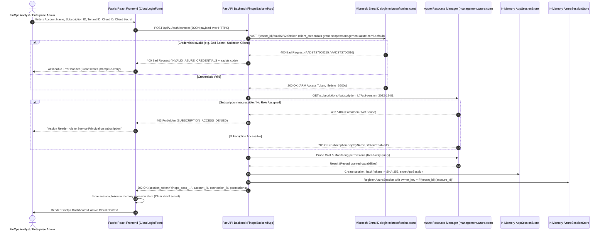

# Service Principal-Only Authentication Architecture

**Document ID:** `SP-AUTH-ARCH-001`  
**Status:** Approved & Enforced  
**Target Environment:** Azure App Service (`FinopsBackendApp`) + Microsoft Fabric Web App  
**Repository:** `cloud-recommender-poc`  
**Branch:** `feature/backend-security-hardening`

---

## 1. Executive Summary & Architectural Shift

The FinOps Multi-Cloud Recommender Platform has transitioned from an interactive, delegated human user authentication model (Microsoft Entra ID with MSAL browser popups, redirect flows, and `access_as_user` user tokens) to a **Service Principal-Only Enterprise Access Model**.

### 1.1 Problems Solved by the Transition
1. **Elimination of Browser MSAL Fragility:** Interactive user authentication in embedded contexts (such as Microsoft Fabric iframes or isolated corporate portal sandboxes) suffered from third-party cookie restrictions, popup blockers, and redirect URI mismatches.
2. **True Headless Enterprise Integration:** Organizations operate FinOps and multi-cloud infrastructure through automation, enterprise accounts, and dedicated read-only identities rather than personal corporate user identities.
3. **Decoupling Application Access from User Tenant Identity:** The application no longer requires a corporate Microsoft user account in the host tenant just to log in and inspect target Azure subscriptions.
4. **Preservation of Microsoft Fabric UDF RPCs:** Fabric User Defined Function (UDF) RPC operations retain their independent client (`fabric-udf-client.ts`) and dedicated tokens (`https://analysis.windows.net/powerbi/api`), completely insulated from standard platform API operations.

---

## 2. High-Level Architecture Diagram



---

## 3. Core Architectural Components

### 3.1 Frontend Cloud Login View (`src/components/CloudLoginForm.tsx`)
The user interface presents a dedicated enterprise connection screen requiring:
1. **Account Name:** User-friendly label for this cloud context (e.g., `Azure Enterprise Production`).
2. **Azure Subscription ID:** Target subscription GUID.
3. **Azure Tenant ID:** Directory GUID.
4. **Client ID:** Service Principal Application GUID.
5. **Client Secret:** Masked password field with show/hide toggle.
6. **Action Button:** `Connect & Access FinOps Dashboard`.

**Zero-Exposure Enforcement:**
- Client secrets live strictly in React component state memory during user entry.
- The secret field is cleared immediately upon submission (both on success and on error).
- Client secrets are never written to `localStorage`, `sessionStorage`, cookies, query parameters, or console logs.

### 3.2 Backend Authentication Endpoint (`/api/v1/auth/connect`)
- **Public Entry Point:** Excluded from global JWT gate dependencies to permit initial credential submission.
- **Rate-Limited:** Bound to a sliding window attempt limiter (default: 5 attempts per minute per tenant/client combination).
- **ARM Client Credentials Flow:** Calls `acquire_service_principal_token` against `https://login.microsoftonline.com/{tenant_id}/oauth2/v2.0/token` with scope `https://management.azure.com/.default`.
- **Subscription & RBAC Probing:** Validates that the Service Principal has active `Reader` access on the requested subscription and probes for `Cost Management Reader`.
- **Session Minting:** Generates high-entropy application session bearer token (`finops_sess_` + 32 URL-safe random bytes).

### 3.3 Application Session Store (`cloud_recommender.core.app_sessions`)
- **Token Hashing at Rest:** Only the deterministic `SHA-256` digest of the bearer token is retained in memory. A memory dump or transient log disclosure will not reveal plaintext session tokens.
- **Thread Safety:** Protected via Python `threading.Lock`.
- **Session Metadata:** Tracks `session_id`, `account_id`, `tenant_id`, `subscription_id`, `client_id`, `connection_id`, `roles`, `permissions`, `created_at`, `expires_at`, `last_used_at`, and `revoked_at`.
- **TTL Expiration:** Default 8 hours (`28800` seconds). Expired sessions are automatically purged during store operations.
- **Explicit Revocation:** `POST /api/v1/auth/logout` flags `revoked_at = now`, immediately invalidating subsequent calls.

### 3.4 Identity & Multi-Tenant Isolation Bridge (`cloud_recommender.core.auth`)
In `get_current_user`:
- When the request carries `Authorization: Bearer finops_sess_<token>`, the backend resolves the active session from `AppSessionStore`.
- Constructs an `AuthenticatedUser` instance:
  ```python
  AuthenticatedUser(
      sub=session.account_id,
      oid=session.account_id,
      tid=session.tenant_id,
      name=session.account_name,
      preferred_username=f"{session.client_id}@{session.tenant_id}",
      roles=["FinOpsAdmin"],
      scopes=["access_as_user"],
      is_authenticated=True,
      is_session_token=True,
      session_id=session.session_id,
      client_id=session.client_id,
      raw_claims={ ... }
  )
  ```
- **Owner Key Parity:** `owner_key_for(user)` evaluates to `f"{session.tenant_id}:{session.account_id}"`.
- **RBAC Parity:** Because `FinOpsAdmin` is granted, all downstream protected endpoints across inventory, pricing, cost simulation, architecture generation, and monitoring accept the request without breaking policy.

---

## 4. Preservation of Microsoft Fabric UDF RPC Architecture

The platform architecture strictly separates:
1. **FinOps Application API Requests:** Handled by FastAPI on Azure App Service (`FinopsBackendApp`) using the `Authorization: Bearer finops_sess_<token>` session token.
2. **Microsoft Fabric Python RPCs (UDF):** Handled by `fabric-udf-client.ts` using dedicated Fabric tokens (`https://analysis.windows.net/powerbi/api`) directed to Fabric User Data Functions.

This separation ensures that native Fabric computations (e.g. PySpark billing lakehouse queries) operate independently without interfering with real-time FastAPI cloud telemetry.

---

## 5. Security & Verification Summary

| Security Requirement | Architecture Control | Verification Test |
| :--- | :--- | :--- |
| Zero Client Secret Storage | In-memory only; cleared upon form submission | `azure-live.spec.tsx`, `cloud-login.spec.tsx` |
| Token Hashing | SHA-256 digest in `AppSessionStore` | `test_app_session_store_token_hashing_and_lifecycle` |
| Subscription Verification | ARM GET verification before session issuance | `test_auth_connect_subscription_permission_denied` |
| Multi-Tenant Isolation | `owner_key_for(user)` enforces tenant/account boundary | `test_multi_tenant_owner_isolation` |
| Session Expiry & Revocation | Explicit TTL check and `revoked_at` timestamp | `test_app_session_store_expiration`, `test_auth_connect_success` |
| Rate Limiting | Sliding window limiter on `/auth/connect` | `test_sp_only_auth.py` |

