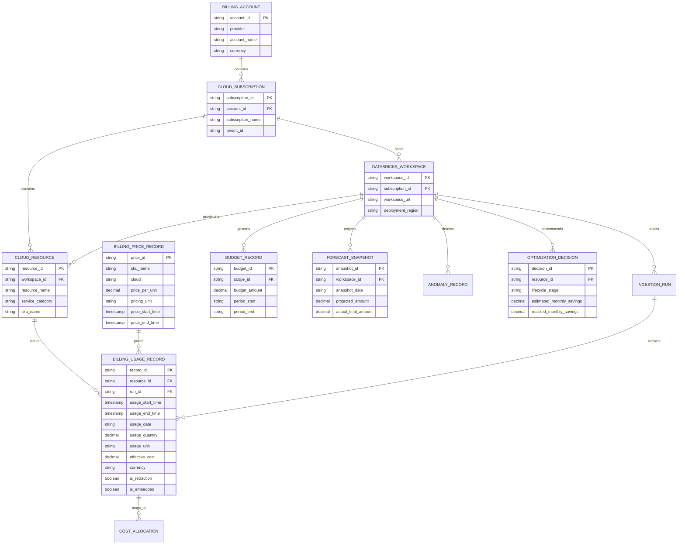

# CANONICAL FINANCIAL DATA MODEL SPECIFICATION

> **Document Identifier:** `MODEL-FINOPS-CANONICAL-2026-01`  
> **Target Version:** `v3.0.0-canonical-decimal`  
> **Status:** APPROVED & ENFORCED  
> **Alignment:** FinOps Open Cost & Usage Specification (FOCUS 1.0) Compatible  

---

## 1. Relational Entity-Relationship (ER) Architecture

The Canonical Financial Data Model unifies multi-cloud billing from Azure, Databricks, AWS, and GCP into a single normalized relational schema with strict Decimal precision and foreign-key integrity.

---

## 2. Logical Entity Definitions & Constraints

### 2.1 Billing Usage Record (`billing_usage_records`)
- **Primary Key:** `record_id` (String 100). Serves as the strict provider-issued idempotency key.
- **Foreign Keys:** `workspace_id`, `resource_id`, `run_id`.
- **Columns:**
  - `provider`: String(50) — `'databricks'`, `'azure'`, `'aws'`, `'gcp'`
  - `billing_account_id`: String(100) — Account / enrollment ID
  - `subscription_id`: String(100) — Cloud subscription ID
  - `workspace_id`: String(100) — Databricks workspace ID (Indexed)
  - `resource_id`: String(500) — Unique resource URI
  - `sku_name`: String(200) — Commercial SKU identifier (Indexed)
  - `usage_start_time`: DateTime(timezone=True) — Interval start
  - `usage_end_time`: DateTime(timezone=True) — Interval end
  - `usage_date`: String(20) — Partition date YYYY-MM-DD (Indexed)
  - `usage_quantity`: Numeric(18, 4) — Metered consumption quantity (Negative indicates retraction)
  - `usage_unit`: String(50) — Measurement unit (`DBU`, `TB-month`, `GB`, `Requests`)
  - `effective_cost`: Numeric(18, 2) — Reconciled financial charge in Decimal
  - `currency`: String(10) — Currency code (`USD`)
  - `is_retraction`: Boolean — Flag for adjustment records
  - `is_embedded_in_platform`: Boolean — Flag indicating charge is part of platform DBU total (e.g. Model Serving)
  - `tags_json`: JSONB / JSONType — Attached FinOps attribution tags
  - `data_quality_status`: String(50) — `LIVE`, `CACHED`, `ESTIMATED`, `SOURCE_UNAVAILABLE`

### 2.2 Billing Price Record (`billing_price_records`)
- **Primary Key:** `price_id` (String 100)
- **Columns:**
  - `sku_name`: String(200) — Matching SKU
  - `cloud`: String(50) — Cloud provider
  - `currency_code`: String(10) — Currency
  - `price_per_unit`: Numeric(18, 6) — Rate card price
  - `pricing_unit`: String(50) — Rate denominator (`DBU`, `Hour`)
  - `price_start_time`: DateTime(timezone=True) — Validity interval start
  - `price_end_time`: DateTime(timezone=True) — Validity interval end (Nullable for current rate)
- **Constraint:** `UNIQUE (sku_name, cloud, currency_code, price_start_time)`

### 2.3 Budget Allocation Record (`budget_records`)
- **Primary Key:** `budget_id` (String 100)
- **Columns:**
  - `scope_level`: String(50) — `'Organization'`, `'Workspace'`, `'CostCenter'`
  - `scope_id`: String(100) — Target ID
  - `period_start`: String(20) — YYYY-MM-DD
  - `period_end`: String(20) — YYYY-MM-DD
  - `budget_amount`: Numeric(18, 2) — Approved ceiling
  - `owner`: String(100) — Responsible owner
  - `alert_thresholds`: JSONType — Notification percentage array `[80.0, 90.0, 100.0]`

### 2.4 Forecast Snapshot Record (`forecast_snapshots`)
- **Primary Key:** `snapshot_id` (String 100)
- **Columns:**
  - `workspace_id`: String(100)
  - `snapshot_date`: String(20) — YYYY-MM-DD
  - `target_billing_period`: String(20) — YYYY-MM
  - `projected_amount`: Numeric(18, 2) — Forecasted spend
  - `actual_final_amount`: Numeric(18, 2) — Reconciled spend after period close (Nullable)
  - `model_methodology`: String(100) — Algorithm name
  - `is_period_closed`: Boolean — True when actuals are locked

### 2.5 Optimization Decision Record (`optimization_decisions`)
- **Primary Key:** `decision_id` (String 100)
- **Columns:**
  - `workspace_id`: String(100)
  - `resource_id`: String(500)
  - `lifecycle_stage`: String(50) — `POTENTIAL`, `ESTIMATED`, `APPROVED`, `IMPLEMENTED`, `REALIZED`
  - `estimated_monthly_savings`: Numeric(18, 2)
  - `realized_monthly_savings`: Numeric(18, 2) — Starts strictly at 0.00
  - `requires_approval`: Boolean — Default True (Zero-Execution guardrail)

---

## 3. FinOps FOCUS 1.0 Mapping Matrix

The canonical model directly aligns with the FinOps Open Cost & Usage Specification:

| FOCUS 1.0 Dimension | Canonical Financial Model Column | Source Provider Mapping |
| :--- | :--- | :--- |
| `BillingAccountId` | `billing_usage_records.billing_account_id` | Azure Enrollment / Databricks Account ID |
| `SubAccountId` | `billing_usage_records.subscription_id` | Azure Subscription ID (`sub-finops-enterprise-01`) |
| `ResourceId` | `billing_usage_records.resource_id` | Full ARM Resource URI or Databricks Object ID |
| `SubResourceId` | `billing_usage_records.tags_json->>'warehouse_id'` | Cluster ID, Warehouse ID, Endpoint Name |
| `ServiceName` | `billing_usage_records.service_name` | `'Azure Databricks'`, `'Storage'`, `'Virtual Network'` |
| `SkuName` | `billing_usage_records.sku_name` | `system.billing.usage.sku_name` |
| `PricingQuantity` | `billing_usage_records.usage_quantity` | `usage_quantity` (DBU, TB-mo) |
| `PricingUnit` | `billing_usage_records.usage_unit` | `usage_unit` |
| `BilledCost` | `billing_usage_records.billed_cost` | Raw invoice cost from Azure Cost Management |
| `EffectiveCost` | `billing_usage_records.effective_cost` | Reconciled price join $(Q \times P)$ in Decimal |
| `ChargeCategory` | `billing_usage_records.service_category` | `'Compute'`, `'Storage'`, `'Network'`, `'AI'` |

---

## 4. Idempotency & Mathematical Precision Standards

1. **Precision Rule:** All currency storage must use `Numeric(18, 2)`. All meter quantity storage must use `Numeric(18, 4)`. All unit rate card storage must use `Numeric(18, 6)`.
2. **Idempotency Rule:** Every provider record must supply or compute a stable `record_id`. Duplicate ingestion with the same `record_id` will execute an SQL `ON CONFLICT (record_id) DO UPDATE` without increasing financial sums.
3. **Unit Separation:** DBU compute records must never be combined with raw token counts or storage bytes. Rate calculations must respect strict unit types.

