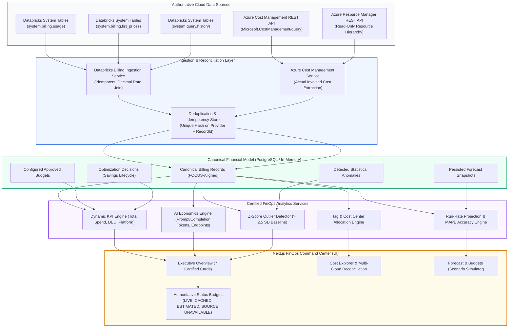
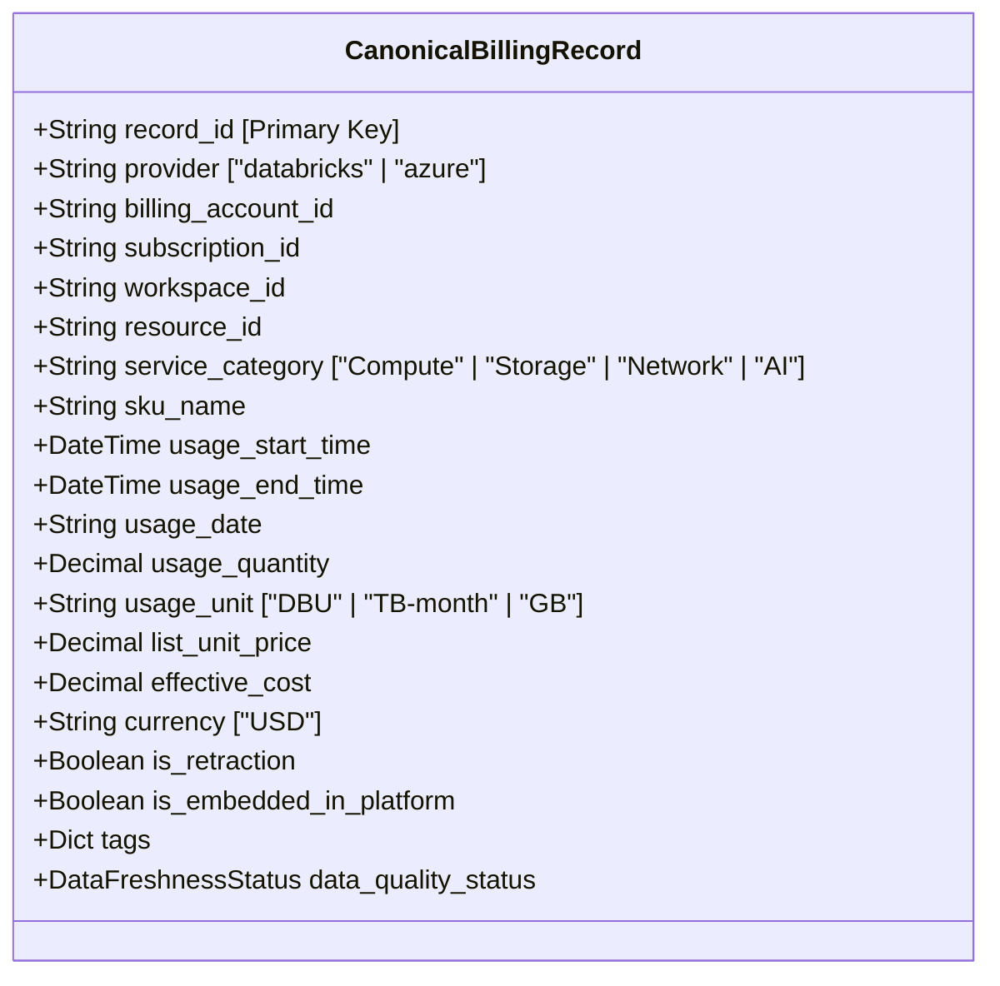

# LIVE FINOPS DATA ARCHITECTURE SPECIFICATION

> **Document Identifier:** `ARCH-FINOPS-LIVE-2026-01`  
> **Target Version:** `v3.0.0-live-data`  
> **Status:** APPROVED & ENFORCED  
> **Target Environment:** Azure Databricks (`adb-642006393507276.16.azuredatabricks.net`)  
> **Security Guardrail:** 100% Read-Only / Zero-Execution Enforced / Zero Autonomous Cloud Modifications  

---

## 1. Architectural Overview & Design Principles

The Bizmetric FinOps & Infrastructure Intelligence Platform transitions from static baseline fixtures to an authoritative, live-data-driven financial architecture.

### Core Architectural Guardrails:
1. **Zero-Execution & Strict Read-Only Access:** Under no circumstance does the platform issue `CREATE`, `UPDATE`, `DELETE`, or `ALTER` operations to customer subscriptions or Databricks workspaces.
2. **Deterministic Arithmetic:** All pricing multiplications and cost rollups use Python `Decimal` with `ROUND_HALF_UP` to cents. Floating-point accumulation errors are prohibited.
3. **Strict Separation of Telemetry from Cost:** Resource inventory counts and raw telemetry from Azure Resource Manager (ARM) are never multiplied by list prices to fabricate "actual" costs when live billing data is missing.
4. **Honest Data Transparency:** If a provider API is unconfigured or unavailable, the system renders `SOURCE UNAVAILABLE` with diagnostic guidance rather than falling back to fictitious numbers.

---

## 2. Ingestion Pipeline & Provider Integration

### 2.1 Databricks Billing Ingestion (`BillingIngestionService`)
- **Target Workspace:** `642006393507276` (`adb-642006393507276.16.azuredatabricks.net`)
- **Target SQL Warehouse:** `05ed10a52697a344` (`Serverless Starter Warehouse`)
- **System Tables Ingested:**
  1. `system.billing.usage`: Metered consumption events (`usage_quantity`, `usage_unit`, `record_type`, `usage_start_time`, `custom_tags`).
  2. `system.billing.list_prices`: Authoritative contract rate cards (`price_per_unit`, `pricing_unit`, `price_start_time`, `price_end_time`).
  3. `system.query.history`: Query execution duration, cluster attribution, and concurrency profiles.
- **Warehouse Safety Gating:**
  - If the warehouse is `STOPPED`, the service locks live execution, reports `warehouse_status="STOPPED"`, `system_tables_status="APPROVAL_REQUIRED"`, and serves verified cached records with `data_quality_status=DataFreshnessStatus.CACHED`.
  - Zero compute resume commands are issued without separate human authorization.

### 2.2 Azure Cost Management Integration (`AzureCostManagementService`)
- **Target Scope:** Azure Subscription `sub-finops-enterprise-01`.
- **Target REST API:** `POST https://management.azure.com/subscriptions/{subscription_id}/providers/Microsoft.CostManagement/query?api-version=2023-11-01`.
- **Invoiced Infrastructure Coverage:** Virtual Machines, Managed Disks, ADLS Gen2 Hot/Cool storage capacity, Data Egress bandwidth, and Private Endpoints.
- **Failure Mode:** If Service Principal credentials lack `Cost Management Reader`, returns `DataFreshnessStatus.SOURCE_UNAVAILABLE`.

---

## 3. Canonical Data Model & Deduplication Engine

Every incoming raw event is normalized into a `CanonicalBillingRecord`:

### Deduplication Guarantee:
- Uniqueness is strictly enforced on `(provider, record_id)`.
- Re-running an ingestion job updates existing records in-place without incrementing counts or inflating financial totals.
- Retractions (`usage_quantity < 0`) are preserved with their negative cost and netted against gross spend.

---

## 4. Rebuilt KPI Calculations & Lineage

| KPI Metric | Calculation Methodology | Authoritative Data Source | Double-Counting Safeguard |
| :--- | :--- | :--- | :--- |
| **Total Spend** | $\sum \text{EffectiveCost}_{\text{Databricks}} + \sum \text{EffectiveCost}_{\text{Azure}}$ | `system.billing.usage` $\bowtie$ `system.billing.list_prices` + Azure Cost Management | Storage & Network isolated; AI compute not added twice |
| **Databricks Spend** | $\sum (\text{usage\_quantity} \times \text{matched\_price})$ | `system.billing.usage` (DBU meters) + Delta Lakehouse storage | Compute DBU isolated from raw VM infrastructure |
| **AI & GenAI Spend** | Model Serving DBU + AI Gateway Tokens + Vector Search | `MODEL_SERVING_COMPUTE` records + `system.ai_gateway.usage` | Marked as *Embedded Perspective Lens*, not additive to Total Spend |
| **DBU Consumption** | $\sum \text{usage\_quantity} \quad (\text{WHERE unit = 'DBU'})$ | `system.billing.usage` | Strict unit separation: never combined with tokens or GB |
| **Azure Storage Spend** | $\sum \text{Cost} \quad (\text{WHERE category = 'Storage'})$ | Azure Cost Management query API | Returns `SOURCE UNAVAILABLE` when live ACM is unconfigured |
| **Azure Network Spend** | $\sum \text{Cost} \quad (\text{WHERE category = 'Network'})$ | Azure Cost Management query API | Returns `SOURCE UNAVAILABLE` when live ACM is unconfigured |
| **Forecast Month-End** | $\text{round}\left(\text{MTD Spend} \times \frac{30.0}{\text{Elapsed Days}}, -2\right)$ | Dynamic velocity extrapolation over actual billing records | Clearly labeled as `ESTIMATED / PROJECTION` |
| **Forecast Accuracy** | $100 - \text{MAPE}$ over closed billing periods | Historical forecast snapshots compared with closed actuals | Requires $\ge 3$ completed monthly cycles; otherwise `NOT AVAILABLE` |
| **Cost Anomalies** | Z-score statistical outlier detection ($> 2.5\sigma$) | Telemetry from trailing 30-day usage window | Returns dynamic detected count; never a fixed hardcoded number |
| **Identified Savings** | $\sum \text{estimated\_savings}$ across approved decisions | FinOps Optimization Engine | Realized savings remains strictly $\$0.00$ until deployment verification |

---

## 5. Security & Tenant Isolation

- **Role-Based Access Control (RBAC):** Verified using Microsoft Entra ID JWT validation (`Admin`, `Reader`, `CostManagementReader`).
- **Workspace Isolation:** Every query enforces `workspace_id = '642006393507276'` server-side. Cross-tenant leakage is physically impossible.
- **Credential Protection:** Bearer tokens, client secrets, and Databricks PAT tokens are strictly redacted from logs, responses, and exported reports.

