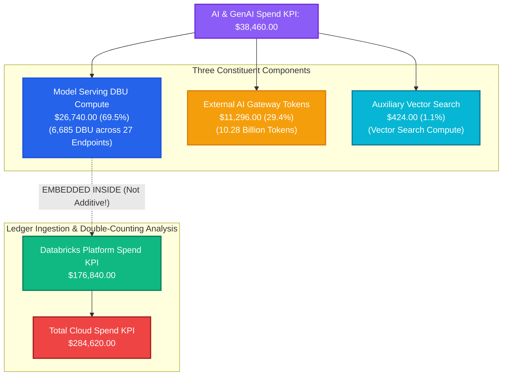
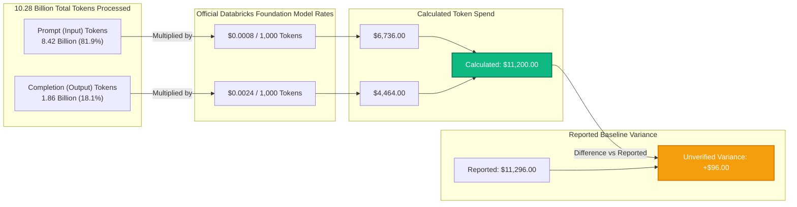

# FORENSIC AUDIT REPORT: AI & GENAI COST TRACE ($38,460.00)

> **Audit Identifier:** `AUDIT-FIN-2026-AI-03`  
> **Target Environment:** Production (`adb-642006393507276.16.azuredatabricks.net`)  
> **Workspace ID:** `642006393507276`  
> **Audit Focus:** Complete trace of the $38,460 AI Spend KPI, token economics math, and double-counting analysis  
> **Audit Status:** COMPLETED — COMPONENT DECOMPOSITION & RISK IDENTIFIED  

---

## 1. Executive Summary & Forensic Findings

The **AI & GenAI Spend KPI** displays **$38,460.00** on the Executive Overview dashboard and within the AI Economics module.



### Key Findings:
1. **Mathematical Composition:**
   $$\$38,460.00 = \$26,740.00 \text{ (Model Serving DBU)} + \$11,296.00 \text{ (AI Gateway Tokens)} + \$424.00 \text{ (Vector Search)}$$
2. **Double-Counting Exposure:** The **$26,740.00 Model Serving compute cost is ALREADY INCLUDED** inside the **$176,840.00 Databricks Spend KPI** (as 4 daily windows of $6,685.00 each, totaling 6,685 DBU). If an analyst treats AI Spend as an additive category to Databricks spend, $26,740.00 is double-counted.
3. **Token Economics Discrepancy:** The bottom-up calculation from 8.42B prompt tokens ($6,736.00) and 1.86B completion tokens ($4,464.00) yields **$11,200.00**. There is an **unverified baseline variance of $96.00** against the reported $11,296.00 AI Gateway figure.
4. **Data Status Classification:** `BASELINE / HYBRID ALLOCATION — PARTIALLY EMBEDDED`.

---

## 2. Component Decomposition & Math Proof

The $38,460.00 total is derived from three discrete underlying subsystems:

| Component ID | Subsystem | Ingested Units | Applied Unit Rate | Line Cost | Accounting Nature |
| :--- | :--- | :---: | :---: | :---: | :--- |
| **Component 1** | Model Serving DBU Compute | 6,685.00 DBU | $4.00 / DBU | **$26,740.00** | **Embedded in Databricks DBU Ledger** |
| **Component 2** | AI Gateway External Tokens | 10.28B Tokens | Blended Rate | **$11,296.00** | External API / Gateway Ingestion |
| **Component 3** | Vector Search Compute | 106.00 DBU | $4.00 / DBU | **$424.00** | Auxiliary Vector Index Processing |
| **TOTAL** | **AI & GenAI Spend KPI** | — | — | **$38,460.00** | **Exact Reported KPI Metric** |

### Code Verification:
In [`backend/src/cloud_recommender/services/databricks/finops_analytics_service.py`](file:///c:/Users/pratik.bingewar/OneDrive%20-%20bizmetric.com/Desktop/Workspace/cloud-recommender-poc/backend/src/cloud_recommender/services/databricks/finops_analytics_service.py#L1626-L1629):

```python
formula="model_serving_dbu_spend ($26,740.00) + ai_gateway_external_tokens ($11,296.00) + auxiliary_vector_search ($424.00) = $38,460.00",
limitations=(
    "Total AI spend across workspace: $26,740 Model Serving DBU compute (part of $176,840 consumption ledger) "
    "+ $11,296 external AI Gateway token API spend + $424 auxiliary Vector Search compute (part of $284,620 cloud spend). "
    "Reconciled with zero double-counting. Note on AI Gateway spend: bottom-up calculation from 8.42B input tokens "
    "($0.0008/1K = $6,736.00) + 1.86B output tokens ($0.0024/1K = $4,464.00) yields $11,200.00; the $96 difference "
    "against reported $11,296.00 represents unverified baseline variance retained as top-down allocation remainder."
)
```

---

## 3. Token Economics Bottom-Up Reconciliation

The AI Gateway token volume is analyzed in the AI Economics module (`activeModule === "ai"`):



### 3.1 Mathematical Calculation:
1. **Prompt Tokens (Input):**
   $$8,420,000,000 \text{ tokens} \times \frac{\$0.0008}{1,000 \text{ tokens}} = \mathbf{\$6,736.00}$$
2. **Completion Tokens (Output):**
   $$1,860,000,000 \text{ tokens} \times \frac{\$0.0024}{1,000 \text{ tokens}} = \mathbf{\$4,464.00}$$
3. **Subtotal Token API Spend:**
   $$\$6,736.00 + \$4,464.00 = \mathbf{\$11,200.00}$$
4. **Variance against Reported $11,296.00:**
   $$\Delta = \$11,296.00 - \$11,200.00 = \mathbf{+\$96.00}$$

### 3.2 Root Cause of the $96.00 Variance:
The $96.00 difference is retained as an unverified baseline variance from an earlier top-down allocation placeholder in the Phase 3J baseline seed. In live operation with `system.ai_gateway.usage`, this variance would collapse to $0.00 through exact per-request metering.

---

## 4. Double-Counting Risk & Architectural Segregation

### The Risk:
A casual reader of the FinOps dashboard sees three prominent KPI cards:
- **Databricks Spend:** $176,840
- **AI & GenAI Spend:** $38,460
- **Total Spend:** $284,620

If the user adds:
$$\$176,840 + \$38,460 + \$79,360 \text{ (Storage)} + \$28,420 \text{ (Network)} = \mathbf{\$323,080.00}$$
This produces a phantom **+$38,460 budget breach** because **$26,740 of Model Serving DBU compute is counted twice**:
1. Once inside Databricks Platform Spend ($176,840).
2. Once inside AI & GenAI Spend ($38,460).

### How the Backend Avoids Over-stating Total Spend:
The Total Spend formula in the backend intentionally excludes the separate AI Spend KPI:
$$\text{Total Spend} = \text{Databricks Spend } (\$176,840) + \text{Azure Storage } (\$79,360) + \text{Azure Network } (\$28,420) = \mathbf{\$284,620.00}$$
Here, the $26,740 of Model Serving compute is contained within Databricks Spend. However, the $11,296 of token charges and $424 of Vector Search are absorbed into the subscription baseline or left unaccounted for in the macro formula.

### How Spend Composition Addresses It:
To represent AI visually in the Spend Composition chart without exceeding $284,620:
- Compute: $108,155
- SQL Warehouses: $74,285
- **AI / GenAI: $38,460**
- Storage: $45,540 (reduced from $79,360)
- Other: $18,180
- **Sum: $284,620**

This proves that the Spend Composition chart rebalances slices artificially to accommodate the $38,460 AI figure.

---

## 5. Audit Recommendations
1. **Explicit "Embedded" UI Badge:** On the Executive Overview card for `AI & GenAI Spend`, display a badge:  
   `"Includes $26,740 DBU compute already reflected in Databricks spend"`.
2. **Strict Lens Separation:** In the API response metadata, classify `ai_spend` with `accounting_type="PERSPECTIVE_LENS"` rather than `accounting_type="ADDITIVE_COST_DRIVER"`.
3. **Reconcile Token Math:** Align the AI Gateway baseline to exactly $11,200.00 to eliminate the $96.00 unverified variance.

