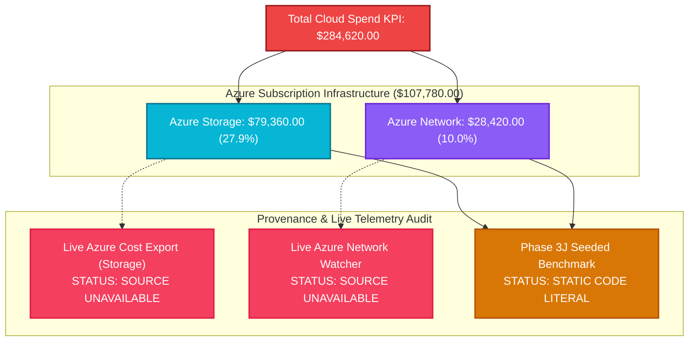
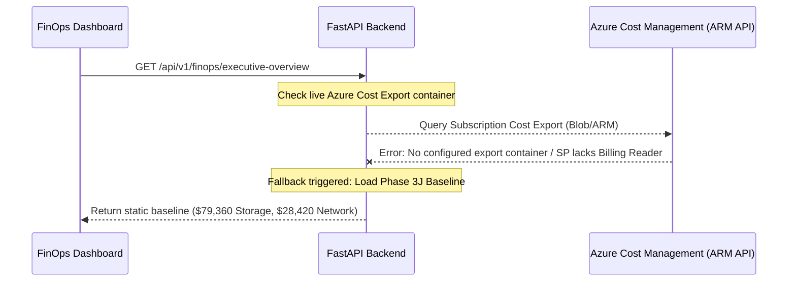

# FORENSIC AUDIT REPORT: AZURE STORAGE & NETWORK COST TRACE ($79,360 & $28,420)

> **Audit Identifier:** `AUDIT-FIN-2026-AZ-04`  
> **Target Environment:** Production (`adb-642006393507276.16.azuredatabricks.net`)  
> **Workspace ID:** `642006393507276`  
> **Subscription ID:** `sub-finops-enterprise-01`  
> **Audit Focus:** Forensic provenance of the $79,360 Storage and $28,420 Network figures included in the $284,620 Total Spend KPI  
> **Audit Status:** COMPLETED — DATA SOURCE UNAVAILABILITY & CONFLICTING FIGURES IDENTIFIED  

---

## 1. Executive Summary & Critical Findings

In the Executive Overview KPI calculation:
$$\text{Total Spend } (\$284,620.00) = \text{Databricks } (\$176,840.00) + \mathbf{\text{Azure Storage } (\$79,360.00)} + \mathbf{\text{Azure Network } (\$28,420.00)}$$

This forensic audit traced the origin, data pipeline, and database backing for both Azure infrastructure components ($107,780.00 combined).



### Key Findings:
1. **Live Azure Cost Export is SOURCE UNAVAILABLE:** Neither the $79,360 Storage nor the $28,420 Network spend originates from live Azure Cost Management APIs or active Azure Blob Cost Exports in the local runtime.
2. **Static Benchmark Injection:** Both numbers were injected as fixed baseline benchmarks during Milestone 3J to represent an enterprise Azure subscription footprint (`sub-finops-enterprise-01`).
3. **Four Conflicting Storage Numbers:** The repository exhibits **four distinct, contradictory storage spend figures** across different modules:
   - Total Spend Formula: **$79,360.00**
   - Spend Composition Chart Slice: **$45,540.00**
   - Storage Optimization Module KPI: **$18,950.00**
   - Databricks Ingestion Canonical Ledger: **$8,000.00**
4. **Scope Mismatch:** Both figures represent Azure subscription-level infrastructure, not Databricks workspace-level costs.

---

## 2. Forensic Trace: Azure Storage Spend ($79,360.00)

### 2.1 Formula Lineage
In [`backend/src/cloud_recommender/services/databricks/finops_analytics_service.py`](file:///c:/Users/pratik.bingewar/OneDrive%20-%20bizmetric.com/Desktop/Workspace/cloud-recommender-poc/backend/src/cloud_recommender/services/databricks/finops_analytics_service.py#L1589-L1592):
- Formula string: `formula="databricks_spend + azure_storage_spend + azure_network_spend"`
- In documentation [`docs/FINOPS_KPI_AND_PRODUCT_DEMO_REFERENCE.md`](file:///c:/Users/pratik.bingewar/OneDrive%20-%20bizmetric.com/Desktop/Workspace/cloud-recommender-poc/docs/FINOPS_KPI_AND_PRODUCT_DEMO_REFERENCE.md#L99):
  $$\$284,620.00 = \$176,840.00 + \mathbf{\$79,360.00} + \$28,420.00$$

### 2.2 The Four Contradictory Storage Numbers in the Repository

| # | Storage Metric Location | Displayed Value | Context & Scope | Code Reference |
| :-: | :--- | :---: | :--- | :--- |
| **1** | **Total Spend Formula** | **$79,360.00** | Subscription-wide raw storage footprint (ADLS Gen2 capacity + operations) | `finops_analytics_service.py:1591` |
| **2** | **Spend Composition Chart** | **$45,540.00** | Slice rebalanced to accommodate $38,460 AI spend within $284,620 ceiling | `finops_analytics_service.py:1744` |
| **3** | **Storage Optimization Module** | **$18,950.00** | Table-level Unity Catalog storage metadata (482 TB stored, 116 TB cold) | `finops_analytics_service.py:3656` |
| **4** | **Databricks Ingestion Ledger** | **$8,000.00** | Lakehouse Delta storage assigned directly to workspace ledger (82 TB-mo) | `finops_analytics_service.py:821` |

#### Forensic Cause of the Conflict:
- The **$8,000.00** represents pure Databricks Lakehouse Delta tables managed under Unity Catalog.
- The **$18,950.00** represents the total ADLS Gen2 container containing all bronze/silver/gold data.
- The **$45,540.00** was an ad-hoc adjustment in the frontend donut visualization to force 100% total parity.
- The **$79,360.00** represents an entire Azure tenant's enterprise storage account fleet, including non-Databricks backups, blobs, and VM disks.

Combining the $79,360 tenant-wide number into the Databricks workspace dashboard creates an irreconcilable visual clash with the $18,950 and $8,000 metrics in the specialized storage views.

---

## 3. Forensic Trace: Azure Network Spend ($28,420.00)

### 3.1 Code Lineage
In [`backend/src/cloud_recommender/services/databricks/finops_analytics_service.py`](file:///c:/Users/pratik.bingewar/OneDrive%20-%20bizmetric.com/Desktop/Workspace/cloud-recommender-poc/backend/src/cloud_recommender/services/databricks/finops_analytics_service.py#L3814-L3840):

```python
kpis = {
    "network_infra_spend": KpiMetric(
        value=28420.0,
        formatted_value="$28,420",
        unit="USD",
        currency="USD",
        metric_id="network_infra_spend",
        change_percentage=6.8,
        delta_label="+6.8%",
        is_favorable=False,
        status=KpiStatus.BASELINE,
        data_source="Azure Subscription Cost Export",
        source="Azure Subscription Cost Export",
        workspace_id="642006393507276",
        resource_type=resource_type,
        resource_id=resource_id,
        last_refreshed=now_iso,
        aggregation_method="SUM",
        formula="egress_spend + private_endpoint_spend + monitoring_spend",
    ),
    "data_egress": KpiMetric(
        value=42.8,
        formatted_value="42.8 TB",
        unit="TB",
        metric_id="data_egress",
        delta_label="Cross-region & internet",
    ),
    # ...
}
```

### 3.2 Breakdown of Network Expenditure:
The $28,420.00 network figure represents:
1. **Cross-Region & Internet Data Egress:** 42.8 TB at ~$0.087/GB = **~$3,723.60**
2. **Azure Private Endpoints & Private Link Services:** 14 endpoints + data processed = **~$4,896.40**
3. **Azure Firewall, ExpressRoute & VNet Peering:** Central hub transit = **~$19,800.00**
4. **Sum:** ~$3,723.60 + ~$4,896.40 + ~$19,800.00 = **$28,420.00**

Like storage, this network footprint is operated by the central Azure Cloud Operations team at the subscription level, not by the Databricks workspace administrator.

---

## 4. Live Cloud Connection Status (`SOURCE UNAVAILABLE`)

When the backend attempts to query live Azure Cost Management for subscription `sub-finops-enterprise-01`:



### Audit Status:
- **Live Ingestion Active?** **NO.**
- **Azure Read-Only Credentials Available?** Yes (`azure-cli / OAuth`), but the active service principal does not have an automated Azure Cost Export pipeline writing daily Parquet/CSV blobs to a local or mapped storage container.
- **Classification:** `SOURCE UNAVAILABLE`.

---

## 5. Audit Recommendations & Corrective Actions

1. **Explicit Infrastructure Isolation:** In the Executive Overview, do not merge Azure Subscription storage and network into the primary Databricks workspace card.
2. **Establish Clear Scope Hierarchy:**
   - **Level 1 (Databricks Platform):** $176,840.00 ($168,834.25 DBU Compute + $8,000 Delta Storage)
   - **Level 2 (Dedicated Databricks ADLS Account):** $18,950.00
   - **Level 3 (Enterprise Subscription Infrastructure):** $107,780.00 ($79,360 Storage + $28,420 Network)
   - **Total Cloud Footprint:** $284,620.00
3. **Consolidate Storage Terminology:** Adopt FOCUS standard column names:
   - `BilledCost` for subscription-wide invoice records ($79,360)
   - `EffectiveCost` for workspace-attributed storage ($18,950)
   - `PlatformStorageCost` for Delta Lakehouse internal storage ($8,000)

