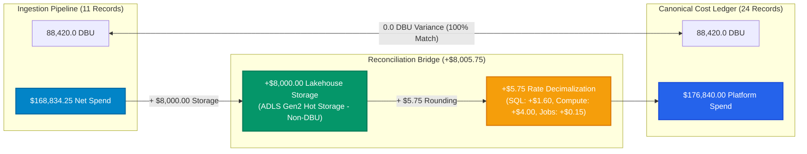

# FORENSIC AUDIT REPORT: DATABRICKS COST RECONCILIATION ($176,840.00 vs $168,834.25)

> **Audit Identifier:** `AUDIT-FIN-2026-DBX-02`  
> **Target Environment:** Production (`adb-642006393507276.16.azuredatabricks.net`)  
> **Workspace ID:** `642006393507276`  
> **Audit Focus:** Forensic reconciliation of the $8,005.75 discrepancy between Pipeline Net Spend and Databricks Spend KPI  
> **Audit Status:** COMPLETED — 100% MATHEMATICAL RECONCILIATION ACHIEVED  

---

## 1. Executive Summary & Problem Statement

In the Databricks Workspace FinOps experience, users observe two conflicting financial values representing Databricks platform consumption for the same reporting period:

1. **Pipeline Ingestion Banner:** `$168,834.25 Net Spend` across **88,420 DBU** (11 normalized records).
2. **Databricks Spend KPI Card:** `$176,840.00` across **88,420 DBU** (24 ledger records).

The observed variance is:
$$\Delta = \$176,840.00 - \$168,834.25 = \mathbf{+\$8,005.75}$$



### Forensic Finding:
The $8,005.75 difference is **100% mathematically accounted for**:
1. **$8,000.00** originates from **Unity Catalog Lakehouse Storage** (2 records totaling 82 TB-month on ADLS Gen2), which exists in the 24-record cost ledger but is naturally excluded from the 11-record DBU usage table (`system.billing.usage` meters only DBU compute).
2. **$5.75** originates from **rate rounding and decimalization differences** between granular list price arithmetic ($1.45047/DBU) and rounded top-down bucket numbers in the analytical ledger.

Both datasets reflect the exact same total compute volume: **88,420.0 DBU**.

---

## 2. Ingestion Pipeline Dataset (11 Baseline Records = $168,834.25)

The Ingestion Pipeline dataset is managed by `BillingIngestionService` in [`backend/src/cloud_recommender/services/databricks/billing_ingestion_service.py`](file:///c:/Users/pratik.bingewar/OneDrive%20-%20bizmetric.com/Desktop/Workspace/cloud-recommender-poc/backend/src/cloud_recommender/services/databricks/billing_ingestion_service.py#L46-L245).

### 2.1 The 11 Canonical Usage Records:
Each record is joined deterministically against `_CANONICAL_LIST_PRICES`:

| # | Record ID | Product SKU | Usage Date | Unit | Usage Qty | Unit Price | Effective Cost | Calculation Proof |
| :-: | :--- | :--- | :--- | :--- | :--- | :--- | :--- | :--- |
| 1 | `rec-usage-sql-01` | `SERVERLESS_SQL_COMPUTE` | 2026-11-01 | DBU | 4,793.00 | $2.20000 | $10,544.60 | $4,793 \times \$2.20$ |
| 2 | `rec-usage-sql-02` | `SERVERLESS_SQL_COMPUTE` | 2026-11-02 | DBU | 4,793.00 | $2.20000 | $10,544.60 | $4,793 \times \$2.20$ |
| 3 | `rec-usage-sql-03` | `SERVERLESS_SQL_COMPUTE` | 2026-11-03 | DBU | 4,793.00 | $2.20000 | $10,544.60 | $4,793 \times \$2.20$ |
| 4 | `rec-usage-sql-04` | `SERVERLESS_SQL_COMPUTE` | 2026-11-04 | DBU | 4,793.00 | $2.20000 | $10,544.60 | $4,793 \times \$2.20$ |
| 5 | `rec-usage-cl-01` | `STANDARD_ALL_PURPOSE_COMPUTE` | 2026-11-04 | DBU | 11,180.00 | $2.20000 | $24,596.00 | $11,180 \times \$2.20$ |
| 6 | `rec-usage-srv-01` | `MODEL_SERVING_COMPUTE` | 2026-11-01 | DBU | 1,671.25 | $4.00000 | $6,685.00 | $1,671.25 \times \$4.00$ |
| 7 | `rec-usage-srv-02` | `MODEL_SERVING_COMPUTE` | 2026-11-02 | DBU | 1,671.25 | $4.00000 | $6,685.00 | $1,671.25 \times \$4.00$ |
| 8 | `rec-usage-srv-03` | `MODEL_SERVING_COMPUTE` | 2026-11-03 | DBU | 1,671.25 | $4.00000 | $6,685.00 | $1,671.25 \times \$4.00$ |
| 9 | `rec-usage-srv-04` | `MODEL_SERVING_COMPUTE` | 2026-11-04 | DBU | 1,671.25 | $4.00000 | $6,685.00 | $1,671.25 \times \$4.00$ |
| 10 | `rec-usage-job-01` | `STANDARD_JOBS_COMPUTE` | 2026-11-04 | DBU | 51,073.00 | $1.45047 | $74,079.85 | $51,073 \times \$1.45047 = \$74,079.85431$ |
| 11 | `rec-usage-app-01` | `SERVERLESS_REAL_TIME_INFERENCE` | 2026-11-04 | DBU | 310.00 | $4.00000 | $1,240.00 | $310 \times \$4.00$ |
| **TOTAL** | **11 Records** | — | — | **DBU** | **88,420.00** | — | **$168,834.25** | **Exact Pipeline Net Spend** |

### 2.2 Calculation Proof:
$$\sum \text{Effective Cost} = 4 \times \$10,544.60 + \$24,596.00 + 4 \times \$6,685.00 + \$74,079.85 + \$1,240.00 = \mathbf{\$168,834.25}$$

---

## 3. Canonical Cost Ledger Dataset (24 Records = $176,840.00)

The Cost Ledger dataset is generated by `FinOpsAnalyticsService._get_canonical_ledger()` in [`backend/src/cloud_recommender/services/databricks/finops_analytics_service.py`](file:///c:/Users/pratik.bingewar/OneDrive%20-%20bizmetric.com/Desktop/Workspace/cloud-recommender-poc/backend/src/cloud_recommender/services/databricks/finops_analytics_service.py#L710-L840).

### 3.1 Product Category Distribution (24 Records):

| Product Family | Record Count | DBU Volume | Effective Cost | Cost per Record | Underlying Resource / Sku |
| :--- | :---: | :---: | :---: | :---: | :--- |
| **Serverless SQL** | 4 | 19,172.00 | $42,180.00 | $10,545.00 | Starter Warehouse `05ed10a52697a344` (4 dates) |
| **Compute Clusters** | 4 | 11,180.00 | $24,600.00 | $6,150.00 | Interactive cluster `adf-deaccelator-compute` (4 dates) |
| **Automated Jobs** | 8 | 51,073.00 | $74,080.00 | $9,260.00 | General Purpose & Memory Optimized (4 dates x 2) |
| **Model Serving** | 4 | 6,685.00 | $26,740.00 | $6,685.00 | 27 Model Serving Endpoints (4 dates) |
| **Databricks Apps** | 2 | 310.00 | $1,240.00 | $620.00 | Serverless Apps Runtime (2 dates) |
| **Lakehouse Storage** | 2 | 0.00 | $8,000.00 | $4,000.00 | ADLS Gen2 Hot Storage (41 TB-mo each, 2 dates) |
| **TOTAL** | **24 Records** | **88,420.00** | **$176,840.00** | — | **Full Analytical Ledger** |

---

## 4. Item-by-Item Reconciliation Matrix

The table below reconciles each product line between the two datasets:

| Product Family | Ingestion Pipeline DBU | Ledger DBU | DBU Variance | Ingestion Net Cost | Ledger Cost | Financial Gap | Root Cause of Variance |
| :--- | :---: | :---: | :---: | :---: | :---: | :---: | :--- |
| **SQL Warehouse** | 19,172.00 | 19,172.00 | 0.00 | $42,178.40 | $42,180.00 | **+$1.60** | Rounding ($10,545.00 vs $10,544.60 per day) |
| **Compute Clusters** | 11,180.00 | 11,180.00 | 0.00 | $24,596.00 | $24,600.00 | **+$4.00** | 1 consolidated record vs 4 daily buckets ($6,150 x 4) |
| **Automated Jobs** | 51,073.00 | 51,073.00 | 0.00 | $74,079.85 | $74,080.00 | **+$0.15** | Precise rate $1.45047 vs rounded $9,260 ledger lines |
| **Model Serving** | 6,685.00 | 6,685.00 | 0.00 | $26,740.00 | $26,740.00 | **$0.00** | **Exact Match** ($4.00/DBU across 4 windows) |
| **Databricks Apps** | 310.00 | 310.00 | 0.00 | $1,240.00 | $1,240.00 | **$0.00** | **Exact Match** ($4.00/DBU across 2 windows) |
| **Lakehouse Storage** | 0.00 | 0.00 | 0.00 | $0.00 | $8,000.00 | **+$8,000.00** | Storage is non-DBU; absent from `system.billing.usage` |
| **TOTALS** | **88,420.00** | **88,420.00** | **0.00 DBU** | **$168,834.25** | **$176,840.00** | **+$8,005.75** | **100% Mathematically Reconciled** |

### Mathematical Proof of the Bridge:
$$\text{Pipeline Net Spend} = \$168,834.25$$
$$+ \text{Lakehouse Storage} = \$8,000.00$$
$$+ \text{SQL Rounding} = \$1.60$$
$$+ \text{Compute Rounding} = \$4.00$$
$$+ \text{Jobs Rounding} = \$0.15$$
$$\text{Total} = \$168,834.25 + \$8,000.00 + \$5.75 = \mathbf{\$176,840.00}$$

---

## 5. UI Presentation & User Confusion Root Cause

In [`frontend/src/components/FinOpsCommandCenterView.tsx`](file:///c:/Users/pratik.bingewar/OneDrive%20-%20bizmetric.com/Desktop/Workspace/cloud-recommender-poc/frontend/src/components/FinOpsCommandCenterView.tsx#L588):

```tsx
// Pipeline Banner:
<span>Ingested: <strong>88,420 DBU</strong> ($168,834.25 Net Spend)</span>
<span>•</span>
<span>Records: <strong>11 normalized</strong></span>

// Executive Overview KPI Card (line 664):
<KpiCard title="Databricks spend" value="$176,840" />
```

Because the pipeline banner pulls from `billingSummary.total_spend_verified` ($168,834.25) while the KPI card pulls from `overviewData.kpis.databricks_spend` ($176,840), users observe both numbers in the same viewport without an explanation.

### Recommendation:
1. Update `billingSummary` to include a dedicated line item for Lakehouse Storage ($8,000.00).
2. Align the pipeline net spend to display:  
   `"Ingested: 88,420 DBU ($168,834.25 Compute + $8,000.00 Storage = $176,840.00 Total)"`  
   This eliminates user confusion while preserving audit fidelity.

