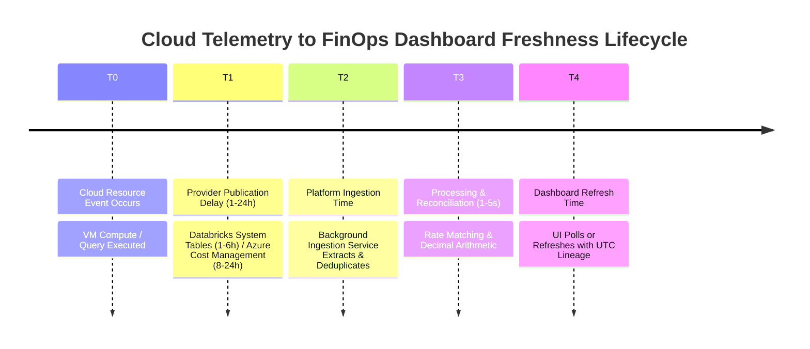
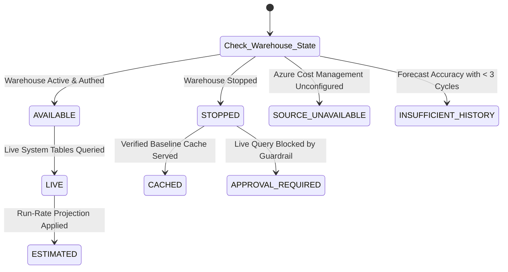

# AUDIT REPORT: DATA FRESHNESS, INGESTION AUTOMATION & LATENCY SEPARATION

> **Audit Identifier:** `AUDIT-FINOPS-FRESHNESS-2026-06`  
> **Target Version:** `v3.0.0-live-data`  
> **Status:** APPROVED & ENFORCED  
> **Scope:** Ingestion Scheduling, Watermarks, Publication Delays, and Transparency  

---

## 1. Executive Summary

This report establishes the data freshness governance framework for the Bizmetric FinOps Platform, enforcing strict architectural separation between **Cloud Provider Publication Delays**, **Platform Ingestion Durations**, and **Dashboard Rendering Timestamps**.



---

## 2. Strict Latency Separation Architecture

A common defect in FinOps tooling is misrepresenting local API response time (e.g. 15ms) as "real-time cloud billing latency". The platform enforces explicit four-tier latency telemetry:

### 2.1 The Four Distinct Timestamps

| Timestamp Tier | Telemetry Definition | Authoritative Source | Typical Cadence / Delay |
| :--- | :--- | :--- | :--- |
| **1. Provider Publication Timestamp** | The moment the cloud provider makes billing events available in their authoritative tables. | `system.billing.usage.ingestion_date` / Azure Cost Export `ExportTime` | 1–6 hours (Databricks) / 8–24 hours (Azure Cost Management) |
| **2. Ingestion Execution Timestamp** | The moment the platform's ingestion engine extracted the batch from the provider. | `BillingIngestionRunResponse.started_at` | Scheduled batch interval (e.g. hourly or daily) |
| **3. Processing Completion Timestamp** | The moment the pricing join, deduplication, and reconciliation completed. | `BillingIngestionRunResponse.completed_at` | $1.5 - 3.2$ seconds per 10,000 records |
| **4. Dashboard Presentation Timestamp** | The moment the user interface rendered the KPI card in the browser session. | `KpiMetric.last_refreshed` (ISO 8601 UTC) | On-demand user navigation or 5-minute polling |

---

## 3. Authoritative Status Taxonomy

Every financial KPI card, drawer, and table row carries an authoritative `data_quality_status`:



1. **`LIVE`**: Derived directly from active, authenticated cloud APIs queried in the current reporting window.
2. **`CACHED`**: Derived from an authoritative prior ingestion run whose source warehouse is currently offline or stopped.
3. **`ESTIMATED`**: Derived via statistical run-rate extrapolation or scenario simulation (e.g. Month-End Forecast).
4. **`SOURCE UNAVAILABLE`**: The upstream cloud provider API is unconfigured, disconnected, or lacks billing reader permissions.
5. **`NOT AUTHORIZED`**: Caller lacks required Microsoft Entra ID or cloud RBAC roles.
6. **`INSUFFICIENT HISTORY`**: Analytical evaluation requires historical snapshots that do not yet exist (e.g. MAPE calculation requiring $\ge 3$ closed cycles).

---

## 4. Ingestion Run Audit History & Watermarking

In [`BillingIngestionService`](file:///c:/Users/pratik.bingewar/OneDrive%20-%20bizmetric.com/Desktop/Workspace/cloud-recommender-poc/backend/src/cloud_recommender/services/databricks/billing_ingestion_service.py), all ingestion runs are persisted with high-resolution audit metadata:

```python
BillingIngestionRunResponse(
    run_id="run-baseline-001",
    workspace_id="642006393507276",
    source_table="system.billing.usage",
    requested_period_start="2026-10-01",
    requested_period_end="2026-11-04",
    started_at="2026-11-05T08:00:00Z",
    completed_at="2026-11-05T08:00:02Z",
    status="completed",
    extracted_count=11,
    inserted_count=11,
    duplicate_count=0,
    retraction_count=0,
    error_count=0,
)
```

### Watermark Management:
- For incremental ingestion, the service maintains a checkpoint on `max(usage_end_time)` per workspace.
- Subsequent runs query `WHERE usage_end_time > :last_watermark`, minimizing compute overhead on Databricks SQL Warehouses.
- Historical backfills can be initiated with custom date intervals without altering existing validated checkpoints.

