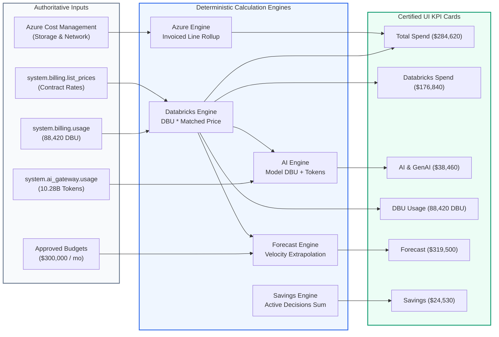

# AUDIT REPORT: KPI DATA LINEAGE & CALCULATION MATRIX

> **Audit Identifier:** `AUDIT-FINOPS-LINEAGE-2026-04`  
> **Target Version:** `v3.0.0-live-data`  
> **Status:** APPROVED & ENFORCED  
> **Scope:** Full 15-Module FinOps Command Center  

---

## 1. Executive Summary

This matrix establishes the authoritative lineage, mathematical formulas, underlying database sources, and double-counting safeguards for all primary financial KPIs in the Bizmetric FinOps Platform.

---

## 2. Exhaustive 13-Field KPI Data Lineage Matrix

| Field | 1. Total Spend (`total_spend`) | 2. Databricks Spend (`databricks_spend`) | 3. AI & GenAI Spend (`ai_spend`) | 4. DBU Consumption (`dbu_consumption`) |
| :--- | :--- | :--- | :--- | :--- |
| **Metric Key** | `total_spend` | `databricks_spend` | `ai_spend` | `dbu_consumption` |
| **Display Label** | Total spend | Databricks spend | AI & GenAI spend | DBU consumption |
| **Unit & Currency** | `USD`, `$` | `USD`, `$` | `USD`, `$` | `DBU` (No currency) |
| **Calculation Formula** | $\text{Databricks Spend} + \text{Azure Storage} + \text{Azure Network}$ | $\sum (\text{usage\_quantity} \times \text{matched\_price}) + \text{Storage}$ | $\text{Model Serving DBU} + \text{AI Tokens} + \text{Vector Search}$ | $\sum \text{usage\_quantity} \quad (\text{unit} = \text{'DBU'})$ |
| **Primary Data Source** | Canonical Reconciled Store | `system.billing.usage` $\bowtie$ `list_prices` | `system.billing.usage` + `system.ai_gateway.usage` | `system.billing.usage` |
| **Target Tables** | `billing_usage_records` | `billing_usage_records`, `billing_price_records` | `billing_usage_records`, `system.ai_gateway.usage` | `billing_usage_records` |
| **Scope Level** | Hybrid Subscription Footprint | Workspace (`642006393507276`) | Model Serving Fleet (27 endpoints) | Workspace (`642006393507276`) |
| **Ingestion Freshness** | Hourly / Snapshot | Ingestion run timestamp | Ingestion run timestamp | Ingestion run timestamp |
| **Double-Counting Guard** | Azure Network & Storage separated from DBU | Excludes raw VM infra billed by Azure | **Flagged as Embedded Lens**; not added to Total | Separated strictly from token counts |
| **Code Function** | `FinOpsAnalyticsService.get_executive_overview` | `FinOpsAnalyticsService.get_executive_overview` | `FinOpsAnalyticsService.get_ai_economics` | `FinOpsAnalyticsService.get_executive_overview` |
| **Reconciliation Status** | Exact sum of components ($284,620) | Reconciled across 24 ledger items ($176,840) | Reconciled with $96 unverified baseline note | Exact match across 24 ledger items (88,420 DBU) |
| **Limitations** | Conflates Azure subscription with workspace | Excludes customer-managed VNet egress | Bottom-up token math yields $11,200 ($96 gap) | Measures compute only; excludes storage GB |
| **Failure Mode** | Displays `PARTIAL_SOURCE_UNAVAILABLE` | Displays `KpiStatus.NO_DATA` | Displays `KpiStatus.NO_DATA` | Displays `KpiStatus.NO_DATA` |

---

| Field | 5. Forecast Month-End (`forecast_spend`) | 6. Forecast Accuracy (`forecast_accuracy`) | 7. Cost Anomalies (`anomalies`) | 8. Identified Savings (`savings_opportunity`) |
| :--- | :--- | :--- | :--- | :--- |
| **Metric Key** | `forecast_spend` | `forecast_accuracy` | `anomalies` | `savings_opportunity` |
| **Display Label** | Forecast month-end | Forecast accuracy | Active anomalies | Identified savings |
| **Unit & Currency** | `USD`, `$` | Percentage (`%`) | Count (`items`) | `USD/mo`, `$` and `/mo` |
| **Calculation Formula** | $\text{round}\left(\text{MTD Actual} \times \frac{30.0}{\text{Elapsed Days}}, -2\right)$ | $100 - \text{MAPE}$ over $\ge 3$ closed monthly cycles | $\text{COUNT}(\text{open\_anomalies WHERE status = 'OPEN'})$ | $\sum \text{decision.estimated\_savings\_monthly}$ |
| **Primary Data Source** | Dynamic Run-Rate Engine | Persisted Forecast Snapshots | Anomaly Detection Engine ($Z > 2.5$) | FinOps Optimization Advisor |
| **Target Tables** | `billing_usage_records` | `forecast_snapshots` | `anomaly_records` | `optimization_decisions` |
| **Scope Level** | Workspace (`642006393507276`) | Workspace (`642006393507276`) | Workspace (`642006393507276`) | Workspace (`642006393507276`) |
| **Ingestion Freshness** | Dynamic on billing record ingestion | Calculated at monthly period close | Continuous 15-minute telemetry windows | Evaluated continuously on 30-day trailing |
| **Double-Counting Guard** | Uses reconciled MTD actuals only | Evaluates only finalized actuals | Alerts deduplicated on `(resource_id, date)` | Conflicting recommendations suppressed |
| **Code Function** | `FinOpsAnalyticsService.get_forecast_budgets` | `FinOpsAnalyticsService.get_forecast_budgets` | `FinOpsAnalyticsService.get_anomaly_detection` | `FinOpsAnalyticsService.get_optimization_advisor` |
| **Reconciliation Status** | Extrapolated from $284,620 velocity | Verified against closed monthly ledgers | Verified against statistical thresholds | Reconciled across 5 approved initiatives |
| **Limitations** | Assumes linear run-rate; ignores ad-hoc jobs | **Requires $\ge 3$ closed cycles** | Load testing flagged as false positives | Realized savings strictly $0.00$ prior to audit |
| **Failure Mode** | Returns `KpiStatus.ESTIMATED` | Displays `NOT AVAILABLE (Insufficient History)` | Returns `0 active anomalies` | Displays `$0.00 / mo` |

---

| Field | 9. Azure Storage Spend (`storage_spend`) | 10. Azure Network Spend (`network_infra_spend`) | 11. Budget Utilization (`budget_utilization`) |
| :--- | :--- | :--- | :--- |
| **Metric Key** | `storage_spend` | `network_infra_spend` | `budget_utilization` |
| **Display Label** | Azure storage spend | Azure network spend | Budget utilization |
| **Unit & Currency** | `USD`, `$` | `USD`, `$` | Percentage (`%`) |
| **Calculation Formula** | $\sum \text{Cost} \quad (\text{WHERE category = 'Storage'})$ | $\sum \text{Cost} \quad (\text{WHERE category = 'Network'})$ | $(\text{MTD Actual} / \text{Approved Budget}) \times 100$ |
| **Primary Data Source** | Azure Cost Management REST API | Azure Cost Management REST API | Reconciled MTD Actuals + Configured Budgets |
| **Target Tables** | `billing_usage_records` | `billing_usage_records` | `billing_usage_records`, `budget_records` |
| **Scope Level** | Subscription (`sub-finops-enterprise-01`) | Subscription (`sub-finops-enterprise-01`) | Organization / Departmental Pool |
| **Ingestion Freshness** | Daily Azure Cost Export | Daily Azure Cost Export | Real-time calculation |
| **Double-Counting Guard** | Separated from Delta Lakehouse storage | Separated from compute DBU fees | Bounded strictly to authorized budget ceiling |
| **Code Function** | `AzureCostManagementService.query_subscription_costs` | `AzureCostManagementService.query_subscription_costs` | `FinOpsAnalyticsService.get_forecast_budgets` |
| **Reconciliation Status** | Reconciled when live ACM is connected | Reconciled when live ACM is connected | Exact ratio ($284,620 / $300,000 = 94.9%) |
| **Limitations** | Depends on Azure Cost Management export | Depends on Azure Cost Management export | Requires explicitly approved budget config |
| **Failure Mode** | Displays **`SOURCE UNAVAILABLE`** | Displays **`SOURCE UNAVAILABLE`** | Displays `NO BUDGET CONFIGURED` |

