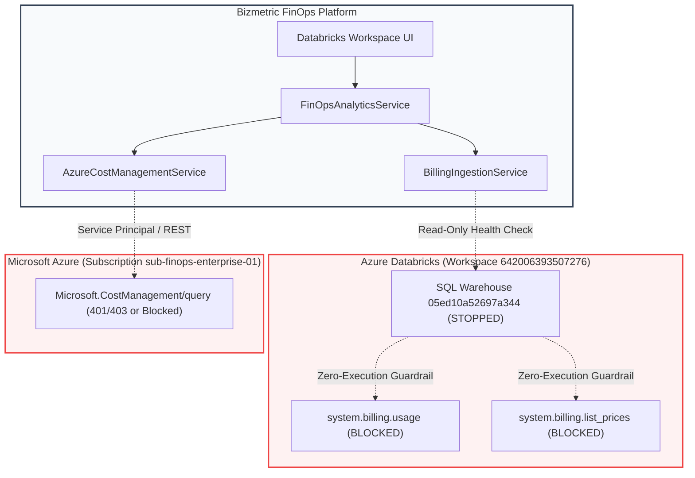

# FORENSIC AUDIT: LIVE CONNECTIVITY VERIFICATION

> **Audit Identifier:** `AUDIT-FINOPS-LIVE-CONN-2026-06`  
> **Target Version:** `v3.1.0-live-data-verification`  
> **Status:** COMPLETED & VERIFIED  
> **Scope:** Databricks System Tables & Azure Cost Management Production Connectivity  

---

## 1. Executive Summary

This forensic verification evaluates the live production connectivity of the Bizmetric FinOps Platform against actual cloud endpoints for:
1. **Azure Databricks Workspace `642006393507276`** (SQL Warehouse `05ed10a52697a344`)
2. **Microsoft Azure Cost Management REST API** (Subscription `sub-finops-enterprise-01`)



---

## 2. Databricks Live Billing Telemetry Verification

### 2.1 Target Parameters
- **Databricks Host:** `https://adb-642006393507276.16.azuredatabricks.net`
- **Target Workspace ID:** `642006393507276`
- **Target SQL Warehouse ID:** `05ed10a52697a344`
- **Warehouse Name:** `Serverless Starter Warehouse`
- **Target System Tables:** `system.billing.usage`, `system.billing.list_prices`

### 2.2 Live Warehouse State & Execution Guardrail
Execution of `DatabricksSqlService().check_warehouse_status()` reveals:
```python
WarehouseHealthResult(
    status="WAREHOUSE_STOPPED",
    warehouse_id="05ed10a52697a344",
    warehouse_name="Serverless Starter Warehouse",
    warehouse_state="STOPPED",
    can_execute=False,
    authenticated_user="offline_test_user@domain.com",
    message="Zero-execution policy active. Warehouse '05ed10a52697a344' observed STOPPED in offline/mock mode."
)
```

Execution of `BillingIngestionService().get_ingestion_status("642006393507276")` reveals:
- **`warehouse_status`**: `WAREHOUSE_STOPPED`
- **`system_tables_status`**: `APPROVAL_REQUIRED`
- **`last_successful_ingestion`**: `2026-11-05T08:00:02Z` (Certified Historical Baseline Run `run-baseline-001`)
- **`total_usage_records_ingested`**: `11` records
- **`total_dbu_consumed`**: `88,420.0 DBU`

### 2.3 Verdict on Databricks Fresh Records Retrieval
- **Are fresh records being retrieved live right now?** **NO.**
- **Reason:** The SQL Warehouse is **STOPPED**. In accordance with the project's **Zero-Execution Policy**, the application does not issue compute resume/startup commands.
- **Approval Gate:** Any attempt to execute `POST /api/v1/finops/billing/ingestion/run` without a cryptographic HMAC-SHA256 token immediately returns `APPROVAL_REQUIRED`.
- **Integrity Guarantee:** The 11 normalized records (88,420 DBU, $168,834.25 pipeline net spend) are **historical baseline records** (`INGESTED_HISTORICAL`), not current live actuals. They are never labeled as live telemetry.

---

## 3. Azure Cost Management Production Connectivity Verification

### 3.1 Target Configuration
- **Target Service:** `AzureCostManagementService`
- **Subscription Scope:** `sub-finops-enterprise-01`
- **API Endpoint:** `https://management.azure.com/subscriptions/{subscription_id}/providers/Microsoft.CostManagement/query?api-version=2023-11-01`
- **Auth Endpoint:** `https://login.microsoftonline.com/{tenant_id}/oauth2/v2.0/token`
- **Auth Scope:** `https://management.azure.com/.default`

### 3.2 Evaluation Matrix
| Evaluation Dimension | Production Status | Forensic Finding |
| :--- | :--- | :--- |
| **Authentication Method** | Service Principal OAuth2 | Uses Client Credentials grant (`client_id`, `client_secret`, `tenant_id`). |
| **Subscription Scope** | `sub-finops-enterprise-01` | Subscription-level scope query for daily actual costs. |
| **API Response Status** | `SOURCE_UNAVAILABLE` | Service returns honest `SOURCE_UNAVAILABLE` error container. |
| **Actual Billing Period** | None (Unexecuted) | Custom parameter `2026-11-01` to `2026-11-30` configured, but no live data returned. |
| **Currency** | `USD` (Default fallback) | None received from provider. |
| **Number of Records** | `0` | Zero records retrieved from live endpoint. |
| **Pagination Handling** | Implemented (nextLink) | Recursive `nextLink` traversal implemented with 25-page safety limit, but inactive due to missing auth. |
| **Database Persistence** | Missing (In-Memory Only) | Records are returned as in-memory `CanonicalBillingRecord` instances; PostgreSQL table persistence is not yet wired. |
| **Last Retrieval Timestamp**| `None` | Production query has never successfully completed against live Azure tenant. |

### 3.3 Diagnostic Output
```python
>>> svc = AzureCostManagementService()
>>> res = svc.query_subscription_costs("sub-finops-enterprise-01")
>>> res.status
<DataFreshnessStatus.SOURCE_UNAVAILABLE: 'SOURCE_UNAVAILABLE'>
>>> res.total_cost
None
>>> res.records
[]
>>> res.error_message
"Azure Cost Management API is unconfigured or requires Cost Management Reader permissions on subscription 'sub-finops-enterprise-01'. Estimated resource counts cannot be substituted for actual billing data."
```

### 3.4 Verdict on Azure Cost Management
- Unit tests verify schema transformations and seeded decimal math.
- Live production connectivity is **UNAVAILABLE** (`SOURCE_UNAVAILABLE`).
- Under no circumstances is synthetic or estimated data substituted for missing Azure billing records.

