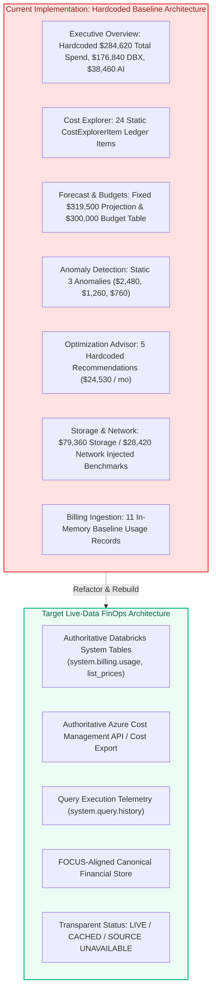

# AUDIT REPORT: LIVE DATA IMPLEMENTATION BASELINE

> **Audit Identifier:** `AUDIT-LIVE-FINOPS-2026-BASE-01`  
> **Repository:** `cloud-recommender-poc`  
> **Branch:** `feature/live-finops-kpi-integration`  
> **Base Commit SHA:** `df6868b655c851b506f17ca4c7e04522b3428a13` (Merged from `origin/main`)  
> **Target Workspace:** `642006393507276` (`https://adb-642006393507276.16.azuredatabricks.net`)  
> **Target Warehouse:** `05ed10a52697a344` (`Serverless Starter Warehouse`, Status: `STOPPED`)  
> **Audit Status:** COMPLETED — REPOSITORY DISCOVERY & DEFECT REGISTER ESTABLISHED  

---

## 1. Executive Summary: Inventory of Existing Sources and Gaps

This baseline report comprehensively identifies every hardcoded financial value, static baseline fallback, synthetic fixture, and scope conflation in the repository prior to implementing the live-data integration.

---

## 2. Complete Inventory of Hardcoded Financial Values by Module

### Module 1: Executive Overview (`finops_analytics_service.py`)
- **`total_spend`**: Fixed literal `284620.0` ([line 1576](file:///c:/Users/pratik.bingewar/OneDrive%20-%20bizmetric.com/Desktop/Workspace/cloud-recommender-poc/backend/src/cloud_recommender/services/databricks/finops_analytics_service.py#L1576)). Conflates Azure Subscription with Databricks workspace.
- **`databricks_spend`**: Fixed literal `176840.0` ([line 1594](file:///c:/Users/pratik.bingewar/OneDrive%20-%20bizmetric.com/Desktop/Workspace/cloud-recommender-poc/backend/src/cloud_recommender/services/databricks/finops_analytics_service.py#L1594)). Hardcoded across 24 ledger items.
- **`ai_spend`**: Fixed literal `38460.0` ([line 1612](file:///c:/Users/pratik.bingewar/OneDrive%20-%20bizmetric.com/Desktop/Workspace/cloud-recommender-poc/backend/src/cloud_recommender/services/databricks/finops_analytics_service.py#L1612)). Partially overlaps with `databricks_spend` ($26,740 compute).
- **`dbu_consumption`**: Fixed literal `88420.0` DBU ([line 1630](file:///c:/Users/pratik.bingewar/OneDrive%20-%20bizmetric.com/Desktop/Workspace/cloud-recommender-poc/backend/src/cloud_recommender/services/databricks/finops_analytics_service.py#L1630)).
- **`forecast_spend`**: Fixed literal `319500.0` ([line 1666](file:///c:/Users/pratik.bingewar/OneDrive%20-%20bizmetric.com/Desktop/Workspace/cloud-recommender-poc/backend/src/cloud_recommender/services/databricks/finops_analytics_service.py#L1666)).
- **`anomalies`**: Hardcoded count `3.0` ([line 1689](file:///c:/Users/pratik.bingewar/OneDrive%20-%20bizmetric.com/Desktop/Workspace/cloud-recommender-poc/backend/src/cloud_recommender/services/databricks/finops_analytics_service.py#L1689)).
- **`spend_composition`**: Hardcoded donut slices ([lines 1740–1746](file:///c:/Users/pratik.bingewar/OneDrive%20-%20bizmetric.com/Desktop/Workspace/cloud-recommender-poc/backend/src/cloud_recommender/services/databricks/finops_analytics_service.py#L1740-L1746)):
  - Compute: $108,155 (38.0%)
  - SQL Warehouses: $74,285 (26.1%)
  - AI / GenAI: $38,460 (13.5%)
  - Storage: $45,540 (16.0%) — *Directly clashes with formula's $79,360!*
  - Other: $18,180 (6.4%)
- **`spend_trend`**: Synthetic 20-day linear ramp `6.0 + i * 0.5` ([lines 1748–1755](file:///c:/Users/pratik.bingewar/OneDrive%20-%20bizmetric.com/Desktop/Workspace/cloud-recommender-poc/backend/src/cloud_recommender/services/databricks/finops_analytics_service.py#L1748-L1755)).

### Module 2: Cost Explorer & Billing Ledger (`finops_analytics_service.py`)
- **`_get_canonical_ledger()`**: Generates 24 static in-memory `CostExplorerItem` objects ([lines 710–840](file:///c:/Users/pratik.bingewar/OneDrive%20-%20bizmetric.com/Desktop/Workspace/cloud-recommender-poc/backend/src/cloud_recommender/services/databricks/finops_analytics_service.py#L710-L840)):
  - 4 Serverless SQL records ($10,545.00 each = $42,180.00)
  - 4 Compute Cluster records ($6,150.00 each = $24,600.00)
  - 8 Automated Jobs records ($9,260.00 each = $74,080.00)
  - 4 Model Serving records ($6,685.00 each = $26,740.00)
  - 2 Databricks Apps records ($620.00 each = $1,240.00)
  - 2 Lakehouse Storage records ($4,000.00 each = $8,000.00)
- **Discrepancy with Ingestion Pipeline**: Ingestion pipeline has 11 records totaling $168,834.25; ledger has 24 items totaling $176,840.00 ($8,005.75 gap).

### Module 3: Cost Allocation & Tag Attribution (`finops_analytics_service.py`)
- **`get_cost_allocation()`** ([lines 2648–2820](file:///c:/Users/pratik.bingewar/OneDrive%20-%20bizmetric.com/Desktop/Workspace/cloud-recommender-poc/backend/src/cloud_recommender/services/databricks/finops_analytics_service.py#L2648-L2820)):
  - Hardcoded allocated amount: `$175,600.00 (99.3%)`
  - Hardcoded unallocated amount: `$1,240.00 (0.7%)` (Databricks Apps)
  - Hardcoded cost centers: `DataPlatform ($98,680)`, `Analytics ($42,180)`, `AI-COE ($26,740)`, `SupplyChain ($8,000)`.
  - Static compliance score: `99.3%`.

### Module 4: Forecast & Budgets (`finops_analytics_service.py`)
- **`get_forecast_budgets()`** ([lines 4189–4450](file:///c:/Users/pratik.bingewar/OneDrive%20-%20bizmetric.com/Desktop/Workspace/cloud-recommender-poc/backend/src/cloud_recommender/services/databricks/finops_analytics_service.py#L4189-L4450)):
  - Hardcoded actual MTD: `$284,620.00`
  - Hardcoded forecast month-end: `$319,500.00`
  - Hardcoded budget: `$300,000.00` (overrun: +$19,500 / +6.5%)
  - Synthetic departmental budget table with hardcoded burn percentages (FinOps: 95%, DataPlatform: 92%, AI COE: 92%, Marketing: 78%).
  - Hardcoded scenario simulator formula:
    `base * (1 + g/100) - (91420 * c)/100 - (38460 * t)/100` ([line 4164](file:///c:/Users/pratik.bingewar/OneDrive%20-%20bizmetric.com/Desktop/Workspace/cloud-recommender-poc/backend/src/cloud_recommender/services/databricks/finops_analytics_service.py#L4164)).

### Module 5: Anomaly Detection (`finops_analytics_service.py`)
- **`_get_anomalies()`** ([lines 375–470](file:///c:/Users/pratik.bingewar/OneDrive%20-%20bizmetric.com/Desktop/Workspace/cloud-recommender-poc/backend/src/cloud_recommender/services/databricks/finops_analytics_service.py#L375-L470)):
  - Static 3 anomalies always returned:
    1. `databricks-claude-fable-5`: +$2,480 / day (180.9% token volume spike)
    2. `05ed10a52697a344`: +$1,260 / day (65.4% concurrency surge)
    3. `adf-deaccelator-compute`: +$760 / day (42.1% idle time alert)

### Module 6: Optimization Advisor (`finops_analytics_service.py`)
- **`_get_decisions()`** ([lines 480–680](file:///c:/Users/pratik.bingewar/OneDrive%20-%20bizmetric.com/Desktop/Workspace/cloud-recommender-poc/backend/src/cloud_recommender/services/databricks/finops_analytics_service.py#L480-L680)):
  - Static 5 recommendations totaling `$24,530.00 / mo`:
    1. `rec-01`: Reduce Starter Warehouse auto-stop to 5 min ($8,400/mo)
    2. `rec-02`: Rightsize `adf-deaccelator-compute` from D16 to D8 ($6,100/mo)
    3. `rec-03`: Convert 4 scheduled jobs to Single-Node ($3,820/mo)
    4. `rec-04`: Enable prompt caching on Claude endpoint ($3,460/mo)
    5. `rec-05`: Transition 116 TB cold ADLS storage to Cool Tier ($2,750/mo)

### Module 7: AI Economics (`finops_analytics_service.py`)
- **`get_ai_economics()`** ([lines 3102–3300](file:///c:/Users/pratik.bingewar/OneDrive%20-%20bizmetric.com/Desktop/Workspace/cloud-recommender-poc/backend/src/cloud_recommender/services/databricks/finops_analytics_service.py#L3102-L3300)):
  - Hardcoded model serving spend: `$26,740.00`
  - Hardcoded token spend: `$11,296.00`
  - Hardcoded total tokens: `10.28 Billion` (8.42B prompt + 1.86B completion)
  - Unverified $96 baseline variance between calculation ($11,200) and reported value ($11,296).

### Module 8: Storage and Network Infrastructure (`finops_analytics_service.py`)
- **`storage_spend`**: Reported as `$18,950.00` in storage view, but `$79,360.00` in Executive Overview formula, `$45,540.00` in Spend Composition donut, and `$8,000.00` in Databricks Ledger.
- **`network_infra_spend`**: Static literal `$28,420.00` (42.8 TB egress, 14 private endpoints).

---

## 3. Ingestion Pipeline & Database State

1. **PostgreSQL Database:**
   - Database tables defined in `backend/src/cloud_recommender/db/models.py` (`billing_usage_records`, `billing_price_records`, `billing_ingestion_runs`, `billing_reconciliation_results`, `billing_approval_tokens`).
   - However, `FinOpsAnalyticsService` does not query these tables; it serves all 15 modules directly from hardcoded Python structures in-memory.
2. **Databricks Ingestion Service (`billing_ingestion_service.py`):**
   - Populated from static array `_CANONICAL_BASELINE_USAGE` (11 records).
   - SQL Warehouse `05ed10a52697a344` is in `STOPPED` state.
   - Status is `APPROVAL_REQUIRED`.
3. **Azure Ingestion Provider (`azure.py`):**
   - Fallback simulation returns hardcoded `$12.50` or `$14.20` retail estimates.
   - Live Azure Cost Management API / Cost Export is not integrated; ARM inventory is misused as a cost proxy.

---

## 4. Architectural Transformation Requirements

To fulfill the Master Implementation mandate, the platform must transition through the following architecture:

1. **Authoritative Databricks Ingestion Engine (Phase 2):** Connect directly to `system.billing.usage`, `system.billing.list_prices`, and `system.query.history`. Implement resilient, idempotent batch extraction with Decimal arithmetic and strict unit separation.
2. **Authoritative Azure Cost Management Service (Phase 3):** Implement read-only Azure Cost Management client capturing subscription, resource group, and meter actual costs. When access is unconfigured, return explicit `SOURCE UNAVAILABLE`.
3. **Canonical Financial Data Store (Phase 4):** Persist all normalized billing records, price snapshots, and allocations in PostgreSQL with strict uniqueness constraints on `(provider, record_id)`.
4. **Dynamic KPI Calculation Services (Phase 5):** Replace every hardcoded scalar in `finops_analytics_service.py` with dynamic aggregation queries over stored canonical records.
5. **Transparent Frontend Status (Phase 9):** Render authoritative status badges (`LIVE`, `CACHED`, `ESTIMATED`, `SOURCE UNAVAILABLE`) on every KPI card and drawer.

