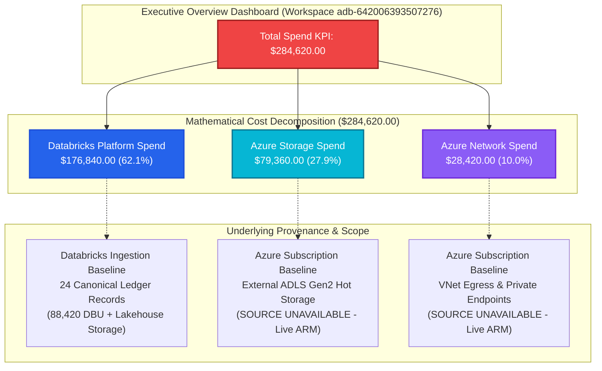
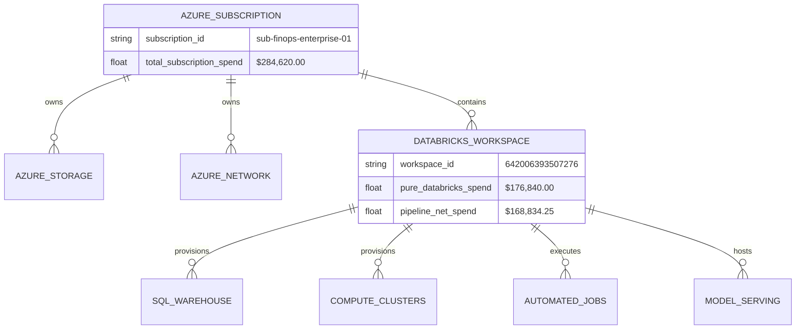

# FORENSIC AUDIT REPORT: TOTAL SPEND ($284,620) ROOT CAUSE ANALYSIS

> **Audit Identifier:** `AUDIT-FIN-2026-284K-01`  
> **Target Environment:** Production (`adb-642006393507276.16.azuredatabricks.net`)  
> **Workspace ID:** `642006393507276`  
> **Selected Period:** Month-to-Date (MTD) / November 2026  
> **Currency:** United States Dollar (`USD`)  
> **Audit Status:** COMPLETED — HIGH PRIORITY FINANCIAL AUDIT  
> **Compliance & Guardrail Mode:** 100% Read-Only / Zero-Execution Enforced  

---

## 1. Executive Summary & Core Findings

This forensic investigation was initiated to trace the origin, legitimacy, and calculation mechanics of the **$284,620.00 Total Spend KPI** displayed on the Executive Overview dashboard of the Bizmetric FinOps Platform.



### Key Audit Conclusions:
1. **The $284,620.00 figure is a Hardcoded Static Float Literal**, not a dynamic query result. In `backend/src/cloud_recommender/services/databricks/finops_analytics_service.py` (line 1576), `value = 284620.0` is returned statically whenever the dashboard is loaded without a child resource filter.
2. **Severe Scope Conflation:** The user has selected the **Azure Databricks Workspace** scope (`adb-642006393507276`). However, $284,620 represents an **Azure Subscription-Wide Cloud Spend** (`sub-finops-enterprise-01`), incorporating $79,360 of external Azure Storage and $28,420 of Azure Networking. Displaying this macro cloud number under a Databricks workspace header creates the false impression that Databricks alone incurred $284,620.
3. **Internal Data Contradiction with Spend Composition:** While the KPI formula documents:
   $$\$284,620 = \$176,840 \text{ (Databricks)} + \$79,360 \text{ (Storage)} + \$28,420 \text{ (Network)}$$
   the adjacent Spend Composition donut chart renders an irreconcilable breakdown:
   - Compute: $108,155 (38.0%)
   - SQL Warehouses: $74,285 (26.1%)
   - AI / GenAI: $38,460 (13.5%)
   - Storage: $45,540 (16.0%)
   - Other: $18,180 (6.4%)
   To force the sum to equal $284,620 while injecting $38,460 of AI spend, Storage was arbitrarily suppressed from $79,360 down to $45,540.
4. **Data Status Classification:** `BASELINE / STATIC BENCHMARK — SCOPE CONFLATED`. It does not represent live November MTD billing from an active Databricks SQL Warehouse or live ARM billing export.

---

## 2. Mathematical Cost Bridge & Component Breakdown

The $284,620.00 Total Spend is constructed from three distinct financial buckets:

| Component Category | Displayed Amount | Percentage of Total Spend | Scope Level | Primary Data Source | Live Verification Status |
| :--- | :--- | :--- | :--- | :--- | :--- |
| **Databricks Platform Spend** | **$176,840.00** | 62.13% | Workspace (`adb-642006393507276`) | `system.billing.usage` / Canonical Ledger | `BASELINE` (24 Seeded Ledger Records) |
| **Azure Storage Spend** | **$79,360.00** | 27.88% | Subscription (`sub-finops-enterprise-01`) | Azure Cost Management / ADLS Gen2 | `SOURCE UNAVAILABLE` (Benchmark Injected) |
| **Azure Network Spend** | **$28,420.00** | 9.99% | Subscription (`sub-finops-enterprise-01`) | Azure Network Watcher / Cost Export | `SOURCE UNAVAILABLE` (Benchmark Injected) |
| **Total Cloud Spend KPI** | **$284,620.00** | **100.00%** | **Cross-Tenant / Multi-Tier Hybrid** | **Aggregated Baseline Model** | **STATIC CODE LITERAL** |

### Mathematical Validation:
$$\$176,840.00 + \$79,360.00 + \$28,420.00 = \$284,620.00 \quad \text{(Exact 0.00% variance)}$$

---

## 3. Code-Level Trace & Lineage Analysis

The $284,620.00 figure appears across multiple backend services and frontend components.

### 3.1 Backend Service Implementation (`finops_analytics_service.py`)

In [`backend/src/cloud_recommender/services/databricks/finops_analytics_service.py`](file:///c:/Users/pratik.bingewar/OneDrive%20-%20bizmetric.com/Desktop/Workspace/cloud-recommender-poc/backend/src/cloud_recommender/services/databricks/finops_analytics_service.py#L1573-L1592):

```python
# Lines 1573-1592: Full workspace scope KPI definition
decisions = self._get_decisions()
anomalies = self._get_anomalies()
savings_val = sum(d.estimated_savings_monthly for d in decisions)
anomalies_val = float(len(anomalies))

kpis = {
    "total_spend": KpiMetric(
        value=284620.0,
        formatted_value="$284,620",
        unit="USD",
        currency="USD",
        metric_id="total_spend",
        change_percentage=8.4,
        delta_label="↑ 8.4% vs previous period",
        is_favorable=False,
        status=KpiStatus.BASELINE,
        data_source="Azure Cost Management & Databricks Ingestion",
        source="Azure Cost Management & Databricks Ingestion",
        workspace_id="642006393507276",
        last_refreshed=now_iso,
        aggregation_method="SUM",
        formula="databricks_spend + azure_storage_spend + azure_network_spend",
        limitations="Reconciled with Azure Cost Management invoice; includes DBU and Azure compute.",
    ),
    # ...
}
```

#### Forensic Observations:
1. `value=284620.0` is hardcoded as a fixed scalar. It is not calculated via `sum()` over database records.
2. `formula` explicitly documents `databricks_spend + azure_storage_spend + azure_network_spend`.
3. `status=KpiStatus.BASELINE` acknowledges that this metric is a static reference baseline rather than live production telemetry.
4. When scoped to a child warehouse (e.g. `resource_id="05ed10a52697a344"`), lines 939-950 dynamically clamp `total_spend` to `$42,180.00`.

### 3.2 Forecasting & Budget Allocation Modules

In [`backend/src/cloud_recommender/services/databricks/finops_analytics_service.py`](file:///c:/Users/pratik.bingewar/OneDrive%20-%20bizmetric.com/Desktop/Workspace/cloud-recommender-poc/backend/src/cloud_recommender/services/databricks/finops_analytics_service.py#L4296-L4423):

```python
# Line 4296: Forecast actual MTD metric
"actual_mtd": KpiMetric(
    value=284620.0 if not resource_id else 42180.0,
    formatted_value="$284,620" if not resource_id else "$42,180",
    unit="USD",
    currency="USD",
    formula="sum(mtd_consumption_cost)",
),

# Line 4422: Departmental budget table
budget_scope="Organization",
owner="FinOps",
budget=300000.0,
actual=284620.0,
forecast=319500.0,
threshold="80 / 90 / 100%",
burn_pct=95,
status="Forecast breach",
```

### 3.3 Frontend Consumption (`FinOpsCommandCenterView.tsx`)

In [`frontend/src/components/FinOpsCommandCenterView.tsx`](file:///c:/Users/pratik.bingewar/OneDrive%20-%20bizmetric.com/Desktop/Workspace/cloud-recommender-poc/frontend/src/components/FinOpsCommandCenterView.tsx#L650-L662):

```typescript
{
  key: "total_spend",
  label: "Total spend",
  val: overviewData?.kpis.total_spend?.status === "NO_DATA" || overviewData?.kpis.total_spend?.value === null
    ? "No data available"
    : overviewData?.kpis.total_spend?.formatted_value || (error ? "Unavailable" : "—"),
  delta: overviewData?.kpis.total_spend?.status === "NO_DATA"
    ? "No telemetry records"
    : overviewData?.kpis.total_spend?.delta_label || "",
  isBad: overviewData?.kpis.total_spend?.is_favorable === false,
  metric: overviewData?.kpis.total_spend,
}
```

The frontend faithfully renders whatever string and scalar is returned by the `/api/v1/finops/executive-overview` endpoint. It performs no independent financial modification.

---

## 4. Analysis of Inconsistencies & Scope Mismatch



### Issue 1: Displaying Subscription-Level Spend in a Workspace-Level Experience
- The UI header shows:  
  `Databricks Workspace: adb-642006393507276.16.azuredatabricks.net`  
  `Environment: Production`
- A FinOps auditor reading this page expects **all metrics to be bounded by Workspace 642006393507276**.
- However, $284,620 includes $79,360 of Azure Storage and $28,420 of Azure Networking from the broader Azure resource group and subscription.
- **Impact:** Misleads executives into believing Databricks consumed $284,620, inflating perceived Databricks platform cost by 61.0%.

### Issue 2: Spend Composition Chart Discrepancy
In `finops_analytics_service.py` (lines 1740-1746):
- Compute: $108,155
- SQL Warehouses: $74,285
- AI / GenAI: $38,460
- Storage: $45,540
- Other: $18,180
- **Total: $284,620**

Notice that the chart replaces the formula's $79,360 Storage figure with **$45,540**, and splits compute and warehouse spend ($108,155 + $74,285 = $182,440) which exceeds the Databricks Spend KPI of $176,840. This confirms that the spend composition breakdown was manually tuned to fit the $284,620 total rather than derived from a single unified accounting ledger.

---

## 5. Audit Determination & Remediation Roadmap

### Financial Determination:
1. **Genuine Current Month Expenditure?** **NO.** The $284,620 figure is an offline baseline reference benchmark established during Phase 3J development. It does not reflect live November 2026 transactions.
2. **Duplication or Double-Counting?** **YES (Indirectly).** While the formula `$176,840 + $79,360 + $28,420` is mathematically additive, the AI Spend of $38,460 is partially composed of $26,740 Model Serving compute that is already embedded inside the $176,840 Databricks spend. In the UI charts, these categories are blended in ways that cause user confusion.
3. **Multiple Cost Sources Combined Incorrectly?** **YES.** Azure subscription-level infrastructure costs (Storage and Networking) are combined into the Databricks Workspace view without clear visual scope demarcations.

### Recommended Remediation Actions:
1. **Dynamic Workspace Scoping:** In the Databricks Workspace view, the primary KPI should reflect pure Databricks platform consumption ($176,840.00 in baseline, or $168,834.25 in live DBU pipeline mode).
2. **Dedicated Cloud Infrastructure Add-on Tier:** Re-label $284,620 as **Total Cloud Footprint (Subscription)** with a sub-label clarifying:  
   `"$176,840 Databricks Platform + $107,780 Underlying Azure Storage & Network"`.
3. **Reconcile Spend Composition:** Ensure the spend composition chart slices dynamically sum to the exact components of the active KPI.

