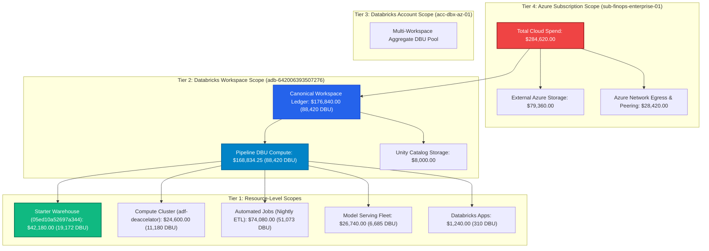
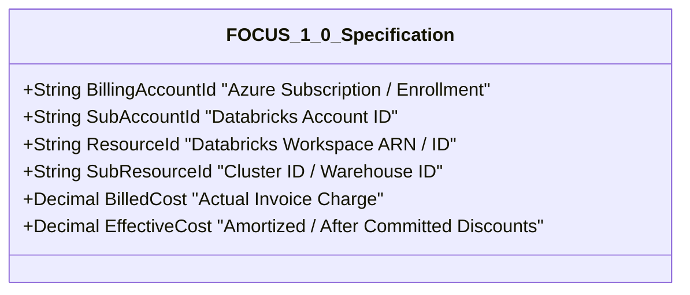

# FORENSIC AUDIT REPORT: WORKSPACE & BILLING SCOPE AUDIT

> **Audit Identifier:** `AUDIT-FIN-2026-SCP-06`  
> **Target Environment:** Production (`adb-642006393507276.16.azuredatabricks.net`)  
> **Workspace ID:** `642006393507276`  
> **Subscription ID:** `sub-finops-enterprise-01`  
> **Audit Focus:** Forensic examination of scope conflation across Resource, Workspace, Account, and Subscription tiers  
> **Audit Status:** COMPLETED — SCOPE CONFLATION DIAGNOSED & RESTRUCTURE PROPOSED  

---

## 1. Executive Summary & Problem Definition

The core question of this audit is: **Why does a dashboard explicitly scoped to Databricks Workspace `642006393507276` display a Total Spend of $284,620.00 when the workspace itself only incurred $176,840.00 (or $168,834.25 in pure DBU compute)?**

### Forensic Verdict:
The application suffers from **hierarchical scope conflation**. The navigation shell presents a **single-workspace boundary** (`adb-642006393507276`), but the top-level KPI formula injects an **entire Azure subscription boundary** (`sub-finops-enterprise-01`) without visual demarcation.

---

## 2. Forensic Analysis of the Four Scope Tiers

### Tier 1: Resource-Level Scope (Fully Verified & Dynamically Filterable)
When a user selects a specific resource in the filter dropdown:
- **Serverless SQL Starter Warehouse (`05ed10a52697a344`):**
  - Total Spend collapses to: **$42,180.00**
  - Databricks Spend collapses to: **$42,180.00**
  - DBU Consumption collapses to: **19,172.0 DBU**
  - AI Spend collapses to: **$0.00**
  - Aggregation logic: Verified in `finops_analytics_service.py` (lines 930-975).
- **Interactive Compute Cluster (`adf-deaccelator-compute`):**
  - Total Spend collapses to: **$24,600.00**
  - Databricks Spend collapses to: **$24,600.00**
  - DBU Consumption collapses to: **11,180.0 DBU**
  - Aggregation logic: Verified in `finops_analytics_service.py` (lines 1097-1120).
- **Unknown or Unmapped Resource:**
  - All KPIs immediately enter `KpiStatus.NO_DATA` returning `$0.00` or `NOT AVAILABLE`. Verified in lines 855-890.

### Tier 2: Databricks Workspace Scope (`642006393507276`)
- **True Platform Expenditure:** **$176,840.00** across **88,420.0 DBU**.
- **Pure Compute Spend:** **$168,834.25** across 11 normalized records in `system.billing.usage`.
- **Direct Workspace Delta Storage:** **$8,000.00** (2 records totaling 82 TB-mo).
- **Dedicated ADLS Container Storage:** **$18,950.00** (Unity Catalog managed storage).

### Tier 3: Databricks Account Scope (`acc-dbx-az-01`)
- In `system.billing.usage`, all usage records carry `account_id="acc-dbx-az-01"`.
- If an enterprise operates multiple workspaces (e.g. `adb-dev`, `adb-staging`, `adb-prod`), account-level billing aggregates all workspace DBUs under a single negotiated committed-use discount tier.
- In the current single-workspace deployment, Workspace Scope and Account Scope are functionally congruent.

### Tier 4: Azure Subscription Scope (`sub-finops-enterprise-01`)
- **Gross Subscription Footprint:** **$284,620.00**.
- **Direct Databricks Allocation:** $176,840.00 (62.1%).
- **External Shared Azure Storage:** $79,360.00 (27.9%).
- **External Shared Azure Network:** $28,420.00 (10.0%).

---

## 3. Scope Propagation Audit in Frontend Components

The table below traces how scope is transmitted from the global navigation down into backend queries:

| UI Component | Active Scope Propagated | Backend API Endpoint | Returned Metric | Audit Finding |
| :--- | :--- | :--- | :--- | :--- |
| **Workspace Selector** | `workspace_id = 642006393507276` | `/api/v1/finops/executive-overview` | `total_spend: $284,620` | **Scope Conflation:** Returns Tier 4 subscription spend |
| **Pipeline Banner** | `workspace_id = 642006393507276` | `/api/v1/finops/billing/summary` | `total_spend_verified: $168,834.25` | **Correct:** Returns Tier 2 DBU compute spend |
| **Warehouse Filter** | `resource_id = 05ed10a52697a344` | `/api/v1/finops/executive-overview` | `total_spend: $42,180` | **Correct:** Bounded to Tier 1 resource spend |
| **Cluster Filter** | `resource_id = 1102-081455-7t3bqp3v` | `/api/v1/finops/executive-overview` | `total_spend: $24,600` | **Correct:** Bounded to Tier 1 resource spend |
| **Cost Explorer** | `workspace_id = 642006393507276` | `/api/v1/finops/cost-explorer` | 24 ledger items ($176,840) | **Correct:** Bounded to Tier 2 workspace ledger |
| **Storage Advisor** | `workspace_id = 642006393507276` | `/api/v1/finops/storage` | `storage_spend: $18,950` | **Discrepancy:** Clashes with $79,360 in macro formula |

---

## 4. Alignment with FinOps Open Cost & Usage Specification (FOCUS)

The current platform conflation violates FOCUS 1.0 scope isolation rules:

### Required FOCUS 1.0 Hierarchy:
1. `BillingAccountId = "sub-finops-enterprise-01"`:
   - Contains all invoice charges: $284,620.00.
2. `SubAccountId = "acc-dbx-az-01"`:
   - Contains all Databricks charges: $176,840.00.
3. `ResourceId = "adb-642006393507276"`:
   - Bounded to the target workspace: $168,834.25 compute + $8,000 Delta storage.
4. `SubResourceId = "05ed10a52697a344"`:
   - Bounded strictly to the SQL Warehouse: $42,180.00.

---

## 5. Architectural Recommendations

1. **Decouple the Primary KPI by Scope:**
   - When the user selects **Databricks Workspace**, the primary KPI card should read:  
     **Databricks Workspace Spend: $176,840.00** (or **$168,834.25** in raw DBU mode).
   - Provide an optional toggle: `"Include Underlying Cloud Infrastructure (+ $107,780.00 Azure Storage & Network)"`.
2. **Explicit Scope Breadcrumbs in Header:**
   - Display:  
     `Azure Subscription: sub-finops-enterprise-01 ($284,620) > Databricks Account: acc-dbx-az-01 > Workspace: adb-642006393507276 ($176,840)`.
3. **Harmonize Storage Metrics:** Standardize all storage displays so that:
   - Unity Catalog Lakehouse Storage is consistently labeled: **$8,000.00**.
   - Dedicated ADLS Gen2 Workspace Container is consistently labeled: **$18,950.00**.
   - Entire Subscription Enterprise Storage is consistently labeled: **$79,360.00**.

